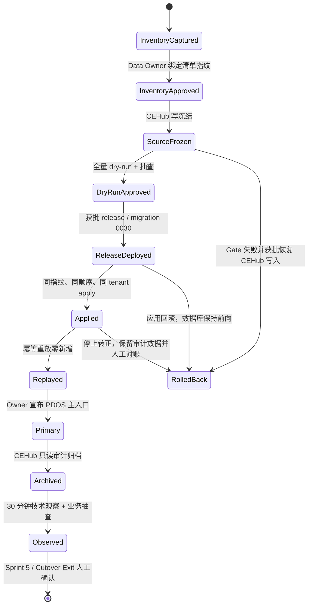

# Sprint 5 全量切换与 CEHub 只读退役契约

> 状态：本地发布候选契约。本文只冻结流程和机器门禁，不代表生产切换已经执行。所有 ECS、RDS、CEHub 权限、Nginx/DNS 操作仍需逐次获得人的明确授权。

## 1. 目标与边界

切换完成的定义不是“新版本已部署”，而是以下结果同时成立：

1. CEHub `projects` 中的**全部项目（含 archived 历史项目）**均进入获批迁移范围；
2. 同一只读源快照的全量 dry-run、生产 apply 与幂等重放都有不可变报告；
3. `pdos.beepump.net` 被业务 Owner 宣布为主入口，登录和核心项目查询通过；
4. 老 CEHub 停止业务写入并保留审计查询能力；
5. 观察窗没有数据完整性、安全边界或持续可用性异常；
6. S5-1 的真实钉钉发送仍处于明确的延期例外，生产保持 `delivery=false`，不被本次切换隐式放开。

v1 只迁移 User、Project、Task、Gate review 与 File reference；文件正文仍在原私有对象存储，迁移只保留可审计引用。ERP/CRM 等外部系统不因切换改变事实源边界。

## 2. 两层快照绑定

切换使用两个不同且均不可省略的 SHA-256 指纹：

- `inventory_fingerprint`：覆盖 CEHub 全部 Project 的身份、类型、阶段、归档/生命周期与更新时间。Data Owner 先据此确认“没有漏项目”。
- `source_fingerprint`：覆盖本次全部选择器解析后的 User/Project/Task/Gate review/File reference 完整内容。Data Owner 再据此批准实际 apply。

`server/scripts/check_cehub_cutover_inventory.py` 有两个只读模式：

- `capture`：列出所有项目，状态只能是 `review_required`；
- `verify`：项目 ID 集合必须与源库完整集合精确相等，源元数据必须仍匹配获批 fingerprint，且项目类型只能为冻结的 `npd` / `obt`，否则 `blocked`。

目前已知的 `C4s`、`S18-01`、`D14-04`、`D15-05` 只是未归档清单的初始线索，不能替代生产全库盘点。发现历史 archived 项目或新增项目时，默认纳入；任何排除都必须成为 Data Owner 的具名例外，而不能继续称为“全量迁移”。

## 3. 状态机与人工 Gate

以下对象必须在最终批准记录中一次绑定：完整 release SHA、Alembic head `0030_phase_three_agents`、目标 tenant UUID、迁移 actor UUID、`inventory_fingerprint`、有序的全部源项目 ID、dry-run `source_fingerprint`、低峰窗口、Data Owner 与发布 Owner。

## 4. 硬门禁

- 盘点与迁移源连接必须是独立 SELECT-only 账号，且 `default_transaction_read_only=on`；可写 CEHub 应用账号 fail-close。
- `capture` 报告必须含 active 与 archived 两类计数；`verify` 必须 `status=ready`、`errors=[]`。
- 最终 dry-run 必须在 CEHub 写冻结后执行，`target_writes=0`；冻结前的报告只能用于预审。
- apply CLI 的一次性确认同时绑定 tenant、source fingerprint 与**有序**项目选择器；源漂移必须重新 dry-run 和人工批准。
- 重放必须五类 `created_counts=0` 且 `skipped_counts=source_counts`。
- 成功 apply 不执行自动删除或 Alembic downgrade。迁移 `0029` 在 CRM/Supplier/Cost/Resource 任一表有数据时也拒绝有损 downgrade。
- 切换期间 Agent 数据库最小权限必须重施并验证；S5-4 Agent 仍只能通过受控 Finding 出口写入。
- `pdos.beepump.net` 已是现有 HTTPS 路由时，不为“转正”制造无意义 DNS 变更；业务入口声明和用户验收即为主入口切换。只有路由现状不符时才另行审批 Nginx/DNS 变更。

## 5. 失败与回滚语义

| 失败点 | 默认动作 | 数据处理 |
|---|---|---|
| 盘点/verify/dry-run | 立即停止 | 零目标写入；修正范围后重新批准 |
| release 部署/健康检查 | 回滚到前一完整 SHA | schema 保持前向，不 downgrade |
| apply | 事务整体回滚 | 禁止手工补半套数据 |
| apply 后抽查失败 | 不宣布主入口或暂停转正 | 保留 migration run/mapping；Data Owner 决定修复迁移 |
| PDOS 转正后严重故障 | 获批后恢复旧镜像；必要时恢复 CEHub 写入 | 不删除已迁移数据，进入对账 |
| 观察窗非阻断告警 | 保持只读归档并建问题 | 不回退事实源，按严重度处置 |

恢复 CEHub 写权限属于新的生产写操作，必须绑定故障编号、批准人和恢复窗口。不能因为旧系统仍可访问就自行回切。

## 6. Exit 证据

最终验收包至少包含：

- 两次 inventory 报告（capture、verify）及 Data Owner 批准；
- 全量 dry-run、apply、replay 三份 `0600` 报告；
- release/image revision、Alembic head、Agent 权限验证；
- 迁移五类行数、全部项目清单、代表性 Task/Gate/File reference 抽查；
- PDOS 登录/项目查询与 CEHub 只读证明；
- 30 分钟健康/错误日志观察；
- 钉钉 `delivery=false` 延期例外；
- Sprint 5 Exit 与切换退役的人工确认。

操作步骤与命令模板见 `docs/runbooks/sprint-5-cutover-and-retirement.md`。
