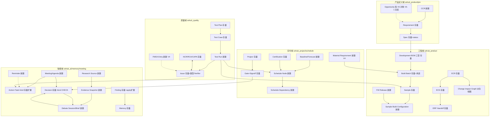

# vNext 统一对象合同 v1（V0-3 交付物·草案待 Owner 走查）

> **2026-09-10 适用性修订**：字段与迁移表继续作为历史草案，不能按§6创建模型直写业务对象接口。当前模型Finding双动作、受控系统记录、前期计划转换和四项建模推荐见[共同架构合同](2026-09-10-ai-native-architecture-consistency-contract.md)；N0-01仍待完整字典及冻结。原版10个namespace是历史基线，现有11个，不按草案搬迁会议表。

> 日期：2026-08-25
>
> 状态：草案（工程事实已核对存量 schema）；冻结需经架构/安全/质量/ERP Owner 走查（V0-3 验证条款）
>
> **2026-09-08 校准**：下文存量统计与 §8 迁移分段是初始设计时点信息，不能当作当前实现或部署事实。冻结前按 [V0/V1 验收合同 §3](2026-09-08-v0-v1-acceptance-and-pilot-contract.md#3-对象合同冻结前必须消除的差异) 完成迁移、namespace、状态/字段与授权接口差异裁决；本文仍待 Owner 冻结。
>
> 存量基线：`server/app/db/schema.py`（75 表、10 个 `cehub_*` 命名空间）；迁移 head `0033_expand_model_providers`；vNext 迁移自 `0034` 起单调递增
>
> 依据：决策台账 D1-D38（已生效）、统一需求稿、全量闭环与盲区分析

## 1. 必须无条件继承的存量模式（合同硬规则）

以下模式经存量盘点确认为全库一致，vNext 新表一律继承，不得例外：

1. **主键与租户**：业务对象 `id UUID` 应用侧生成；每表 `tenant_id UUID NOT NULL FK → cehub_core.tenants ON DELETE RESTRICT`；每表 `UniqueConstraint(tenant_id, id)`；跨对象引用一律做携带 tenant 的复合 FK（跨租户引用在 DB 层结构性不可能）。
2. **状态枚举**：不用 PG ENUM；`String(16/32)` + `CheckConstraint`（约束名 `status_allowed`）；关键生命周期不变量用 CHECK 固化（参照 `findings.review_lifecycle_consistent` 风格）。
3. **JSON**：`JSONB` + `jsonb_typeof` CHECK。
4. **时间戳**：`created_at`/`updated_at` timezone-aware、server_default。
5. **事件/审计**：所有业务写经 `EventAuditWriter` 同事务落 `cehub_event.events` + `cehub_audit.audit_log`；新事件类型必须先注册 `app/events/catalog.py`（当前 60 个）；payload 键集精确匹配 + 敏感键扫描不变。
6. **迁移**：`NNNN_snake_case` 单调递增、revision 字符串为可读 ID；测试只连 `pdos_test`（`test_safety.py` 守卫不变）。
7. **Agent 写路径**：`pdos_agent` 零直接表写（`model_invocations` INSERT 除外），一切写经 SECURITY DEFINER 函数白名单 + GUC scope 绑定（`bind_agent_scope` 模式）；vNext 新增 Agent 写能力沿用"新增函数入白名单"方式，不放开表权限。

## 2. 存量补强（新对象之前先修的通用底座）

| 项 | 现状 | 合同 |
|---|---|---|
| 统一版本模式 | `version` 仅 4 表 | 新增可版本化对象（Spec 发布、Baseline、Strategy/Definition、FMEA、映射模板）统一采用 `version int NOT NULL` + `superseded_by_id` 自引用 + "发布后不可变"CHECK；不给全部旧表补 version |
| 快照统一 | 快照散落 5 处 | 新建统一 `evidence_snapshots`（§4.6），存量各 `*_snapshot` 列保留不迁移，新功能只用统一对象 |
| decision_kind | String(64) 无 CHECK | 补 CHECK 收敛已知 4 值 + vNext 新增值（`debate_brief`、`ccr_response`、`rebaseline`、`definition_release`）；迁移前先盘点存量脏值 |
| Finding apply 目标 | CHECK 硬编码 `('risk','memory')` | 按 D32 改造：apply 目标扩展为白名单表（§6）；同时保留旧值兼容 |
| per-project 角色 | `project_members` 无 role 列 | **补列 `project_role`（nullable）**：为 Verifier/四眼/席位映射提供项目内角色；空值回退租户全局角色，存量无损 |
| 前端契约漂移 | TaskStatus 缺 `pending_approval`；FINDING_TYPES 缺 2 个 | V1-A1 修复；同时建立"枚举单一来源"生成机制（Python StrEnum → 生成 TS union），杜绝三处手抄 |

## 3. 对象关系总图（五域）

（口径：`存量` = 不动或小改；`新建` = 0034+ 新表；虚线 = 派生/推送关系。）

## 4. 新建对象最小字段字典

通用列（`id/tenant_id/created_at/updated_at` + uq(tenant,id)）不再重复列出。下列分区是8月草案标注；当前写路径以架构一致性合同§4及9/8联合合同§3为准，不能从旧“自由区”字样推导Agent可写业务草稿。

### 4.1 会议域（历史草案拟用 `cehub_meeting`；当前实现位于 `cehub_project`）

**meetings**（确认区创建/自动策略创建）
`project_id FK`、`meeting_type CHECK(weekly, material, special, tr, dcp, build_review, retrospective)`、`title`、`scheduled_at`、`duration_minutes`、`status CHECK(draft, scheduled, in_progress, minutes_pending, closed, cancelled)`、`external_provider CHECK(dingtalk, tencent, none)`、`external_meeting_id`、`join_url`、`created_by_user_id`、`recurrence_policy JSONB`（例会节奏）。

**meeting_agenda_items**：`meeting_id FK`、`ordinal`、`title`、`source_entity`/`source_entity_id`（会前装配跳源）、`kind CHECK(exception, review_item, decision_request, carryover)`。

**meeting_attendees**：`meeting_id FK`、`user_id FK`、`role CHECK(host, required, optional)`、`attended bool`。

**meeting_transcripts**：`meeting_id FK`、`document_id FK`（转写稿走存量 documents 上传管道）、`uploaded_by_user_id`、`language`、`speaker_map JSONB`。

Minutes 固化为 `documents` 分类扩展（`classification` 增值 `minutes`）+ Decision/Action 经确认区落对象（D19/D32）。

### 4.2 测试执行（cehub_quality 扩展）

**test_runs**（自由区草稿→确认区转正；核心新对象，修复"执行无独立行"缺陷）
`test_case_id FK`、`sample_id FK`（复合 FK 带 tenant）、`run_number int`（case 内递增）、`status CHECK(planned, in_progress, passed, failed, aborted)`、`expected_completion_at`（长周期在测，G28）、`conditions JSONB`、`metrics JSONB`（[{name, value numeric, unit, target, limit_low, limit_high, verdict}]，jsonb 数组 CHECK）、`equipment`、`environment`、`operator_user_id`、`executed_at`、`evidence_document_id FK`（原始 Excel）、`import_batch_id FK`（AI 导入溯源）、`draft_state CHECK(draft, confirmed)`。

**test_report_import_batches**（D36 管道）
`document_id FK`（原始 Excel）、`template_fingerprint`（模板识别）、`mapping_version_id FK`、`status CHECK(parsing, parsed, partially_confirmed, confirmed, failed)`、`parse_confidence JSONB`、`created_run_ids JSONB`。

**import_mapping_versions**（模板记忆，版本化模式）
`template_fingerprint`、`version int`、`mapping JSONB`、`confirmed_by_user_id`、`superseded_by_id`。

### 4.3 样机与固件（cehub_product 扩展）

**sample_build_configurations**（D37 报告驱动，自由区草稿）
`sample_id FK uq`、`bom_id + bom_type 复合 FK`（沿用 prototype 强制模式）、`pcb_version`、`structure_version`、`fw_release_id FK`、`key_component_suppliers JSONB`、`build_date`、`source CHECK(report_extract, manual)`、`source_document_id FK`、`draft_state CHECK(draft, confirmed)`。

**fw_releases**（G25，轻对象）
`project_id FK`、`version`（uq within tenant+project）、`release_notes`、`released_at`、`released_by_user_id`。关联经 sample_build_configurations 与 test_runs（不建 Git 集成）。

**build_batches 增列**：`purpose CHECK(engineering, certification_submission, customer_sample, tooling_trial)`（默认 engineering；含 D 类"认证送样"）；**tooling 台账并入**：新表 **tooling_items**（`project_id`、`kind CHECK(mold, test_fixture, assembly_jig)`、`code`、`supplier_id FK`、`trial_round`（T0/T1/T2）、`promised_at/actual_at`、`status CHECK(planning, in_making, trial, modification, accepted, scrapped)`）——进齐套视图与 Resource 池（V6 映射）。

### 4.4 时间域（新 namespace `cehub_schedule`，V3 冻结细节、本合同定骨架）

**schedule_nodes**：`project_id FK`、`node_kind CHECK(task, gate, build, test_run, certification, milestone, tooling)`、`ref_entity`/`ref_entity_id`（多态引用 + 应用层校验，模式同 events.entity）、`baseline_start/end`、`forecast_start/end`、`commitment_date`、`actual_start/end`、`calendar_id FK`。

**schedule_dependencies**：`predecessor_node_id FK`、`successor_node_id FK`、`dep_type CHECK(fs, ss, ff, sf)`、`lag_days int`、`cross_project bool`；cycle 检测在引擎层 + 插入时校验。

**schedule_baselines**（版本化模式）：`project_id`、`version int`、`label`、`snapshot JSONB`、`approved_by_user_id`、`approved_decision_id FK`（硬闸留痕）、`superseded_by_id`。

**work_calendars**：`name`、`site`、`timezone`、`working_days JSONB`、`holidays JSONB`（G8 多站点）。

### 4.5 提醒（cehub_event 扩展）

**reminders**（通用化存量 certification_expiry_alerts 模式）
`policy_key`、`target_entity`/`target_entity_id`、`recipient_user_id FK`、`fire_at`、`status CHECK(scheduled, fired, suppressed, cancelled)`、`dedupe_key uq(tenant, dedupe_key)`（重放不重发）、`escalation_level int`。Delivery 复用存量 `integration_outbox`（生产级，不重建）。

### 4.6 证据与联网（新 namespace `cehub_evidence`）

**research_sources**：`name`、`source_type CHECK(web, api, file, internal_system)`、`base_url`、`owner_user_id`、`license_note`、`allowed_use`、`collection_frequency`、`retention_policy`、`trust_tier CHECK(official, public, community, unknown)`。

**evidence_snapshots**（不可变；自由区自动写）
`source_id FK nullable`、`url`、`captured_at`、`content_digest sha256`、`content_ref`（对象存储 key，复用 documents 的 object_key 模式）、`content_language`、`source_version`、`trust_tier`、`taint CHECK(untrusted_external, internal, verified)`（注入"标注不拦截"载体）、`freshness_expires_at`、`superseded_by_id`。CHECK：行不可 UPDATE 正文字段（触发器或应用层 + 审计强制）。

**引用统一**：扩展存量 `domain/quality_evidence.py` 校验器的 `kind ∈ {document, event}` 为 `{document, event, evidence_snapshot, test_run, decision}`——全系统引用 preflight 单点收口。

### 4.7 辩论（cehub_ai 扩展，D26）

**debate_sessions**：`project_id FK nullable`（scope v3 后支持非项目 scope）、`topic_entity`/`topic_entity_id`（ECR/Gate/Definition/CCR…）、`initiated_by CHECK(agent, user)`、`initiator_ref`、`status CHECK(convened, arguing, converged, budget_stopped, briefed, cancelled)`、`budget_tokens int`、`spent_tokens int`、`round_count int`。

**debate_seats**：`session_id FK`、`seat_key CHECK(product_manager, project_manager, structure_engineer, hardware_engineer, dqe, supplier)`、`agent_key CHECK(六值沿用 + product_management_intelligence)`、`stance_projection JSONB`（服务端冻结的锚定对象清单）、`persona_version`。

**debate_utterances**（transcript，append-only）：`session_id FK`、`seat_id FK nullable`（主持=null）、`round int`、`content`、`cited_refs JSONB`（须过引用 preflight）、`created_at`。

**decision_briefs**（补齐"Brief 无持久化"缺口）
`session_id FK uq`、`agreements JSONB`、`disagreements JSONB`（[{position_by_seat, cost, evidence_refs}]）、`recommendation`、`status CHECK(draft, human_reviewed, adopted, rejected)`、`reviewed_by_user_id`、`resulting_decision_id FK → decisions`（decision_kind='debate_brief'）。

### 4.8 客户变更（cehub_project 扩展，G18）

**customer_change_requests**：`project_id FK`、`customer_id FK`、`title`、`change_scope JSONB`、`status CHECK(received, impact_analysis, quoted, customer_confirmed, rejected, converted)`、`impact_summary JSONB`（受影响 Requirement/Spec/Test/成本/排期，确定性分析产出）、`quote_document_id FK`、`response_decision_id FK`（对外回复=硬闸，留 Decision）、`linked_ecr_id FK`。

### 4.9 Action 与 Issue（存量扩展，不建新表）

- **tasks 增列**：`kind CHECK(task, meeting_action, issue_action, gate_action, change_action, risk_action)` 默认 task；`source_entity`/`source_entity_id`；`expected_output`；`completion_evidence_ref`（D28；存量行 kind=task 无损）。
- **issues 增列**：`issue_type CHECK(engineering, quality, supplier, test_failure, certification)`（C7 类型化）；`verifier_user_id`；`closure_criteria`；`closure_evidence_ref`；`reopen_count`；状态机保持五态 + `verification` 退回语义（D5）；高/严重四眼由应用层 + `project_role` 支撑。

## 5. 状态机汇总（新增对象）

| 对象 | 状态机 | 硬闸点 |
|---|---|---|
| Meeting | draft→scheduled→in_progress→minutes_pending→closed（cancelled 旁路） | 无（对外通知走 outbox 受 S5-1） |
| Test Run | planned→in_progress→passed/failed/aborted；draft→confirmed 正交 | 无 |
| Import Batch | parsing→parsed→partially_confirmed→confirmed（failed 旁路） | 无 |
| Debate | convened→arguing→converged/budget_stopped→briefed | Brief adopted 后的真值动作按目标对象分区 |
| Decision Brief | draft→human_reviewed→adopted/rejected | adopted 若含硬闸动作→走对应硬闸流程 |
| CCR | received→impact_analysis→quoted→customer_confirmed/rejected→converted | quoted（对外发送） |
| Baseline | (version n) active→superseded | 创建新版本=硬闸（approved_decision_id 强制非空） |
| Evidence Snapshot | 不可变，无状态机（superseded 链） | — |
| Reminder | scheduled→fired/suppressed/cancelled | — |

## 6. 历史三级授权草案（模型直写/单次转正部分不再适用）

**Finding/apply 改造**：`findings.apply_lifecycle_consistent` 的 `applied_entity_type IN ('risk','memory')` 扩展为 `('risk','memory','issue','task','test_run','sample_build_configuration','knowledge_candidate','schedule_change_proposal','material_exception')`；同时新增 `draft_state` 语义：

- **自由区**：Agent 经新增 SECURITY DEFINER 函数 `create_draft_object(kind, payload, refs)` 直接落草稿态行（`draft_state='draft'`），全量 Event/Audit；覆盖对象：Issue/Action/Risk Candidate/Knowledge Candidate/Test Run(导入)/SBC/Evidence Snapshot/Debate 全套/Reminder 建议。
- **确认区**：`confirm_draft(id)` 单动作（API 层，人操作）：draft→confirmed/正式状态，支持批量、可撤销（保留前值于 audit before_snapshot）。
- **硬闸区**（封闭清单，函数层拒绝 Agent 触达）：Baseline/Commitment、Gate/DCP/TR 结论、BOM Freeze（ECN effectivity）、供应商选定、高/严重 Issue 关闭、对外发送（outbox 真实投递）、删除/覆盖历史、涉金额。沿用双动作 + `gate_signoffs` 四眼模式。

## 7. Scope v3 语义（合同冻结，实现推迟至 V5-8）

`FrozenRunContext` schema_version 2→3：`project_id` 由必填改为 typed scope 联合体 `scope: {kind: CHECK(project, market_space, product_line, opportunity, product_definition, portfolio, tenant), ref_id}`；`agent_runs` 增列 `scope_kind`/`scope_ref_id`（`project_id` 保留兼容读）；GUC 增 `pdos.scope_kind`/`pdos.scope_ref_id`；`bind_agent_scope` 签名扩展；所有 `*_scope_allows()` 断言函数按 kind 分派。禁止虚拟 Project（D13）。V1-V4 期间全部 run 仍为 kind=project，行为不变。

## 8. 迁移规划（0034 起，与执行清单对齐）

| 迁移段 | 内容 | 服务任务 |
|---|---|---|
| 0034-0037 | tasks/issues 增列（kind/source/verifier/closure）、project_members.project_role、reminders、decision_kind CHECK | V1-A4/A5/A7/A11、V1-B5 |
| 0038-0041 | test_runs、import 管道两表、sample_build_configurations、fw_releases、build_batches.purpose | V1-B2/B3/B10/B11 |
| 0042-0044 | findings apply 扩展 + create_draft_object/confirm_draft 函数与授权（agent-runtime.sql 增补） | V1-C1 |
| 0045-0048 | cehub_meeting 四表、documents.classification 增值 | V2-1~V2-3 |
| 0049-0051 | cehub_evidence 两表 + 引用校验器扩展 | V2-7/V2-8 |
| 0052-0054 | debate 四表 | V2-9 |
| 0055-0058 | cehub_schedule 四表 | V3-1~V3-2 |
| 0059+ | 物料需求/齐套、tooling_items、CCR、FMEA、V5 域、Resource 扩展 | V4/V5/V6 |

每段迁移单 head、可 downgrade、有损 downgrade guard（存量 DoD 不变）。

## 9. 开放项（历史建议；最新具体推荐见架构一致性合同§9）

1. `cehub_meeting`/`cehub_evidence`/`cehub_schedule` 三个新 namespace 命名是否用此形式（与存量 `cehub_*` 一致）——建议是。
2. schedule_nodes 的多态引用（entity + entity_id 字符串对）沿用 events 模式还是逐类复合 FK——建议沿用 events 模式 + 应用层校验，避免 7 组复合 FK 爆炸；代价是 DB 层弱一致，靠对账任务兜底。
3. `project_role` 枚举集合是否与全局 Role 同集——建议同集复用 `app/auth/roles.py`。
4. metrics JSONB（test_runs）是否需要抽出行级表以支持跨样机指标对比查询——首版 JSONB + 生成列/索引，量大后再抽表（记入 V1-B3 验证观察项）。
