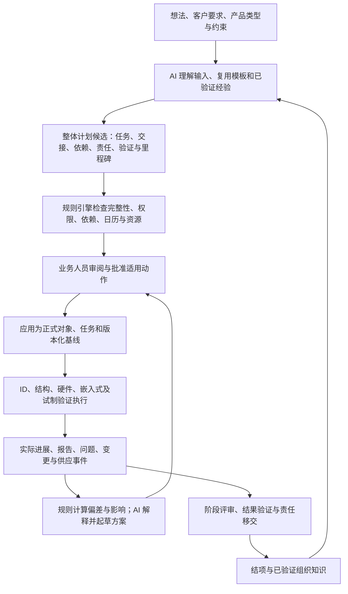

# PDOS AI-native 整体架构复核与功能轴职责

> **后续适用性（2026-09-10）**：本文保留9月9日静态事实与职责盘点；当前共同架构解释见[一致性合同](2026-09-10-ai-native-architecture-consistency-contract.md)，施工顺序见整合计划v1.2。本文后部的建议顺序、广义全能力人审表述不能覆盖后续计划；已实现与目标状态仍分别判断。

日期：2026-09-09。依据：用户要求重新确认整个 AI-native 架构及 AI 在各功能轴的作用，并明确研发包含 ID、结构、硬件、嵌入式；整体任务流程应在项目开始时确认。

**复核结论：保留“研发数字链 + 项目控制链 + 领域 AI”的总体方向；当前已实现业务对象、规则和若干 AI 能力，但完整的项目规划、执行反馈与跨轴决策闭环尚未成立。初始计划遗漏属于产品架构与实现接线问题，不能归因于用户没有提供完整历史材料。**

本文区分目标职责、当前代码与验证证据；不是全量能力完成证明，也不代替 V0/V1、Sprint 或生产出口签核。本次只做本地静态审计和文档校准，未调用生产、修改权限或运行新的业务测试。系统由用户独立开发并验收，实际业务由多人分工。

## 1. 整体运行方式

系统应让团队在项目开始时看清完整路径，随后依据真实执行持续更新。AI 的价值要落实为可审阅、可执行、可验证的业务对象。

图中是目标闭环，不能整体标为已实现。尤其 B→F 的整项目初始规划、H→I 的时间/资源传播，以及部分决策回写仍缺失。

三类触发应共同服务这条主线：用户对话提出目标或变更；业务事件暴露新事实；定时规则发现逾期、停滞和待验证项。只有需要理解、解释或提出方案时才调用模型；每次状态变化都调用模型既无必要，也不构成 AI-native 的判据。

| 架构部分 | 应承担的责任 | 当前情况 |
|---|---|---|
| 产品入口 | 对话与对象页面使用同一份项目事实；展示来源、缺项、候选差异、待确认与执行结果 | 项目问答、测试项专用对话已有；通用 Chat 目前只读，尚不能办理所有业务 |
| 组织流程与模板 | 按产品类型配置阶段、专业、交付物、测试适用性和审批责任；模板有版本，项目保留快照 | 测试模板与 NPD 指引已有切片；整项目模板实例化及完整配置化未完成 |
| 业务对象与证据 | 需求、规格、设计/BOM、样机配置、测试、问题、变更、决策和知识保留版本与关联 | 对象骨架较完整；完整变更影响图、初始计划对象和市场产品定义域仍缺失 |
| 确定性引擎 | 计算日期、依赖、资源、齐套、成本与证据覆盖，执行状态机、角色权限和 Gate | 任务 readiness、覆盖、提醒、部分 Gate 等已有；V3 时间、V4 齐套/成本、V6 资源引擎未完成 |
| AI 能力运行层 | 按业务目的装配证据、理解输入、提出候选、解释影响；保留调用与引用 | 六类 Agent、13 个登记能力、Gateway 和 Finding 已有；能力登记与真实入口/调度仍有差距 |
| 业务执行与反馈 | 经授权的领域服务写入正式对象，发 Event/Audit；从实际结果核对是否完成 | 部分纵向链成立；专业提案应用、Decision 回写和结项约束存在缺口 |

PDOS 持有研发管理对象、判断、版本关系和证据；ERP 持正式物料/库存/交易，MES 持制造执行，PLM/CAD 持设计文件真值，Git 持固件代码。系统中的 AI 可协助分析和提出工作，工程师仍需在专业工具中完成设计、开发和实物验证。

## 2. 初始项目规划是十条功能轴的共同入口

原十轴编号保持不变，补齐跨轴的初始规划主线。项目不能仅创建七个阶段后就让用户自行发现缺少哪些工作。

立项输入至少包含产品类型/功能、需求版本、ID 来源与范围、团队及可用资源、目标日期、客户要求、验证与交付边界。AI 先利用已有信息，只追问会影响方案的缺项；未知项保留负责人和确认节点。初始计划确认全生命周期、关键依赖、责任和里程碑，后期细节允许版本化细化。

| 专业 | AI 应辅助什么 | 人与规则必须落实什么 |
|---|---|---|
| ID（工业设计） | 判断全新/复用/客户提供方案的适配点；起草方向评审、外观样、修改与冻结计划；解释下游影响 | 立项确认设计资源、预算、工作量、评审轮次、客户反馈等待、缓冲、冻结目标和决策人；设计结果由责任人确认 |
| 结构 | 根据外观、空间、接口与工程约束起草设计/模具/装配/验证任务和交接要求 | CAD、结构包络/板框、图档版本、可制造性与设计批准由专业人员完成；必需输入由规则检查 |
| 硬件 | 从需求和接口起草电路、器件、PCB、样板与验证任务；提示方案差异与风险 | 工程师完成并审核设计；PCB 输入关联真实板框/接口版本，样板与物料状态可追溯 |
| 嵌入式 | 从功能与接口起草软件架构、基础功能、板级联调、版本发布与回归任务 | 工程师完成代码与测试，Git 为代码来源；样机/Test Run 关联具体固件版本 |

ID 在立项确认的是**计划与投入**，并非立项时必须完成设计。ID 周期较长要单列管理，是否为关键路径仍须按本项目依赖与资源计算。

四专业依赖应按交付物建立：共同架构明确后，结构/硬件/嵌入式预研可与 ID 方案并行；ID 与接口冻结后发布结构空间/板框；结构详细设计与 PCB 在具备各自输入后并行；目标板联调汇合硬件样板与基础固件；整机评审再汇合四专业成果。依赖变更只影响实际可达的后续工作，不能把全部研发机械顺延。

当前 20 项 JSON 基线是组织模板与模拟资产，尚未在产品中由 AI 适配后应用为项目计划。项目创建无任务实例化，`PROJECT_CREATED` 无 Agent 路由，现有 Task 将 `done/skipped` 均视为前置完成；因此 ID 专属立项约束与不可随意跳过的冻结控制仍未建立。

## 3. 十个功能轴：AI、规则与业务人员的分工

下面的“当前”只描述本地实现。基础对象、API、模型调用与完整用户闭环分别判断，不用百分比表示完成度。

| 功能轴 | AI 应发挥的作用 | 规则及业务人员的责任 | 当前实现与缺口 |
|---|---|---|---|
| **1. 个人工作与问题追责** | 根据事实解释阻塞，提出风险/行动候选，引用相似问题，说明下一步及其依据 | 系统聚合本人工作、判定逾期、提醒升级、执行责任与验证状态机；人分派、接单、执行、验证关闭 | My Work、问题责任和周期提醒已有。Project AI 能提风险/阻塞建议；完整计划分派、跨轴下一步行动尚未接通。逾期扫描和失败开单是规则，不能记为模型能力 |
| **2. 会议与决策** | 装配会前例外，引用转写片段生成纪要/Decision/Action 候选，明确分歧和待决事项，复查上次决议 | 系统校验项目/参会人、来源片段、候选重复和决策执行状态；人确认纪要、责任及有权作出的决策 | 会议/议程/转写/绑定 API 已有；`meeting_minutes`、会前装配、会后候选确认和业务页面缺失。Decision 后续完成目前可凭备注登记，未与目标 Gate/ECN 成功强绑定 |
| **3. 时间与延期传播** | 适配初始计划，解释延期影响，提出并行、调整资源或范围等恢复方案，列出估算假设 | 引擎处理依赖类型/lag/日历/关键路径/资源和 Forecast；人确认首版计划、Baseline、Commitment 及其变更 | 只有基础 Task 日期和同项目依赖 readiness；正式四类时间、传播、关键路径和延期 AI 仍待 V3。计划·资源页面为占位 |
| **4. 物料与供应** | 解释供应异常，提出催交或替代候选，识别供应资料变化可能影响的项目 | 引擎按 Build 与 BOM 版本展开需求，对 ERP 时点快照算齐套/短缺和影响；采购/工程/品质确认供方、替代、承诺与放行 | BOM/Build/Sample、ERP BOM 引用与供应延迟建议已有；Build 物料需求、供给快照、齐套及短缺→排期/Gate 链未完成。现有 ERP 引用不等于库存/齐套数据 |
| **5. 工程与客户变更** | 理解变更诉求，识别受影响对象与专业，起草方案比较、复测/复审建议和决策摘要 | 引擎遍历版本化关系、检查冻结与生效边界；人批准客户要求响应、ECR/ECN、BOM 变更及正式应用 | ECR/ECN、CCR 业务链已有；Engineering AI 的影响建议当前应用为 Risk。完整跨域 Change Impact Graph、专业变更提案和可跟踪复测清单未完成 |
| **6. 测试与验证** | 依据品类/功能/客户要求对话增改测试候选；理解新表格式并建议字段映射；指出证据缺项或冲突 | 系统维护适用模板、抽取原值、检查版本、计算覆盖、失败开单；品质/工程确认方法、条件、判据、导入与结论 | 已有真实模型测试项对话→审阅→独立应用为新版计划；导入有 LLM 列映射及确定性模板路径。资源预约、完整变更复测链仍缺；导入确认 API 已有，但上传页尚缺批次确认操作 |
| **7. 质量与可靠性** | 聚合失败模式，提出根因假设、调查步骤和 CAPA 建议；对 FMEA 修订给出证据和理由 | 人以实验验证根因，批准措施并独立验证有效性；系统执行观察期、证据、纠正/预防与关闭条件 | NCR/根因/CAPA/有效性业务闭环已有；Quality AI 的 CAPA 建议仍落 Risk。Living FMEA、跨对象覆盖检查和专业提案应用未完成。模型判断不能当根因证明 |
| **8. 市场→产品定义→IPD** | 基于可追溯证据整理竞品/JTBD，提出机会、实验、策略与定义草稿，发现需求冲突 | 指标引擎复算量化指标；产品经理确认研究边界、实验结果、策略/定义发布和立项决策 | Requirement→Case→Project 与证据底座已有；市场对象、定义发布链和第七个 Product Management Agent 未实现，属于 V5 |
| **9. 成本与 Design-to-Cost** | 解释目标差异与驱动项，提出降本/替代方案并说明质量、时间、供应等代价 | 引擎按 BOM/报价/汇率时点滚算、比较目标与 NRE；人确认成本口径、预算、报价和方案冻结 | Cost BOM 可登记币种与单价；目标分解、汇率时点、成本滚算、Cost Gap 和成本 AI 闭环未实现 |
| **10. 知识与组织记忆** | 从证据提炼可复用经验，检索相似项目，说明适用/不适用条件，辅助发现失效或冲突 | 系统保留来源、版本、权限、重复/失效状态和使用记录；业务人员验证与发布经验 | AI 知识草稿、人工验证、语义检索已有。Issue 关闭候选是规则组装。知识推送服务/API 存在，但未发现立项/ECR/选型业务入口自动调用与呈现；主动复用闭环未接完整 |

Gate、认证、Build/样机、模具/治具、共享人员/设备资源和管理层看板是跨轴能力，不能遗漏在表外：Gate 综合多个轴的证据；认证属于验证和交付；模具、长周期可靠性测试与设备预约必须进入计划；管理层读取同一份事实。现有驾驶舱摘要不等于六维健康度、资源约束排程和组合情景比较已经实现，这些仍落在 V3/V4/V6。

## 4. Agent 如何覆盖功能轴

保留已有“六个运行时 Agent + 规划中的一个产品管理 Agent”方向。功能轴、页面、专业席位和运行时 Agent 是不同划分；一个轴可调用多个领域能力，一个 Agent 也可服务多个轴。

| 运行时 Agent | 当前登记能力 | 后续应接的业务用途 |
|---|---|---|
| Project Intelligence | 风险、阻塞、Gate 异常、风险建议 API | 初始规划的组织者、计划变更和跨轴影响解释；所有任务仍需领域依据 |
| Engineering Intelligence | BOM 影响、变更影响 | 四专业计划适配、接口交接、设计变更方案与验证影响 |
| Quality Intelligence | 质量聚类、CAPA 建议、测试项变更、测试报告导入 | 品类验证、根因调查辅助、复测与可靠性策略 |
| Supplier Intelligence | 供应延期风险 | 齐套异常解释、供应替代候选、器件变化影响 |
| Knowledge Lite | 知识草稿 | 会议纪要、上下文知识复用、经验整理；纪要能力当前未实现 |
| Executive Intelligence | 项目组合简报 | 聚合例外、需要管理者决定的事项和组合方案比较 |
| Product Management Intelligence | 当前无运行时实现 | 市场证据、机会/实验、产品策略与定义，按 V5 接入 |

当前共 13 个登记 capability，独立只读 Chat 不包含在这个数量中。Supplier/Executive 在合同登记为 `shadow`，但静态审计未发现 `rollout` 被调度和应用链用作强制隔离门禁；标签本身不能作为已验证隔离或生产启用证据。

专业讨论需要 ID、结构、硬件、嵌入式均有基于自己证据的评审视角。当前辩论席位只有产品经理、项目经理、结构、硬件、DQE 和可选供应商，确实漏了 ID 与嵌入式。建议补齐席位及证据投影，继续复用领域运行时，不因专业增多就新增四套常驻 Agent。

多 Agent 讨论只用于有真实取舍的议题。每个席位引用各自负责的对象和版本，输出共同点、分歧、代价和未决条件；实际日期/成本来自计算引擎，最终决策由具名人员承担。当前 DebateRuntime 和联网组件只有底座与测试调用证据，未发现真实模型席位、应用/worker 与产品入口的完整接线，不能声称 AI 已自动发起评审会。

## 5. 当前 AI 运行机制与授权口径

已经具备的底座包括业务事件路由、项目事件合并、服务端冻结 scope、业务只读投影、LLM Gateway、结构化输出、调用留痕、预算与失败降级、Finding 审阅及应用。模型不可用时应明确显示能力不可用，已有业务操作继续可用。

当前事件执行图是**四步固定取数后一次模型调用**：项目上下文→近期事件→知识→领域证据→生成分析。它可以提供有用的领域判断，但没有因此获得自主续读工具、联网、召集讨论和执行整套项目工作的能力。现有通用 Chat 同样是带引用问答；测试项对话另有专用生成/应用路径。

2026-09-08 [验收与试点合同 §3](2026-09-08-v0-v1-acceptance-and-pilot-contract.md) 已明确：模型 Finding 保留 accepted→applied 两次人工动作，确定性候选和导入草稿的确认不能泛化为模型直写真值。因此当前保留双动作有后续合同依据，不能简单解释为代码落后于 D32。还需统一以下范围与登记差异：

| 差异 | 核查事实 | 后续收口要求 |
|---|---|---|
| D32 广义目标与后续验收范围 | D32 设计允许模型创建可逆草稿、普通候选单次确认；9 月 8 日合同明确模型 Finding 保留双动作，代码自由区仅有确定性引擎 | V0-3/V0-4 按具体对象和生产路径统一描述；模型 Finding 沿用后续合同，普通确认路径逐项核对；本次不扩大权限或临时新增硬闸清单 |
| 登记的授权档与实际交互 | 风险建议 API 标为 `confirm`，实际创建 Finding 并走接受/应用；测试计划当前登记为 `hard_gate` 并走双动作 | 使登记、API、页面和回归测试一致；不要让用户因同类动作遇到未解释的不同确认方式 |
| 专业能力名称与输出对象 | Engineering/Quality 多种建议仍使用 RiskSuggestionPayload；Finding apply 实际支持 Risk、Memory、TestPlan | 需要专业动作时建立类型化提案和适用领域服务；“建议 CAPA”不能冒充“CAPA 已创建并验证” |
| 能力注册与真实调度 | dispatcher 仍按 Agent 路由；capability 路由辅助函数未接入主调度，工具描述不保证工具执行 | 每个能力检查触发入口、上下文、模型/工具、候选出口、应用、回链与降级；无接线不能报告可用 |

概念上可将可逆候选、普通确认和关键批准分级，但实际生效边界必须来自已统一的服务端合同。`pdos_agent` 不应因目标设计文字获得业务表直写权。已批准的业务动作仍由有权限的应用服务执行、同事务留痕；Baseline/Commitment、Gate、ECN、对外发送等按其既有审批与授权要求处理。

## 6. 这次确认出的优先缺口

| 编号 | 缺口及用户影响 | 既有任务落点 |
|---|---|---|
| AR-01 | 整项目初始计划缺失；用户仍要自己补专业、依赖和交付链 | V0-6 + V3-1～V3-6；沿用初始规划遗漏审计 |
| AR-02 | 时间、资源、物料、成本引擎未接；AI 缺少可引用的跨轴影响结果 | V3、V4-2～V4-6/V4-14、V6 |
| AR-03 | 会议、联网、辩论、知识推送有底座或 API 但缺业务接线；主动性不足 | V2-3～V2-9、V1-B7/B9、V4-11；补 ID/嵌入式席位 |
| AR-04 | 专业建议出口多为 Risk；变更、CAPA、计划等仍需人工重新整理 | V1-C1/C2、V4-7/V4-8 与规划提案合同 |
| AR-05 | D32、capability zone/rollout 与调度/页面不一致；容易错误描述权限和启用状态 | V0-3/V0-4、V1-C1/C2 |
| AR-06 | Decision 完成未强绑定实际执行；项目可提前 completed；部分页面缺最终确认动作 | V1 决策/工程闭环、V2-6；保留 SIM-GAP-01/02 与报告确认 UI 缺口 |
| AR-07 | 市场产品定义、第七 Agent、组织记忆主动复用尚不完整；完整生命周期尚未闭合 | V5、V1-B9、V6 Exit |

本次建议的施工顺序：先把 AR-01 与必要的权限/版本合同做成可评审的初始规划纵向切片，随后接执行偏差与变更回链，再补会议/专业建议出口和各领域引擎，最后完成市场前端与组织反馈。整个范围继续保留，不删十轴；具体版本化实施顺序沿既有执行计划收口，不能因本次审计自动勾选后续阶段。

## 7. 按业务闭环重新验收

每项验收都从产品入口开始，观察正式结果与回链，不由预设脚本提前创建全部业务数据。规则测试、假模型测试、真实模型质量、产品端到端操作和真实业务效果分开记证据。

| 场景 | 必须观察的结果 |
|---|---|
| 新建自行车泵项目 | 输入需求与约束后生成可解释的四专业及下游计划候选；ID 计划单列；缺项明确；审阅/应用后才有正式任务与首版基线 |
| ID 周期变化 | 只传播实际受影响的依赖；能并行的预研继续；显示原基线、最新预测和方案差异，不静默改变对外承诺 |
| 新功能或客户额外要求 | AI 检查需求、设计、固件、验证、材料、成本和排期的适用影响；相关对象形成同源的变更候选。当前仅测试项切片通过，不能当全域已通过 |
| 会议出现行动或关键决策 | 有转写依据、去重、具名责任与期限；普通候选和关键动作遵循各自确认规则；目标业务成功才回写决策执行结果 |
| 物料延期与供应替代 | 根据具体 Build/BOM 和 ERP 时点算缺口，展示受影响验证/Gate；AI 比较可行方案，人确认承诺和替代 |
| 测试失败并整改 | 原始结果保留，失败关联 Issue；整改关联 ECR/ECN、样机/固件版本和复测；验证人确认结果，旧结果不被覆盖 |
| 质量措施无效 | 系统根据观察期和验证结果退回措施；AI 可提出下一轮调查候选，不能自行宣布根因或关闭 |
| 成本超标 | 引擎可复算差额与币种/报价时点；AI 说明驱动项和方案代价；采纳后有对应工程对象变化 |
| 市场机会转项目 | 从来源与实验结论到已发布定义、候选需求、立项留有完整关系；研究推断不会直接变成已批准事实 |
| 项目结项与下次复用 | 最终 Gate、遗留项和责任移交满足条件；经验经验证发布；下一次立项可在产品入口看到适用经验及引用记录 |
| 模型或工具不可用 | 明确指出哪个 AI 能力不可用；已有计划/规则与人工流程可继续；静态模板或规则结果不伪记为一次模型成功 |

关键质量口径：计划必需项覆盖与漏项、引用正确性、不可执行依赖、候选修改/拒绝原因、真正应用后的任务成功率、重复/过期应用、提前暴露偏差、问题复发和知识复用。当前没有真实运行基准，不编造百分比目标；先在独立案例中记录基线，再按试点校准。未经人工审阅，不将模拟或模型自生成结果写入冻结 golden 集。

D14-04 仍是锂电自行车泵、无照明，29 项必测基线保持原口径。应急启动属于用户提出的新品类示例，只用于检验扩展能力，不自动加入 D14-04。D14-02 的两份历史报告证明特定样本解析与回放；其中固定模板路径为零模型调用，不能证明通用 AI 抽取或整项目规划质量。

## 8. 证据与交付边界

本次检查的是 2026-09-09 当前本地工作树，包含未提交候选，不是冻结发布版本。依据代码路径判断“已接通”，依据已有报告描述“曾验证”；本次没有重新运行这些历史测试。

| 核查点 | 关键依据 |
|---|---|
| 原架构与十轴目标 | [原执行计划](2026-08-09-preview-execution-plan.md)、[统一需求](2026-08-24-pdos-vnext-unified-requirements.md)、[十轴设计](2026-08-25-vnext-full-scope-axis-closure-and-gap-analysis.md)、[决策台账 D32](2026-08-25-vnext-decision-conflict-improvement-register.md) |
| 实施与阶段状态 | [vNext 活动清单](../../tasks/vnext-unified-todo.md)、[验收与试点合同](2026-09-08-v0-v1-acceptance-and-pilot-contract.md)、[原版生产出口](2026-09-08-original-production-exit.md) |
| 无初始规划/任务实例化 | [projects.py:348](../../server/app/domain/projects.py)、[runtime_contract.py:112](../../server/app/ai/runtime_contract.py)、[规划遗漏审计](../reports/2026-09-09-ai-native-planning-gap-audit.md) |
| 能力、固定执行图与写出口 | [capability_contract.py:49](../../server/app/ai/capability_contract.py)、[executor.py:266](../../server/app/ai/executor.py)、[findings.py:957](../../server/app/domain/findings.py)、[dispatcher.py:86](../../server/app/worker/dispatcher.py) |
| 权限/模型与降级底座 | [runtime_factory.py:43](../../server/app/ai/runtime_factory.py)、[gateway.py:106](../../server/app/ai/gateway.py)、[chat.py:374](../../server/app/ai/chat.py) |
| 四专业、依赖与缺失席位 | [管理流程 v1.1](2026-09-09-management-process-v1.md)、[tasks.py:115](../../server/app/domain/tasks.py)、[debates.py:37](../../server/app/domain/debates.py)、[四专业模拟验证](../reports/2026-09-09-id-disciplinary-validation.md) |
| 会议/决策与讨论接线 | [meetings.py:216](../../server/app/domain/meetings.py)、[decisions.py:338](../../server/app/domain/decisions.py)、[debate_runtime.py:75](../../server/app/ai/debate_runtime.py)、[reach.py:301](../../server/app/ai/reach.py) |
| 物料与成本仅局部对象 | [npi_execution.py:297](../../server/app/domain/npi_execution.py)、[product_engineering.py:601](../../server/app/domain/product_engineering.py) |
| 测试对话与真实报告边界 | [AI 测试项验收](../reports/2026-09-08-ai-test-plan-acceptance.md)、[D14-02 确认回放](../reports/2026-09-09-d14-02-import-confirm-validation.md)、[test_report_import.py:369](../../server/app/domain/test_report_import.py)、[上传页面](../../web/src/components/projects/project-test-import.tsx) |
| 工程变更与质量验证 | [change_governance.py:302](../../server/app/domain/change_governance.py)、[customer_changes.py:181](../../server/app/domain/customer_changes.py)、[nonconformance.py:385](../../server/app/domain/nonconformance.py)、[effectiveness.py:149](../../server/app/domain/effectiveness.py) |
| 知识提取、验证与推送 | [knowledge_candidates.py:41](../../server/app/domain/knowledge_candidates.py)、[memories.py:364](../../server/app/domain/memories.py)、[knowledge_push.py:83](../../server/app/domain/knowledge_push.py)、[推送 API:519](../../server/app/api/memories.py) |
| 项目结项与角色问题 | [完整项目模拟及 SIM-GAP-01/02](../reports/2026-09-09-npd-project-simulation.md) |

最后已验证生产仍以生产出口文档记录为准：release `905e888fb3b183be8f14d9fad13b20535569c1d7` / migration `0032`；后续本地能力不据此视为上线。最后生产 AI 记录为 0 eligible model，本地模型资格与测试对话成功不能替代生产激活证据。本次未访问生产核验当前状态，未关闭任何 Exit。
