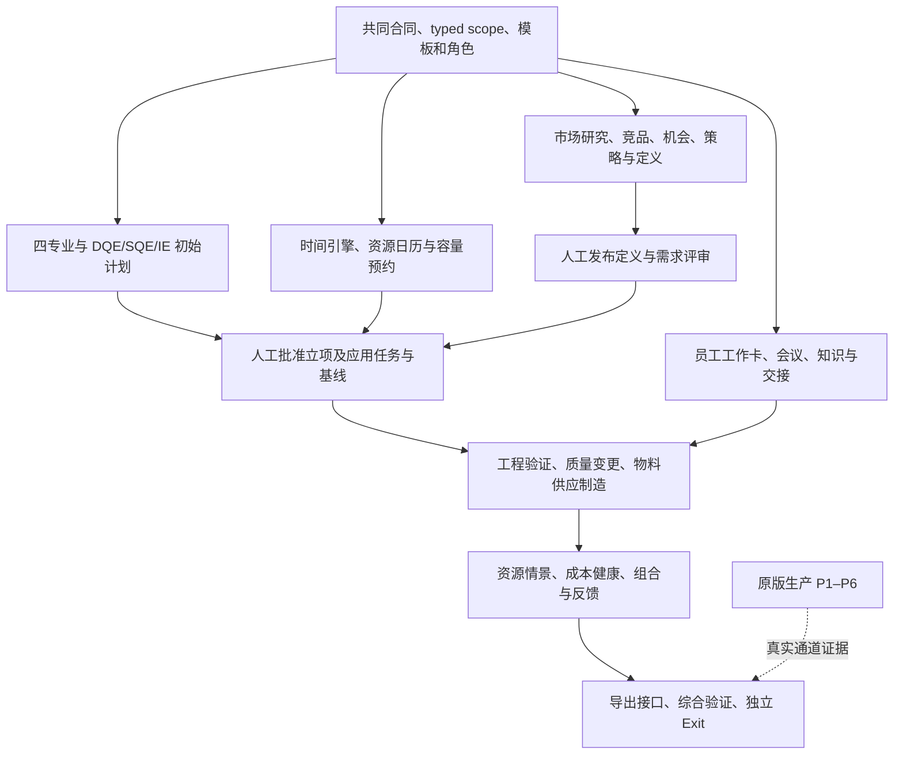

# PDOS AI-native 整合执行计划 v1.5

> **2026-09-11 统一对话与文件输入 v1.5**：用户明确要求通过统一AI对话上传文件、输入数据及查询项目信息，已纳入[统一对话设计](2026-09-11-unified-conversation-and-file-input.md)。N0-03承接公共运行/会话关联，N3-01承接统一交互与候选办理，N4-01/N3-10承接专用文件录入，其他领域逐项接入；65项编号、完成状态及当前指针不变。本轮为设计整合，文件可阅读不等于正式数据已录入。

> **2026-09-10 生效与施工指针**：N0-01六项及N0-02三组（DC-06/07/08）均获用户批准并冻结，见[运行合同生效记录](../contracts/pdos-runtime-v1/freeze-record.md)。当前进入N0-03实际运行基础接线；以下计划编制/待批描述为历史，完成状态以唯一活动清单为准。

> **2026-09-10 完整设计整合 v1.4**：统一阅读[完整设计合同v1.0](2026-09-10-pdos-complete-design-contract.md)，包含业务/数据/运行/体验/验收及原要求追溯。第25节集中新增建议的冻结；本次为文档整合与事实核对；65项编号/状态不变，Q3去除V4/V6整包硬依赖，仍须六维规则与缺失降级、V3双层看板和项目经理真实Baseline投影分项全验。后期完整能力仍在对应出口/Q6验收。下方v1.2/v1.3为历次变更记录。

> **2026-09-10 Harness补充 v1.3**：用户要求进一步明确上下文、工具与运行控制，已补[详细设计合同](2026-09-10-ai-context-tools-harness-contract.md)：服务端授权/manifest与模型所见分开、追加观察与记忆压缩、四类注册合同、14类目标工具、预算/租约/恢复、三层状态及评测。归入原N项，65项编号/依赖/完成状态不变，不代表新增能力已实现或合同全部冻结。

> **2026-09-10 架构校准 v1.2**：共同语义见[架构一致性合同](2026-09-10-ai-native-architecture-consistency-contract.md)。本轮统一旧授权/联网条款、只读与变更出口、立项前计划衔接、运行身份/证据及独立验收依赖；N0-01 部分完成，四项建模方案及完整字段合同仍待冻结。65 项范围不变，不代表功能已实现。

日期：2026-09-09。根据用户要求，将此前未完成执行清单、整体架构复核，以及产品经理 AI、员工工作辅助、DQE/SQE/IE 早期介入合并为同一份后续建设计划。

2026-09-10 语义补正：重新核对原vNext原文，发现编号映射之外的细则遗漏/过度概括，已在活动清单原N项补实，并加入UX与原业务指标专项矩阵。见[12组补正、107个原条款及27个能力语义追溯](../reports/2026-09-10-vnext-semantic-coverage-audit.md)。52项建设/整合、6项生产、7项人工出口的编号与状态不变；未据此实现功能或通过验收。

**当前应先完成共同合同及已发现的业务缺口，再并行建设“立项前产品研究与定义”和“初始项目计划”，随后贯通员工执行、工程验证、供应制造与反馈。** 旧全量范围保留，工作顺序改为具体能力依赖。原版生产收口独立推进。

唯一活动勾选清单：[AI-native 整合执行清单](../../tasks/ai-native-integrated-todo.md)。本文规定顺序、工作方式和验收；清单记录工作项、依赖、完成证据及旧项映射。**本轮交付是计划，不代表这些能力已实现、合同已冻结或任何 Exit 已通过。**

## 1. 与既有计划的关系

| 文档或状态 | 本次处理 |
|---|---|
| [原 S0–S5 执行计划](2026-08-09-preview-execution-plan.md) | 保留原版规格、工程纪律、历史验收和生产边界；剩余生产工作在新清单 P1–P6 追踪，原版出口仍单独裁决 |
| [旧 vNext 清单](../../tasks/vnext-unified-todo.md) | 作为历史交付记录与验收细则来源；84 个带编号条目逐项映射到新清单，不再作为当前队列。旧 `[x]` 表示当时交付的切片，不自动扩大为整轴通过 |
| [统一需求](2026-08-24-pdos-vnext-unified-requirements.md)、[D1–D38 台账](2026-08-25-vnext-decision-conflict-improvement-register.md)、[十轴/UX 合同](2026-08-25-vnext-full-scope-axis-closure-and-gap-analysis.md) | 全量继承；新清单的摘要不删除原验收细则，D/C/I/G/UX 覆盖经旧 ID 传递。实质差异由 N0-01/02 版本化裁决，不重新询问已确定事项 |
| [V0/V1 联合合同](2026-09-08-v0-v1-acceptance-and-pilot-contract.md) | 保留双动作、证据层级、真实试点与人工出口；采用后续 §13/14 的“先建流程、运行形成资料”和多人业务分工口径 |
| [架构复核](2026-09-09-ai-native-architecture-reconfirmation.md)、[规划遗漏审计](../reports/2026-09-09-ai-native-planning-gap-audit.md)、[管理流程](2026-09-09-management-process-v1.md) | 将审计建议变为有依赖和验收的工作项；本文替代架构稿中“最后再做市场前端”的建议顺序 |

本计划不改技术栈、ERP/MES/PLM 的真值边界，也不恢复已移除的 **V4-13 测试设备直采、V4-15 供应商外部账号**。文件/报告导入、内部供应协同、资源台账仍在范围内。D35采用钉钉/腾讯会议并人工上传转写，仅处理已授权且绑定项目的会议；飞书与深度转写拉取不在本轮。D37不做扫码/位置管理。I7/C10中的统计或模型延期/复发预测型Risk Radar待Phase6数据积累后另评，本轮交付规则风险、确定性Forecast及AI解释。所有保留项必须完成，不用分批交付缩减全量范围。

用户负责系统开发和系统最终验收；实际业务由多人协作。产品经理、项目经理、ID、结构、硬件、嵌入式、DQE、SQE、IE、采购等是业务职责，可映射到组织现有岗位与权限，不为每个称谓机械增加 RBAC 角色。各项目发布计划前绑定具名责任人和接收人；当前不虚构姓名，也不默认全部由用户承担。

## 2. 已有基础与仍需补齐的部分

| 可复用基础 | 后续重点 |
|---|---|
| Requirement→Case→Project、Stage/Gate、Task/Issue/Risk、Decision/CCR、BOM/Build/Sample/Test/FW | 项目创建尚未生成完整任务/依赖/首版计划；Decision 需实际执行回链；结项和 Quality Test Run 权限缺口需修复 |
| My Work、组织/代理、提醒扫描、审核收件箱、页面/BFF 与性能改善 | 把来源、AI 已准备内容、可办理动作、接收方和实际结果接起来，避免员工重复录入和追问 |
| Gateway、受限 Agent 数据库角色、Finding 审阅/应用、六 Agent 的登记合同 | 验证 capability 路由、真实工具执行和 shadow 控制；为计划、变更、CAPA 等提供领域载荷和窄应用接口 |
| 测试模板快照、AI 测试项对话、Excel 抽取和字节去重 | 复用现有能力；补确认 UI、多模板准确率、样机配置/逐次测试/失败问题闭环，不能把字节去重说成语义去重 |
| Meeting/Evidence/reach/debate/knowledge-push 的服务组件 | 补实际入口、模型/供应商接线、异步运行、结果办理和反馈；类、API 或 fake provider 通过不等于功能可用 |
| 20 项四专业任务基线及脚本模拟 | 作为模板与回归样本，不能替代产品内初始规划能力或真实项目验收 |

上述是本次静态审计基线。N0-01 开始时复核当前代码和已有证据，防止重做后续已补齐的部分。例如 V4-1 旧标题的“UI 待建”不能覆盖后来已有的 NPI 面板事实。历史已修复的类型错误、提醒扫描和 DUP-01 不重新立项修复。

主试点 **D14-04 为锂电自行车泵，不带照明，当前 29 项待测**。D14-02 两份报告是历史回放材料：8/30 已完成隔离确认验证，22 页保留缺项或参考状态；不转为 D14-04 的测试结果。第二产品类型仍待汽车泵、帐篷泵等适用性试配，不能用另一个自行车项目替代。开发和模拟先使用明确标识的样例；真实角色、操作时间和业务结果在试用中产生。

## 3. 执行包和顺序

N0–N7 是工作包，不是新增的八个 Sprint，也不自动对应旧 V0–V6 的阶段通过。清单每个条目的具体依赖决定何时可开始；同一包内可以分批交付。原有人工合同冻结和 Exit 仍保留在 Q0–Q6。

| 包 | 交付结果 | 为什么此时做 |
|---|---|---|
| **N0 共同合同与基础修正** | 对象/权限/范围/应用合同，业务缺口修正，模板与指标采集设计 | 确保后续 AI 有正确上下文、可执行动作和实际结果反馈 |
| **N1 产品经理研究到规格定义** | 研究任务、竞品证据、市场/机会/实验、开发策略、结构化规格书、定义发布与需求候选 | 产品经理应在创建项目之前就得到帮助；非项目 typed scope 前移 |
| **N2 初始计划与时间资源基础** | 四专业和 DQE/SQE/IE 任务、ID 专项计划、依赖/日历/容量校验、人工确认首版任务与基线 | 在立项时明确管理流程；已有获批需求的项目也能先规划，不等待完整市场矩阵 |
| **N3 员工日常执行与协同** | 一次输入、多对象候选、可办理工作卡、交接、会议、知识辅助、移动/搜索、流程配置 | AI 准备实际工作，员工在同一上下文内办理和反馈 |
| **N4 工程验证与质量变更** | 可追溯测试、专业工作包、影响图/FMEA、复测整改、真实结果回链与交付硬闸 | 把专业建议变成可跟踪、可验收的业务执行 |
| **N5 物料、供应、制造与成本** | 齐套/短缺、供方/合规、模具治具、供应方案、实际成本 | 以真实 BOM/快照和工程证据支撑排期与取舍 |
| **N6 资源、组合与反馈** | 资源受限排程、情景比较、六维健康、产品家族路线图、结果回到策略与经验 | 管理层与员工使用同一事实；形成从市场到开发结果的反馈 |
| **N7 输出、综合验证与出口证据** | 报表/开放接口、安全运行、员工价值观测、逐项 Exit 证据包 | 覆盖全部并行工作，尤其旧总出口旁路的 V6-8 导出/API |
| **P 原版生产收口** | 原版候选、生产 AI、真实钉钉、全量切换/只读退役及正式确认 | 保留原版义务；具体生产/真实外发受既有逐项授权约束，本地建设可先继续 |

图展示业务汇合；具体工程依赖以清单为准。初始规划 N2 可用现有已批准 Requirement 开发和验收；N1 的新产品定义链完成后由 N1-07 汇合。资源身份/日历/容量与时间基础同期建设，不等 V6 全部完成；资源受限优化稍后接入，未具备前不承诺排程最优。目标成本先用于策略，BOM/报价实际滚算后接；DQE/SQE/IE 先提供约束和验证计划，后续补零件、样机和生产证据。

### 当前第一轮可执行顺序

1. **N0-01 → N0-02**：复用现有合同，补清楚新增对象、专业职责、typed scope、候选应用与运行边界；只提交仍有实质冲突的差异供裁决。
2. **N0-03、N0-04、N0-05、N0-06**：按具体依赖完成运行接线、结项/测试权限/Decision 修正、模板及测量设计；其中资料与模板准备可并行。
3. **N1-01/02 与 N2-01/02/03**：先让产品经理能做有来源的研究，同时让已有获批需求能生成受规则校验的初始计划。两条入口共享 N0 合同。
4. **N1-03～07 与 N2-04～07**：逐步接市场分析、策略规格、计划审批/应用和变更更新；优先验收“定义一个产品”和“确认一份可执行计划”两个真实页面闭环。
5. **N3–N6 按前置就绪接入**：一次只把少量纵向能力推进到界面、领域服务、验证和反馈全部成立；不积攒大量未接线 API。

没有用户确认的工期和可投入时段，本计划不虚构截止日期。N0-01 盘点后，按各条剩余工作量和上一轮实际速度安排滚动周计划；承诺日期由用户确定。独立开发时主实现队列优先 N0→N2 首版计划，同时让可独立的 N1 证据/界面工作推进；多人/Agent 协助限有明确文件边界的工作，迁移编号、schema、共享合同和集成版本由一个负责人串行收口。

## 4. AI 在业务链中必须提供什么

统一对话是上述能力的日常入口：Home输入框、全局入口、完整会话与对象页侧面板共享服务端会话和附件记录。用户可上传资料、持续补充/纠正、查询有权限的项目信息，并在同一会话核对预览、办理和查看实际回执。先复用PDF/XLSX及项目Chat形成可恢复的阅读/问答切片；正式录入依对应领域预览/确认或Finding接受与独立应用验收，不能只交付聊天外壳。详见统一对话设计UC-01～UC-10，归原N0-03、N3-01/02/06/08/10、N4-01及N7验收；非项目范围随N1接入，不虚构项目。

沿用 `ai-agent-engineering` 的上下文—动作—反馈诊断：固定阶段和状态转换使用确定性工作流；资料探索、研究与问题诊断可采用有预算和停止条件的局部工具循环。沿用六领域 Agent，按旧 V5-9 增加产品管理能力；ID/FW/DQE/SQE/IE 是证据视角和职责，不强制各开一个 Agent。

每个能力须具备触发入口、授权来源/版本、可见结果与验证反馈。**模型业务变更链**为：触发 → 已授权来源与版本 → 类型化 Finding → 规则校验和缺项 → 人工接受/独立应用 → 领域对象 → 实际结果 → 修正或经验候选。只读研究/问答/比较直接展示有来源的结果，不强制接受和应用；按已批准政策生成的确定性派生值另走规则服务。采用目标明确的准备工具，例如编制计划、准备变更验证包和准备交接材料；不能用一个泛化 Risk 建议替代所有专业工作。

原计划27个能力语义各有落点，N0-03逐一映射实际capability而非只数Agent；每项及实际专业席位均需对应版本的真实模型评测。D25的默认放行/blocklist、全席位受控GET与快照保留，D26的Agent在受限run内自行发起、冻结席位投影及预算停止语义完整继承；这不扩展模型对业务表的写权限。

| 功能轴（沿用旧编号） | 新清单落点 | 可见的 AI 价值 |
|---|---|---|
| 1 个人工作与问题追责 | N0-04、N3-01/02/04、N7-03 | 带上下文的下一步、预填候选、持续跟踪恢复，减少重复录入 |
| 2 会议与决策 | N3-05/06/07、N4-06 | 会前装配事实，会后准备行动/决策，用专业证据比较分歧并按实际执行复查 |
| 3 时间与延期传播 | N2 全部、N6-01/02 | 编制/更新计划、解释确定性影响，展示方案与不确定性 |
| 4 物料与供应 | N5-01/02/03/05 | 解释短缺影响，准备催交/替代/借料方案和内部协同 |
| 5 工程与客户变更 | N4-03/04/06 | 准备结构/硬件/FW 影响包及复测、重审、认证行动 |
| 6 测试与验证 | N1-06/07、N4-01/02/05 | 将要求翻译成可验证条目，按产品功能调整测试，关联配置和失败证据 |
| 7 质量与可靠性 | N2-03、N4-02/04/05/07 | 早期验证约束、根因假设、整改复测、关闭证据核查 |
| 8 市场→产品定义→IPD | N1 全部、N6-04/05 | 调研市场、比较竞品、定义策略与规格，结果反馈到原假设 |
| 9 成本与 Design-to-Cost | N1-05、N5-06、N6-02/03 | 解释目标差异，比较降本方案的质量、时间、供应代价，回告产品定义 |
| 10 知识与组织学习 | N3-03/04、N6-05 | 在立项/选型/变更提供适用经验，帮助新人接手，纠错进入审核 |

产品管理 Agent 的八项能力仍全量交付：research_planning、competitor_analysis、market_analysis、opportunity_mapping、experiment_design、product_strategy、product_definition、product_matrix。前三项在 N1 对应数据与范围就绪后先可用，其余逐项接入；每项都要有独立来源投影、结构化输出、应用或只读出口、评测与失败处理。

## 5. DQE、SQE、IE 与四专业如何提前介入

DQE 负责设计开发质量，SQE 负责供应商质量，IE 负责工业工程及制造可行性；实际组织可由 PE/ME 等承担对应职责。系统按新类别、新功能、新供方、关键质量特性、工艺变化等风险触发专业任务，不要求所有会议全员到场。

| 时点 | DQE 输入/输出 | SQE 输入/输出 | IE 输入/输出 |
|---|---|---|---|
| 调研/概念/定义 | 使用风险、历史失败、质量目标、可验证性和缺失判据 | 关键件/新供方能力、打样和长交期未知项 | 装配/标定/检测可达性、工艺/工装/产线可行性与成本假设 |
| 立项与初始计划 | 验证矩阵、长周期试验/认证及样品资源 | 供样、资格验证、关键件证据补齐任务 | 试装、治具、模具、测试站/试制线需求及准备时间 |
| ID/接口与设计冻结前 | 关键质量特性、设计风险/验证控制 | 材料与件版本的供应依据及替代限制 | 拆装维修、装配/测试空间、开模和工艺条件 |
| EVT | 工程测试、失败/整改与复测闭环 | 样件缺陷、供应纠正和复验 | 试装、工艺问题、节拍和治具测算依据 |
| DVT | 设计冻结配置的验证与认证证据 | 供方/关键件准备程度和一致性 | 工艺/工装验证、试产准备 |
| PVT→MP/交接 | 生产质量与遗留项接收、稳定性跟踪 | 来料一致性、供应异常责任与持续改善 | SOP、实际节拍/产能、工装/产线交付与接收 |

每个专业任务有触发条件、输入版本、交付物、责任人、审阅/接收人、前置条件和完成判据。在尚未发布 Definition 的机会/概念阶段，也能先形成专业约束和计划候选，以此支持策略比较；正式任务/基线应用才要求获批来源和立项批准。资料未知时创建待验证约束，不伪装为已有专业结论。必要约束未解决时阻塞相关冻结/执行，例外按批准的版本化政策办理。

ID 计划在立项时单列设计来源、投入资源、方案/评审轮次、客户反馈等待、缓冲与冻结目标。首版计划确认的是这项工作及其约束，未来 ID 冻结作为计划中的里程碑，不要求立项时设计已经冻结。结构、硬件、嵌入式预研可并行；详细结构和板框取决于批准的 ID/接口，PCB 取决于板框/接口，固件基础开发可前置，联调需实际硬件与固件版本汇合。**ID 冻结不能仅因任务被标为 skipped 就成立。**

## 6. 工作项完成与证据要求

每项先落领域合同，再实现服务/权限/事件、AI 接线与 UI，最后用同一候选版本验收。现有确定性候选沿已批准合同办理；模型输出保持 Finding 接受与独立应用两个动作，Agent 数据库角色对业务表零写。清单中的“应用”均指有权限的人工动作调用领域服务，不能解释成模型直接批准、发布或外发。

本轮补实的业务连接必须单独可验：DCP商业决策与TR技术评审的独立结果进入Gate readiness；Issue与NCR/CAPA双向关联但各自关闭；CCR经过报价/交期回复及客户确认后联动内部ECR；测试覆盖四桶、六字段样机对比和报告驱动建档；资源排队/政策/批准方案版本校验；Frozen Cost到量产成本回测；预防措施到经审核Design Rule及下项目复用。不能只以相邻对象存在作为这些连接通过的依据。

| 证据等级 | 能说明什么 | 不能说明什么 |
|---|---|---|
| 文档/静态审计 | 范围、合同和缺口有落点 | 功能已经运行 |
| 单元/API/隔离模拟 | 规则、权限、失败处理、可复现行为成立 | 真实业务效果、生产可用 |
| 冻结候选的真实进程/HTTP/浏览器与模型评测 | 员工入口和端到端链路在该环境可用 | 生产部署及现场质量结论 |
| 真实试用/生产指定场景 + 人工确认 | 对应业务或阶段验收成立 | 自动扩展到其他产品类型、环境或 Exit |

所有 AI 工作包验证来源缺失/冲突、权限隔离、工具停止与可见结果；涉及业务变更时，另验关键来源变化导致候选过期、重复接受/应用幂等、应用失败原子性和恢复、实际结果回链。数值计算由时间/资源/齐套/成本引擎产生，模型不创造日期、库存、通过结论或供应承诺。供应商/网页/文件内容是证据，不提高其指令权限。

工程验证沿原 DoD：按变更完成必要单测/集成、类型、构建、真实 HTTP/浏览器；测试数据库只能是 `pdos_test`。到阶段出口冻结候选再跑联合门禁，不用历史分散的全绿记录代替。新增迁移号从实施时真实 head 单调分配，不复用旧草案预留号；受限账号正反向和迁移回滚/恢复证据需覆盖新增实体。

每条完成记录写：候选 SHA/文件清单、迁移 head、环境、复用基础、剩余差异、正反向证据、实际页面/模型运行、残余风险与批准人。`[x]` 只在该条全部验收成立后勾选；`[~]` 有剩余就保留，`[!]` 写具体外部阻塞，不能以等待或重试次数代替完成。

## 7. 试用、独立出口和生产轨

N0-06 先定义采样和埋点；N7-03 在实际使用中比较同类任务的无 AI 基线与辅助结果：总主动操作时间（含审核与纠错）、重复录入、追问、漏项返工、接收通过率、通知噪声、候选过期率、实际问题恢复和预测误差。样本必须覆盖产品经理研究到规格、DQE/SQE/IE 早期评审以及研发/品质执行，不能用旧研发样本代替新增价值验证。保留样本量/角色/窗口，阈值按基线校准并由用户确认，不现在编造“提升百分比”。已有资料的有效批准继续复用。

员工价值与原vNext业务指标并列：里程碑按最新人工Commitment兑现、预警提前、Issue响应/关闭/复发、会议/行动、齐套/新鲜度、需求/样机/测试/Gate证据覆盖、研究/定义/实验周期及AI/辩论质量均不得省略。后段最终效果在N7-04/Q6逐项核验。活动清单列有完整指标族及UX1–UX10矩阵，包含默认14天TTL、批量diff/撤销、逐触点降级和My Work/项目概览/Review Inbox各自P95<1.5s；不能用“减负有改善”或一个平均耗时代替原出口。

Q0–Q6 是原 V0–V6 独立出口的继承记录，逐条保留旧细则与适用新增能力证据，不能被 N7 一次性盖章。Q0–Q5 消费各自范围的冻结候选门禁/采样证据，不能要求 N7-02/03 整项完成才裁决；Q6 保留全量 N7 依赖。P3 与 Q1 共用适用通道证据，不设 S5-1 整包完成的隐含前置。Q0 的真实基线与冷启动材料可在运行中补齐；**它们不是本地流程建设前置条件**，但具体对象/权限合同在依赖它的实现前仍须完成相应裁决。原版 S5-1、Sprint 5、切换退役也分别确认。系统验收由用户关闭；业务任务接收/专业签核由项目中的有权限责任人完成。

原版 P1–P6 详见 [生产出口合同](2026-09-08-original-production-exit.md)。最后已验证生产版本为 `905e888fb3b183be8f14d9fad13b20535569c1d7`、migration `0032`；本地新模型资格和功能不据此声明部署。生产 `delivery=false`，真实钉钉身份、外发/建会、模型业务数据出站、部署、源系统写冻结/迁移及退役保持原具体授权边界。先完成本地候选、脚本、范围和回滚方案，再在执行相关操作前取得所需授权；复用同一范围仍有效的授权。

全量建设完成的必要条件是：所有保留 N 项、Q0–Q6 和各项真实证据均成立；原版生产交付再满足 P1–P6。任何授权阻塞仅暂停依赖它的条目。不得将“新计划生成”“样例跑通”“某页有入口”或“新 Agent 已登记”当成整个平台验收完成。
