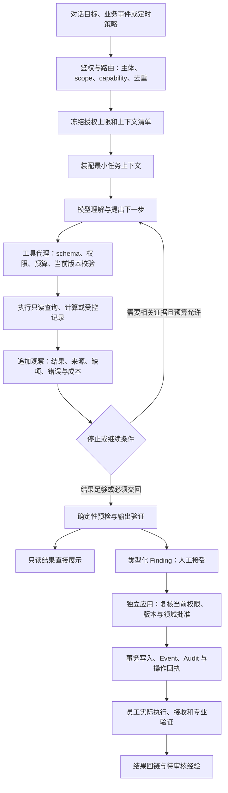

# PDOS 上下文、工具与 Harness 设计合同 v1

> **完整设计入口（2026-09-10）**：[完整设计合同v1.0](2026-09-10-pdos-complete-design-contract.md)已将业务、对象与本专题内容整合为单份评审稿。本专题保留详细取证；新增建议未因此批准或实现，状态以活动清单为准。

日期：2026-09-10。属于[统一架构合同](2026-09-10-ai-native-architecture-consistency-contract.md)的运行设计附件；执行仍使用[整合清单](../../tasks/ai-native-integrated-todo.md)，不另建实施队列。

**目标：让每个 AI 能力明确“为何运行、能看到什么、可调用什么、如何判断结果有效、失败后如何继续、最终由谁办理”。Harness 是围绕模型的运行控制与验证机制，包括上下文、工具、约束、验证、纠正；它不是另一个 Agent，也不只是提示词或 LangGraph。**

本文明确目标接口及验收要求，表中建议名称/状态是待 N0 合同冻结的设计标识，不能当作已存在的 API、数据库列或已获生产授权。现有受限行为、模型 Finding 双动作、静态前缀、可信 golden 根和 ERP/MES/PLM 边界全部继承。原版 `run-context-v2` 的四层不删除，typed scope v3 按兼容合同演进，不把本附件版本当 migration 或运行 schema 版本。

## 1. 各部分分别负责什么

| 部分 | 本系统中的责任 | 不应混用 |
|---|---|---|
| LLM / 模型 | 理解文字、比较证据、提出假设/方案、选择受控工具和生成结构化候选 | 模型输出不是批准、日期计算、实物验证或权限事实 |
| Context / 上下文 | 本次目标、已知事实/版本、相关规则、证据片段、历史决定、待解决项与当前运行状态 | 不是把全库、所有聊天和所有文件一次放进提示词 |
| Memory / 记忆 | 保留可继续的运行记录与经审核可复用经验，按来源/权限/有效性检索 | 聊天摘要和一次成功不自动成为正式组织知识 |
| Capability / 业务能力 | 版本化业务目标与结果合同，例如竞品比较、初始计划、变更影响；绑定评测与入口 | 不等于独立服务、单个工具或某个页面 |
| Tool / 工具 | 有明确 schema、handler、权限、预算和结果的可调用接口 | 工具描述不等于已接线，也不是把所有 REST API 暴露给模型 |
| Skill / 工作方法 | 可信、版本化的领域办事步骤、检查方法和模板使用说明 | 产品内 Skill 不运行本机任意 SKILL.md/shell；不得改变授权、验收标准或业务规则 |
| Harness / 运行控制 | 装配上下文、调度与约束调用、保存轨迹、验证结果、暂停/恢复/终止和移交 | 不给模型万能权限，不机械拆成五个微服务 |
| 领域服务 / 规则引擎 | 状态机、权限、时间/容量/齐套/成本/覆盖计算、正式写入和回执 | 模型不能绕过它直接写业务表，计算结果不能冒充实际执行 |

运行时继续六领域 Agent + Product Management Intelligence；专业席位是授权证据视角。上下文、工具和领域 adapter 随 capability 组合，不能因新加 ID/SQE/IE 视角就复制一套运行系统。

## 2. 同一次运行的完整路径

固定填报、状态转换和数学计算直接走领域服务；只有需要理解/解释/方案时调用模型。图内研究循环与数据库事务分开：网络/模型调用期间不持有业务写锁或等待人工批准。失败与中途输入由 §7/8 处理，不无条件循环。

## 3. 上下文合同：服务端清单与模型所见分开

### 3.1 服务端控制清单

下列是逻辑记录，不要求每个都新建一张表；先复用 `agent_runs`、已有调用/证据/审计结构，N0-01 冻结物理归属与兼容方式。

| 记录 | 必需信息 | 谁产生 / 用途 |
|---|---|---|
| Run authorization envelope | tenant/run/lineage、触发方式与触发人、执行服务主体、委托或调度策略、typed scope、绑定对象集、用途、授权/策略版本、有效期 | 服务端从真实登录/服务授权生成；persona、模型参数和事件作者都不能替代它 |
| Context manifest | manifest_revision_id、目标及修订号、期望输出类型、capability/prompt/Skill/tool/schema版本、来源引用集合/observation序列及digest、policy/模型资格版本、event watermark、构建时间、装配选择/省略理由、token估计/输出预留、缺项、上下文完整性、序列化digest | 每次invocation绑定实际消费的不可变manifest_revision_id及观察序列；其内部字段不是整包外发给LLM |
| Observation | tool call/parent、顺序、结果状态、对象/来源版本、采集时间、原件定位、ACL判定、可信/taint/新鲜度、shown/total/截断/续读、输入与结果digest、成本 | 可信工具服务追加；原观察不可覆盖，后续修订保留指向关系 |
| Run control | lease/续租、checkpoint、attempt、累计费用/token/工具数、剩余时间、取消、暂停/停止原因、当前工具、待人事项 | 运行控制可以变化，与冻结manifest/观察正文分开；过期worker不得继续发布结果 |
| Compaction / handoff record | 原manifest、source_observation_ids/source_acl_dependencies、压缩器与调用版本、摘要引用/digest、保留的精确事实/批准/待办、已省略材料及可回读引用、未决冲突 | 正常任务阶段生成；冻结后不修改，失败使用确定性精简/显式缺项，worker异常处理不另调模型压缩 |
| Operation / handoff receipt | 候选版本、审批/应用人、幂等键、目标及版本映射、事务/外部回执、业务待执行状态 | 领域服务产生，支撑“应用成功”与“实际完成”的区分 |

请求模型时经过统一出口投影：数据库凭据、对象存储key、登录信息、访问票据、无关PII和内部完整授权清单不入模型。内部使用digest做重放/版本校验不代表要把SHA或受限原件地址发给模型；使用可回链的引用句柄、允许的业务版本和片段。现有classification及出站策略未批准扩展前继续适用；有权在页面看文件不等于该文件已可发给模型。

### 3.2 模型可见的最小任务包

| 层 | 必须包含的业务内容 | 示例 |
|---|---|---|
| 稳定前缀 | 已发布职责/输出合同、通用约束、当前capability版本化工具描述 | Quality准备验证候选，不能判定未测样机合格；工具定义固定顺序 |
| 任务与范围 | 用户原目标的有效修订、当前阶段、输出类型、允许处理的对象句柄、明确排除项 | D14-04是自行车泵，照明=false；新品类应急启动属于另一个设计场景 |
| 当前事实 | 已批准需求/定义、功能配置、版本、责任引用、计划/资源/样机/问题的相关部分 | ID来源、投入、接口版本；Baseline/Forecast/Commitment分别标识 |
| 规则与方法 | 该产品类型/阶段的模板版本、适用性、完成判据、审批条件；Skill只补办事步骤 | DQE长周期试验在计划中占用样机和实验室；skipped不能代替ID冻结 |
| 证据与经验 | 与问题相关的原文片段/表格行/转写定位、可复算引擎结果、经审核适用经验 | 报告sheet/单元格，竞品型号/工况/抓取时间；知识需解释为何适用 |
| 差异与未知 | 来源冲突、未确认假设、缺判据、未就绪工具、尚未验证的候选 | 竞品宣传不等于实测；没有阈值不能自动判测试通过 |
| 运行状态 | 已完成步骤、候选/观察引用、剩余预算/时间、工具可用性、失败及禁止重试事项 | 已找到3份证据，关键参数仍冲突；当前等待品质确定方法 |

字段分别保留来源性质 `observed`（原始记录）、`derived`（规则计算）、`hypothesis`（待证假设），以及独立的 `approval_ref`（批准记录）。这不是把 approved 与前三者放入互斥枚举：已批准估算仍是 derived/hypothesis；同一段模型文字不因再次总结就升级为事实。缺项分为“当前动作必需”“未来任务需补”“可暂存假设”，只阻塞真正依赖它的动作。

### 3.3 上下文怎么选、怎么更新

1. 先验证权限、来源用途/分类和模型出口范围，再按capability选择相关对象与片段。检索排名不能扩大可见范围；数量/摘要也不能泄漏无权项目。
2. 正式来源保持版本和as-of；关键事实冲突并列呈现。模型可以继续查证，不能静默选一边。明确“未检索到”“数据不可用”“无权访问”的对用户可见差异，错误细节不得透露无权来源是否存在。
3. 时间/成本/齐套/覆盖由代码预聚合，保存输入版本/计算版本。模型拿到结论与足够的追溯信息；不得从片段自己拼一个库存、日期或合格率。
4. run内续读生成新的observation，不修改旧manifest/旧观察；每次模型调用生成新的manifest版本，引用追加后的观察序列及前序manifest，保存实际消费集合。同digest冻结重试只返回原记录，不同内容须新版本。冻结的是授权上限，不冻结当前访问权；撤权后停止新取数、再向模型发送、结果披露/导出和应用，按政策保留审计；不能撤回模型在撤权前已经收到的信息。
5. 内部scope或席位锚定对象扩大时，经服务端授权产生关联新run/session；目标修改同样留修订关系。原run、已接受载荷和历史批准不被覆盖，lineage累计预算/期限/取消继续生效。
6. 应用之前核对关键来源/目标版本和当前权限；无关文件更新不使整包过期。正式对象保留旧版本结果，新变化形成影响分析和适用重验。

### 3.4 长上下文、记忆与缓存

| 信息类型 | 保存和使用方式 | 失效与隔离 |
|---|---|---|
| 当前工作记忆 | 目标、约束、观察引用、决定理由、待办、错误和候选版本，随run/checkpoint保存 | 不随窗口滑动静默丢失；恢复需重新检查访问权 |
| 历史运行记录 | 作为带时间/来源/结果的项目或scope历史，可检索解释过去发生什么 | 历史模型推断不当verified知识；不同项目不能因相似而混入 |
| 正式组织知识 | 复用既有Memory草稿→人工审核→verified与适用性/撤销机制 | 新经验仅进候选，不自动改prompt、规则或golden；verified也不能扩大来源ACL |
| 原始材料 | 文件/报告/网页快照在已有私有存储，模型按需取获准片段和定位 | 摘要保留taint/来源；OCR或解析未实现时明确不可用，不用空文本伪装 |
| Context压缩/交接 | 删除重复和无关片段，外置长原文；保留精确标识、数值/单位/否定约束、批准状态、差异与未决项 | 压缩产物是有源索引，不是新真值；新接手执行器能凭交接包恢复，缺原件则标不完整 |
| 缓存 | 静态prefix缓存与证据/检索/计算缓存分开；应用级缓存key含tenant、访问投影版本、scope、对象/查询/模型或算法版本 | 缓存命中仍重新鉴权；角色撤销/来源变更/过期后不得沿用旧可见内容。缓存TTL不等于证据有效期或记录保留期 |

上下文预算先预留输出及下一次必要工具反馈空间，再装任务/硬约束、关键事实/引用、未知项，最后相关经验。字符限制不等于模型token窗口；超过预算时按规则分段/按需检索/生成可追溯压缩包。必需约束仍装不下则返回 `context_incomplete` 并给缺项，不能丢掉限制后继续生成“完整方案”。正文被截短、条目分页、检索漏项分别给标志及续读方式。

压缩包、handoff和缓存都保存传递的`source_observation_ids/source_acl_dependencies`。每次Gateway发送最终装配包前复核其中所有受限来源及派生摘要的当前ACL/出站政策；撤权后移除并重建受影响派生包，或终止本次调用。不能仅挡新取数，却继续发送旧缓存中的受限摘要。

前缀按版本固定；只加载本次capability所需的专业方法与工具包，D25研究工具仍对所有席位可用。执行中不得悄悄替换tool/schema/prompt版本；需要不同工具包时走服务端重新选择的关联运行，保留预算及来源。

## 4. 工具合同：模型接口、引擎接口与人工动作分开

### 4.1 四类注册合同

- **Capability Registry**：业务目标/触发、scope、输出模式（只读/模型业务提案/已批准专用导入）、上下文构建器、模型资格、prompt/Skill/toolset、预算/质量线、rollout和负责人。旧27语义映射实际键，不机械新增27个Agent。
- **Tool Registry**：可执行handler、输入/输出schema、权限、副作用、超时/计费/重试/幂等、结果验证及来源。未知工具、版本或handler缺失返回明确不可用，不能让模型以工具名存在推断已执行。
- **Engine Contract Registry**：确定性计算器的版本、输入快照、日历/单位/算法、输出与新鲜度、计算资源上限。情景工具引用无正式写入的计算接口；派生Forecast/齐套等正式更新由可信服务按已批准政策办理。是统一引擎目录，不要求额外服务或重复存一份计算真值。
- **Human Action Registry**：review/apply、定义发布、Gate/DCP/TR/ECN等领域批准和外发操作。由登录人通过UI/BFF/API调用，**不加入模型工具列表**；服务端复核当前权限与具名批准。这里是逻辑职责划分，沿用现有领域服务，不新造通用万能apply接口。

### 4.2 每个 ToolSpec 必须定义的字段

| 类别 | 必需合同 |
|---|---|
| 身份与选择 | tool_key/version、Use when / Do not use when、参数例子、owner_module、handler、关联capability、允许scope种类 |
| 参数与结果 | 严格input/output schema、单位/枚举/引用版本、最大页大小/载荷、可选项含义；模型参数原样记录，合法规范化保留原值/规范值和规则版本 |
| 范围与数据出口 | scope/principal由run注入，模型仅给查询/业务目标/获准对象句柄；每次对象引用重验，结果统一出口投影 |
| 副作用 | `read`、`simulate`、`record_observation`、`propose_finding`之一；组合工具列清可信服务附带写。正式业务apply与真实发送不在模型可调用枚举 |
| 可靠性 | timeout、max_attempts、retryable条件、幂等键、取消支持、并发/预算计量、输出大小、side-effect receipt、checkpoint恢复点 |
| 验证与运维 | deterministic validator、citation policy、数据新鲜度、error taxonomy、trace字段、golden/故障案例、live/shadow/disabled强制行为 |

工具schema校验不等于业务正确。每次调用至少校验：工具是否启用/已实现 → run lease与当前权限 → 参数/引用/来源版本 → 预算/截止时间 → handler执行 → 输出结构/来源/实际回执 → 追加observation。失败时不得合成成功返回。

### 4.3 代表性目标工具目录

以下14项为目标语义，不宣称同名接口已存在；优先复用现有工具和领域服务，通过版本化适配实现。`prepare_*` 接收模型已形成的候选及证据，做组包/校验，不在内部偷偷启动另一只LLM或直接创建正式业务对象。

| 目标工具 | 输入及来源 | 输出 / 副作用 | 验证与失败结果 | 落点 |
|---|---|---|---|---|
| `research.search_sources` | 研究问题、型号/区域/时间范围、分页；授权run | 来源命中和线索，`read`；复用`web_search` | 正常完成可返回zero_results，provider未配置/不可用不当0条；未抓回的线索不得当成事实 | N1-02 |
| `research.capture_snapshot` | 受控公开URL或命中句柄 | 带原文定位的快照观察，`record_observation`；复用`web_fetch/source_snapshot` | D25每跳检查、来源ACL/taint/用途、digest/去重；失败不得返回可引用的假快照 | N1-02 |
| `knowledge.search_applicable` | 当前问题/产品类型/功能/阶段、引用范围 | 经审核知识与适用/不适用条件，`read`；复用`search_memory` | 先权限后相关性，返回来源和召回缺口；unknown不补成经验 | N3-03 |
| `verification.get_evidence` | 规格/用例/样机/Build/Run引用与版本 | 证据矩阵、缺项、原始结果定位，`read`；复用质量证据查询 | 旧配置/缺阈值/未测/失败分别显示，不以附件存在判通过 | N4-01/02 |
| `readiness.evaluate` | 目标动作/版本与必需政策 | 可办理/阻塞条件及解释，`read` | 必需批准/证据实时复核；只返回readiness，不批准Gate或关闭问题 | N0-04、N4-07 |
| `schedule.evaluate_scenario` | 候选节点/边/工期依据、日历和容量快照 | 日期/关键路径/冲突/成本权衡计算，`simulate` | 环路、单位/时区、缺容量来源拒绝或标不可计算；不改Baseline/Commitment/实际预约 | N2-01/02、N6-01/02 |
| `engineering.trace_impact` | 变更对象/版本/生效范围 | Spec/BOM/配置/测试/认证/计划影响关系，`read` | 引用边与执行依赖分开，缺边显式声明；不自动创建ECN或复测通过 | N4-04 |
| `product.prepare_definition` | 已批准/候选策略、模型规格草案、证据/假设、专业约束 | 类型化定义Finding及缺项，`propose_finding` | 稳定条目/单位/工况/验证办法和冲突；不足则保持不可发布 | N1-05/06 |
| `planning.prepare_initial_plan` | 模型任务草案、来源/模板、ID专项、专业约束和情景结果 | 计划Finding、node key、缺项/依赖diff，`propose_finding` | Case/Project衔接、Owner/接收/当前入口条件；不创建正式任务/基线 | N2-03/04 |
| `verification.prepare_plan_change` | 新功能/客户要求、当前测试计划版本、模型条目草案 | 新版测试计划Finding，`propose_finding` | 适用性/判据/来源/版本检查；不迁移旧结果为新配置通过 | N4-02 |
| `reports.preview_import` | 已授权文档/解析批次句柄、计划及映射版本 | 读取已有原值预览、复用批次/错误清单，`read`；不新建导入草稿 | 原件与单元格定位、映射状态可见；尚未解析返回not_ready，不能以模型数值代替预览 | N4-01、N3-10 |
| `change.prepare_work_package` | CCR/ECR要求、影响图、模型方案/范围/复验提议 | 关联需求/工程/测试/成本/日期的候选包，`propose_finding` | 共享来源、批准单元与原子边界明确；客户确认不替代内部ECN批准 | N3-01、N4-03/04/06 |
| `quality.prepare_capa` | NCR/Issue/失败证据、根因假设和候选措施 | CAPA/行动/有效性验证提案，`propose_finding` | 假设非已证根因，计划非措施已完成；不能压成Risk后称CAPA已建立 | N4-05 |
| `handoff.prepare_package` | 项目/Build/变更的已批准版本、交付证据和遗留项 | 可审阅交接包或只读缺项清单；业务变更为`propose_finding` | 明确交付/接收角色与未齐项；发出/生成文件不算接收通过 | N3-04、N4-07 |

`reports.preview_import`只读现有解析产物；上传→映射→抽取草稿由已获授权的专用导入工作流和可信服务执行，模型不能通过预览工具启动任意草稿写入。新映射建议与原值抽取/确认分别溯源；未具备解析产物给出继续办理入口。没有该已批准专用合同的通用模型提案仍走Finding，不能借预览工具直接写正式Test Run。

### 4.4 统一结果信封与参数保真

所有结果至少包含 `operation_id/tool_call_id/tool_version/status/data/evidence_refs/source_versions/as_of/completeness/continuation/validation/receipt/error/usage`；无副作用的工具receipt为空。`data`遵循领域schema；可恢复页必须有稳定cursor及查询/版本约束。错误对象含code、retryable、办理方式及安全的用户提示，不泄漏凭据/内部堆栈或无权对象详情。

建议错误语义包括：`tool_unavailable`、`scope_denied`、`source_unavailable`、`source_stale`、`context_incomplete`、`input_invalid`、`dependency_unmet`、`budget_exhausted`、`rate_limited`、`timeout`、`cancelled`、`version_conflict`、`duplicate_reused`。具体错误码映射在N0-01/02冻结；`duplicate_reused`属于成功复用结果，不作为需要重新创建的失败。

示例：用户要求增加一项测试时，工具输入是“基础计划引用/版本、客户要求引用、模型拟定条目、适用性和缺项”；服务端注入tenant/scope/主体。工具返回候选Finding引用和diff，以及“判据待DQE确认”；不会返回“新测试已通过”。员工补齐条件并接受后，另用人工应用接口创建新版计划，原始测试结果保持原版本。

### 4.5 运行内部的讨论与方法加载

结构化辩论是同一Harness管理的异步子运行，不是任意Agent互发消息。模型可在已授权run内请求开展讨论；可信编排器绑定议题/来源版本、实际专业席位及内部锚定对象、预算台账与截止时间，返回operation引用。读状态/追加允许的公开观察/取消均使用同一运行合同，席位无权自选更高权限或另开无限子运行；等待讨论释放调用资源，产物为带分歧/停止原因的Brief，正式业务决定仍走Finding及领域批准。

专业Skill从人工发布的可信方法目录选择，记录skill_key/version/适用品类与阶段/所需工具/输出与停止条件；原文文件、供应商网页或员工上传材料不能自行注册为可执行Skill。方法可指导先核对什么、如何比较和何时补证，不能修改工具权限、质量判据、模型配置或可信golden。实际工具集合和方法版本在run开始时确定，升级按治理版本重新评测。

## 5. Harness 五项功能及代码职责

| Harness功能 | 实际机制 | 主要复用位置 / 增量 |
|---|---|---|
| 上下文 | §3授权清单、按任务投影、来源ACL/版本、RAG/观察、预算与工作记忆 | `context_builder.py`、`context_projection.py`、`runtime_contract.py`；补manifest/observation生命周期 |
| 工具 | §4注册表、固定toolset、类型schema、窄代理与结果信封 | `tools.py`、领域服务、reach；补实际handler路由和局部工具执行循环 |
| 约束 | 来源/角色/范围/分类、静态前缀、模型资格、调用及lineage预算、租约、人工出口 | gateway、DB受限projection/run lease、capability治理；不以prompt替代服务端校验 |
| 验证 | schema/引用/范围、规则复算、关键事实冲突、应用真值/回执、真实业务效果与golden | Finding preflight、领域validator、事务/audit、已有测试；新增能力逐项接入 |
| 纠正 | 缺项补证、有限重试/停止、候选修订、幂等重放/补偿、人工接手、知识候选 | dispatcher/executor/run_store、outbox、领域恢复；worker错误清理零LLM |

调度器处理事件去重/合并/入队，执行器维护模型—工具循环，工具代理检查并执行窄调用，领域服务处理业务写，验证器对照实际来源。共享同一上下文清单、权限/能力注册及追踪协议，不另建聊天、测试对话、会议辩论三套互不相通的事实来源。

## 6. 模型、预算与运行发布

- 沿用租户模型治理、已通过golden的provider/model资格和数据出站政策。每次调用记录资格/配置版本、prompt/tool/context版本；模型换版或降级备用也必须有对应能力资格，不静默改用未评测模型。
- 输入结构化输出需求、工具调用能力、上下文窗口及数据用途应匹配该模型。无合格模型/无搜索provider时返回明确失能；不拿固定JSON或空结果冒充生产回答。
- 在工具/模型调用之前预留额度，结束按实际对账；同时受租户预算、lineage预算、单次输出/时间上限及并发额度约束。并发预算检查必须原子，重试/讨论席位/关联新run共同计费；取消不能靠另起run绕过。
- 超时或响应丢失时，费用未知部分保持待对账预留，不能按0消耗释放；按provider用量或既定保守核算规则对账。每次attempt累计，新worker接管复用原预算台账；预算不足或未决预留占满时停止后续消耗，明确原因。
- 现有代码默认值只作兼容事实：Context Builder为最多5文档/20片段、片段最多1000字符/合计12000字符；dispatcher默认15分钟事件合并；Gateway结构化尝试配置范围1–3；应用Gateway默认请求超时30秒。这些不是全部capability的新统一配置，也不代表生产当前值。
- 用户直接发起的交互不应无条件等待事件15分钟窗口；显式取消/越权撤销/已批准业务状态变化有独立处理路径。批量项目事件按配置合并，避免每次细微变更都打断员工或自触发递归。

N0-02政策表必须逐capability填具体 `context_input_limit/output_reserve`、租户/lineage额度和单位、deadline、tool_timeout/max_attempts、并发/预留方式、来源freshness/retention、candidate TTL、notification政策、quality_profile、rollout与批准版本。现有有效值直接继承；新增能力缺必需参数时标不可启用，不能把“预算待定”当已具备运行保护。Review Inbox默认14天TTL不等于所有证据14天失效。

## 7. 三套状态：AI做完、建议应用、业务完成

以下是目标对外语义；新增枚举/迁移需在N0统一，不直接覆写现有状态列。

| 状态层 | 关键状态/终止原因 | 员工应看到什么 |
|---|---|---|
| Run | queued/running/waiting_input/completed/degraded/failed/cancelled；completed附read_only_ready/proposal_ready/no_action，预算停止独立原因 | AI正在做哪一步、依据/缺项、是否能继续、可补充/停止/重试；不显示隐藏推理链 |
| Finding / 变更候选 | 沿用pending_review→accepted/rejected→applied；expired/superseded等有效性与失败独立表示 | 具体diff、接受了哪个版本、谁能独立应用、何处过期；Run completed不把它变成applied |
| 业务对象 / 操作 | 领域状态及operation pending/applied/failed/receipt_unknown，真实执行/接收/验证各有依据 | “计划已建立、任务待执行”“变更已批准、尚未到样”“CAPA待有效性验证”；apply成功不等于项目完成 |

用户中途输入按语义处理：取消/权限撤回优先使后续调用失效；修正同一目标在安全点保存新修订；状态问题读取事实即时回答；独立只读问题可在其授权范围独立运行。实质改变目标/内部对象范围开启关联新run，保存当前进度并继承lineage约束。不得因一条普通补充丢失已完成工作，也不能拿新要求覆盖旧已批准载荷。

等待人的工作保存为持久状态并释放worker lease，不让进程空等；恢复重新鉴权、检查来源和候选版本。交接包必须包含有效目标/范围、已确认事实、批准/候选版本、关键引用、已做动作及回执、失败/不可重试事项、缺项责任和下一步。完整轨迹可按授权追溯，但接手人不必重读全部聊天。

## 8. 验证与恢复表

| 触发 | 谁检查 | 允许的恢复 | 停止/升级条件 |
|---|---|---|---|
| 来源缺失/冲突、上下文不完整 | context builder +领域validator | 同scope内追加检索或返回缺项/专业补证工作；独立工作可继续 | 必需判据缺失则阻止相关判定/应用，不编造 |
| 短暂超时/429、结构输出不合法 | gateway/tool adapter | 正常调用合同内有限退避/结构修复，预算计入lineage | 次数/期限/预算到达；失败进入明确状态 |
| 参数错、工具不存在/未接线 | registry/schema validator | 返回可识别错误；正常运行可在允许预算内选择另一已授权工具 | 不能猜测成功、加载任意代码或伪造结果 |
| 租户/范围/角色撤回、来源出站不允许 | 每次工具/披露/人工apply边界 | 返回安全拒绝；独立获准资料可另行处理 | 禁止扩大权限或借别的persona/缓存重读 |
| worker退出/lease过期 | run store/执行监督 | 从最后已落盘checkpoint恢复；检查已完成tool/operation回执并幂等复用 | 旧lease不能提交，未知外部回执先查询对账 |
| 人工apply版本冲突或事务失败 | 对应领域服务 | 事务回滚；瞬时失败可重放同一已审载荷，实质冲突退回修订 | 不能重新调用模型制造另一份已批准内容 |
| 外发/建会结果未知 | outbox/connector | 用原幂等键和provider查询对账；必要人工核实 | 未确认前不重复创建/发送、不标已成功 |
| 已执行后错误、后继已引用 | 领域修正/变更服务 | 可撤销范围内留痕撤销，否则补偿/新版变更 | 不用audit前值覆盖后续事实 |
| 知识/指标/摘要派生失败 | 派生队列/监控 | 独立重试/待处理，不影响已合法完成的业务动作 | 不把生成知识成功变成业务关闭隐藏前置 |

worker错误清理、失败汇报、权限拒绝及预算终止路径零LLM；正常研究中的查证/有限schema修复与异常清理分开。恢复以同一operation、版本、租约及回执为依据，不假设“再跑一次”就安全。

## 9. 用一个新品类工作包验证这些设计

以明确标识的新品类“泵增加汽车应急启动功能”为贯通样例，不修改D14-04的已确认功能：

1. 产品经理提出目标。Context装配场景/区域/客户要求和未知项；受控research工具获得带来源的竞品信息；Harness直接展示比较，不制造阅读审批。
2. 需电池/控制/验证/供方/制造判断时，模型准备专业评审工作候选。DQE/SQE/IE在真实非项目scope收到可办理工作；未建立Project也能提交约束和结果。
3. PMI据证据形成策略/定义候选；初始计划工具组织ID、结构、硬件、FW及验证/供样/工装。日期由情景引擎计算，ID投入与等待单列，未知验证判据不能变成通过。
4. 产品经理修改目标或上传新要求。Harness按相关性判断哪些候选需要修订；保留旧观察和原批准，未受影响的工作继续。Case/Project/计划按统一架构合同§3衔接。
5. 人工接受并独立应用计划/测试提案。领域服务核查scope转换、权限/版本/批准，原子写任务和基线；运行界面显示“已应用，待员工执行”。
6. 后续测试失败。工具读取具体样机配置、原件/实测和现有Issue；AI准备调查/CAPA/复验工作，不替人宣告根因。供应/成本/排期影响采用引擎及外部时点快照。
7. 关闭与量产交接使用实绩和接收/验证回执。知识建议从这些记录派生；模型停用或知识生成失败时，合法业务办理继续，主动智能明确失能。

D14-02的8/30仍仅是隔离回放确认的结果证据覆盖，D14-04仍为无照明的29项待测基线；样例流程、工具设计或历史回放不能共同拼成真实D14-04验收。

## 10. 观测、评测与发布闭环

一条可追溯链至少包含：trigger→run/lineage→授权/上下文版本→model invocation/tool call→observation→Finding及review/apply→领域operation/Event/Audit→执行结果。保存结构化输入/输出摘要、来源/版本和必要回执，不要求保存或展示模型隐藏思维链；受限原文和PII不复制进普通日志。

| 验证族 | 必需样例 / 判据 | 所属验收 |
|---|---|---|
| Context与RAG | 已知来源可召回；冲突/缺项不丢；压缩前后保留精确约束和批准；跨项目/撤权/缓存命中仍隔离 | N0-03、N1-01/02、N3-03 |
| 工具与参数 | 选择正确、原值保真、单位/版本合法；截断可续读；未配置返回失能；反例无业务写 | N0-03及每个领域N项 |
| Harness与恢复 | timeout/预算/worker重启/lease竞争/取消/新输入；应用原子性、幂等与回执未知处理 | N0-03、N2-04、N3-01、N7-02 |
| 安全/不可信来源 | 网页/文件/转写注入、席位越权、受限数据出站、scope重定向、模型冒充批准 | 零穿透硬判据；N0-02/03、N1-02、N3-07、N7-02 |
| 模型与专业能力 | 真实模型的来源支持度、方案可执行性、缺项识别、专业差异、正确拒绝与有效完成 | 每capability/实际席位独立golden；未接工具的fake不算实际质量 |
| 员工价值 | 正确工作包被下游接收、审核/纠错时间、重复录入、错误阻塞、通知噪声、实际恢复 | N7-03/04及各Q适用样本，不能仅数调用/采纳量 |

用相同授权样本和业务目标比较：现有固定取数单调用 vs 局部工具循环；无压缩 vs 有引用压缩；无知识辅助 vs 已审核适用经验；单Agent相同计算预算 vs 带独立证据的多席位。记录质量、遗漏/误报、成本、延时和人工主动时间，不预设多工具/多Agent一定更好。离线消融不在生产取消安全约束；研究没有额外收益时保持较简单路径。

golden候选、反馈归因、prompt/Skill/tool改动和重新评测按版本留痕；人工发布可信根及治理配置。资料问题修来源/投影，工具问题修schema/handler，确定性业务约束修领域代码，策略问题才修prompt/Skill；不要把每次失败都补成一条提示词。

## 11. 当前底座、差距和施工落点

| 当前已有依据 | 仍需交付 |
|---|---|
| v2 Context四层、受限run lease投影、Gateway出口白名单、文档片段限额、verified Memory检索 | 真实授权主体与typed scope、manifest/观察的不可变生命周期、精确截断/恢复、缓存权限合同 |
| 六Agent/13个capability登记、工具名称/说明、reach/辩论服务组件 | 严格ToolSpec及可执行handler注册、capability实际路由、模型—工具续读循环、真实speaker/provider、shadow/disabled强制执行 |
| Finding接受/独立应用、领域事务/事件审计、部分测试计划与导入纵向链 | 初始计划/变更/CAPA/移交的专业提案与adapter，不把统一Risk载荷当全域办理能力 |
| Gateway尝试/用量留痕、dispatcher/lease/重试及outbox基础 | 全lineage预算与并发预留、checkpoint/未知回执恢复、三层状态和目标完成验证 |

本地`FrozenRunContext`的冻结数据类不等于所有持久化路径已不可变：`persist_agent_run_context`及owner持久化路径仍需补首次冻结/同digest幂等保护；测试计划建议有往旧run_context写替代元数据的路径。新增方案应把可变控制/替代关系与冻结观察正文分开，保留旧v2可读兼容，不声称本轮已修复。

| 工作项 | 本附件对应交付 | 完成边界 |
|---|---|---|
| N0-01 | §3逻辑记录、状态/版本、引用与错误码、迁移兼容 | 完整字段/物理归属/兼容合同冻结；本文设计本身不完成该项 |
| N0-02 | §4注册表、授权/工具副作用、§6具体政策、人工出口 | 逐能力窄接口和政策值/批准版本齐备，不因工具可逆扩大Agent业务写权 |
| N0-03 | §2/5/7/8运行接线、manifest/观察、预算/恢复、公共工具验证 | 公共基础与已有能力实际回归；新增领域工具随所属N项交付，不等全部14项目标工具先完成 |
| N1/N2/N3/N4/N5/N6所属项 | §4领域工具与§9员工流程、上下文选择、真实模型及目标回执 | 原65项逐能力闭环，复用现有模型/服务/接口，不另开Harness大重构队列 |
| N7-02/03/04与Q0–Q6 | §10专项回归、各阶段证据和员工价值 | 各Q消费适用分项证据，Q6全量；不得重新引入V1等V6完成的整包依赖 |

本轮仅完成设计与静态取证；未改业务代码、执行模型/迁移/数据库操作或确认Exit。[设计检查记录](../reports/2026-09-10-context-tools-harness-validation.md)另行记录文档覆盖、引用及依赖检查。
