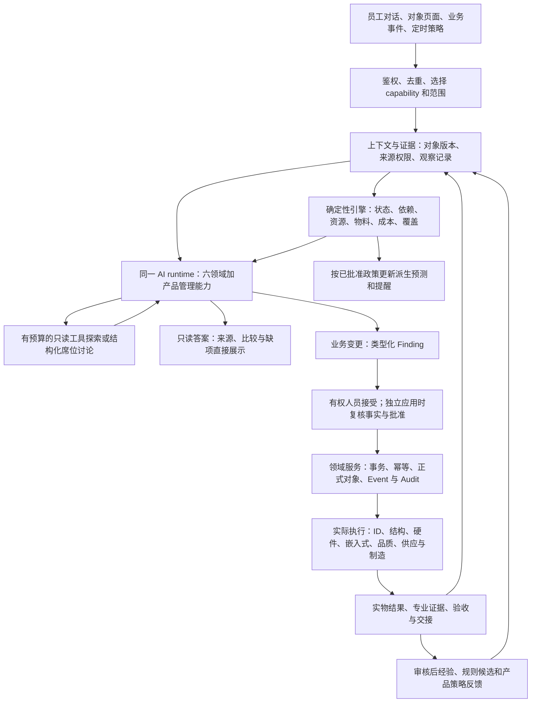

# PDOS AI-native 与 vNext 架构一致性合同 v1

> **完整设计入口（2026-09-10）**：[完整设计合同v1.0](2026-09-10-pdos-complete-design-contract.md)已将业务、对象与本专题内容整合为单份评审稿。本专题保留详细取证；新增建议未因此批准或实现，状态以活动清单为准。

> **运行设计附件（2026-09-10）**：[上下文、工具与Harness合同](2026-09-10-ai-context-tools-harness-contract.md)细化本文§4/5/7，包括模型实际所见、证据/记忆/压缩、工具handler与人工出口、运行监督/恢复和验证。与本文共同使用，新增记录/状态/参数仍按N0正式冻结，不扩大业务权限。

日期：2026-09-10。范围：原版 v3.2、原 vNext、9 月 9 日整体架构与整合计划，以及产品经理、四专业和 DQE/SQE/IE 的完整业务链。

**结论：保留“研发数字链 + 项目控制链 + 领域 AI”，采用同一业务底座、确定性引擎和受控 AI 运行层，整体方向合理。原稿存在授权、文档优先级和运行语义冲突，不能原样同时实施；本文统一其解释，并给出尚待 N0 合同冻结的具体技术方案。架构审查不等于代码已满足这些约束。**

本文是[整合计划](2026-09-09-ai-native-integrated-execution-plan.md)的架构附件，不另设执行队列。已明确的用户决定及后续验收合同继续生效；§9 的新增建模选择是待冻结方案，不能据此扩大 Agent 权限或宣布 V0 通过。当前 N0-01 部分完成，仍须交付完整字段、状态/事件/错误码和兼容合同。验证范围见[本轮审查记录](../reports/2026-09-10-architecture-consistency-validation.md)。

## 1. 文档优先级与已统一的冲突

不采用“日期最新的文件覆盖全部旧设计”。只按具体主题继承有效决定：用户最新明确要求 → 同主题后续已确认合同 → 已生效 vNext 决策 → 原版规格。执行顺序由整合计划和活动清单管理；历史源码、旧勾选和草案不能授予权限。原版技术栈、SoR 和工程纪律继续有效，实体/Agent/事件数量是原版基线，不能阻止已批准的 vNext 扩展。

| 编号 | 相互冲突或含混的表述 | 统一解释 / 处置 |
|---|---|---|
| AC-01 | 原版“规格唯一、六 Agent、十 namespace”与 vNext 新域/第七 Agent | 原版基线保留；vNext 按已批准范围增量演进，不重建第二平台。6+1 是运行时职责，10 轴是产品范围，27 是旧能力语义；三者不一一对应。namespace 现状与推荐见 §9 |
| AC-02 | 8 月 D3/D19/D32 模型直写草稿、单次转正，与后续 Finding 双动作 | 按 9/8 联合合同 §3：模型业务变更经 Finding，接受和独立应用两个动作；`pdos_agent` 零业务表直接写。保留自动研究/分析；确定性导入与规则候选按已批准路径办理，不能成为模型直写的通道 |
| AC-03 | 旧 allowlist/首次域名审批、辩论场景白名单与 D25/D26 | 沿用已生效默认放行 + blocklist、全席位可用的受控研究 GET；辩论可在授权 run 内自行发起，以预算控制，无新增业务场景白名单。外部原文保留并标不可信，模型指令权限不因此提高 |
| AC-04 | “所有能力都接受/应用”与只读研究、规则计算 | **只有模型提出的业务变更**走 Finding 双动作；只读答案、对比展示、运行摘要没有强制应用。发布为正式定义、任务、知识等才检查目标领域权限。确定性派生 Forecast 不需要每次人审 |
| AC-05 | “Agent 唯一写出口”与自动保存抓取快照/辩论过程 | 区分模型业务变更与可信运行服务记录，按 §4 的封闭写接口实施；不向 Agent 发通用业务连接，不使用模型自报 tenant/user，不伪造人审 |
| AC-06 | 立项前必须有计划，但计划/Task/评审又依赖 Project | 立项前用真实 typed scope 的计划候选和评审工作；批准来源后创建 Project 草案，项目执行批准消费这份计划版本，再独立应用为正式任务/基线。保留七态，不造虚拟项目，见 §3 |
| AC-07 | DCP/TR 与项目 Meeting/Gate 混称 | DCP 是商业决策检查点，TR 是技术评审，Gate 是阶段通行条件，Meeting 是协作载体。立项前 DCP/TR 可绑定 Case/Definition 等真实来源；不依赖外部会议创建，不突破 D35 的项目会议接入范围 |
| AC-08 | 冻结 context/席位对象与工具续读、人工中途补充相冲突 | 冻结授权上限和观察版本，不把它当永久授权；新证据追加 observation，权限撤回立即生效。席位不可用新资料静默扩大内部对象范围，见 §5 |
| AC-09 | 所有 Snapshot 租户共享与受限项目/客户文件 | 公共研究资料可按共享政策复用；受限来源变成快照后继承来源权限。可信度、可见范围、内容不可信标记是三个维度，不相互替代 |
| AC-10 | 确定性 Forecast/健康度被说成真实结果，或反馈链被当排程边 | 算法可复算不等于估算已成事实；Baseline、Forecast、Commitment、Actual 分开。执行依赖、审批条件、引用/影响和学习反馈分别建模，见 §6 |
| AC-11 | 一人开发/系统验收被外推为一人执行业务 | 用户负责系统开发及系统最终验收；产品业务多人协作，具名岗位、接收与独立品质验证仍保留。角色模拟不冒充真实多人验证 |
| AC-12 | Q1 整包依赖 P3/N7-02/03，Q0 整包依赖 N7-03，导致 V1 等待 V6、V0 等待全部新增场景效果 | 撤销误加的整包依赖，Q0–Q5 取得各自冻结候选、样本和适用通道证据即可分别裁决；不是取消本阶段门禁。Q6 保留全量 N7 集成/效果，P3 生产 smoke 独立未完成。V1需要的转产模板证据与N4-07完整PVT/MP闭环也分别判断 |

旧需求、决策台账、对象草案和原版入口已增加适用性说明，冲突段落标明历史范围；保留原文便于追溯，不允许实施者任选较宽松的一版。

## 2. 统一架构：一套事实、两类执行

图中的循环是业务反馈与有界研究，不要求数据库依赖边形成环。前端页面、聊天、工作卡和开放接口均调用同一领域服务，不能各自维护一份计划或状态机。沿用 Next.js + FastAPI + PostgreSQL + LangGraph + 已批准 UI 栈；以模块和窄接口分工，不为七个 Agent 新建七套业务服务。

| 真值/执行位置 | PDOS 管什么 | AI 实际帮助员工什么 |
|---|---|---|
| 产品研究与定义 | 来源、研究边界、机会/实验、策略/Definition 版本、需求关系与发布决定 | 组织研究、比较竞品、列事实与假设、提出方案和可验证规格；未知项形成待验证工作 |
| 研发与项目控制 | 计划、任务、交接、决策、版本关系、开发 BOM、样机配置、阶段证据与变更治理 | 编制初始计划、整理专业输入、解释影响、准备可应用的行动/变更包 |
| 品质与验证 | 验证计划/Run、NCR/CAPA/FMEA、引用的真实结果、独立验证与关闭状态 | 建议测试项、调查假设、复测/复审与证据缺口；不把 AI 推断当实物通过或根因证明 |
| ERP / MES / PLM / CAD / Git | 保存外部权威对象引用、版本、as-of 快照及交接对账；研发资源预约仅覆盖开发/试制用途 | 解释短缺/成本/版本差异，准备内部催交/替代方案；不另建库存交易、生产执行、CAD Vault 或代码真值 |
| 组织与复用 | 经审核知识、模板、Design Rule 版本、适用性与过期状态 | 在立项、选型、变更、交接时给出适用经验，记录采用后的效果和纠错 |

产品管理八能力完整继承；ID/结构/硬件/FW/DQE/SQE/IE 是专业职责与证据视角，不必每个常驻一只 Agent。多席位讨论仅在存在取舍时使用，先具备独立证据再讨论；日常填报、日期计算、状态转换不必开 AI 会议。员工看到的是来源、待办、影响和结果，而非内部 Agent 编排细节。

## 3. 从想法到首版计划：消除立项循环

现有代码 `ProjectService.create` 消费 approved Case，创建 **draft Project** 并转换 Case；后续 Project 沿 draft→proposed→approved→active 演进。不得把 Case approved、Project approved、某个 DCP 通过或某条 Finding accepted 视作同一件事。

目标衔接如下，合同字段/API 在 N0-01/02 冻结，功能由 N1-01/07、N2-03/04 实现：

1. **立项前准备**：研究与专业评估绑定 Market Space/Opportunity/Definition 等真实 scope；已有获批 Requirement/Case 可直接准备，不要求补建市场链。推荐既有入口使用服务端授权的 tenant scope 并收窄至明确 Requirement/Case 对象集，不借 tenant scope 获得全租户资料；具体绑定字段在 N0 冻结。Case 是关联业务对象，无需擅自增加新的 run scope 枚举。计划候选有稳定 node key、来源版本、Owner/接收人、估算依据、ID 专项、关键依赖和验证约束。它不是正式 ScheduleNode/Baseline。
2. **真实可办理的前期工作**：研究任务、专业评审请求、缺项验证和 DCP/TR 有具名责任/状态/证据，显示在 My Work。可复用 Action 的交互合同，但不把现有强制 project_id 的 Task 塞进虚拟项目。需要任务化落库时补 typed scope 工作项合同，确认 API/权限/迁移后实现。
3. **产品与 Case 评审**：产品经理发布 Definition/Requirement；必要 DCP/TR 绑定受评来源和计划候选版本，分别记录结论。Case approved 表示同意转项目；它不等于未来每个执行任务已满足开工条件，也不替代 Project 执行批准。
4. **创建 Project 草案**：沿用 approved Case→draft Project 原子转换。保留原 Finding/run scope 和已接受载荷；服务端版本化转换记录将该 Case 唯一绑定到生成的 Project，并把稳定候选 node key 映射到该项目。Project 批准同时引用转换记录与候选 digest。apply 校验来源、唯一转换关系和双方当前权限，禁止任意指定另一目标项目；这不是通用跨 scope 重定向接口。字段与接口列入 N0 待冻结。
5. **确认首版计划并批准执行**：Project proposed→approved 消费确定的计划版本、必要评审、具名责任、ID 投入/里程碑和当前必须处置的资源冲突。批准记录引用候选 digest；模型 Finding 必须已接受。初始计划确认的是未来路径，不要求 ID、认证、供应验证此时已完成。
6. **独立应用和激活**：有权人员另行应用同一版本，领域服务在一个数据库事务中创建/复用 Task、依赖和 Baseline，并记录稳定 node key→正式 ID 映射。Baseline 包含批准的计划范围；不自动制造客户/供应商 Commitment。Project active 检查已应用基线和当前入口条件。

创建项目草案与应用基线可以是两个可恢复业务步骤，不把用户审批或外部调用挂在数据库长事务里。应用失败保持“已批准、计划未应用”，不得出现半份任务或进入 active；幂等重试返回同一映射。候选内容/关键来源/审批政策版本变化，旧接受/批准不得用于新载荷，应修订后重新审阅相应差异。已有 Project 复用已有关联和批准，仅补缺项/生成变更，不强制倒退重立项。

ID 长周期单独看板与计划字段从立项出现；结构/硬件/FW 预研可并行，详细工作按各自交付物/接口批准进入。当前即需使用的约束必须闭合，未来工作只要求有负责人、完成节点和完成标准。DQE/SQE/IE 在概念阶段先给约束和验证计划，不能先索取尚未产生的完整图纸、供方报告或产线实绩。

## 4. AI、系统与人的权限不能混用

每个 run 的授权记录至少区分：trigger actor、执行服务主体、委托/策略来源、tenant 与 typed scope、用途、可用能力/工具、政策版本和授权时效。专业 persona 不是授权主体，事件作者也不自动成为后台任务的被代理人。事件/定时运行必须有服务端配置的授权策略，不能因为订阅了事件就继承全租户权限。

| 主体/动作 | 可自动做什么 | 正式业务写入与约束 |
|---|---|---|
| 模型与受限 Agent | 读取获准投影，使用受控研究工具，提出比较/假设、调用编制候选工具 | 模型业务变更唯一出口为类型化 Finding；无通用 SQL/任意写表/任意 URL 外发工具 |
| 可信运行/采集服务 | 记录 run/调用/工具观测、抓回原文快照、辩论过程、只读 Brief 等运行产物 | 接口和字段封闭；从 run 绑定主体/范围/来源 ACL，保留服务身份与触发人，不伪造 approved_by。不可借“运行产物”名义创建已生效任务、质量结论、正式发布知识 |
| 确定性领域规则 | 从已知事实生成 Forecast、覆盖/齐套/成本计算、策略提醒；按已批准导入合同抽取原值草稿 | 引擎服务按自己的窄合同写派生状态；记录规则/输入版本。LLM 产生的业务字段不能仅改名为规则结果而绕开 Finding |
| 人工 review | 查看同源 diff、来源、影响、缺项，接受/编辑/拒绝候选 | accept 表示认可该候选版本，不自动完成 apply，也不替代 Gate/DCP/TR/ECN 等领域批准 |
| 人工 apply 的领域服务 | 复核当前权限、批准、来源版本、业务状态与幂等键后执行 | 只执行已审版本及白名单目标适配器，同事务 Event/Audit。已批准职责可在同一交互提交适用决策记录，不能省略必要签核或把两次人工动作合成一个 |
| 人工业务执行/Verifier | 设计、测试、接收、整改、验证关闭 | “已应用”只说明对象创建或变更成功；“已完成”必须有对应实绩/接收/验证证据，高严重 Issue 保留独立验证 |
| 外部投递 adapter | 在有效的具体发送/周期政策授权内投递已确定内容 | 使用 outbox、幂等与回调对账。模型无直接外发路径；只读网页工具禁止借 GET 调用有动作语义的链接。HTTP 方法本身不是无副作用证明 |

普通只读答案直接展示，不要求员工接受再应用才能阅读。批量办理仍保留“批量接受”和“独立批量应用”两步，展示所选范围/差异；领域硬批准由适用角色完成，不机械为每个对象额外加一次泛化审批。确定性报告确认沿现有批准合同，AI 列映射与原始数值分别溯源；模型补写测试结果不属于该例外。

## 5. 上下文、证据与 Agent 运行合同

- **冻结什么**：run 的授权上限、目的、prompt/tool/capability/policy 版本，以及已形成的观察内容。系统 prompt/工具前缀保持静态；动态信息以服务端投影追加。冻结 scope 不冻结未来访问权，成员/委托撤销后工具和应用重新检查。
- **如何继续调查**：同一 scope 内工具续读追加 observation，记录来源 ID/版本/digest、采集时间、ACL 判定、计算输入/输出版本。不得覆盖旧 observation。尚未持久化的搜索提示不能冒充已获得证据；正式结论须可跳转快照/原对象。
- **席位如何补资料**：内部锚定对象保持冻结，全席位可用受控公开研究。已授权的新公开观察可追加但不扩内部权限；新增内部对象或改变 scope/席位时开启关联的下一轮 run/session，保留旧 transcript。人工补充同样版本化，不能在已有结论背后替换证据。
- **怎样共享证据**：公共资料共享与受限来源继承分开；检索/数量/摘要、模型投影、引用、Brief、导出及 apply 使用同一可见性判定。组合分析只能看到获准项目集；派生摘要不能泄漏无权来源。过期、冲突、unknown、未验证均显式保留，verified 不会扩大 ACL。
- **什么时候调用 AI**：每类事件登记 capability route、确定性规则处理或 no-route 及理由。按 scope/capability/事实版本去重与合并；AI 自产事件不无条件递归触发自己。业务后继运行需要实质新证据或显式修订请求；同一operation的有限技术重试可无新证据，但复用幂等键并累计预算。
- **启用状态**：disabled 不调度、不执行工具、不应用旧候选；shadow 结果仅供对应评测/管理可见，不作为正常工作待办或可应用业务候选；live 仍受权限和审批约束。停用后已获人工批准的业务事实保持历史，不逆向删除。
- **有限探索**：固定状态/审批用工作流，未知资料探索用局部工具循环，按能力设置 token/费用/工具调用/截止时间预算与停止理由。同一调查/工作包的lineage跨run/session累计成本、继承截止时间并传播取消，不能靠换轮次重置额度。不用预算内可运行推导为论证完整；预算停止、无新增论据和真正形成共识分开表示。

预算、保留期和质量线须从现有已批准参数继承；尚无批准值的能力在 N0-02 的政策表登记具体待冻结值，不能只写“有预算”就发布。可信 golden 集由人工发布，生产输入、模型纠错或历史用户采纳不能自动变成合格答案。

## 6. 时间、对象关联与质量闭环

| 关系/值 | 含义与规则 |
|---|---|
| 执行依赖 | 交付物完成与 FS/SS/FF/SF、lag、日历、资源时间约束；进入排程图并检查环。跨项目边还需双方范围权限；普通 skipped 不能满足必需批准的冻结交付物 |
| 批准/入口条件 | DCP/TR/Gate、接口冻结、资格验证等证据谓词；可以映射为计划里程碑，但不能仅用日期或任务 done 代替评审结论。缺失只阻塞相关入口 |
| 引用/影响 | Requirement→Spec→BOM/配置→Test/变更的版本关联，用于追溯和影响分析；不是每一条都阻塞开工或自动顺延 |
| 反馈/学习 | 试验结果、质量/成本与市场实绩反馈到下一版定义/模板/策略；创建修订候选，不回改已批准历史，不反向阻塞当前版建设 |
| Baseline | 人工批准的计划快照是唯一版本真值，不被预测覆盖；节点baseline日期若保留只是可重建投影，变更形成新版本和理由 |
| Forecast | 引擎按依赖、容量和当前估算重算；保留输入、假设、计算版本/as-of 和误差。AI 可提时长估算候选，引擎负责日期计算，预测不是日期保证 |
| Commitment | 具名内部/客户/供应承诺及其版本，需对应责任人确认；基线发布、预测重算不自动改承诺 |
| Actual | 工程/测试/交付实绩及证据；录入修正留痕，不由 LLM 补出实测值 |

Build 使用冻结 Prototype BOM/配置，ECN 形成新版本与生效范围；旧 Test Run 继续指向当时样机/固件/条件，不因模板或 BOM 最新版变化而改写历史。新功能和客户要求从同一输入形成 Requirement/Spec/工程/验证/成本/计划候选包，先确认适用性和冲突，不自动假定所有轴都要新增任务。

Issue 管协调，NCR/CAPA/8D 管质量事实，关联升级不合并两套关闭条件；CAPA 建议必须到达 CAPA/行动领域适配器，不能只创建 Risk 后称措施已落实。需要执行的 Decision 分清批准与实际执行，消费目标 Gate/ECN/基线/行动等真实回执，备注不足以证明执行；纯记录性决定保留“无需执行”，独立验证只在目标业务要求时适用，不新增全体决策验证关卡。PVT/MP 移交须有交付清单、接收责任和遗留项处置；项目 completed 检查最终阶段与接收证据，不能只看任务数量或 AI 总结。PDOS ECN已批准/生效与ERP已接收/执行分别留回执，不能互相代替。

## 7. 工作包、失败和纠正

同一次输入使用 correlation ID 关联候选、正式对象和后续结果；各候选保留类型、稳定 key、scope、来源版本、预期对象版本、依赖、批准与回执。通用 inbox 提供统一办理，领域 adapter 承担各自不变量。

| 情况 | 收敛方式 |
|---|---|
| 同一项目计划的任务/依赖/基线应用 | 必要对象同事务；任何失败全部回滚；同一个幂等键只能得到同一正式映射 |
| 多域工作包审批权限不同 | 同屏说明总影响，按可独立的批准单元办理。批准单元内部原子；后继必须等依赖成功。UI 明示未获准/待处理部分，不能把半包显示为全部成功 |
| 外部调用/建会/通知超时 | outbox 有持久化意图和状态，按供应商幂等/查询回执判断；不盲目生成新会议/重发。没有明确回执不能标成功 |
| 网关输出格式错误/短暂限流 | 仅在正常调用合同内有限修复/退避，受预算和次数限制；与 worker 异常清理分开 |
| 正常研究发现证据不足/冲突 | 可在授权范围和预算内换来源、追加观察或返回缺项；不编造答案，不无限追问同一项 |
| worker 异常、权限拒绝、预算终止、应用失败 | 错误处理零 LLM；记录明确状态、可重试条件和办理入口。应用只重放已审载荷，不能故障后让模型重新生成另一份“已批准”内容 |
| 应用后发现错误 | 无后继且领域允许时用带审计的撤销；存在使用/签核/外发的结果走补偿或受控变更，保持历史，不能用 audit before_snapshot 覆盖后续事实 |
| 对话/确认后来源变化 | 候选标过期并展示变化；生成修订需要相应重新接受/批准，不以旧接受记录确认新版本 |
| 业务完成后知识/指标派生失败 | 已满足条件的业务动作保持完成，派生失败进入可恢复队列；不能隐藏增加“知识生成成功才准关闭”的关卡，也不要求员工再录一份相同事实 |

“完成”以实际目标状态与回执为准；无动作、尚在排队、模型停用、数据未齐和失败分别显示。候选过期针对引用的关键输入/适用范围变化，无关文件更新不能使全部计划失效；已有签核和实测保留当时版本，新事实进入影响分析和必要重验。通知按已批准 TTL/去重/节奏和责任升级策略执行，员工收到可办理的变化，不能把每次模型运行都变成新提醒。

## 8. 用真实研发场景审查设计

以下是本次桌面场景推演的必需不变量，**不是已通过的产品测试**。后续以真实入口、领域写入、失败负例和业务效果验证，不能预先用脚本创建全部结果。

| 场景 | 设计应呈现的结果 | 工作项 |
|---|---|---|
| 新品类增加汽车应急启动功能 | PMI 收集有来源的场景/竞品与未知要求；工程/DQE/SQE/IE 提可行性、验证与制造约束；缺阈值时保留待验证，不直接写测试通过或修改 D14-04 功能 | N1-02～07、N2-03、N4-02/03 |
| 尚无项目时要专业协助 | 非项目范围的研究/评审工作可分派、接收、反馈；DCP/TR 消费真实来源；无需先建虚拟 Project 或外部会议 | N1-01/07、N2-03/04、N3-02/04 |
| ID 用时长且客户迟迟不反馈 | 首版明确 ID 来源、投入、轮次、等待/缓冲、冻结目标；只传播受影响路径，FW/硬件预研按可用输入继续；不改客户承诺 | N2-01～07 |
| DQE/SQE/IE 在概念阶段介入 | 给出当前可判断的约束与后续验证节点；工程图、供样及工艺实绩在对应阶段形成，未来证据不足不会把研究入口锁死 | N1-05/06、N2-03、N4/N5 对应项 |
| 客户增加特殊性能要求 | 同源 diff 覆盖需求/规格/测试及受影响设计、成本、交期；CCR 对外回复与客户确认回链内部变更；不让员工逐页重新录入 | N3-01、N4-03/04/06、N5-06 |
| 上传 D14-02 两份历史报告 | 同内容提示复用已有批次；8/30 仅是隔离回放确认覆盖，22 页保留缺项/参考；D14-04 无灯、29 项待测保持独立，不能继承结果 | N4-01/02、N0-05/06 |
| 某样机测试失败后整改 | Run 绑定实测配置/原件→Issue/NCR→责任行动/CAPA→对应复测→独立验证→Gate readiness；复测新 Run，不覆盖失败历史 | N0-04、N4-02～07 |
| 一人输入，涉及多人批准 | 同屏工作包按权限分工，普通只读不审批；模型业务候选批量接受后独立应用，专业签核与接收保留，不把开发者视为全业务 Owner | N0-02、N3-01/02/04 |
| 成本/供应变化与共享实验室冲突 | ERP 时点快照+已选 BOM+资源容量驱动可复算方案；AI 解释取舍；不写 ERP 库存、MES 生产调度或未经确认的承诺 | N2、N5、N6-01～03 |
| 量产移交与反馈 | 接收人确认交付/遗留项；外部实绩按来源回链，形成新策略/Design Rule 候选；不能倒改已批准定义或让“必须先有量产实绩”阻塞前段建模 | N4-07、N5-06、N6-05、N7-04 |
| 研究期间成员撤销或来源有注入 | 旧 context 不续借权限；拒绝受限取数和应用，公开来源内容不成为指令，必要时保留缺证据的结果及停止原因 | N0-03、N1-02、N3-07、N7-02 |
| 模型停止/应用崩溃后重试 | 业务事实录入继续、主动智能明确失能；无半份计划、重复任务或假成功；修复/补偿从原 operation 与版本恢复 | N0-03、N2-04、N3-01、N7-02 |

## 9. 四个开放建模项：具体推荐，待 N0-01 冻结

这些属于尚未冻结的对象合同，不再只写“待定”。本次推荐兼顾现存代码、独立开发维护成本及关键关系可靠性；未执行迁移或变更访问权。

| 项目 | 本地代码事实 | 推荐方案及理由 | 冻结/实现验收 |
|---|---|---|---|
| namespace | `namespaces.py` 为原十个 + `cehub_evidence`；会议已在 `cehub_project`，不存在草案所称会议/时间 namespace 全部已落地 | 保留现有 11 个与已有表位置。计划/会议/资源按项目域归属使用 `cehub_project`，产品研究定义按 `cehub_product`，来源快照用 `cehub_evidence`；不为逻辑功能轴新建 schema 或搬迁已有表。新增 schema 仅在真实隔离需要被批准时引入 | 明确每张新增表所在域；受限角色清单、复合引用、迁移单 head 对齐。不能把“原十个”解释成删掉现有 evidence |
| ScheduleNode 引用 | 旧草案允许字符串多态引用，与“跨对象一律复合 FK”自相矛盾；正式排程尚待建设 | 正式节点用按 kind 的有类型引用/连接及带 tenant 的 FK；固定少量目标优先显式 FK，并约束恰好一种。里程碑可独立；依赖使用节点 ID。纯事件/审计历史保留 generic ref，不能作为正式排程完整性保证 | 节点来源存在、tenant/所属 project 一致；跨项目只在获准依赖边上建立；删除/迁移不能留孤儿。性能与扩展性按实际图规模验证 |
| project_role 与专业职责 | 全局七 Role；`project_members` 当前无 `project_role` 列；存在成员/委托范围与窄动作权限 | 若增加项目授权角色，复用现有 Role 集合并显式执行范围校验；NULL 只沿用现有角色+成员政策，不给全租户项目通行。专业 responsibility binding 单独映射 ID/FW/DQE/SQE/IE 等，可多人/兼任，不把 persona/称谓转成 RBAC 权限；委托不借出授权角色 | 角色/成员/责任/委托分别回归；低权限不能因专业席位升权，高严重 Owner≠Verifier 不变。角色映射设计不伪造真人姓名 |
| Test Run metrics JSONB | 当前已用 JSONB 数组，具有形状 CHECK；不存在完整逐指标对比/来源合同 | 保留现有存储，补版本化 payload 校验、稳定指标 key、单位/工况/上下限/原始表示及报告单元格来源；规范值与原值分开，比较仅同口径。首版提供可查询投影视图/必要索引；有实际查询证据后再决定拆行表，不先做双份真值 | 未知/文字/空值不当 0；导入保真、跨样机比较、版本回放与批量性能通过。`jsonb_typeof='array'` 不能代替指标正确性 |

同时修正对象草案“发布后不可变 CHECK”的实现描述：行形状约束不能单独证明历史未被 UPDATE。版本化发布服务与数据库更新权限/必要触发约束共同保护；发布版本及快照不可原地覆盖，新增版本用关联表/独立元数据标记替代关系。具体验证包括拒绝已发布正文更新，而非仅检查状态枚举。

## 10. 合理性结论与后续落点

这一架构把 AI 用在资料理解、方案准备、跨专业解释与经验复用，把计算/状态/权限交给确定性代码，把实物结果与商业/技术批准留给具名人员。所有轴使用统一对象、证据、候选和反馈，因此能够服务真实多人研发，不需为了“AI-native”增加无关 Agent、重复数据或泛化审批。

目前仍有实现差距：真实 capability 路由和局部工具循环、run 授权主体/证据 ACL、shadow 强制控制、非项目工作办理和计划应用、专业 adapter、Decision/Gate/关闭回执等需按 N0–N7 落地。已有固定取数加单次 LLM、13 个 capability 和局部测试项闭环不证明目标架构整体实现；原版与 vNext 的 Exit 均保持未关闭。

本轮完成架构解释统一、场景推演和四项建模建议，**不声称绝对无冲突或生产已验证**。N0-01/02 的剩余工作是将本附件变成字段、状态、事件、错误码、政策参数和兼容映射的可冻结合同；真实能力验收在所属 N 项及 N7-02，员工价值和逐项出口在 N7-03/04、Q0–Q6。P1–P6 是独立原版生产轨，Q 的独立裁决不替代相应生产/外发授权。
