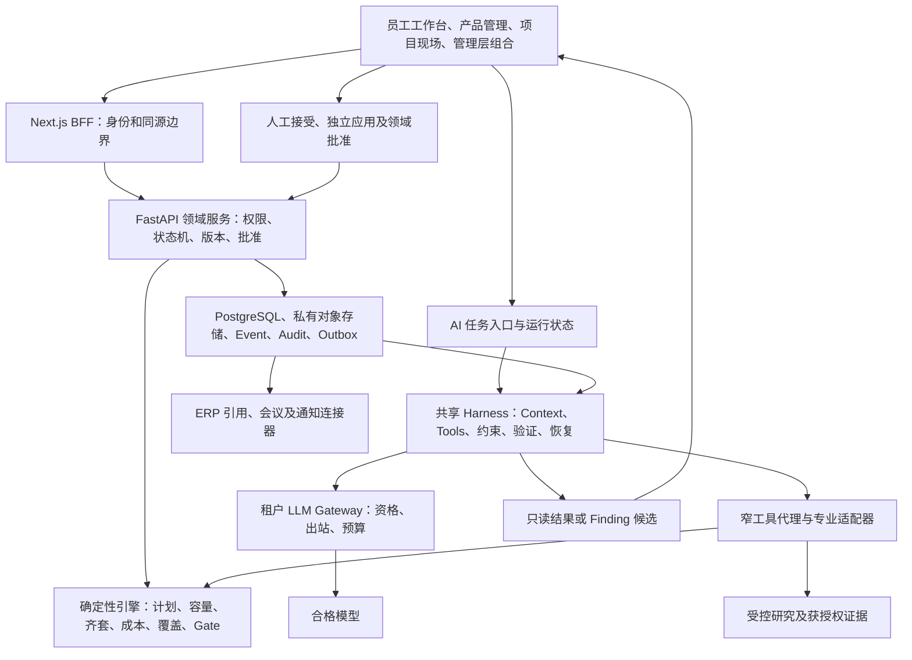

# PDOS AI-native 产品开发操作系统 · 完整设计合同

版本：v1.1 · 完整评审稿　更新：2026-09-11　系统负责人及软件验收人：胡汉伟

> **v1.1 统一对话补充**：用户明确统一对话、文件输入与项目信息查询，细则见[统一对话与文件输入设计](2026-09-11-unified-conversation-and-file-input.md)。第8节补充入口与办理语义，UC-01～UC-10映射原N项；原冻结合同版本/原件、65项编号和出口状态不变。新增会话字段及实际接线仍须在所属N项交付。

> 生效登记（2026-09-10）：DC-01～05及DC-09共同部分见[共同合同批准](../contracts/pdos-v1/freeze-record.md)；用户随后确认DC-06/07/08，见[运行合同批准](../contracts/pdos-runtime-v1/freeze-record.md)。N0-01/02已完成，当前N0-03；第25节其余未获批部分及各Exit继续按原关卡办理。下文候选表保留提案来源，以具名生效记录确定批准范围。

**本合同定义：员工从发现机会到产品移交，管理什么、由谁办理、何时进入下一步，以及 AI 用什么上下文和工具帮助他们完成工作。** 产品采用“受控业务流程 + 确定性引擎 + 任务型 AI + 人工业务裁决”的架构。AI 主动研究、组织证据、提出计划、协调工作和跟踪结果；正式业务事实由有权限的人及领域服务建立。

这是可供统一评审、实施和验收的设计基线，不是功能完成声明。已确定要求直接继承；本文给出的新增技术选型和配置候选集中列于第 25 节，尚未自动获批。原版生产、V0/V1 和后续出口分别裁决。完整项目历史材料不是开始建设的前置条件。

**阅读入口：**第 1–8 节规定产品与工作流程；第 9–13 节规定对象、状态、引擎和接口；第 14–20 节规定 AI、Context、Tools、Harness；第 21–25 节规定运维、验收、实施及冻结。附录 A 是 27 项能力目录，附录 B 是全部 65 项实施归属，附录 C 保留 107 项原要求的追溯。

## 1. 合同效力与交付范围

本文件是完整设计的统一阅读入口，整合现有 vNext、管理流程、架构一致性和 Harness 合同。执行顺序仍以[整合执行计划](2026-09-09-ai-native-integrated-execution-plan.md)及[唯一活动清单](../../tasks/ai-native-integrated-todo.md)为准。本文不建立第二套待办；编号和状态保持。第24节将Q3过度依赖后期整包的问题改为原V3分项硬验收，其余依赖保留。

要求优先序：用户最新明确决定及有效批准 → 已批准的安全、业务与阶段合同 → 本文整合的目标设计。本文新增建议经第 25 节冻结后成为对应实现依据。旧文档中已被后续决定替代的句子不能复活；未被替代的细则继续保留，附录 C 逐条关联。代码事实仅说明当前实现，不自动裁决目标设计是否合理。

| 合同范围 | 必须交付 |
|---|---|
| 全量业务 | 十个功能轴、立项前产品管理、七阶段研发、ID/结构/硬件/嵌入式、DQE/SQE/IE、供应制造与结果反馈 |
| 全量智能 | 六领域 Agent + Product Management Intelligence，共 27 项原能力语义；上下文、工具、运行、评测和业务接线均可追溯 |
| 全量体验 | 十个全局域、九个项目标签、八个产品经理工作区；桌面/移动、中英、搜索、冷启动、导入导出及开放接口 |
| 原版兼容 | 原状态机、SoR、受限数据库角色、模型资格、人审双动作、已批准 UI 与原 S0–S5 历史验收 |
| 独立出口 | P1–P6 原版生产；Q0–Q6 分阶段与全量出口。旧完成切片不自动证明整个功能轴通过 |

不在本轮范围：新建 CRM 销售漏斗、ERP/MES/PLM 替代、供应商外部账号、测试设备直采、条码/库位/借还系统、飞书、会议深度转写拉取。保留既有客户/需求入口、内部供应协同、报告导入、样机及研发资源台账。预测型机器学习 Risk Radar 在积累数据后另行评估；本轮规则告警、确定性预测和 AI 解释照常交付。

## 2. 使用者、责任与批准

用户独立开发和验收软件，业务由多人协作。权限角色、专业职责、当前对象责任和 AI 席位分别建模；兼任专业不自动获得管理员或别的项目权限。

| 人员职责 | 系统帮助其完成的主要工作 | 本人承担的业务判断 |
|---|---|---|
| 产品经理 | 市场/竞品研究、机会与实验、策略、产品规格、客户要求及产品矩阵 | 证据取舍、定义发布、产品/客户价值约束与变更意见 |
| 项目负责人 | 初始计划、责任确认、依赖/资源、例外、会议、承诺与交接 | 计划和资源协调、承诺确认、适用的项目管理批准 |
| ID | 设计简报、方案/客户反馈整理、CMF、外观样、接口和冻结交付 | 设计成果、投入估时与专业可行性 |
| 结构 / 硬件 / 嵌入式 | 图档/电路/PCB/固件版本、接口、联调、影响分析和整改 | 对应专业设计、版本和技术结果 |
| DQE / 测试品质 | 可验证性、验证矩阵、可靠性、测试执行、根因和有效性核查 | 专业判据、实际测试结论及验证签核 |
| SQE / 采购供应 | 新供方/关键件、样件、供期、质量异常、替代及资格 | 供应事实、供方质量、适用供应承诺与准入 |
| IE / 制造接收方 | 可制造性、工艺/工装、试装/试产、节拍、SOP、移交 | 工艺证据、制造可行性与接收 |
| 管理层 / 商业批准人 | 跨项目例外、投资/优先级、取舍方案、Decision Brief | DCP 商业决定、资源优先级及对应硬闸 |
| 系统/知识治理人 | 组织流程配置、模型资格/预算、知识审核、审计 | 配置发布、有效授权、正式知识及技术合同批准 |

| 动作 | 执行主体与规则 |
|---|---|
| 读取、解释、计算、研究、比较 | 获授权用户或受控服务；只读结果直接显示，无额外接受/应用步骤 |
| AI 形成正式业务变更候选 | Agent 只能创建类型化 Finding，保留来源、版本、差异和缺项 |
| 接受 / 拒绝 Finding | 具有对象范围和审阅权限的登录人；接受固定载荷版本，不等于已应用 |
| 独立应用 Finding | 另一个明确人工动作，可由具备权限的同一人办理；重验版本、权限及领域批准 |
| 定义发布、项目执行批准、DCP/TR、Gate、ECN、对外承诺 | 对应政策中的具名业务批准人；Finding 接受或会议结束均不替代 |
| 实际执行、提交证据、接收或验证 | 任务责任人及适用验证/接收人；AI 不填充实测值或冒充接收 |
| 高/严重 Issue 关闭 | Owner 与 Verifier 必须独立；低/中按已批准政策。软件开发者身份不豁免 |
| 外发、真实建会、生产操作 | 有效的具体或已批准自动化授权；发送/创建及回执可审计，结果未知先对账 |

责任人离职、休假、委托和换岗保留生效期、接受人和移交证据；委托权限不得超过委托人及被委托人的有效授权。未认领工作可进入待分派，但不得伪造具名责任和已确认估时。

保留的业务硬闸封闭清单：Baseline/Commitment 变更、Gate/DCP/TR 结论、BOM Freeze、ECN 生效、供应商选定、高/严重 Issue 关闭、真实对外发送/外部写操作、删除或覆盖历史、涉及金额的正式批准或承诺；另继承既有产品定义发布及项目执行批准。只读估算、方案比较和内部 API 的 HTTP POST 方法本身不新增业务审批。模型业务提案始终走 Finding 双动作，领域硬闸按各自角色和适用四眼规则办理，不强制每个子步骤再加通用审批层。

## 3. 系统边界与整体架构

| 真值系统 | 拥有的正式事实 | PDOS 的处理 |
|---|---|---|
| PDOS | 需求、Case、开发项目、定义/规格、开发 BOM、计划与决定、Gate、开发验证、变更决定、知识及协作责任 | 版本化办理、关联、批准、执行和审计 |
| ERP | 物料主数据、生产 MBOM/工艺/生产版本、库存/采购交易、正式核算 | 保存外部 ID 与 as-of 快照；计算研发齐套/估算；交付及执行分别对账 |
| MES | 生产执行、实际产出与质量实绩 | 引用受授权数据及来源时点，不实施生产调度 |
| PLM / CAD / Git | 正式图档/工程版本、源代码及发布物 | 版本引用、可授权预览和交接定位，不建立第二份设计/代码真值 |
| 钉钉 / 腾讯会议 | 真实身份、已授权会议与投递回执 | 项目绑定的建会/通知，人工上传转写；不抓取所有聊天 |

复用 Next.js + FastAPI + PostgreSQL/pgvector + LangGraph(Python) + shadcn/ui；模型—工具循环和领域写事务分开。调度器合并事件，执行器运行任务，领域服务写正式事实；无需为每个专业或 Harness 功能新建微服务。停模型后业务手工办理继续，主动智能在现场明确失能。

## 4. 十个功能轴的完整合同

| 轴 | 对象与业务闭环 | AI 实际帮助 | 引擎 / 人的责任 | 实施归属 |
|---|---|---|---|---|
| 1 个人工作与问题追责 | Task/Action、Issue、Risk、责任/验证/证据；分派→接收→执行→证据→验证关闭→复发反馈 | 一次输入整理行动包、补问当前必需项、准备今日卡片、识别重复/阻塞、帮助接手 | readiness、提醒、权限确定性；实际执行/验证由人 | N0-04、N3-01/02/04/09/10 |
| 2 会议与决策 | 例外→Agenda→授权转写→Minutes/Decision/Action→执行回执→下次复查 | 会前资料、会后差异候选、多立场 Brief、未执行决定跟踪 | 真实建会/发送有授权；决定与实际完成分开 | N3-05/06/07、N4-06 |
| 3 时间与延期 | 节点/依赖/日历/资源→Baseline/Forecast/Commitment/Actual→恢复方案→批准新版本 | 初始四专业计划、ID 反馈、影响解释、恢复方案及实际跟踪 | 日期/容量/关键路径由代码；基线/承诺具名确认 | N2、N6-01/02 |
| 4 物料与供应 | 冻结 BOM/Build→需求→供给快照→齐套/短缺→行动/会议/Gate→恢复 | 解释关键短缺、供方延迟、替代权衡、供样与工装证据 | ERP 真值、数量/单位/时点计算；供应承诺由人 | N5-01/02/03/04/05 |
| 5 工程与客户变更 | CCR→影响/回复→客户结论→ECR/ECN→实施/复测/重审/重认证→关闭 | 跨规格/BOM/软件/测试/成本/交期组包，追踪遗漏 | 内部变更批准不被客户接受替代；外部执行有回执 | N4-03/04/06、N3-01 |
| 6 测试与验证 | Spec→Plan/Case→Run/Result→Evidence→Issue→复测/覆盖/Gate | 按品类/功能/客户要求补测试候选，报告映射、去重与缺项解释 | 方法/阈值专业确认；真实配置、结果和计算可核验 | N4-01/02、N1-06/07 |
| 7 品质与可靠性 | NCR→遏制→根因调查→CAPA→有效性验证→FMEA/Design Rule | 提出根因假设、关联失败、组织措施及验证包、复发线索 | 假设非根因，行动计划非措施已完成；品质独立验证 | N2-03、N4-05/07 |
| 8 市场到产品定义 | 研究→同口径竞品→细分/JTBD→机会/实验→策略→定义→需求/Case→项目→反馈 | 主动研究、比较路线、试验设计、规格书与路线图 | 量化可复算、来源可查；产品经理发布及商业取舍 | N1、N6-04/05 |
| 9 成本与降本设计 | 目标分解→BOM/报价/NRE→Cost Gap→取舍→冻结→实绩回测 | Top Drivers、降本方案和质量/交期/供应代价解释 | 币种/税费/汇率/数量口径明确；财务真值归 ERP | N1-05、N5-06、N6-02/03 |
| 10 知识与组织学习 | 工作结果→知识候选→审核→适用推送→采用反馈→复核/撤回 | 提炼经验、找相似失败、解释适用差异、给新人交接摘要 | 正式经验有人审、继承来源权限；不自动改规则/golden | N3-03/04、N6-05 |

所有轴共享一个对象图、证据体系、身份/权限和运行协议。项目会议 Action 使用 Task 真值；立项前行动使用第7节 ScopedWorkItem，不另设会议专有任务表。Issue 协调与 NCR/CAPA 专业关闭各自独立；AI Workbench 汇总候选，不成为唯一办理页面。

## 5. 从想法到结束的阶段合同

NPD 模板项目阶段固定为 `concept / planning / design / evt / dvt / pvt / mp`；立项前研究和项目后反馈不伪造新 Project 阶段。具体品类的阈值、样本数、认证及 Gate 要求来自版本化模板，平台不编造通用合格数值。

| 阶段 | 入口 | 交付及责任 | 进入下一步的条件 |
|---|---|---|---|
| 立项前研究/定义 | 想法、客户要求、产品机会 | 产品经理形成证据/竞品/策略/定义；研发与 DQE/SQE/IE 形成约束和待验证工作 | typed scope 下可分派接收；正式发布/商业决定有批准；阅读研究无需审批 |
| concept 概念与立项 | 可追溯需求、Case 与计划候选 | 产品经理定范围；项目负责人组织 ID 投入、四专业计划、责任和风险 | approved Case→draft Project→项目执行批准→独立应用初始计划→active，见第 7 节 |
| planning 规格与计划 | 获批范围及初始计划 | 规格、接口、验证矩阵、资源和长周期项；专业责任及接收人确认 | 当前必要输入/冲突已处置；未来冻结和测试结果是计划节点，不能要求提前完成 |
| design 设计与评审 | 当前任务所需规格及接口版本 | ID/结构/硬件/嵌入式成果汇合；DQE/SQE/IE 专业审查 | 有效设计/接口/BOM 及 EVT 输入；独立预研并行；skipped 不代替冻结 |
| evt 工程验证 | 可制作的设计和试制准备 | 样机/配置、核心功能和技术方案实测；问题/整改/复测 | Build/Sample/配置/原始结果可追溯；满足该 Gate 当前必需交付和判据 |
| dvt 设计验证 | 拟定型设计和受控变更配置 | 完整规格、可靠性、适用认证、供方和工艺准备证据 | 当前配置证据满足政策；旧配置通过不能直接证明新配置 |
| pvt 试产验证 | 拟转产配置、物料和工艺准备 | IE/制造记录工艺、工装、检验、实际节拍/产出；品质/研发组织交接 | 冻结 BOM、SOP/治具/检验、试产数据满足政策；冻结期变更升级；ERP 回执独立 |
| mp 稳定与移交 | PVT 放行及接收准备 | 项目负责人组织稳定观察；制造/品质/供应/维护接收版本及遗留责任 | 接收成立、最终阶段和遗留项处置有效；文件生成和任务完成数不足以结项 |
| 复盘/持续反馈 | 实际质量、成本、供应及客户反馈 | AI 预填事实；人员补判断；知识审核；产品经理修订假设/定义 | 新候选不改写历史；派生失败不阻塞已经合法完成的业务 |

例外必须具名、有原因、范围、期限和证据。`conditional` 只能处理政策允许的条件项，不能绕过当前必需证据或禁止豁免项。`on_hold` 保存基线/承诺/未决任务，恢复重算当前输入；终止或归档沿既有项目状态规则，不借 AI 取消任务改项目状态。

## 6. ID、四专业依赖与品质前移

### 6.1 立项时必须确认的 ID 计划

ID 单列：全新/复用/客户提供及来源版本、设计范围、Owner/接收人、内部或外部资源、预算、工作量、方案/评审轮次、客户反馈等待、外观样制作、缓冲、方向确认/外观样/冻结目标与未知项。区分工作日工时和自然日等待，不默认所有等待都占用全职设计资源。

冻结交付至少核验：图档或外观样、关键尺寸/包络、CMF、操作布局版本、产品/客户确认和结构/硬件共同接口可行性。立项批准的是计划和投入，未来的 ID 冻结在计划中；ID 是否为关键路径由实际依赖与日历计算。

### 6.2 首版模板的 20 个稳定节点及依赖

下表是可配置模板基线；新增品类按差异审阅修订，不把所有项目硬编码成相同工期。每个节点另带输入版本、输出、Owner/接收人、估时依据、资源、完成证据与就绪条件。

| 节点 | 工作 | 前置节点 |
|---|---|---|
| REQ | 需求/规格与范围依据 | 无 |
| ID-PLAN | ID 专项计划和投入 | REQ |
| ID-CONCEPT | 外观方向/方案 | ID-PLAN |
| ARCH | 系统方案和接口分解 | REQ |
| MD-PRE | 结构预研 | ARCH |
| EE-PRE | 硬件预研 | ARCH |
| FW-PRE | 嵌入式预研 | ARCH |
| INTERFACE | 四专业共同接口 | ID-CONCEPT、MD-PRE、EE-PRE、FW-PRE |
| ID-FREEZE | ID 冻结交付 | ID-CONCEPT、INTERFACE |
| MD-ENVELOPE | 结构空间与板框 | ID-FREEZE、INTERFACE |
| MD-DETAIL | 结构详细设计 | MD-ENVELOPE |
| EE-PCB | PCB/目标硬件 | EE-PRE、MD-ENVELOPE、INTERFACE |
| FW-BASE | 基础固件 | FW-PRE、INTERFACE |
| FW-BRINGUP | 目标板联调 | EE-PCB、FW-BASE |
| DESIGN-REVIEW | 整机设计评审 | ID-FREEZE、MD-DETAIL、EE-PCB、FW-BRINGUP |
| EVT-BUILD | 工程样机 | DESIGN-REVIEW |
| EVT-VERIFY | 工程验证 | EVT-BUILD |
| DVT-VERIFY | 设计验证 | EVT-VERIFY |
| PVT-VERIFY | 试产验证 | DVT-VERIFY |
| MP-HANDOVER | 量产移交 | PVT-VERIFY |

模板节点是最低依赖结构，实际计划还需并入供样、模具/治具、测试/认证、试制准备与接收任务。取消功能或复用设计要有适用性/批准依据；不得删除依赖来制造可执行状态。

### 6.3 DQE / SQE / IE 的阶段交付

| 时点 | DQE | SQE | IE |
|---|---|---|---|
| 概念/定义 | 使用风险、关键质量特性、可验证性/判据缺口 | 关键件/新供方能力、打样及长交期未知 | 装配/标定/检测/维修可达性、工艺工装/成本假设 |
| 立项/计划 | 验证矩阵、长周期试验/认证、样品/实验室需求 | 供样、资格验证、关键件补证 | 试装、模具/治具/测试站/试制线及准备周期 |
| 设计冻结前 | 设计风险、接口质量约束和控制 | 件版本、供应依据和替代限制 | 开模、装配/测试空间、工艺条件 |
| EVT/DVT | 失败/整改/复测、定型验证和认证 | 样件缺陷、纠正复验、供方一致性 | 试装问题、工装/工艺验证、节拍测算和试产准备 |
| PVT/MP | 生产质量、遗留项接收、稳定性跟踪 | 来料一致性、供应异常和持续改善 | SOP、实际节拍/产能、工装/产线交付接收 |

新类别、新功能、新供方、关键质量特性或工艺变化触发适用专业任务。不同组织可由 PE/ME 等承担 IE 对应职责；不要求所有人参加所有会议。缺未来实验结果不阻止计划实验；缺当前安全/设计判据则阻止相应冻结。

## 7. 产品经理工作与立项前后衔接

研究可从零开始，也可从已有获批需求或客户项目进入；不强迫员工补造市场研究。立项前使用真实 `market_space / product_line / opportunity / product_definition`，已有 Requirement/Case 可由服务端授权的 tenant scope 及绑定对象集处理，不能依靠模型自报项目或创建虚拟项目。

立项前的专业审查、补证、实验准备及交接使用 **ScopedWorkItem（目标逻辑对象）**：scope/来源锚点、行动类型、Owner/接收人、due、输入版本、输出/完成判据、证据、状态与审计齐备；建议过程 pending_assignment→ready→in_progress→submitted→completed，可退回 in_progress 或有理由 cancelled。完成是否需接收按行动类型政策，不能强制所有研究阅读都接收。现有 Task 的 project_id 必需性保留，不能仅靠 ResearchTask 替代 SQE/IE 等专业工作。建议 ScopedWorkItem 归 cehub_project，以统一工作卡聚合；转项目记录旧ID→Task ID、来源版本及未完内容，既有成果继续引用，未完工作迁移后仅一个活动执行真值。完成历史不复制成新的未完成任务，迁移完成不等实际工作完成。scope授权继承第15节，非项目工作不授权外部项目会议。

| 工作环节 | 必需产物和质量合同 |
|---|---|
| 研究计划 | 问题、用户/地区/场景/时间范围、方法、来源、Owner、预期决定、未知和停止条件 |
| 竞品比较 | 品牌/具体型号/配置、地区渠道、价格币种/采集日/促销口径、性能工况及来源；宣传/实测/推断分开，同口径才排序 |
| 市场/用户 | 细分、JTBD、期望 Outcome、市场规模输入/公式/假设；证据不足明示区间或未知 |
| 机会与实验 | Opportunity 与 Requirement 多对多；每棵机会树一个可衡量 Desired Outcome，收敛选型前至少3个Solution Candidate，少于3明示不足；VUVF（价值、可用性、商业可持续性、技术可行性）各维度假设、可证伪条件、方法/样本依据、结果 supported/refuted/inconclusive |
| 开发策略 | 九区 Canvas 完整保留；目标用户/场景、价值、差异、业务/成本、路线与风险有证据；至少比较继续、调整、停止等适用选项及专业代价 |
| 产品定义 | 产品概念、目标规格、功能包含/排除、成本/价格带/上市窗口、地区约束；每条规格有稳定编号、数值/单位/容差/工况、理由/来源、优先级、验证方法/阶段、Owner、确认及版本 |
| 发布与传递 | 产品经理发布 Definition；条目稳定映射 Requirement/工程 Spec/验证矩阵，避免生成 Word 后再手工重录 |
| 产品矩阵 | Line→Family→Platform→Series→Model/Variant完整归属，地区/渠道维度、层级环路和定位冲突检查；场景/价格带/能力覆盖、重叠/空白、生命周期和路线图；未立项产品基于发布定义亦可比较，上市反馈返回原机会/策略/实验 |

Canvas 九区逐区保留：①愿景；②市场细分/JTBD；③相对成本位置；④价值主张；⑤明确取舍；⑥NSM/OMTM 等成功指标；⑦采用/增长路径；⑧关键能力/合作伙伴；⑨防御性与竞争者难以复制之处。每区记录 evidence/assumption/decision、来源和缺项；N1-05 将其落实为版本化 schema 与示例。VUVF 每类假设独立记录验证方法、通过/证伪阈值、Owner、期限和实际结果，实验计划不算结果。新开发、平台复用、升级路线均比较 ID 周期、NRE、质量/供方/制造代价。

**初始计划衔接必须可重放：**PlanCandidate 使用稳定临时 node key，保存模板/来源版本、候选 digest、责任/接收、估时假设和当前/未来输入，尚不是正式 ScheduleNode。Case approved 后一对一创建/复用 draft Project；转换记录固定 Case→Project 映射。模型形成的计划Finding须先被人工接受，Project proposed→approved 的执行批准再引用该当前有效载荷 digest 和必需评审。随后独立 apply，在一个批准单元内创建/复用 Task、依赖、首版 Baseline 和 node key→ID 映射。Project 进入 active 之前，应用回执及当前必要条件必须成立。

Case 的商业成立、DCP 商业评审、Project 执行批准、Finding 接受和计划应用分别留痕。同一已有批准可按政策引用复用，不人为重复审批；不能互相冒充。批准后实质改候选需新版本，历史 run/Finding 不改 scope 或载荷。多对象包有共同来源和原子边界；不属于同一批准单元的对象拆包并显式依赖。

已有 active 项目采用版本化迁入政策：保存现状快照和已有效批准，标出基线/责任/来源缺项，在原状态下准备补齐候选及批准应用；不把旧日期伪造为已批准 Baseline，也不回退历史项目重新立项。新的 active 入口守卫仅对适用的新建/已迁入合同版本生效；需要有效基线或新批准的后续动作仍分别校验。迁入状态是独立兼容记录，不增改项目七态。

## 8. 一次录入、办理界面与信息架构

### 8.1 统一对话与文件输入（2026-09-11用户明确）

Ask PDOS作为日常统一入口，提供Home输入框、全局入口、AI Workbench完整会话和对象页侧面板，共享持久会话/附件/运行/回执。用户用自然语言及文件表达目标，AI帮助识别、补缺、查证、准备输入和追问结果。显示当前对象范围；切页面不静默换范围；多文件逐个显示状态，刷新和返回能继续。普通员工不需要选择Agent或理解运行控制细节。

文件只读问答直接给有来源答案；专用原值导入沿第12.2节的解析/映射→原值预览→人工确认；模型生成的业务候选沿Finding接受→独立应用。三者在同一会话呈现并复用既有领域服务；对话审阅卡与Review Inbox共享唯一Finding/裁决状态。用户说“好的”不自动替代明确动作。上传/抽取/候选/正式录入/实际完成分开显示，后续查询重新读取业务真值。

全局入口按当前权限绑定实际查询对象及附件用途，非项目场景沿typed scope接入。会话、消息及派生答案不成为独立业务真值或永久授权。历史披露、撤权、幂等恢复、归属歧义和文件注入防护，以及UC-01～UC-10验收，统一见[详细设计](2026-09-11-unified-conversation-and-file-input.md)。首片复用PDF/XLSX阅读和项目问答，正式数据输入须连同领域回执验收；格式及专业能力按实际就绪状态呈现。

### 8.2 业务输入与专业信息架构

| 员工输入 | 系统中的可见结果 | 防止重复或假完成 |
|---|---|---|
| 对话“增加应急启动功能” | 新功能差异、专业约束、规格/验证/计划候选，在对应业务页审阅 | 合成新品类场景不改 D14-04；未知判据保留待确认 |
| 上传整机/可靠性报告 | 解析状态、原值/单元格、配置匹配、复用批次、确认入口及覆盖缺项 | 原文件重复返回已有批次；相似内容提示人工复核；不复制一套结果 |
| 会议转写或现场描述 | 纪要、Decision/Task/Issue 等候选 diff，定位原文 | 候选业务包经接受/独立应用；无行动的决定不强造验证任务 |
| 客户新增要求 | CCR、影响/回复版本候选、成本/交期及工程变更关系 | 客户确认不替代 ECN；内部 buffer 与客户 Commitment 分开 |
| Issue 更新或实测失败 | 当前责任、遏制/调查/复验及适用知识建议 | 复发关联既有问题，撤销/重开保留历史，不能不断创建重复记录 |
| 自然语言配置流程 | 版本化模板、阶段/角色/硬条件 diff 和受影响项目预览 | 治理人发布；在途项目按变更政策迁移，不能改文字即改全部流程 |
| 进行中项目导入 | 导入版本、映射/缺项、当前阶段和初始化提案 | 保留未知及历史来源；旧日期不自动升级为已批准基线 |

自然语言流程配置在发布前展示历史或明确标识的模拟项目正反例演练、受影响差异及回退方案；确认发布后保留旧版本及在途项目采用记录。超出现有配置表达能力的要求生成待决扩展，不能靠任意代码或自由文本绕过现有状态机/硬闸。

| 信息架构 | 完整区域 |
|---|---|
| 全局十域 | Home、Portfolio、Products、Projects、Engineering、Quality、Delivery、Knowledge、AI Workbench、Admin |
| 项目九标签 | 概览·控制塔；计划·资源；工作项；物料·供应；工程·变更；例会·决策；Gate·交付物；试制·测试·质量；文档·知识 |
| 产品管理八区 | 研究中心；竞品情报；市场细分·JTBD；机会树；产品策略；产品定义；产品矩阵·路线图；实验·决策 |

Products 进入独立于 Project 的产品管理工作区，八区不是新增项目标签或第二套全局同义导航。Home 默认本人可办理工作；Portfolio 分“决策请求/例外”与“全项目进度”，按当前证据聚合，不使用手填百分比冒充进度。旧书签/卡片深链兼容，导航按权限裁剪，未交付能力显示状态与已有替代入口。

业务卡须包含来源、目标、Owner/接收、期限/依赖、所需动作、证据/差异及下一步。空态有示例和首周使用路径；全局对象、附件全文与知识统一授权搜索；中文/英文界面、对象内容及跨语言证据可用。图纸预览用授权引用，不因预览需求复制 PLM 真值。

## 9. 共同对象、字段与物理归属

### 9.1 所有新增合同共享的不变量

公共标识为 UUID；`tenant_id` 非空，跨对象关系使用带 tenant 的复合约束，项目内关系同时校验 project 一致。时间 UTC `TIMESTAMPTZ`；业务日历另存时区。版本/序号为正整数；金额与物理数值使用明确精度及单位，不用浮点隐式核算。状态采用现有字符串及约束习惯，不无理由改成 PostgreSQL ENUM。

每个正式对象有稳定业务 key、归属、版本、来源、状态、责任及上下游。可发布正文冻结后不原地改写；superseded/撤回关系放控制记录，保留旧内容。发布不可变由服务、权限及必要数据库约束共同保证，不能只靠一个 CHECK。引用含类型、ID、版本及出处；无版本外部资料保存 as-of/digest。

事实性质 `observed / derived / hypothesis` 与 `approval_ref` 是两个维度：已批准的估算仍是估算。不能把 `approved` 当作会抹掉来源性质的事实类型。候选、正式对象、运行记录、实际执行分开。审计说明谁、何时、以何授权、改变何版本及原因；不记录隐藏推理链。

### 9.2 对象族最小字典

| 对象族 | 主键以外的最小业务字段与关系 | 发布/使用硬条件 |
|---|---|---|
| Product / Line / Family / Platform / Series / Model / Variant | 层级父子、类型、功能配置、地区、生命周期、定义版本 | 未立项产品可管理/比较；同名不同型号/配置可区分 |
| MarketSpace / ResearchTask / Observation | scope、问题、用户/地区/时间、来源及方法、Owner、假设/结果/缺项 | 来源权限/可用用途及快照可追溯 |
| Opportunity / Solution / Experiment | JTBD/Outcome、重要度/满意度口径、方案、实验条件/样本/结果、Requirement 关系 | 收敛前至少3方案；不足可继续研究但不能伪称已充分比较；无结果不判成立 |
| Strategy / Definition / SpecItem | 模板/正文版本、稳定条目、目标/单位/工况/边界、来源/理由、验证、责任 | 定义发布及版本映射；缺方法/阈值不能产生通过 |
| Requirement / Case / Project | Opportunity↔Requirement、Case↔Requirement两组多对多；需求customer/market/product层级及父子关系；商业/执行批准、阶段模板、责任、转换记录 | 分别验证两组关联并保留旧primary link；Case→Project唯一，批准/应用分离 |
| Task / ScopedWorkItem / Action / Issue / Risk | scope/来源、行动类型、Owner/Verifier/Receiver、日期、输入/输出、依赖、完成判据/证据及迁入映射 | 项目Action共用Task；前期工作可分派接收；Issue分级关闭与重开历史 |
| Meeting / Decision / Review | 议程/片段、选项/证据/取舍/理由、决定人、requires_execution、执行引用；DCP/TR 轮次政策 | Meeting、Decision、DCP、TR、Gate 各自状态和权限 |
| PlanCandidate / ScheduleNode / Dependency | 候选 node key、正式来源引用、工期/日历/资源、FS/SS/FF/SF及 lag | 候选不充正式节点；引用完整、无执行环路 |
| Baseline / Forecast / Commitment / Actual | 输入版本、算法/as-of、批准或确认、责任、实绩来源 | 四真值分别版本化，节点缓存不是第二真值 |
| Resource / Reservation | 类型、技能/能力、日历/容量/时区、窗口、节点、优先级/批准 | 提案不占用正式容量；并发冲突和释放幂等 |
| Part / DevelopmentBOM / Build | EBOM/Prototype/Cost 类型、修订/件数量单位、冻结快照/摘要 | Build 绑定冻结 Prototype BOM；ERP 引用独立 |
| Sample / SampleConfigurationRevision / FW Release | bom、pcb、structure、firmware、关键供方、build date 六项配置；revision_id/序号、冻结时间、来源/谱系；当前配置为最新指针 | Run绑定当次不可变revision；缺配置标缺项，固件引用Git/发布 |
| TestPlan / Case / Run / Result | 模板/功能适用性、方法/阈值、实际样机/配置、操作者/环境/设备、指标/原值/单位、起止/预计时间、报告定位 | 执行状态与草稿确认分轴；复测新 Run，旧结果不覆盖 |
| Evidence / Source / ImportBatch | URL/对象/原文件摘要、页/片段/单元格、采集/as-of、用途/ACL/可信度、映射版本、确认人 | 证据失效可见；重复复用；模型不得编造实测 |
| CCR / ECR / ECN / ImpactEdge | 要求/回复/客户结论版本、影响范围、效力/审批、复验任务、执行/ERP 回执 | 客户/内部/外部接收分开；反馈边不作任务依赖 |
| NCR / RootCause / CAPA / FMEA | 遏制、假设/证据/批准、措施/责任、有效性、风险控制/S-O-D版本、规则候选 | 根因须证实；FMEA评分不被模型自动改；有效性独立 |
| Demand / Supply / Kit / Shortage | Build/BOM/数量/need-by、外部来源/as-of、分配口径、缺量/关键件/恢复 | 单位/来源完整，过时供应不作当前已齐套 |
| Cost / Quote / FrozenCost | 目标模块、价格/税费/币种/汇率、数量、NRE/报价有效期、算法、实绩引用 | 缺数据非 0；批准成本版本与 ERP 实际分开 |
| Gate / Handoff / Acceptance | 政策与轮次快照、要求/签核/决定、交付版本、接收/条件/遗留责任 | 当前必需证据不可绕过；接收是独立结果 |
| Memory / DesignRule | 内容版本、源事实/ACL、适用品类/阶段/条件、审核/有效期/纠错 | 候选→审核→verified；撤回传播到引用显示 |

### 9.3 四项建模推荐

保留实际 11 namespace：`cehub_core / cehub_project / cehub_product / cehub_quality / cehub_supplier / cehub_cost / cehub_ai / cehub_memory / cehub_event / cehub_audit / cehub_evidence`。会议/计划/资源留 project；立项前产品对象入 product；证据入 evidence；运行记录入 ai。十轴不各建 schema，不搬已有表来追求命名整齐。

正式 ScheduleNode 使用少量显式 FK 或带 tenant/project 的 typed link，约束恰好一种来源；独立里程碑允许无外部实体。跨项目边另验双方权限。通用 event 引用不承担正式排程引用完整性。专业职责独立于已有 Role；若扩项目权限角色仍复用真实授权模型，NULL 保留现行角色+成员规则。

TestRun metrics 保留 JSONB 并增加版本化 schema、稳定指标 key、单位/工况/阈值、原值/规范值和单元格来源；查询采用必要投影/索引，有实际需求再拆行表，避免两份真值。

## 10. 状态机与动作守卫

下表“现有”已按本地代码核对；“目标”是待对应 N 项实现的合同。状态集合不代表任意两态可转换；每条 transition 在领域服务有前置、权限、事件和失败码。

| 对象 | 状态 / 转换 | 核心守卫 |
|---|---|---|
| Case（现有） | draft→evaluating→approved/rejected；approved→converted | 一次转换；获批 Case 与唯一 Project 关联 |
| Project（现有七态） | draft、proposed、approved、active、on_hold、completed、archived | on_hold 可恢复；补初始计划应用及结项守卫，不新增 AI failed/cancelled 项目态 |
| Issue（现有流程） | open→analysis→action→verification→closed；可受控重开 | analysis 起责任/验证/期限/判据完整；关闭实际证据和分级独立验证 |
| Gate（现有） | preparing、reviewing、approved、conditional、hold、rejected | 轮次冻结、当前 readiness、签核/加签与历史 grandfather 按政策 |
| CCR（现有） | received→impact_analyzed→reply_drafted→reply_approved→accepted/rejected；cancelled | 回复批准不等于客户接受；另转工程变更 |
| ECR / ECN（现有） | ECR：request/impact_analysis/approval/approved/rejected/cancelled；ECN：ecn/effectivity_decision/erp_handoff/cancelled | 相应阶段守卫；内部效力与 ERP 交付分开 |
| ERP handoff（现有） | pending/ready/queued/sent/confirmed/failed | sent 非 confirmed；未知结果按原 operation 对账 |
| NCR / CAPA（现有） | NCR：open→containment→root_cause→action→verification→closed；CAPA action：planned→in_progress→completed | 措施完成不自动证明有效；Issue 可独立协调关闭 |
| TestRun（现有） | DB：planned/in_progress/passed/failed/aborted；确认另轴 draft/confirmed | 当前 create API 只收 in_progress 或终态；公开计划态需补操作，不伪称已支持 |
| ImportBatch（现有） | parsed/confirmed/failed | 解析任务过程单列，不把旧草案 parsing/partially_confirmed 冒充 DB 枚举 |
| ResearchTask / Experiment（目标） | draft→active→completed/cancelled；实验 draft→approved→running→concluded/cancelled | 实验结论 supported/refuted/inconclusive 另存；研究完成不等于假设成立 |
| Definition（目标） | draft→in_review→published；拒绝退回草案 | 修改已发布正文必须新版本；替代/撤回是独立元数据 |
| DCP / TR（目标） | draft→in_review→finalized/withdrawn；结果 approved/conditional/hold/rejected | 过程与决定分开；来源变化判失效，不改历史决定 |
| Reservation（目标） | proposed→reserved→released/cancelled | 容量校验、版本锁及实际占用分别留痕 |
| Internal Handoff（目标） | draft→ready→submitted→accepted/returned | 按项接收，遗留责任有效，返回有缺项 |

Decision 包含上下文、选项、证据、取舍、理由、批准人和后果；`requires_execution=false` 的纯决定记录不强制实际执行链。需要执行的决定必须关联任务/变更及回执，不能由“已记录”自动变“已完成”。适用的 DCP/TR 结果进入 Gate readiness，但不通过 Meeting 状态间接授权。

## 11. 确定性引擎合同

所有引擎输出包含输入对象/版本集合、算法/政策版本、as-of、完整性、结果与缺项；同输入同版本可复算。AI 解释结果和取舍，不能心算代替正式引擎。

| 引擎 | 输入、计算与输出 | 不可混淆 |
|---|---|---|
| 时间 | 工期、工作日历、依赖 FS/SS/FF/SF及 lag、实际/剩余工作；拓扑/关键路径、最早日期、浮动和影响路径 | 环路拒绝；未知估时不可装成精确日期；执行依赖、批准谓词、影响引用、学习反馈四种边分开 |
| 资源受限排程 | 人/技能组/实验室/台架/设备/模具/治具/试制线容量、预约、优先级政策 | 情景方案不占正式容量；超额并发 fail/冲突；跨项目应用验证两侧版本及批准 |
| 四时间比较 | Baseline 获批版本；Forecast 计算；Commitment 独立确认；Actual 证据记录 | 预测不自动改基线/承诺；基线更改不改实际；旧 Task due 不自动回填批准 |
| 齐套 | Build 冻结 BOM 需求、批准替代、可分配供应及时点、need-by | 行齐套=同单位可分配合格量≥需求量；总体按适用行计数，关键件另报，缺供给状态 unknown；不能跨 Build 重复分配 |
| 成本 | 同口径数量×有效单价+规定费用/NRE；按版本汇率换算，与目标/冻结成本比较 | 税费/良率/分摊各有政策；缺报价不作0；实际成本源自 ERP 快照 |
| 规格/验证覆盖 | 适用规格/测试、计划版本、配置、有效 confirmed 结果、证据及豁免政策 | 报告存在不等通过；未测、失败、配置不适用和证据缺失分别展示 |
| Gate / readiness | 当前对象/来源版本、适用规则、必需证据/签核、例外政策 | 一次批准同事务重算，不能用旧页面绿灯；不允许不适用标记绕过必需条件 |
| 提醒 / SLA | 已批准期限、优先级、责任/工作日历、规则和幂等提醒记录 | 合并、静默时段、日额度与升级在派发端强制；投递失败不改变任务责任 |
| 市场 / 组合 | TAM/SAM/SOM 的可追溯量价及约束、Opportunity=`Importance × (1-Satisfaction)`（二者归一化口径版本化）、组合权重 | 公式/分母/区间/权重版本化；未知非0，LLM不评分；同口径才比较 |
| 六维健康 | Schedule/Engineering/Quality/Cost/Supplier/Certification 证据聚合 | 各维指标/权重/缺失规则发布；unknown 不画绿色，AI只解释和建议 |

齐套金额权重、组合评分权重、健康度阈值等业务政策由对应 N 项提供版本化配置与样例，不使用本文示例公式静默替换已批准口径。时间差用指定日历，资源占用和交期等待区分。真实良率/认证阈值由专业与项目政策决定，不由模型或此文预填。

## 12. 测试、报告、变更与移交的证据合同

### 12.1 品类模板与测试执行

测试模板由产品类型、功能配置、客户/地区要求、阶段及模板版本共同选择。自行车泵、汽车泵、帐篷泵可复用共同项并做差异；AI 对新功能提出新增/修改/不适用项，逐条保留依据、方法、判据、单位/工况、样本/资源和确认状态。没有可信阈值时写“待专业确认”，不借历史报告猜标准。

Run 绑定实际样机/配置、操作者、开始/完成/预计完成、环境/设备、原始和规范化指标及证据。长期在测具有资源占用与预计结束；失败/中止保留原因，复测建立新 Run。故障关联 Issue/NCR/CAPA 和变更；验证覆盖明确沿用或失效依据，不能把新版功能自动套旧通过结果。

目标新增不可变 SampleConfigurationRevision，TestRun保存当次 `configuration_revision_id` 及必要来源摘要；样机当前配置只指向最新版。变更FW/PCB/关键件形成新revision，不能改变旧Run解释。初评时样机配置仅可upsert、Run仅有sample_id。2026-09-14本地候选0179–0181已新增不可变配置版本、当前版本指针、TestRun.sample_configuration_revision_id及未确认报告草稿的具名样机补缺；后续只读历史/六维比较已接到试制和逐次测试页面。候选尚未迁移及阶段联验，不能据此声明已验收历史配置冻结。迁移无法还原的旧配置标unknown；不得用今天配置补成当时事实。该兼容及引用验收归N4-01，并进入DC-04冻结。

### 12.2 导入与重复复用

已授权专用导入采用上传→解析/映射→原值预览→确认的既有合同，可信服务可保存导入草稿；它不是模型通用业务写权限。模型映射建议与实际原值抽取分开，原值确认不得补造测量。`reports.preview_import` 仅只读已有解析产物，未解析返回 not_ready 和继续入口。

按 tenant、project、目标计划/版本及文件内容指纹识别适用重复；原名变化不应新建相同批次。返回原批次 ID、状态、已确认范围和“复用已有批次”入口。跨权限不泄漏重复存在；不同文件的语义相似只提示候选，由人判同一次测试还是新的执行，不自动合并不同日期/配置。映射修改新版本，重复确认幂等，同幂等键不同载荷冲突。

### 12.3 变更与交接

影响图涵盖 Requirement/Spec、Part/BOM、结构/PCB/FW、样机/测试/认证、供方、成本和日期。结果区分确定引用、推断影响和缺关系；新变更对旧结论是否失效可追溯。批准工作包原子创建相关行动，实际复测、重审、重认证和外部实施各自回链。

PVT/MP 内部移交包含冻结配置/BOM、SOP/治具/工艺/检验引用、测试/认证、培训或接收证据、遗留项 Owner/期限及持续质量入口。接收方逐项接受或退回，不能把文件导出、ERP sent 或模型总结当作 accepted。项目结束守卫核验最终阶段、必需动作/证据与遗留安排。

### 12.4 已知试点材料的正确用途

| 材料 | 可证明 | 不能证明 |
|---|---|---|
| D14-04 | 锂电自行车泵、无照明；29 项适用测试基线待测 | 真实整机/可靠性测试已完成、项目已验收 |
| D14-02 两份历史报告 | 已授权隔离回放中 8/30 的结果证据覆盖；其余 22 为缺结果/参考 | D14-04 实测、模型准确率、完整员工试点或第二品类验收 |
| 合成“泵+汽车应急启动” | 新功能差异、专业协作、运行故障和流程的设计验证 | 真实产品需求批准、法规/认证结论或实测合格 |

流程验证可用标识清楚的合成项目；业务实绩由实际执行逐步形成，不能拿不同证据层拼成一次真实验收。

## 13. API、事件与集成合同

### 13.1 命令和查询

现有 API 继续复用；新增逻辑命令在所属 N 项冻结为 OpenAPI/前端类型，不把设计工具名当已存在 URL。查询只读、带分页/版本/as-of；命令由登录用户或具名可信服务调用，模型不持有人工动作接口。

命令最小输入：目标 ID、expected_version、payload/schema version、payload digest、idempotency key、适用批准引用。tenant、principal、scope 由服务端解析。响应：对象及版本、operation ID、created/reused、Event/Audit 引用和后续状态。单批准单元内对象、关系、事件、审计同事务；模型/网络调用不持有写锁。

| API / 操作类别 | 复用面与目标补齐 |
|---|---|
| 研究/证据 | 现有 `/api/evidence/sources`、`/api/evidence/snapshots`；新增 research.start/observe/conclude 和非项目权限接线 |
| 立项 | 现有 Requirement convert-to-case、Case transitions、Projects create/transitions；新增 definition.publish、dcp/tr.finalize、plan.validate/apply 和 active 守卫 |
| 工程 | 现有项目 product-engineering 的 specifications/boms/erp-references/spec-coverage；补稳定条目映射、冻结和影响图 |
| NPI/AI | 现有项目 npi builds、test-cases 的 runs、runs complete、test-imports confirm、测试计划 suggestions；复用 Finding review/apply；补长期在测完整界面及类型化领域适配 |
| 变更/品质 | 现有 CCR analyze/reply/approve/customer-decision/engineering-change，ECR/ECN，NCR/根因/行动/有效性；补跨域工作包、FMEA和结果回链 |
| Gate/移交 | 现有 rounds/signoffs/decisions、ERP handoff ready/queue/delivery/reconcile/replay；补 DCP/TR 输入、内部接收与结项 |
| 时间/资源/成本 | 新逻辑操作 schedule.evaluate/recompute、baseline.apply_version、commitment.confirm、actual.record/correct、reservation.reserve/release、kit.calculate、cost.freeze/compare_actual |

错误 HTTP 语义：401 未认证；403 已知动作无权；404 不存在或按政策隐藏越权对象；409 版本/状态/幂等载荷冲突或入口不满足；422 格式非法；503 依赖不可用。业务错误返回安全 code、缺项、可重试条件和办理方式。重复复用是成功，非异常；来源不存在/无权的提示遵循既有保密政策。

### 13.2 事件与派生

现有 EventDraft 字段为 `event_id/type/source/entity_id/payload/occurred_at`。新增 correlation/causation/operation 关联需版本化持久化设计，不能直接给旧严格 payload 塞额外字段。事件最少能关联租户授权存储上下文、对象版本、操作、原因事件及 payload version；外部事件校验来源与幂等键。

| 事件族 | 生产者→消费者与结果 |
|---|---|
| 现有 Requirement/Case/Project/Task/Issue 事件 | 领域事务→投影/规则/已登记 capability；未订阅则 no-route，不默认调用全 Agent |
| 现有 SPECIFICATION/DEVELOPMENT_BOM/NPI_RECORD_CHANGED/TEST_FAILED | 工程或测试事务→覆盖/readiness/影响和适用调查候选 |
| 现有 DECISION_RECORDED/MEETING_STATE_CHANGED/CHANGE_RECORD_CHANGED/品质事件 | 对应领域→执行跟踪/会议/质量派生，保持各自对象状态 |
| 目标 DEFINITION_PUBLISHED / REVIEW_FINALIZED / INITIAL_PLAN_APPLIED | 发布/评审/应用→需求约束、DCP/TR readiness、任务/计划投影 |
| 目标 BASELINE_VERSION_APPROVED / FORECAST_RECALCULATED / COMMITMENT_CONFIRMED / ACTUAL_RECORDED | 计划服务→四时间比较、例外及影响更新 |
| 目标 RESOURCE_RESERVATION_CHANGED / SUPPLY_SNAPSHOT_CAPTURED / KIT_CALCULATED / COST_BASELINE_FROZEN | 资源/供应/成本服务→派生、工作卡及需处理的差异 |
| 目标 CHANGE_WORK_PACKAGE_APPLIED / FMEA_VERSION_PUBLISHED / HANDOFF_ACCEPTED | 变更/品质/接收→后继 readiness 与受控反馈 |

每个新事件登记 producer、严格 payload、消费者、确定性或模型路由/no-route、幂等/合并策略和反馈终止条件。业务自触发按 scope/capability/事实版本去重；Forecast 更新不无限生成 Forecast。网络回执经 outbox，重试不再次创建已成功对象；派生失败不回滚已完成业务。

### 13.3 对外协作

保留钉钉/腾讯会议授权建会、通知和手动转写输入；Webhook/OpenAPI 有范围/签名/幂等/重放防护与审计。外发内容按目标受众字段白名单组包：客户看到批准回复/Commitment，不包含内部 buffer、内部成本细节或未授权来源。Word/Excel/PPT 的规格书、周报、Gate、8D、DFMEA 与签核证据按客户模板导出，保留版本和引用；导出与真正发送分开。

## 14. AI 的能力合同与编排

LLM 负责文字理解、查证选择、比较、假设、工作包和解释；确定性表单/转换/计算直接执行。六领域 Agent + PMI 是业务职责划分，ID/结构/硬件/FW/DQE/SQE/IE/采购/管理等是专业证据视角，不能各自复制一套权限和存储。

每个 Capability 注册：key/version、业务目标、触发/去重、typed scope、预期输出、Context builder、prompt/Skill/toolset、模型资格、预算/质量 profile、rollout、责任模块、入口/结果回链及失败人工替代。附录 A 完整列出 27 个原语义；现有键可映射，登记不等于 handler、真实模型和员工闭环已接通。

| 运行方式 | 适用条件 | 输出 |
|---|---|---|
| 固定领域流程 | 输入清晰、状态/计算可确定 | 正式结果/回执，无需模型 |
| 单次模型 | 已有足够证据的解释或结构整理 | 有引用只读结果或业务候选 |
| 局部工具循环 | 需要查证、续读、检验方案 | 持久观察、可核验结果/缺项，有预算和停止条件 |
| 多席位讨论 | 不同专业有实际独立信息与取舍 | 共识、分歧、证据、代价、建议和停止原因的 Brief |

按 D25，受控公开 GET 研究对所有席位可用，默认放行+blocklist，无首次域名审批；禁止内网/元数据地址、凭证/登录页和可执行下载，重定向逐跳重验，原文自动留 Evidence Snapshot。无法检索是不可用，不冒充零结果；受限材料用授权连接器。网页/报告/转写的指令视为数据，不升级为政策、Skill 或权限。

按 D26，Agent 可在已有授权 run 内自主发起结构化讨论，不设业务场景白名单。服务端锚定主题、来源、席位、范围、预算和取消；无 run 外自由消息。先比较同样本/同预算单 Agent 基线；新席位必须有新的信息贡献，不能靠角色表演证明价值。员工可看摘要、来源、进度、插话和停止，不展示隐藏思维链。

## 15. Context 与 Memory 合同

### 15.1 服务端记录及模型可见信息

| 逻辑记录 | 必需字段 | 不变量 |
|---|---|---|
| AuthorizationEnvelope | tenant/run/lineage UUID；principal_kind/id、trigger_actor、delegation/policy；typed scope/anchor_refs、purpose、issued/expires/revoked | 主体/范围由服务端生成；事件作者、persona、模型参数不授权 |
| ContextManifest | revision/parent UUID、run 内 revision_no、goal_revision；capability/prompt/Skill/toolset/projection/model qualification/schema/policy 版本；observation IDs/顺序、event watermark、选择/省略、token估计/预留、完整性、digest | 每次 invocation 绑定实际消费的不可变 revision；追加观察生成新版，不覆盖旧内容 |
| Observation | tool_call/parent、sequence、状态、来源/版本/digest/定位、observed_at/as-of/fresh_until、ACL/用途/taint、派生来源、分页/截断、输入输出摘要/用量 | 可信工具追加；UNIQUE(run_id, sequence)，正文不可覆盖 |
| RunControl | lease token/generation/expiry、checkpoint、attempt、预算台账、取消/等待/停止原因 | 可变控制独立于冻结正文；过期 worker 不可发布 |
| Compaction/Handoff | 原 manifest/observation IDs、source_acl_dependencies、摘要/digest/压缩器版本、精确事实/批准/未决项、原件回读与省略说明 | 压缩不消除来源/权限，不能把假设升级为事实 |
| OperationReceipt | 候选 digest、审阅/应用人、幂等键、目标/版本映射、事务或外部回执、实际待办 | 应用、实际执行和接收分别显示 |

ScopeRef 目标种类：tenant、market_space、product_line、opportunity、product_definition、portfolio、project；`ref_id` 为 UUID，tenant 类型等于当前 tenant_id。服务端验证引用存在及父子关系、绑定对象集。首次冻结同 key 同 digest 幂等，不同 digest 冲突；控制关系更新不重写上下文。

模型包依次包含：固定职责/输出/schema/tool 前缀 → 当前目标和范围句柄 → 相关业务事实 → 品类/阶段规则与方法 → 证据/经验 → 冲突/未知 → 已做步骤/剩余额度/工具状态。动态信息追加到稳定前缀后。内部凭据、存储 key、访问票据、完整授权记录和无关 PII 不入模型；原件地址可用授权引用句柄替代。页面有权读取不等于已获准发给模型。

### 15.2 选择、更新、压缩与缓存

先查当前 ACL/分类/用途/模型出站政策，再按任务检索；排序不能扩大权限，数量也不能泄漏别的项目。表格保留行/列/单位/工况，文档保留页/片段定位。来源冲突并列，不静默择优；缺项分当前必需、未来补齐、可保留假设，仅阻塞实际依赖动作。

每次工具反馈形成 Observation，下一次调用生成新 Manifest，包含实际观察集合。目标或内部对象范围实质变化时生成关联新 run 和转换记录，保留旧批准并继承 lineage 预算/期限。旧 v2 记录可读适配，不能恢复的字段标 legacy_unknown，不能伪造授权再执行。

长原文外置，按需分段续读。压缩保留精确 ID/数值/单位/否定约束、批准及未决事项，摘要带原观察/ACL 依赖；必需事实仍装不下则 context_incomplete。每次 Gateway 发送前重验最终包内所有来源和派生摘要的当前 ACL/出站政策，撤权后移除/重建或停止，不能只挡新检索却发送旧缓存摘要。已经合法送出的信息无法事后收回。

工作记忆是可恢复任务记录；历史模型输出不是正式知识。正式 Memory 通过候选、人工审核和 verified 适用性管理进入组织知识，不自动改 prompt/规则/golden。缓存键包含 tenant、scope、ACL/投影、来源/查询、索引及模型/算法版本；命中仍鉴权。缓存 TTL、证据有效期、记录保留和 Inbox 归档各自配置。

## 16. Tools、Skills 与四类注册表

| 注册表 | 内容与执行者 |
|---|---|
| Capability | 业务目标/入口/上下文/模型/工具/预算/质量/输出及归属 |
| Tool | 实际可调用 handler，严格输入输出、scope、副作用、超时/计费/幂等/验证和版本 |
| Engine Contract | 确定性算法/政策、输入快照、单位/日历、结果/缺项与计算限额 |
| Human Action | review/apply、发布、DCP/TR/Gate/ECN、外发等人工入口；不加入模型 toolset |

ToolSpec 必须有 key/version、Use when/Do not use when、示例、owner module/handler、允许 scope、严格 schema/单位/版本/载荷上限、当前权限/出站投影、side_effect、timeout/max_attempts、幂等/取消/预算、validator/citation/freshness、trace/golden/rollout。参数合法规范化保留原值及规则，模型给的 tenant/project 不得覆盖服务端绑定。

工具调用顺序：已实现/启用→lease及当前权限→参数/引用/来源版本→原子预留预算→handler→输出结构/来源/回执验证→Observation。未知工具/未接线返回 unavailable，不得用模型文字伪装已执行。

| 目标工具 | 输入 | 输出 / 副作用 | 验证 / 失败 | 归属 |
|---|---|---|---|---|
| `research.search_sources` | 研究问题、型号/区域/时间范围、分页；授权run | 来源命中和线索，`read`；复用`web_search` | 正常完成可返回zero_results，provider未配置/不可用不当0条；未抓回的线索不得当成事实 | N1-02 |
| `research.capture_snapshot` | 受控公开URL或命中句柄 | 带原文定位的快照观察，`record_observation`；复用`web_fetch/source_snapshot` | D25每跳检查、来源ACL/taint/用途、digest/去重；失败不得返回可引用的假快照 | N1-02 |
| `knowledge.search_applicable` | 当前问题/产品类型/功能/阶段、引用范围 | 经审核知识与适用/不适用条件，`read`；复用`search_memory` | 先权限后相关性，返回来源和召回缺口；unknown不补成经验 | N3-03 |
| `verification.get_evidence` | 规格/用例/样机/Build/Run引用与版本 | 证据矩阵、缺项、原始结果定位，`read`；复用质量证据查询 | 旧配置/缺阈值/未测/失败分别显示，不以附件存在判通过 | N4-01/02 |
| `readiness.evaluate` | 目标动作/版本与必需政策 | 可办理/阻塞条件及解释，`read` | 必需批准/证据实时复核；只返回readiness，不批准Gate或关闭问题 | N0-04、N4-07 |
| `schedule.evaluate_scenario` | 候选节点/边/工期依据、日历和容量快照 | 日期/关键路径/冲突/成本权衡计算，`simulate` | 环路、单位/时区、缺容量来源拒绝或标不可计算；不改Baseline/Commitment/实际预约 | N2-01/02、N6-01/02 |
| `engineering.trace_impact` | 变更对象/版本/生效范围 | Spec/BOM/配置/测试/认证/计划影响关系，`read` | 引用边与执行依赖分开，缺边显式声明；不自动创建ECN或复测通过 | N4-04 |
| `product.prepare_definition` | 已批准/候选策略、模型规格草案、证据/假设、专业约束 | 类型化定义Finding及缺项，`propose_finding` | 稳定条目/单位/工况/验证办法和冲突；不足则保持不可发布 | N1-05/06 |
| `planning.prepare_initial_plan` | 模型任务草案、来源/模板、ID专项、专业约束和情景结果 | 计划Finding、node key、缺项/依赖diff，`propose_finding` | Case/Project衔接、Owner/接收/当前入口条件；不创建正式任务/基线 | N2-03/04 |
| `verification.prepare_plan_change` | 新功能/客户要求、当前测试计划版本、模型条目草案 | 新版测试计划Finding，`propose_finding` | 适用性/判据/来源/版本检查；不迁移旧结果为新配置通过 | N4-02 |
| `reports.preview_import` | 已授权文档/解析批次句柄、计划及映射版本 | 读取已有原值预览、复用批次/错误清单，`read`；不新建导入草稿 | 原件与单元格定位、映射状态可见；尚未解析返回not_ready，不能以模型数值代替预览 | N4-01、N3-10 |
| `change.prepare_work_package` | CCR/ECR要求、影响图、模型方案/范围/复验提议 | 关联需求/工程/测试/成本/日期的候选包，`propose_finding` | 共享来源、批准单元与原子边界明确；客户确认不替代内部ECN批准 | N3-01、N4-03/04/06 |
| `quality.prepare_capa` | NCR/Issue/失败证据、根因假设和候选措施 | CAPA/行动/有效性验证提案，`propose_finding` | 假设非已证根因，计划非措施已完成；不能压成Risk后称CAPA已建立 | N4-05 |
| `handoff.prepare_package` | 项目/Build/变更的已批准版本、交付证据和遗留项 | 可审阅交接包或只读缺项清单；业务变更为`propose_finding` | 明确交付/接收角色与未齐项；发出/生成文件不算接收通过 | N3-04、N4-07 |

上表目标工具名不代表现有同名 API。`prepare_*` 接收模型已形成的专业候选和证据，校验组包后创建 Finding；不隐藏第二个 LLM 或正式业务写。`read/simulate/record_observation/propose_finding` 是模型工具副作用上限。报告专用原值导入仍按第 12 节独立授权流程处理。

结果信封至少含 operation_id、tool_call_id、tool_version、status、data、evidence_refs、source_versions、as_of、completeness、continuation、validation、receipt、error、usage；只读无副作用回执为空。分页保留查询/版本约束。工具错误语义含 tool_unavailable、scope_denied、source_unavailable、source_stale、context_incomplete、input_invalid、dependency_unmet、budget_exhausted、rate_limited、timeout、cancelled、version_conflict；duplicate_reused 是成功结果。空检索 zero_results 与 provider 不可用分别呈现。

产品 Skill 从人工发布的可信方法目录加载：key/version、适用品类/阶段、步骤、所需工具、输出、停止条件。它是办事方法，不运行本机任意 SKILL.md/shell，不扩权限、不改质量标准。prompt/tool/Skill 固定随 run 的 release bundle，升级不开在途隐式热替换。

## 17. Harness 五项机制和完整执行环

| 机制 | 必须产生的实际行为 | 复用与增量位置 |
|---|---|---|
| 上下文 | 授权投影、Manifest、可引用观察、工作记忆和压缩恢复 | context_builder/context_projection/runtime_contract，补冻结生命周期 |
| 工具 | 注册+真实 handler、窄调用代理、分页/参数保真和输出回执 | tools、reach、领域服务和能力适配 |
| 约束 | scope/ACL/出站、模型资格、预算/并发/期限、lease、人工出口 | Gateway、受限 run projection、治理与领域权限 |
| 验证 | schema/引用/规则、缺项/冲突、应用版本、实际业务回执 | Finding preflight、领域 validator、事务审计与评测 |
| 纠正 | 正常有限查证/修复、checkpoint、幂等重放、补偿/人工接手 | dispatcher/executor/run store/outbox，异常清理零 LLM |

共同运行路径：用户/事件/定时策略→身份和 capability 路由/去重→冻结授权上限及 Manifest→装配 Context→模型→工具代理→观察追加→判断证据/目标/预算→继续或停止→确定性输出预检。

预检后分流：**只读结果→直接展示来源、结论和缺项**；**业务 Finding→人工接受→独立应用与领域批准复核→业务事务/回执→人员实际执行/接收→结果与知识候选**。只读结果不进入接受/应用链。

停止原因必须具体：目标完成、无需行动、必需缺项、请求取消、权限撤销、预算/期限到达、工具/模型失能、无信息增量或无法安全恢复。不存在“循环到模型说完成”的通用规则。只读结果能有 partial；工作包未满足发布条件则保持缺项，不能假装通过。

## 18. 模型、预算和运行参数

已有租户模型治理和两类协议继续使用。凭据留环境，用户只选已配置且通过资格的模型；资格包含 capability、schema、工具、Context用途及套件版本。降级到备用模型也须合格；无合格模型显示失能，不以固定 JSON 冒充智能结果。

**核对到的本地默认值**：日 token 预算 2,000,000；应用 Gateway 超时 30 秒；结构尝试默认 2，允许 1–3；dispatcher 合并窗口 15 分钟、批量 500；连续失败阈值 3；reach 大小 2 MiB、最多 3 次重定向；旧 Context 最多 5 文档/20片段、每片段1000字符/合计12000字符。这些是代码兼容事实，不代表生产当前配置或新增能力最优值。

本地 Gateway 两条构建路径目前使用 `ProviderRateCard(0,0)`，所以不能宣称真实金额熔断已生效。新合同要求版本化价格：未知时 cost=null、price_status=unknown，用 token 限额保护；测试费率必须显式 test_fixture，不显示“免费”。

### 18.1 新能力本地评测候选 profile

下表是明确可评测的建议值，未批准启用；有效旧配置优先继承。实际能力可覆盖字段，但完整配置与模型资格齐备才可 live。

| 参数 | 简短解释/事件建议 | 计划/变更工作包 | 研究/多席位讨论 |
|---|---:|---:|---:|
| 每次输入上限 token | 16,000 | 32,000 | 32,000 |
| 输出预留 token | 2,000 | 6,000 | 4,000 |
| lineage 总 token | 60,000 | 240,000 | 360,000 |
| 工具调用上限 | 8 | 20 | 40 |
| 模型调用上限，含重试/席位 | 3 | 6 | 10 |
| 累计活动执行额度 | 120秒 | 600秒 | 900秒 |
| 绝对生命周期上限 | 24小时 | 7天 | 7天 |

实际输入额度为 `min(profile_limit, qualified_window - output_reserve - next_tool_reserve - safety_margin)`；候选 next_tool_reserve=2048 token，safety_margin=max(1024, ceil(window×5%))。qualified_window 来自资格配置，不猜测。字符上限不等于 token 上限。

其他候选：tenant 并行2个 lineage，单 lineage 同时1次模型/工具调用；lease60秒/20秒续租；工具默认10秒、公开抓取20秒；短暂技术失败最多2 attempt，指数退避上限8秒加抖动。等待人工释放 worker，不计活动额度，但绝对截止和总预算继续；恢复不重置。讨论按证据增量、总预算及停止原因，不把旧 max_rounds=4 变成新的通用业务限制。

### 18.2 原子预算与对账

每次调用先原子预留 tenant+lineage+attempt 额度，完毕结算实际输入/输出/工具费。BudgetEntry 至少有唯一 attempt_id、reserved/charged token、cost_microusd 可空、price_status、rate_card_version、reservation_status（reserved/settled/unknown）。重试、关联新 run、讨论席位和新 worker 共用 lineage 台账。

费率单位明确为“微美元/百万 token”时，预留金额为 `ceil((estimated_input×input_rate + output_limit×output_rate)/1,000,000) + tool_reserve`，禁止单位混用。响应丢失仍保留未知预留，查 provider 用量或按获批保守策略对账，不能释放成 0。金额价目未配置的租户不得声称已启用真实金额硬限；其 token 限制与失能状态独立有效。

用户直接请求立即排队，不等待默认15分钟事件窗口。旧体验要求队列可见≤5秒、里程碑≤3分钟给 Finding 或明确 no-action：合并等待+队列+执行共同计时；不能先等3分钟再开始推理。N0-02/N3-02 用优先队列和能力时限落实；故障/缺项按时显示明确状态不冒充成功，非故障超时计 SLA 失败。高频编辑15分钟合并作为不同策略保留。

## 19. 三层状态、输入中断与故障恢复

| 状态层 | 对外目标语义 | 不能推导出的结论 |
|---|---|---|
| Run | queued/running/waiting_input/completed/degraded/failed/cancelled；completed 附 read_only_ready/proposal_ready/no_action | 运行完成不等于 Finding applied 或业务完成 |
| Finding | 既有 pending_review→accepted/rejected→applied；过期/替代有效性及应用失败独立记录 | 接受不是应用；归档不是拒绝；重试不重新生成已批准载荷 |
| 业务 / Operation | 领域状态；操作 pending/applied/failed/receipt_unknown；实际执行/接收/验证有来源 | 计划建立不等员工执行，发送不等接收，CAPA计划不等有效 |

新增 Run 语义由兼容适配映射现有存储，实施时冻结，不把设计枚举直接覆写旧列。用户新输入：取消/撤权优先；相关修正保存新目标版本；状态问题只读取即时回答；独立只读问题可获权单独运行；实质改目标/范围开关联 run。普通补充不抛弃既有工作，旧已接受载荷不被覆盖。

| 故障 | 恢复路径 | 必须停止的边界 |
|---|---|---|
| 来源缺失/陈旧/冲突 | 授权内补证、重算，显示缺项责任，继续独立工作 | 必需判据不全不应用，不生成伪值 |
| 超时/429/输出不合 schema | 正常合同内有限退避/结构修复，计入预算 | 到限、无恢复价值则明确终止 |
| 工具未接线/参数非法 | 明确 error，允许正常任务选择另一已获权工具 | 不加载任意代码、猜测成功 |
| 撤权/出站不允许 | 停新调用/披露/导出/apply，重建可用 Context | 不换 persona 或旧缓存绕过 |
| worker 退出/lease过期 | 接管 checkpoint，核对已落盘观察/回执，复用幂等键 | 旧 generation 不可提交，不能重复副作用 |
| apply 冲突/事务失败 | 回滚；瞬时失败重放同已审载荷，实质变化退回修订 | 不模型重生“已批准内容” |
| 外发/建会结果未知 | 原 operation 查询/对账，必要人工核实 | 未确认不重复发、不标成功 |
| 后继已引用的错误事实 | 授权撤销或补偿/新版变更，保留前值与审计 | 不直接回填历史覆盖后续事实 |
| 知识/摘要/指标派生失败 | 独立队列重试和待办 | 不阻塞合法业务关闭 |

等待人工保存持久状态并释放 lease；恢复重验当前权限、关键来源与候选版本。交接包包含有效目标/范围、已确认事实、批准/候选、证据、已做动作/回执、失败和禁止重试项、缺项责任及下一步。worker 错误清理、失败汇报、权限拒绝和预算终止路径零 LLM；不把正常查证修复混入异常清理。

## 20. 权限、安全、保留与审计

Agent 数据库角色 `pdos_agent` 对业务表零写；唯一模型业务出口是 Finding。可信运行服务仅通过窄接口写 Manifest/Observation/讨论过程，不能因它们需要落盘就扩大模型业务授权。scope 和操作人服务端绑定，每次工具/模型出站/结果披露/人工应用重验；冻结的是授权上限，不是永不过期的访问权。

文档/网页/报告/转写和其派生摘要保留不可信标签及来源 ACL。公开可用证据与租户私有资料分别管理；“知识已验证”不自动允许跨项目共享。服务端出站字段白名单、classification、模型用途继续继承；新 Context 字段须单独通过投影与资格验证。受限原文不复制到普通日志，事件 payload 不承载凭据或整份敏感文件。

| 生命周期 | 新增本地候选配置 |
|---|---|
| 未被正式对象引用的临时原文/运行正文 | minimal7天 / standard90天 / extended365天 |
| 操作元数据、Manifest索引、预算回执 | 365天 |
| 正式 Finding/决定/验证引用的证据 | 由对应业务保留政策固定引用，不能随临时运行清理 |
| 检索/派生缓存 | 5分钟；撤权/源变更立即失效 |
| 只读临时展示缓存 | 24小时，每次使用再鉴权 |
| Review Inbox 未处理归档 | 沿既定默认14天，可恢复；不等于删证据/撤批准 |

初始候选 `purge_enabled=false`；先做引用分析和删除预览，冻结后启用清理。来源限制优先；正文不能继续保留时，仅留允许的 tombstone/digest/删除原因与失效引用，不能宣称原件仍可读。数据主体、租户导出/删除及恢复操作由真实授权治理流程执行；具体业务保留政策不是本文新造法律要求。

正式业务引用保护覆盖其解释/追溯所需的 Manifest、Observation、压缩来源索引和引用映射，不只保护文件正文。下游引用未解除且业务保留政策不允许前，不按临时TTL或365天元数据期限删除这些关联记录；来源必须删除时保留获准的失效映射，显式说明不能再完整回放。

追踪链：trigger→run/lineage→authorization/manifest→invocation/tool→observation→Finding/review/apply→operation/Event/Audit→实际结果。保存必要可复核输入输出和版本，不需要隐私化的隐藏思维链。开发/测试/生产配置隔离，测试仅 `pdos_test`。

## 21. 部署、兼容、容量与可运维性

复用现有容器、RDS/OSS、Nginx 和获批入口，不更换基础设施。当前记录的最后已验证生产 release 为 `905e888fb3b183be8f14d9fad13b20535569c1d7` / migration0032；这是历史记录，本轮未检查生产。其后本地候选不代表已部署，生产 delivery=false 的关闭条件仍由 P 轨办理。

迁移采用增量扩展→有来源回填→旧新兼容读取→完整性验证→收紧约束→受控切换。迁移号从实施时真实 head 单调分配，不使用旧草案预占号码。本地已存在至0058的迁移不能据此认定生产可直接一次切换。旧 Requirement/Case 主关联、Task日期、资源分配、TestRun/Contextv2保留；不可恢复的历史缺项显式标识，不补造批准。

发布 bundle 绑定代码/迁移兼容、capability/schema/tool/Skill/prompt/projection/policy/model qualification/golden 版本。`disabled/shadow/live` 在调度、工具、结果和应用端强制：shadow 仅供评测/管理查看，不进入员工正常待办或可应用候选，不写正式业务或真实发送；disabled 保留领域人工流程，但不得应用停用能力的旧Finding。已有合法业务历史不随停模型倒退。在途 run 固定原 bundle；撤权/取消立即停止；故障回滚切回兼容 bundle，不删除新增审计/实际事实。

可运维指标包括队列延迟、活动/等待 run、过期 lease、成功/复用/失败/未知回执、缺模型/工具、预算预留/结算、来源陈旧、候选拒绝/修订、通知噪声和业务结果回链。管理员可定位一条链的失败模块，重试原 operation 或停用能力；普通员工只看到可理解状态和办理入口。

容量与灾备使用原生产运行手册的已批准参数，未有有效值的环境在发布前记录实测规模、并发、RPO/RTO、备份和恢复演练结果；不能拿 UI P95 推导业务吞吐或灾备通过。本次文档不授予部署、建库、DNS、push 或真实外发权限。

## 22. 体验及非功能验收

沿用 shadcn/ui + Tailwind v4 + Geist、Phosphor 图标、8px 圆角、双主题，亮橙 #c2410c/暗橙 #fb923c。业务页展示员工需要的事实/动作，token、schema、lease 等技术细节只在运行详情或治理页；不要求员工先理解 Harness 才能工作。

| 编号 | 硬判据 |
|---|---|
| UX1 | 研发/品质登录零导航看到本人工作；管理层按角色查看/切换组合 |
| UX2 | 单项确认子动作≤3次点击；同类可批量、提交前diff；接受与独立应用分别保留 |
| UX3 | 按优先级/对象/席位 digest 聚合与质量排序；默认14天归档可恢复；通知日额度/静默在派发端生效 |
| UX4 | 结论、健康、风险、讨论论点一键到对象/原文；来源过期/撤回可辨识、无死链 |
| UX5 | 可撤销动作有授权、批量入口、窗口、前值和审计；有后继引用时拒绝或补偿，不伪成功 |
| UX6 | 320px可完成 Issue快速录入、测试拍照、待办确认；390/1440一并回归 |
| UX7 | 讨论异步可观战/插话/停止，结束有按席位/轮次/来源回放的 Brief |
| UX8 | 每个AI触点显示运行/停用/超预算/工具不可用及人工替代，不静默消失 |
| UX9 | 报告、会议、Issue输入产生可见聚合/提醒/候选等下游价值，不为凑数制造Finding |
| UX10 | My Work、项目概览、Review Inbox 各自首屏 P95<1.5秒；固定设备/网络/数据/样本，重分析异步 |

空态、首周引导、中英、可访问键盘/焦点/错误提示、权限视图和旧深链均纳入对应页面回归。首屏性能、队列可见和深度 AI 完成是三个独立指标。未授权看不到对象数量/搜索摘要；断网/重复点击/过期页面有明确结果，不以乐观 UI 冒充已持久化。

## 23. 验证、员工价值与证据分层

每项交付按“合同→迁移/服务→事件/权限→BFF/页面→真实操作→故障/重复恢复→证据→活动清单”验收。文档、schema、组件测试、脚本模拟、历史材料回放、真实模型、多人实际试用和生产回执是不同证据层；彼此不能替代。

| 验证族 | 必须证明 |
|---|---|
| 对象/规则 | 状态合法、同租户/项目引用、发布不可变、四时间/容量/齐套/覆盖可复算、必需Gate证据100%成立 |
| 业务操作 | 真实入口→候选/确认→领域结果→下游接收；并发/重复点击/事务冲突不重复写，不假完成 |
| Context/RAG | 必需来源可召回、单位/否定/批准不丢、缺项/冲突/陈旧可见；压缩/缓存/撤权后隔离不穿透 |
| 工具/Harness | 真handler/参数/回执；超时/预算/取消/lease竞争/重启恢复；worker错误路径零LLM |
| 安全红队 | 网页/文件/转写注入、跨租户/项目、冒充批准、直接业务写、受限内容出站：0穿透 |
| 拆除 | 停LLM/搜索/工具/通知后各触点可见失能、保留人工路径，不用fake结果替代 |
| 专业AI | 每capability/实际席位真实模型样本，引用支持、专业差异、可执行性/缺项、正确拒绝、修改/拒绝/应用分别统计 |
| 员工价值 | 真实员工完成当前工作并被下游接收；主动时间含审核/纠错/学习、重复录入、误阻塞、噪声和交接成本 |
| 发布运维 | 版本资格、回滚、备份恢复、outbox对账、当前环境和真实身份/外发授权证据 |

Gateway 现有 golden 资格要求100%通过，不改为平均分。QualityProfile 记录 capability/model/toolset、suite id/digest、case/assertion、baseline result、reviewer及released_at；可信 golden 由人工发布，自动化不得写入。每能力覆盖适用正常、缺项、冲突、陈旧、越权、注入、工具失能、超时、取消、压缩恢复及重复应用。

新增质量指标沿 I9 与真实基线校准：约束保真率=正确保留的必需约束/原必需约束；引用有效率=可解析且支持事实的引用/抽查引用；减负=原流程主动时间−新流程主动时间；错误阻塞增量=新方案误阻塞−基线误阻塞。分母为0记 N/A。历史90%/95%/80%或PM40%改善目标不能在没有校准样本时自动当通过；安全0穿透、Gate必需证据100%、UX硬线不被校准放宽。现有“≥5已审且采纳率<50%收窄”只是遥测默认值，非专业质量验收线。

业务指标保留：最新人工 Commitment 的里程碑准时率、预警提前量/Forecast偏差、Issue响应/关闭/重开/复发、会议准备/时长/行动与决定执行、关键件/总体齐套及数据新鲜度、实绩/承诺差、测试追溯/导入准确度、目标/实际成本、研究证据/假设验证与定义周期、知识采用效果。采用率和调用次数不能单独证明员工获益。

比较试验使用同授权样本/目标/模型及计算预算：固定一次调用与局部工具循环、无压缩与有源压缩、单Agent与有新证据多席位、无知识与适用verified知识。统计质量、漏项/误报、金额/token、延时与人工时间，不预设复杂架构必然更好；不在生产拆掉安全边界。

### 23.1 可直接执行的贯通验收场景

这些是目标验收脚本的输入/结果合同，不宣称本轮已经运行。合成数据仅用于相应流程/机制断言，真实员工与生产另按出口要求取证。

| 场景 | 输入与操作 | 必须观察到的结果 |
|---|---|---|
| AT-01 从零研究 | 创建无Project的新类别想法，召集DQE/SQE/IE约束并比较三方案 | ScopedWorkItem能分派/接收；来源与假设分开；Canvas九区/规格/验证候选完整；无虚拟Project |
| AT-02 初始计划 | 应用ID长周期的20节点及供样/认证/工装约束 | 先接受模型候选、执行批准、独立应用；ID投入在立项明确，专业预研并行；Task/边/Baseline/映射同事务 |
| AT-03 变更与重复 | 同一已审计划重复apply；再用同幂等键改载荷 | 前者复用同operation/对象；后者409，无重复任务，无覆盖旧批准 |
| AT-04 报告导入 | 在隔离范围重复导入D14-02原文件及重命名副本 | 提示复用批次、原值/单元格一致；8/30结果覆盖不变，D14-04仍29项待测 |
| AT-05 配置变更 | 同样机FW/PCB修订后读取旧Run，再执行新测试 | 旧Run仍指原revision，新Run用新revision；unknown历史不被自动补齐 |
| AT-06 时间/容量 | A+6、B+3、C浮时案例；另让两个项目争用同台架 | Forecast依法传播、Baseline/Commitment不变；容量冲突可重现，未批准情景不占用真实资源 |
| AT-07 会议到执行 | 输入含决定/行动/无须执行决定的转写 | 原文定位、候选diff、人审应用、Task同源；纯决定不强造完成证据，需执行者必须回执 |
| AT-08 质量与结束 | 测试失败→Issue/NCR→CAPA→复验→移交 | 根因/有效性由证据成立；高严重独立Verifier；未接收不能completed；知识故障不挡合法关闭 |
| AT-09 撤权与注入 | 原文夹写库指令；压缩后撤回其来源权限 | 0业务写穿透；下一次模型包不含旧受限摘要，界面不泄漏无权来源 |
| AT-10 预算/恢复 | 并发预留、模型响应丢失、worker重启/旧lease续写、取消 | 同ledger计费、未知预留不释放、旧lease不能发布；取消后不新增调用，错误路径零LLM |
| AT-11 治理失能 | disabled/shadow、停搜索/模型、外发回执未知 | shadow不进员工待办或apply；人工领域流程仍可办；失能可见；未知外发先对账不重复发 |
| AT-12 真实员工价值 | 按固定样本让真实多人办理输入→执行→接收，对照原流程 | 记录含审核/纠错/学习的主动时间、误阻塞/噪声、真实模型及接收；角色模拟不算多人证据 |

## 24. 实施顺序、出口和交付证据

活动清单保持65项：52建设/整合、6原版生产、7人工出口；N0-01仍部分完成，其余未关闭。本文补齐可评审设计，不勾选实现/验收条目。

| 包 | 完成内容及顺序 |
|---|---|
| N0 | 先冻结共同对象/授权/政策，补现有假完成和模板边界，接通公共运行及测量基础 |
| N1 + N2 | 按具体依赖并行建设立项前研究/策略/定义和初始四专业计划/资源，贯通立项前后 |
| N3 | 一次输入、多对象包、今日工作、知识/交接、会议/讨论、搜索/移动、配置/导入 |
| N4 + N5 | 工程/测试/品质与供应/成本各自成闭环，补变更、冻结期与制造接收 |
| N6 | 资源受限组合、健康控制塔、产品矩阵及生命周期反馈 |
| N7 | 报表/API、全量模型/工具/安全集成、真实员工价值及全范围证据包 |
| P1–P6 | 原版获批候选/部署、真实AI、钉钉身份/外发、最终兼容、切换/只读退役、人工出口；独立轨 |

| 出口 | 适用验收与独立性 |
|---|---|
| Q0 原V0 | 共同合同、授权/模板/流程配置/导入、试点与原V0基线口径冻结；不等全N7或完整历史项目 |
| Q1 原V1 | 三轨与员工工作、关闭/权限、实际测试/AI计划变更/交接、适用UX和真实试用证据；不等P3或全组合引擎 |
| Q2 原V2 | 会议、真实reach、讨论、搜索/移动及相应来源/外发证据 |
| Q3 原V3 | 四时间、持续监控、六维规则/缺失降级、V3双层看板及项目经理真实Baseline投影；后期冻结期完整能力不作为本出口前置 |
| Q4 原V4 | 物料/变更/制造、质量、成本、PVT/MP交接 |
| Q5 原V5 | 市场到IPD、产品家族/矩阵和假设反馈 |
| Q6 原V6及全量 | 全52个N项的传递依赖、N7完整证据、所有旧范围逐项对账，用户正式确认 |

Q3硬依赖调整为Q2、N2-07，仍必须取得N6-03的V3分项：六维规则/权重/政策、证据缺失降级及现有数据手算对账，两层看板全部V3字段、排序/钻取/证据聚合、手机/权限/UX；以及N4-06中的项目经理席位真实Baseline投影、当前事实硬闸与完整DoD。固定案例包含A延期6天→B传播3天→C按浮时处理，并验证Forecast变、Baseline/Commitment不变。未就绪后期数据明确unknown，不能删维度或假绿。原V3允许V4短缺/供方/CostGap、V5机会/DCP、V6资源优化后续挂接；对应完整N项及Q6仍全部验收。

精确65项依赖见附录 B 的本次快照；后续唯一状态仍写回活动清单。每个出口是适用功能证据及用户批准，不因文档发表、先前“好的”、生产延期例外或一个历史样本自动通过。N0基础验收以公共合同/已有能力回归为准，14个新工具和27能力真实专业样本随所属领域N项完成，N7最终汇总。

每项完成记录必须包含：合同/条款ID、代码/迁移与配置版本、环境/数据来源、操作/测试或真实模型证据、正反例、权限/重复/恢复结果、残余风险、审核人及适用出口。未实现、实现但未验、已验证未获出口批准三种状态明确分开。

## 25. 集中冻结的具体决定

下列是已经给出推荐方案的设计决定，不要求员工在日常流程重复审批；系统负责人集中评审后记录生效版本。已获批范围/安全规则不重问。没有答案的生产身份、真实费率/容量或专业阈值保持有名的待配置项，不填假值。

| 决定 | 本文推荐 | 冻结归属 / 验收证据 |
|---|---|---|
| DC-01 物理归属 | 保留11namespace和现有表；新增对象按第9节归属 | N0-01：表/字段/FK/迁移兼容与现有代码差异清单 |
| DC-02 正式排程引用 | typed link/显式复合FK、恰好一种来源，独立里程碑例外 | N0-01、N2-01：同租户/项目、孤儿/并发/环路反例 |
| DC-03 角色与专业 | RBAC和职责分离，兼任不扩权；保留独立Verifier | N0-01/02：授权矩阵、委托/NULL兼容与反例 |
| DC-04 测试指标与配置 | JSONB版本schema+原值/规范值/单位/来源；不可变SampleConfigurationRevision绑定当次Run，必要查询投影 | N0-01、N4-01：历史兼容/unknown、同口径比较、配置变更及导入回放 |
| DC-05 新对象/状态/操作 | 第9/10/13节逻辑合同；旧枚举不改名，DCP/TR独立，事件严格版本化 | N0-01：新增字段级schema/OpenAPI/事件版本及兼容表冻结；领域扩展随对应N项 |
| DC-06 运行配置 | 第18节三profile、租约/并发/预算、能力可覆盖；不自动启用 | N0-02/03：原子预留、到限/重启/取消，专业质量与成本对照 |
| DC-07 金额未知与真实计费 | 未知价目null，token保护；真实费率版本化，未知预留不释放 | N0-02/03：去掉0价假成功的设计缺口，计量/费用对账证据 |
| DC-08 保留/压缩/撤权 | 第15/20节引用保护，逐次ACL复核，purge初始停用 | N0-02/03：缓存撤权、压缩恢复、删除预览/保护引用 |
| DC-09 发布兼容 | 固定bundle，在途不热替换，v2可读不伪造授权，回滚保留事实 | N0-01/03、N7-02：兼容/回滚/受限账号回归 |
| DC-10 质量与员工基线 | 第23节真实模型与实际员工样本；旧硬线不降，收益指标同样本校准 | N0-06、各领域N及N7-03：真实身份/责任、样本/阈值/结果版本 |

**冻结记录格式：**合同版本+文件digest、决定ID、同意/修订项、最终值/理由、批准人和时间、影响N项、兼容/回退方案。设计冻结不是部署/外发授权；软件验收不是代替业务专业签核。

本合同已覆盖完整目标和共同操作语义。实施前仍需把新增逻辑字段落为可验证 schema/OpenAPI、填入具体部署与逐能力配置，并按上述决定记录正式冻结；这些是现有 N0/领域项的施工内容，不是再次另起架构设计。

## 附录 A · 原 27 项 AI 能力及实施归属

| 职责 | 能力语义 | 归属 | 必须保留的输出 |
|---|---|---|---|
| Project Intelligence | `requirement_readiness` | N1-07、N2-03 | 需求缺项/可立项输入，引用明确 |
| Project Intelligence | `schedule_control` | N2-03、N2-06 | 初始规划/恢复方案基于确定性时间 |
| Project Intelligence | `execution_followup` | N2-07、N3-02 | 执行偏差与实际恢复跟踪 |
| Project Intelligence | `gate_readiness` | N0-04、N4-07 | 解释版本化Gate缺项，不代人裁决 |
| Knowledge Lite | `meeting_minutes` | N3-06 | 转写片段到纪要/候选与责任核对 |
| Knowledge Lite | `document_extract` | N1-02、N3-08、N3-10、N4-01 | 文档/报告结构抽取与可追溯映射 |
| Knowledge Lite | `project_memory` | N3-03、N6-05 | 关闭/决策/测试/复盘经验候选与主动复用 |
| Engineering Intelligence | `spec_bom` | N4-03 | 规格与BOM/设计约束缺项和修订候选 |
| Engineering Intelligence | `material_substitution` | N4-03、N5-05、N5-06 | 替代对比及质量/时间/成本约束 |
| Engineering Intelligence | `change_impact` | N4-04、N4-06 | 跨域影响和复验工作包 |
| Quality Intelligence | `test_quality` | N4-01、N4-02 | 功能适用测试与证据缺项 |
| Quality Intelligence | `issue_verification` | N0-04、N4-05 | 验证调查/证据核查，独立验证由人 |
| Quality Intelligence | `capa_recurrence` | N4-05、N6-05 | CAPA/复发证据和经验，非未经批准的预测模型 |
| Supplier Intelligence | `material_readiness` | N5-02、N5-03 | 解释齐套引擎结果与短缺影响 |
| Supplier Intelligence | `supplier_delay` | N5-03、N5-05 | 供应延期方案与实际恢复 |
| Supplier Intelligence | `sourcing_risk` | N5-04、N5-05 | 供方/EOL/PCN证据与验证候选 |
| Executive Intelligence | `portfolio_schedule` | N6-02、N6-03 | 解释组合时间方案 |
| Executive Intelligence | `resource_conflict` | N6-01、N6-02 | 解释容量冲突与资源情景 |
| Executive Intelligence | `decision_brief` | N3-07、N6-03 | 据专业投影准备决策摘要 |
| Product Management Intelligence | `research_planning` | N1-02 | 研究问题/范围/证据任务 |
| Product Management Intelligence | `competitor_analysis` | N1-03 | 同工况竞品对照 |
| Product Management Intelligence | `market_analysis` | N1-04 | 市场/JTBD/确定性量化解释 |
| Product Management Intelligence | `opportunity_mapping` | N1-04 | 机会树与至少3方案 |
| Product Management Intelligence | `experiment_design` | N1-04 | VUVF实验/证伪与结果回链 |
| Product Management Intelligence | `product_strategy` | N1-05 | Canvas九区及开发策略 |
| Product Management Intelligence | `product_definition` | N1-06、N1-07 | 结构化定义与正式发布/需求候选 |
| Product Management Intelligence | `product_matrix` | N6-04 | 产品家族/矩阵/路线图 |

每行都须按第14节登记上下文、真实工具/模型、读或候选出口、来源、预算、评测和失能，不用一个通用 Risk schema 代替专业工作包。七种业务职责与十轴不要求一一对应。

## 附录 B · 65 项实施归属与依赖快照

2026-09-10 生成时快照，仅便于本合同独立评审；状态以活动清单后续记录为准，本表不承载勾选。N编号是系统建设任务，不是客户项目20节点模板。

| 编号 | 完整工作项 | 依赖 |
|---|---|---|
| N0-01 | 增量盘点与共同对象合同收口 | 无；可先开展本地准备 |
| N0-02 | 范围、候选应用及授权合同统一 | N0-01 |
| N0-03 | 真实 capability 调度和领域应用基础 | N0-02 |
| N0-04 | 修复结项、逐次测试权限与决策假完成 | N0-02 |
| N0-05 | 全项目及多产品类型模板合同 | N0-01, N0-02 |
| N0-06 | 试点责任与员工价值测量设计 | N0-01 |
| N1-01 | 立项前工作区与 typed scope 实现 | N0-01, N0-02, N0-03 |
| N1-02 | 研究任务与真实证据采集 | N1-01 |
| N1-03 | 竞品同口径对比 | N1-02 |
| N1-04 | 市场、机会树与验证实验 | N1-02, N1-03 |
| N1-05 | 开发策略、目标成本与专业约束 | N1-04, N2-03 |
| N1-06 | 结构化产品规格书与发布 | N1-05, N0-05 |
| N1-07 | 产品定义到需求、立项及首版计划 | N1-06, N2-04, N4-01 |
| N2-01 | 时间与资源日历基础 | N0-01, N0-02 |
| N2-02 | 依赖传播、关键路径与容量预约 | N2-01 |
| N2-03 | 初始四专业计划与 DQE/SQE/IE 约束 | N0-03, N0-05, N2-01, N1-01 |
| N2-04 | 首版计划审阅、责任确认与独立应用 | N2-02, N2-03 |
| N2-05 | ID 反馈整理与跨专业交接 | N2-04, N0-04 |
| N2-06 | 跨项目影响和重基线方案 | N2-02, N2-04 |
| N2-07 | 计划实际反馈与持续监测 | N2-05, N2-06, N0-06 |
| N3-01 | 一次输入生成多对象候选包 | N0-03, N0-04 |
| N3-02 | 员工每日可直接办理的工作卡 | N3-01, N2-04 |
| N3-03 | 主动知识复用与纠错 | N0-03, N3-02 |
| N3-04 | 交接接收、新人与临时接手 | N3-02, N3-03, N2-05 |
| N3-05 | 会议模板、会前装配与业务页面 | N0-05, N3-02 |
| N3-06 | 纪要 AI、会后应用及真实自动建会 | N3-01, N3-05 |
| N3-07 | 真实多立场辩论与 Decision Brief | N0-03, N1-06, N3-05 |
| N3-08 | 全局搜索、移动采集与图纸预览 | N0-02, N3-01, N4-01 |
| N3-09 | 自然语言配置组织流程 | N0-05, N3-01, N2-04 |
| N3-10 | 进行中项目导入与冷启动 | N0-05, N0-06, N3-01, N4-01 |
| N4-01 | 复核 NPI 操作面并补报告确认 | N0-04, N0-05 |
| N4-02 | 按功能和客户要求生成验证工作包 | N4-01, N2-03, N0-03 |
| N4-03 | 结构、硬件和嵌入式专业工作包 | N0-03, N2-05, N4-01 |
| N4-04 | 跨域变更影响图与复验执行 | N4-02, N4-03, N5-01, N5-04, N5-06 |
| N4-05 | Living FMEA 与 CAPA 专业闭环 | N4-02, N0-03 |
| N4-06 | 专业辩论投影与冻结期政策 | N3-07, N4-04, N4-05, N2-07 |
| N4-07 | PVT/MP、认证与项目结束交接 | N4-04, N4-05, N4-06, N3-04, N5-04, N5-05 |
| N5-01 | Build 物料需求与 BOM 快照 | N0-01, N2-01, N4-01 |
| N5-02 | 供给快照与齐套计算 | N5-01 |
| N5-03 | 短缺工作区与排期/会议/Gate闭环 | N5-02, N2-07, N3-05 |
| N5-04 | 供方工程画像与合规矩阵 | N5-01, N2-03 |
| N5-05 | 供应 AI 与模具治具/样机台账 | N1-02, N5-02, N5-04 |
| N5-06 | 实际成本、Cost Gap 与降本反馈 | N5-01, N1-05, N0-03 |
| N6-01 | 资源受限排程与优先级 | N2-02, N2-07, N5-05 |
| N6-02 | 组合情景比较与人工应用 | N6-01, N5-06, N3-07 |
| N6-03 | 六维健康与管理层控制塔 | N2-07, N4-07, N5-03, N5-06, N6-02 |
| N6-04 | 产品家族、矩阵与路线图 | N1-01, N1-06 |
| N6-05 | 实验、质量、服务与生命周期反馈 | N1-04, N1-06, N4-05, N3-03, N6-04, N5-06 |
| N7-01 | 报表导出、签核证据与开放接口 | N1-06, N2-07, N3-06, N4-07, N5-06, N6-03, N6-04 |
| N7-02 | 全量能力集成、安全与运行验证 | N1-07, N2-07, N3-04, N3-06, N3-07, N3-08, N3-09, N3-10, N4-07, N5-03, N5-05, N5-06, N6-01, N6-02, N6-03, N6-04, N6-05, N7-01 |
| N7-03 | 真实试用与员工价值基线校准 | N0-06, N1-06, N2-03, N2-04, N3-02, N3-04, N4-01 |
| N7-04 | 全量范围对账与逐项出口证据包 | N7-01, N7-02, N7-03 |
| P1 | 原版候选、门禁与获授权部署 | 无；可先开展本地准备 |
| P2 | 生产模型可用与真实AI链 | P1 |
| P3 | S5-1真实身份与通知外发补验 | P1 |
| P4 | 原S5-2～4最终兼容性复验 | P1 |
| P5 | 全量切换与CEHub只读退役 | P2, P3, P4 |
| P6 | 原版三项人工出口确认 | P5 |
| Q0 | 原V0合同与试点冻结出口 | N0-01, N0-02, N0-05, N3-09, N3-10 |
| Q1 | 原V1三轨与员工工作流出口 | Q0, N0-03, N0-04, N3-02, N3-04, N4-01, N4-02 |
| Q2 | 原V2会议/reach/辩论出口 | Q1, N1-02, N3-05, N3-06, N3-07, N3-08 |
| Q3 | 原V3时间与管理看板出口 | Q2, N2-07 |
| Q4 | 原V4物料/变更/制造出口 | Q3, N5-03, N5-05, N5-06, N4-04, N4-05, N4-06, N4-07 |
| Q5 | 原V5市场到IPD及反馈出口 | Q4, N1-07, N6-04, N6-05 |
| Q6 | 原V6及vNext全量人工出口 | Q5, N6-01, N6-02, N7-01, N7-02, N7-03, N7-04 |

## 附录 C · 107 项原要求追溯

以下保留原 D/C/I/G/UX/PM 编号、要求摘要与处理归属，沿已明确的后续覆盖规则阅读。D32旧模型直写/单动作由后续Finding双动作替代；D25受控GET默认放行、D26授权run内预算受控讨论保留。原文仅有历史来源但未提供可读正文的部分不宣称重新核验。

| 原条款 | 处置 | 当前工作项 | 保留的具体含义 |
|---|---|---|---|
| D1 | 保留 | N2-04、N0-03、N7-02 | AI-primary与显式失能，人工事实路径仍可用 |
| D2 | 保留 | N0-03、N3-07 | 6+1运行时与capability/席位解耦 |
| D3 | 后续替代 | N0-02 | 模型草稿直写按后续Finding双动作和受限DB角色约束 |
| D4 | 保留 | N2-01、N2-06、N2-07 | Forecast自动派生，Baseline与Commitment分别批准 |
| D5 | 补实 | N0-04、N3-04 | Open暂存、Analysis四字段、分权/四眼/重开审计 |
| D6 | 保留 | N3-05、N3-06 | 会议对象与议程/纪要/行动的一等闭环 |
| D7 | 保留 | N5-01、N5-02 | ERP引用/时点快照与项目齐套派生 |
| D8 | 补实 | N1-07 | 两组多对多分别验，不只写“来源关系” |
| D9 | 补实 | N1-01、N3-02 | 项目九标签及旧深链，非旧六标签 |
| D10 | 保留 | N3-02、P3 | 站内与outbox先行，真实钉钉另验 |
| D11 | 补实 | N4-05 | Issue与NCR/CAPA独立，双向关联/升级不互相假关闭 |
| D12 | 补实 | N0-02、N0-03、N3-02、P2 | P0/P1事件、响应时效/分级去抖和现场Finding逐条复核 |
| D13 | 保留 | N0-02、N1-01 | 服务端typed scope，禁止虚拟Project |
| D14 | 补实 | N0-01、N1-07、N4-07 | 商业DCP与技术TR独立，版本化结果进入Gate readiness |
| D15 | 保留 | N5-01 | Build冻结BOM快照，ECN只产新修订/差量 |
| D16 | 补实 | N0-02、N0-03 | 领域类型/白名单适配器/真值复核；不恢复旧扩权 |
| D17 | 保留 | P4、N1-01 | 现有CRM需求入口兼容，不扩建CRM/销售链 |
| D18 | 已被替代 | N3-01、N3-06 | 由D28扩展，会议Action与Task单一真值 |
| D19 | 后续替代 | N0-02、N3-06 | 纪要与逐项责任核对保留，模型候选沿现行双动作 |
| D20 | 已被替代 | N1-02 | 原离线限制由D25受控联网替代 |
| D21 | 保留 | N1-02、N1-03、N1-04、N1-05、N1-06、N6-04、N3-07 | 第7产品管理Agent八能力及产品经理席位 |
| D22 | 补实 | N0-01、N6-04 | 上市前PDOS对象与发布后ERP/PLM主数据交接引用 |
| D23 | 补实 | N1-05、N1-06、N1-07 | 产品经理发布与IPMT/DCP决策授权区分 |
| D24 | 补实 | N1-04、N6-02、N6-04 | TAM/机会/组合评分公式权重参数均确定性复算 |
| D25 | 补实 | N0-02、N1-02 | 默认放行/blocklist、全席位、GET/快照/不可信标注与引用隔离 |
| D26 | 补实 | N0-02、N3-07、N4-06 | Agent可在run内发起、无业务场景白名单、冻结投影/预算/复读/转正 |
| D27 | 保留 | N4-01、N4-02、N0-04、N3-01 | 工程骨架与控制轨同时承接 |
| D28 | 补实 | N3-01、N3-04、N3-06 | Action来源/预期输出/完成证据，单一Task生命周期 |
| D29 | 补实 | N4-01、N4-02 | 测试关键数值字段结构化，草稿/确认/失败链 |
| D30 | 补实 | N0-04、N3-06、N4-06 | Decision完整字段及目标实际执行回链 |
| D31 | 补实 | N1-01、N3-02 | 全局十域/项目九标签/立项前八区工作台 |
| D32 | 后续替代 | N0-02、N0-03 | 后续联合合同§3及AGENTS优先，不恢复模型直接业务写 |
| D33 | 保留 | N7-04、Q6 | 全量十轴与保留范围，切片不是MVP删减 |
| D34 | 排除保持 | N5-04、N5-05 | 内部SQE/采购，无供应商外部账号 |
| D35 | 补实 | N3-05、N3-06 | 钉钉/腾讯、项目绑定、人工上传转写；不做飞书/深度拉取 |
| D36 | 保留 | N4-01、N3-10 | Excel与AI映射/确定性抽取，设备直采不恢复 |
| D37 | 补实 | N4-01、N5-05 | 报告/Build驱动编号配置批次建档，无扫码位置管理 |
| D38 | 补实 | N6-03 | 两层控制塔具体列/排序，机会DCP/供方/成本/资源逐域挂接 |
| C1 | 保留 | N0-03、N3-07 | 运行时与席位不一对一 |
| C2 | 补实 | N1-01、N3-02 | 两层IA并存 |
| C3 | 用户重排 | N7-04、Q0、Q1、Q2、Q3、Q4、Q5、Q6 | N包依赖替代旧顺序，原Q出口独立保留 |
| C4 | 保留 | P4、N1-01 | CRM边界同D17 |
| C5 | 补实 | N3-01、N3-06 | 所有Action来源/产出/证据要求 |
| C6 | 补实 | N1-02 | 真实联网+版本快照与订阅采集 |
| C7 | 补实 | N4-05 | 协调Issue与质量事实双向关联及独立状态 |
| C8 | 保留 | N1-02 | 证据底座前置复用 |
| C9 | 保留 | N3-05、N3-06 | 会议一等对象，Action复用Task |
| C10 | 补实 | N6-03、N6-05 | 六维/规则保留，预测型Risk Radar数据积累后另评 |
| I1 | 撤销保持 | N1-07、N6-04、Q6 | D33已撤销V5收缩，不恢复MVP限制 |
| I2 | 保留 | N0-02、N0-03、N3-02 | 平台与员工功能各自验收 |
| I3 | 保留 | N0-02、N1-01 | scope合同先行 |
| I4 | 补实 | N0-03、N7-02 | 跨端/未知类型fail-close与新能力登记回归 |
| I5 | 保留 | N1-02、N1-03、N1-04、N1-05、N1-06、N6-04、Q5 | 八能力分批，独立质量线/停用 |
| I6 | 保留 | N6-03 | 六维健康由对象证据确定性聚合 |
| I7 | 补实 | N2-07、N6-05 | 规则风险先行，模型延期/复发预测不默认上线 |
| I8 | 补实 | N3-07、N4-06、N7-02 | 恶意快照污染与非锚定席位越权为两类负例 |
| I9 | 保留 | N0-06、N7-03、N7-04 | 业务阈值试点校准，不降低安全/Gate/UX硬线 |
| I10 | 补实 | N3-03、N6-05 | 关闭候选同步触发、失败不阻断合法关闭、幂等 |
| I11 | 保留 | N7-03、Q1 | 研发/品质单日工作流，新角色不替代旧角色 |
| I12 | 补实 | N0-03、N3-07、N7-02 | 每能力/实际席位真实模型证据，非单一JSON测试 |
| G1 | 补实 | N3-10 | Excel/PDF/授权邮件与在途对象导入 |
| G2 | 保留 | N0-05、N3-09 | 多产品流程模板/配置版本 |
| G3 | 补实 | N0-05 | 项目文控样机号及临时/ERP/客户料号映射 |
| G4 | 补实 | N3-02、N7-02 | 各模块空态/示例/首周路径，不等于新人交接 |
| G5 | 补实 | N3-04 | 部门/汇报线/防环/升级复验 |
| G6 | 补实 | N3-04 | 休假代理与离职在办批量移交，历史原主保留 |
| G7 | 排除保持 | N5-04 | D34供应商外部账号移除 |
| G8 | 保留 | N2-01、N2-02 | 多站点时区日历/DST/跨项目 |
| G9 | 补实 | N0-05、N1-02、N3-08、N7-02 | 中英界面/对象内容/跨语言证据 |
| G10 | 保留 | N5-06 | 多币种与汇率时点 |
| G11 | 保留 | N3-08 | 拍照/语音草稿与编号歧义，沿现行授权 |
| G12 | 补实 | N4-01、N5-05 | 报告样机复用/建档候选与批次，不造实测 |
| G13 | 替代保持 | N4-01 | D36采用Excel，设备直采排除 |
| G14 | 保留 | N3-08 | PDF/STEP/Gerber预览/版本比较 |
| G15 | 保留 | N7-01 | 8D/DFMEA/Gate/周报客户模板导出 |
| G16 | 补实 | N7-01 | 签核版本及按适用条款证据组包/撤回 |
| G17 | 补实 | N7-02 | 对象保留、备份恢复/容灾非仅迁移回退 |
| G18 | 补实 | N4-04 | 报价/交期回复、客户明确结论再接内部ECR |
| G19 | 补实 | N7-01 | 客户Commitment字段白名单，内部buffer等不泄漏 |
| G20 | 保留 | N7-01 | 客户审厂证据包 |
| G21 | 补实 | N3-08 | 跨对象+附件正文+知识统一检索及查询权限 |
| G22 | 保留 | N7-01、N7-04、Q6 | API/Webhook显式进入总出口 |
| G23 | 补实 | N0-03、N6-03、N7-02 | 租户AI用量/预算/能力质量/降级看板 |
| G24 | 补实 | N0-03、N7-02 | 全部新旧AI触点失能/人工替代清单 |
| G25 | 补实 | N4-01、N4-03 | FW/SW/App轻版本，Git开发边界 |
| G26 | 保留 | N2-01、N5-05、N6-01 | 模具/治具T0T1T2与齐套资源 |
| G27 | 保留 | N1-05、N5-06 | NRE预算实际与ERP财务边界 |
| G28 | 补实 | N2-07、N4-02 | 长周期在测ETA进入ScheduleNode/Forecast |
| G29 | 保留 | N5-05 | EOL/PCN在用器件命中、来源及去重 |
| UX1 | 补实 | N3-02 | 真实角色登录零导航 |
| UX2 | 补实 | N3-01、N3-02、N3-06、N4-01 | ≤3点击/全选/diff与现行模型双动作兼容 |
| UX3 | 补实 | N3-02、N6-03 | digest排序/14天TTL可恢复/日上限静默 |
| UX4 | 补实 | N3-02、N3-07、N6-03 | 一键跳源覆盖所有新结论且无死链 |
| UX5 | 补实 | N3-01、N3-02、N3-06、N3-10 | 撤销含批量、窗口/前值/审计与受控补偿 |
| UX6 | 补实 | N3-02、N3-08、N4-01 | 手机Issue/测试拍照/待办三个实操场景 |
| UX7 | 保留 | N3-07 | 异步观战/插话/席位轮次引用回放 |
| UX8 | 补实 | N0-03、N6-03、N7-02 | 停模型/超预算/工具失效逐触点替代 |
| UX9 | 补实 | N3-01、N3-02、N3-06、N4-01 | 每次输入产生至少一个可见下游价值 |
| UX10 | 补实 | N7-02 | 指定三页分别P95<1.5s，不用平均数替代 |
| PM1 | 保留 | N3-05、N3-06、N5-03 | 会议节奏与例外驱动 |
| PM2 | 保留 | N5-05 | 试制轮次/批次/真实良率 |
| PM3 | 补实 | N2-02、N2-03、N5-04 | 认证窗口倒排并行，不只建节点 |
| PM4 | 保留 | N4-06 | PVT/MP冻结期升级与版本例外 |
| PM5 | 补实 | N2-02、N6-01、N6-02 | 跨项目抢资源、排队、政策与过期方案 |
| PM6 | 保留 | N2-01、N2-06、N7-01 | 内部Baseline/对外Commitment区分 |
| PM7 | 补实 | N3-03、N3-05、N6-05 | 项目复盘→知识候选→有效经验复用 |
| PM8 | 补实 | N4-05、N7-02 | 来料/设计/制程证据驱动定责golden |

## 附录 D · 来源与验证状态

产品来源：[原版计划](2026-08-09-preview-execution-plan.md)、[vNext统一要求](2026-08-24-pdos-vnext-unified-requirements.md)、[D/C/I决策台账](2026-08-25-vnext-decision-conflict-improvement-register.md)、[十轴/UX补全](2026-08-25-vnext-full-scope-axis-closure-and-gap-analysis.md)、[管理流程](2026-09-09-management-process-v1.md)、[原对象草案](2026-08-25-vnext-object-contract-v1.md)。

共同设计来源：[架构一致性合同](2026-09-10-ai-native-architecture-consistency-contract.md)、[Context/Tools/Harness附件](2026-09-10-ai-context-tools-harness-contract.md)、[107条语义审计](../reports/2026-09-10-vnext-semantic-coverage-audit.md)。本轮按 ai-agent-engineering 方法使用上下文生命周期、工具能力边界与 Harness 验证/恢复模块；方法不增加系统权限。

验收来源：[联合验收/试点合同](2026-09-08-v0-v1-acceptance-and-pilot-contract.md)、[原版生产出口](2026-09-08-original-production-exit.md)、[UI基线](2026-08-09-ui-baseline.md)。代码事实核对范围包括 db/schema/namespaces、领域状态机、API路由、events、Gateway/runtime_factory/reach/dispatcher/golden；未访问生产。

本次完成文档整合、代码事实核对和静态一致性验证；未修改业务代码、运行模型/数据库迁移、生产部署、真实外发或确认任何 Exit。验证记录：[完整设计合同检查](../reports/2026-09-10-complete-design-contract-validation.md)。
