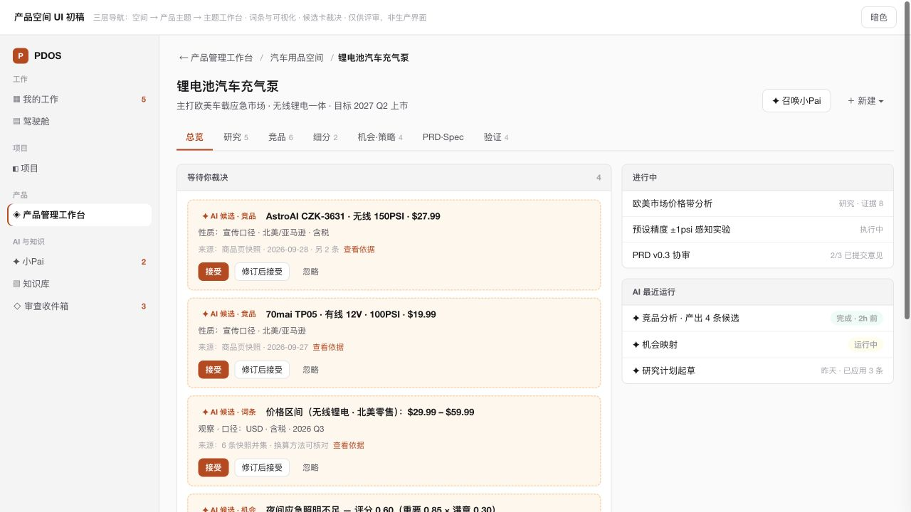
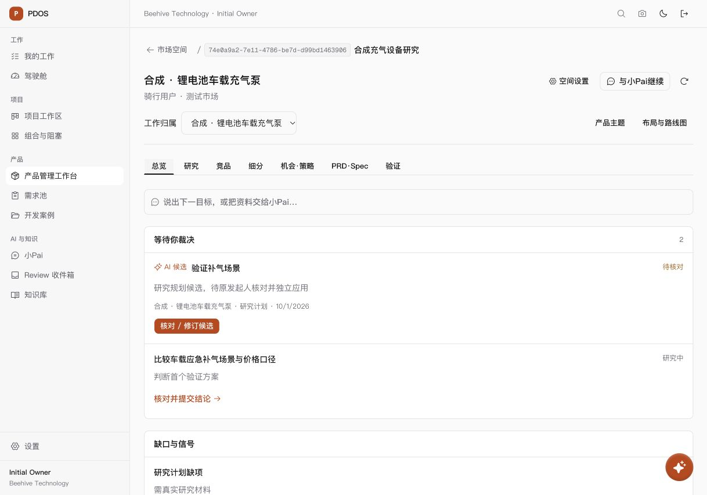

# 产品空间交互原稿与当前实现对照

日期：2026-10-01。用户指出首版与指定 HTML 不一致，要求实际分析可交互原稿。本轮只分析，不修改业务代码。

参考：[2026-10-01-product-space-mockup.html](2026-10-01-product-space-mockup.html)。原稿说明、演示数据和代码提示作为设计材料读取，不作为授权或真实业务事实。

## 结论与观察

首版完成了三层入口、七视图及本人队列，但专业工作面仍沿用大量旧对象组件。原稿的核心是“主题内阅读研究成果、比较方案、直接裁决 AI 候选”，首版实际更偏向“聚合待办后进入原办理组件”。差异包含页面构图、阅读密度和裁决路径，不能归因于合成数据较少。

实际操作原稿：空间目录→主题列表→充气泵主题；七视图全部切换；竞品价格图→同口径对比表；研究词条来源展开；忽略候选并填写原因；接受另一候选并打开小Pai，确认两处呈现相同裁决状态。重新加载后恢复原稿初始状态。原稿演示裁决仅改变页面内存，不连接真实业务服务。

当前真实预览只查看页面，没有接受、应用、批准或发布业务记录。预览服务继续保留；用于读取原稿的独立本地 HTTP 服务在分析结束后关闭。

## 差异与修正方向

| 场景 | 原稿 | 当前实现与修正方向 |
| --- | --- | --- |
| 空间与主题列表 | 纵向整行卡；状态、成果计数、待裁决、下一步同卡呈现 | 主题为多列卡，主要统计研究和本人工作。改为原稿行卡，专业计数只用真实可读数据，未知不算零。 |
| 主题页头 | 三层面包屑、主题摘要、小Pai和收敛新建入口 | 面包屑展示空间编号；页头另设归属、主题与布局按钮。以主题明确范围，范围切换并入面包屑或主题选择器，保持原URL及深链。 |
| 总览构图 | 1.6:1两栏；左为裁决与缺口，右为进行中与运行；900px以下单栏 | 1280px起才两栏，当前预览宽度下排成长单栏，额外AI入口占一行。按内容可用宽度恢复两栏及14px间距、灰色面板标题。 |
| 候选卡 | 淡橙背景、虚线边框；结果/口径/来源同卡，接受/修订/忽略邻近结果 | 白色摘要行，只有核对入口，展开原候选组件后办理。恢复结果卡和直接动作位置，来源按需展开，接受与独立应用分离。 |
| 研究 | 紧凑任务行＋词条（取值、口径、来源、生效/挑战状态） | 任务详情、表单和来源管理，尚无原稿词条工作面。默认阅读任务与有效结论，办理时展开；词条须绑定真实来源和版本。 |
| 竞品 | 价格区间图／同口径对比表／观察列表切换 | 已有真实比较，但先勾选再生成矩阵，无原稿价格图和切换。复用比较规则提供阅读视图，不将单次报价捏造为价格区间。 |
| 细分 | JTBD摘要行＋规模区间及依据 | 现有细分和测算办理组件。先呈现JTBD和结果，参数编辑按需展开；区间来自真实假设与计算回执。 |
| 机会与策略 | 四象限图＋机会摘要行，评分、证据数和方案支撑取舍 | 仍以记录详情及折叠方案为主。提供图/清单互相定位、方案并列比较；保留策略取舍功能，百分制展示保持原公式。 |
| PRD·Spec | 发布关卡常驻；左文档右规格表，缺项逐行标注 | 已有结构化阅读，但藏于定义卡折叠区。当前版本文档＋规格表成为默认主面，协审发布邻近真实关卡，历史及责任按需展开。 |
| 验证 | 四维摘要＋实验行，突出待批准事项 | 已有四维统计，仍用旧办理组件。保留真实统计，实验采用紧凑摘要，批准/结果确认进入具名办理。 |
| 小Pai | 420px右侧抽屉；主题范围、过程回执、候选卡同处 | 已复用个人会话和页面上下文，桌面为浮动面板。贴合侧抽屉，共享原候选状态和依据入口，继续使用受控运行。 |

## 演示占位与业务约束

原稿真实可交互的部分包括三层导航、七视图、竞品视图切换、词条来源展开、候选状态呈现、小Pai开关和两处候选状态同步。

“修订后接受”没有真实编辑表单，“查看依据”和机会点定位只弹提示，小Pai发送不运行；新建、部分对象行、导出与批准尚未接业务。词条、图表、计数和关卡为静态示例，未实现跨视图引用、真实版本与持久审计。应还原它们的入口和结果呈现，并接现有真实服务。

现有 `product-evidence-proposal.tsx` 可逐项核对修订，但接受/拒绝/应用针对一个整批 Finding。原稿每条竞品、词条、机会均有独立裁决按钮。须明确真实裁决粒度、持久状态、来源复核及幂等；不能把整批接受伪装为逐条接受或用前端本地状态冒充生效。

词条应保留取值、单位、适用口径、来源、版本及人工裁决状态。可先以现有受控成果构成阅读视图，再完善跨视图引用与证据挑战链；不直接合并为无版本字段，不复制示例市场数字、法规结论或运行状态。

## 推荐顺序

1. 还原目录与主题行卡、主题页头、两栏总览、候选卡和面板密度。
2. 将研究、竞品、机会、PRD·Spec改为默认阅读/对比视图，原表单在明确编辑/办理时出现；细分、验证统一摘要行。
3. 完成逐条候选真实状态和小Pai共享裁决，补词条跨视图引用及冲突复核。来源权限、接受/独立应用、人工具名批准发布保持。

## 截图

两图为各自实际默认视口；断点差异由CSS和组件源码核对，不宣称同尺寸像素比较。
