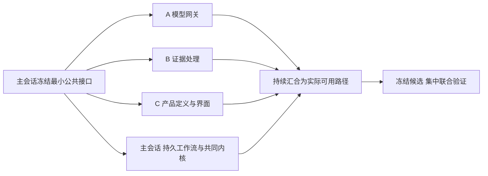

# PDOS Next · 已有成果衔接与并行施工

日期：2026-10-02。回应用户“衔接原来已完成的内容、核对复用、最大限度提高执行速度”。目标与验收仍按[完整目标架构](2026-10-02-pdos-complete-target-architecture-v1.md)和[执行方案](2026-10-02-pdos-next-execution-plan.md)；本文是复用依据与施工分工，活动状态仅在[唯一清单](../../tasks/ai-native-integrated-todo.md#pdos-next-queue)。

**结论：保留新领域内核，优先带入已经实现的算法、协议适配、交互、模板和失败场景。G1 人工定义路径可在 G0 后续底座未完成时继续，不必等真实模型或完整 G0。** 本文留存2026-10-02资产核对及历史文件分工；当前按[执行方案§3.1](2026-10-02-pdos-next-execution-plan.md#execution-acceleration)与唯一清单施工，默认主会话连续建设。历史四路容量与包状态不授权新开Agent、任务消息或公共环境操作。

## 1. 衔接依据及复用方式

本轮进行了基础能力、产品/UI、工程/NPI三路只读核对，并由主会话交叉检查当前源码与证据。没有修改旧业务源码、连接数据库、运行旧测试或执行模型调用。[源码与候选核对](../reports/evidence/pdos-next-reuse-parallel-20261002/source-inventory.json)记录61个重点文件的当前摘要，另对三份已有候选比对：

| 已有候选 | 本轮比对结果 | 可以支持的结论 |
|---|---|---|
| 新 G0 首轮 | 修改本轮计划前，51/51 文件与原 manifest 一致 | 沿用已经实现的来源事实、受控命令与34项局部检查基线，继续扩展。原代码检查没有重跑；本轮计划修订不修改历史 manifest。 |
| 10/1 产品原稿业务实现 | 31/31 文件与 source-manifest 一致 | 对应实现可作为提取起点，六类逐条候选、产品阅读与来源规则有原证据；不代表新 G1 已完成。 |
| 10/1 岗位场景 UI | 1084/1095 文件一致，11文件已变更 | 原岗位候选是范围明确的历史证据；同期产品及成本/变更增量不能拼成当前全树联合通过。变化文件在 JSON 列出。 |

原清单仍是2项完成、51项部分完成、12项待完成。大量分项已经可用，不能把“原条目尚未全部验收”理解成从零开发，也不能因复用改勾原 N/P/Q。

复用分三类：

- **直接复制或继续使用**：独立的组件/格式化函数/静态资产，或新 G0 已有实现。记录来源摘要，加入新工程自己的依赖；复制后不依赖旧 `app` 或旧服务。
- **抽取适配**：保留低层计算、协议、字段和守卫规则；用新 DTO、身份、版本、读写接口替换旧 schema/auth/settings。抽取只取当前切片需要的部分，不先建设通用兼容层。
- **按新契约建立**：权威对象、状态机、事务、资格与正式决定。旧实例、账号、来源授权、批准结果和真实资格不随代码复制。复用旧负例来验证新实现。

## 2. 复用矩阵

### G0 · 平台与可信执行

| 已有成果与入口 | 复用处理 | 新目标及必要补齐 |
|---|---|---|
| 新 `pdos-next/server/pdos_next/{contracts,service,database,safety}.py`、`tools/local_environment.py` | **继续使用**，无需重写首轮底座 | G0共同命令、Product范围、原件、回执/审计/Outbox、RLS、幂等、取消与单Claim补偿。尚缺多动作原子组、来源传播及持久恢复；当前Claim性质/可用性只是完整契约的子集。 |
| [密码哈希](../../server/app/auth/passwords.py)及旧身份/权限负例 | 密码核可独立复制；权限语义抽取 | 新 Principal/Grant/会话生命周期，支持无项目Product范围；不继承旧用户、角色枚举或授权行。 |
| [双协议适配](../../server/app/ai/provider_adapters.py)，`test_model_provider_adapters.py`、`test_model_provider_http_contract.py`、`test_provider_bounded_usage.py` | **优先抽取** HTTP封装、usage归一化、输出限额、超时/截断分类 | G0.2 OpenAI兼容/Anthropic原生。Route/Transport由新服务注入，模型目录、默认型号、配置键与资格不整包复制。 |
| [出站守卫](../../server/app/ai/egress.py)、[预算](../../server/app/ai/model_budget.py)、`model_call_fence.py`、`budget_ledger.py` | 抽取规则及port，存储重绑新Run/Attempt | URL白名单与材料出站授权分别校验；预算预留/结算、取消/权限/资格提交前复查。未知模型调用不得自动重发。 |
| [循环检查点](../../server/app/ai/checkpoints.py)、`application_checkpoints.py`、`run_store.py` | 复用“完成步骤才续接”、租约和故障负例 | 旧自定义checkpoint不是原生持久LangGraph，未发现旧Temporal实现；G0.3仍需独立Temporal库、Activity幂等与真正重启恢复。 |
| [Golden套件](../../server/app/ai/golden_suite.py)、`qualifications.py` | 复制schema/digest/版本验证思路 | 新能力建立独立评测与真实资格；不移植旧通过标记，不允许自动化写可信根。合成通过仍只用于测试。 |
| [S3接口](../../server/app/storage/documents.py)、[文档解析](../../server/app/domain/documents.py)、[邮件解析](../../server/app/domain/email_documents.py) | 抽取适配器及PDF/XLSX/邮件解析核 | G0.3独立私有对象版本、准确页/表/单元格定位、限额与隔离worker。旧配置不带入；原解析归一化空白，不能取代原件字节，也未实现完整扫描/OCR/进程隔离。 |
| [事务事件写入](../../server/app/events/writer.py)、`ai_issue_withdrawals.py`、[钉钉Outbox](../../server/app/integrations/dingtalk_outbox.py) | 复用幂等、历史保护、租约/未知结果/对账规则 | 保留新service唯一写入口。旧EventAuditWriter还触发旧排程/知识侧效应，旧Outbox专属钉钉，不能整块复制为通用Inbox+Temporal。 |

### G1 · 产品与使用体验

| 已有成果与入口 | 复用处理 | 新目标及必要补齐 |
|---|---|---|
| [UI基线](2026-08-09-ui-baseline.md)、`web/src/components/ui/button.tsx`、`web/src/lib/{utils,decimal}.ts` | **直接复制独立部分**；Button已在新工程且字节一致 | 沿用橙色、Geist、Phosphor、Tailwind4、shadcn、8px及双主题；Decimal显示不经浮点，缺值不补零。全局旧CSS不整文件搬。 |
| [阅读容器](../../web/src/components/product-work/product-reading-ui.tsx)、[任务办理容器](../../web/src/components/projects/project-task-workspace.tsx) | 复制主体后适配tokens/路由与当前lint | 复用详情展开、草稿保留、深链和键盘处理；新组件展示新领域事实，开发fixture不进入业务预览。 |
| `workspace-experience.ts`、`my-work/my-work-scenario.ts`、产品七视图与岗位场景 | 复用阅读构图、任务排序和办理路径 | 视角不授予权限，AttentionItem只投影。旧role、市场空间和route必须改绑新Principal/Grant/Product，避免重做视觉原稿。 |
| `product-source-files.tsx`、`source-citations.tsx`、`evidence-picker.tsx`、[逐条裁决](../../server/app/domain/product_evidence_items.py) | 复用来源阅读、撤权清空、条目修订与范围预览 | 改绑ArtifactVersion/EvidenceReference/Claim；ProposalBatch独立原子组一次确认。旧Finding“接受→独立应用”不成为新通用T1流程。 |
| [市场计算](../../server/app/domain/market_analysis.py)的`calculate_market`，竞品/机会/实验界面 | 抽取Decimal区间、同条件比较及专业约束字段 | G1.1观察/机会/实验；单位和工况不可比不自动排名，Claim性质与可用性拆分。策略可作输入，不强制所有定义先发布策略。 |
| [定义编辑](../../web/src/components/product-work/definitions.tsx)、[定义领域](../../server/app/domain/product_definitions.py) | 复用PRD/Spec双栏、稳定条目、未知/条件/方法/负责人、差异与历史 | 新DefinitionRevision归属Product/Variant，允许真实draft；重建用途/排除范围/来源/发布身份。旧strategy_id、space/product_line和固定五专业审查不整包沿用。正式发布仍T2。 |
| [派生差异](../../server/app/domain/definition_inheritance.py)的`merge_paths/three_way/accept_changes` | **优先抽取纯算法** | G1.2固定父版+覆盖与三方差异；新Platform/Variant/受众/适用性校验，禁止继承父版批准/负责人或自动确认变更规格。 |
| [工作日历](../../server/app/domain/working_time.py)、`work_calendars.py`、[排程](../../server/app/domain/plan_scheduling.py)、[预测](../../server/app/domain/schedule_forecast_engine.py) | 抽取确定性核和反例，替换输入类型 | G1.3/G5.2依赖、日历、未知估时与四时间；新ProjectProductLink/双线工作包/PlanRevision。未知等待不默认0，预测不改承诺，计算不改实际预约。 |
| [定义文档渲染](../../server/app/exports/definition_documents.py) | 复制格式渲染，改接新固定定义投影 | 内部导出沿用，不等于发布或客户接受。旧PDF中文字体仅特定阅读器视觉验证的限制仍保留，需新候选复核。 |
| [交付指南资产](../../assets/cehub/deliverable-guide-manifest.json)（325类交付、687条checkItems）及项目/测试模板 | **直接消费资产，适配模板映射** | 不再解析xlsx反推。映射到新项目类型、阶段、工作包与验证；指南条目不是自动通过的关卡，也不强制每种轻路径套全模板。公共CA沿用时仍须匹配实际连接目标，不产生云资源权限。 |

### G2～G5 · 工程、NPI、品质与交付

| 已有成果与入口 | 复用处理 | 新目标及必要补齐 |
|---|---|---|
| [样机配置版本](../../server/app/domain/sample_configuration_revisions.py)、[配置比较](../../server/app/domain/sample_configuration_comparison.py)、`npi_execution.py` | 抽取固定版本、规范化差异、缺值显示和录入表单 | G2.1工程/制造两条配置、Build/BuildLot/SampleUnit/ActualConfiguration重建。旧BuildBatch与BOM不能代替制造基线，配置相同也不等于证据适用。 |
| [报告原值解析](../../server/app/domain/test_report_workbook.py)、`test_import_preview.py`、`test_import_samples.py`、测试配置/补录界面 | 复用原单元格位置、配置选择与未知/依据交互 | G2.4适配ArtifactVersion/Measurement/TestRun。旧TestRun终态passed/failed/aborted混合执行与结果，未填终态时间自动取系统当前时间，**状态机不能原样复制**；新执行/判定、事实/接收/生效时间分离。 |
| [工装轮次](../../server/app/domain/tooling_rounds.py)、`tooling_resources.py`、[项目交接](../../server/app/domain/project_completion.py)、`project_handoff_sources.py` | 抽取承诺/实际/可用时间、固定manifest与接收后来源漂移守卫 | G2.2/3试模前VerificationRequest、trial_round与write_tier分开；样件/资料各自时间、品质部分/正式接收新建。旧项目结束交接不等于试模品质接收。 |
| [Issue品质关联](../../server/app/domain/quality_issue_links.py)、[CAPA](../../server/app/domain/capa_actions.py) | 复用失败归并、升级幂等、根因/措施/独立有效性和原值回查 | G3.1接新TestRun事件，AI假设不提升为已证原因；独立验证和高风险具名关闭继续保留。旧本地HTTP链采用合成测量，不是工厂真实验收。 |
| [影响图](../../server/app/domain/change_impact_graph.py)、[实施结果](../../server/app/domain/change_execution_results.py)、`change_execution_evidence.py` | 抽取图边、范围上限、冻结来源漂移守卫与专业办理组件 | G3.2/3需补工程/制造双线、工序/SOP/治具/在途处置与EffectivityPlan。旧成本文件协同证据不证明真实新配置/Build/Run、物理复验或ERP生效。 |
| [齐套](../../server/app/domain/material_coverage.py)、`build_materials.py`、`material_supply_pools.py`、`material_allocations.py`；[成本核](../../server/app/domain/cost_rollups.py)的`_calculate`、`cost_inputs.py` | **优先抽取纯计算**：层级数量/单位、共享池去重、Decimal/汇率/口径/差额解释 | G4.1读固定BOM/供给快照；SQL锁和批准重新接新服务。供应承诺不等于实到，参数相近不等于替代资格；工艺/损耗/数量口径补齐，估算不是实绩降本。 |
| [资源求解](../../server/app/domain/resource_schedule_solver.py)、`resource_capacity.py`、`portfolio_scoring.py` | 抽取时段容量、已占用/提议区间、不可解解释与评分 | G5.2扩充设备校准、人员资格、工装适用、线体和样件破坏性消耗。旧预约状态不证明这些条件，复杂图/并发/真实冲突须新候选验证。 |
| [FMEA规则候选](../../server/app/domain/fmea_design_rules.py)；旧自动化/会议/等待的版本、去重、冷却规则 | 复用来源失效、固定版本、幂等和独立审核语义 | G5.1/3以新领域事件接Temporal，不复制旧worker调度。正式规则、个人记忆分层；旧verified状态不迁入即成为新可信规则。 |

主要旧证据：[产品闭环](../reports/evidence/pm-loop-20260929/joint-verification-0415.md)、[产品交互实现](../reports/evidence/product-space-reference-implementation-20261001/result.md)、[岗位场景](../reports/evidence/role-scenario-ui-20261001/result.md)、[排程](../reports/evidence/parallel-schedule-20260930/result.md)、[供应](../reports/evidence/parallel-supply-20260930/result.md)、[成本恢复](../reports/evidence/cost-recovery-20261001/result.md)、[成本变更实施](../reports/evidence/cost-change-execution-20261001/result.md)。这些是对应候选/范围的历史证据，新系统抽取后按受影响语义验证，测试数量不能相加成新验收。

主要需要新建的内容：Temporal与持久检查点、通用Inbox和投影水位、完整T1原子组、真实新能力资格、工程/制造双配置、试模前验证与品质部分接收、独立制造基线/工序/控制计划/试产、四种放行及外部接收/生效。旧代码的存在不消除这些缺口。

## 3. 并行施工：四路上限、接口先行、纵向汇合

### 第一波 · 补G0，同时提前G1人工定义

主会话先冻结下面的最小接口，随后三个独立包可同步施工。冻结的是需要消费的接口版本，不先设计完整全系统；接口变化由主会话统一修订，受影响包收到变化后继续。

| 执行者 | 独占文件范围（规划，尚未创建的目录不代表能力已实现） | 可并行交付 | 汇合条件 |
|---|---|---|---|
| 主会话 · 共同内核/持久工作流/集成 | 现有 `pdos-next/server/pdos_next/{models,contracts,service,api,runtime}.py`；新`workflows/**`、`dispatch/**`；全部迁移/公共配置/依赖锁；前端`workspace.tsx`、BFF/会话/全局壳；清单与方案 | 事件/身份/命令接口、Outbox/Inbox、Temporal与持久LangGraph、来源失效、原子组/具名决定；持续串接独立包，不成为纯管理角色 | 与各包复用当前G0命令服务；所有正式写入经共同事务，业务决定不在Workflow重复实现 |
| A · 模型网关 | 新`pdos-next/server/pdos_next/providers/**`、`model_gateway/**`、`server/tests/providers/**` | 双协议、typed output、usage/限额、预算port、出站/默认失能与fake transport负例 | 新RunContext/Gateway/BudgetPort冻结；接线由主会话负责。缺真实凭据/出站/资格只阻塞真实调用，不阻塞包实现 |
| B · 证据输入与隔离处理 | 新`pdos-next/server/pdos_next/object_storage/**`、`evidence_processing/**`、`server/tests/evidence_processing/**` | 独立私有存储adapter、上传/类型/大小限制、PDF/XLSX解析与准确定位、隔离worker和明确失败状态 | ArtifactRef/ObjectStore/ParseResult冻结；主会话统一加新列/解析状态/ACL和工作流接线。扫描未就绪时不伪标clean |
| C · 产品定义完整路径 | 新`pdos-next/server/pdos_next/domain/products/**`、`schemas/products/**`、`server/tests/products/**`；新`pdos-next/web/src/components/product/**`、`lib/product-view.ts` | 提取阅读/Spec/来源/差异组件与纯函数；实现Product→人工draft DefinitionRevision/Spec→版本/来源→真实回执路径 | ProductScope/定义/来源DTO与CommandPort冻结；提交实体与handler需求，主会话合迁移/注册/API/BFF入口。初期无需模型或长期workflow；正式发布等T2底座 |

三个包仅读公共文件，不改中央schema、迁移号、认证、BFF、依赖锁、唯一清单，不另建相同公共对象。不导入旧业务包，不访问旧数据库/凭据。独立包可以运行本包纯计算/协议/组件的必要检查；数据库测试、完整Next构建、共享`.next`生成、共同环境和浏览器候选由主会话统一。

最小公共接口：

1. **ProductScope / RunContext**：服务器绑定tenant、product、writer、requester/owner、purpose、skill/provider/tool/policy版本与cancel_epoch。模型输出不提供这些政策事实。
2. **CommandPort / Receipt**：沿用strict命令、expected_revision、source_read_set、稳定intent与请求key；事实/回执/审计/Outbox同事务。handler只实现对象规则，不另开旁路写入。
3. **EventEnvelope / Inbox**：event_id、tenant/scope、aggregate/type/revision、schema_version、causation/correlation、consumer_key；重投去重、乱序/缺口补读与watermark。
4. **Gateway / Budget / Checkpoint**：不可变来源引用与用途、Claim候选+usage+invocation；预算预留、未知调用、版本固定、取消及恢复重验。
5. **ArtifactRef / ObjectStore / ParseResult**：原件version/hash/size/media、ACL、页/表/行/区域、原件与解析派生分离、解析/隔离失败状态。
6. **Definition / Spec读写DTO**：Product/Variant、定义版本/用途、条目值型/单位/工况/方法/未知/来源；页面只展示权威结果，草稿与正式发布分别表达。

### 后续波次 · 按真正依赖滚动分派

| 波次 | 可同时运行的独立包 | 必须先就绪的接口/结果 |
|---|---|---|
| G1后半段 | 平台/派生差异；日历/计划/模板纯计算；定义/首版双线计划UI | 定义版本与引用稳定。计划纯核可提前提取；项目写入必须有真实ProjectProductLink和具名责任；正式定义发布依赖T2 |
| G2 | 工程/制造配置+Build/Sample；验证请求/品质接收/TestRun；供应/齐套/成本 | G1真实定义/项目范围；配置和样件接口先定。后两包消费固定快照，不共写BOM/样件；真实接收需前置验证与样件/资料状态 |
| G3 | Issue/CAPA独立有效性；双线变更/实施/复验；制造基线/工序/试产 | TestRun失败事件、实际配置、Measurement和来源稳定。制造合同/纯计算可提前，但实际试产必须有配置/资源/物料依据 |
| G4/G5 | 固定放行包；外部接收/对账；Loops/资源/知识中当前所需一包 | 放行读取已固定的工程/制造/品质成果；外部结果未知独立，真实外发单独授权；Loops调用已实现命令，不补造事实 |

完成或阻塞一个包后立即让出并发槽，接入已满足条件的下一包；不机械等待整波三包同时结束。每次分派写明用户结果、文件归属、接口版本、必要验证和禁止触碰的公共文件，不把可读模块都分派成施工任务。

## 4. 提速规则与出口

- 优先满足当前路径：双协议共用接口，不逐厂家建另一套网关；先消费现成指南/模板与交互，不重画已经定稿的体验。只复制当下需要的函数/组件，并留来源摘要。
- 主会话连续实现共同内核和工作流，各包交付按入口→动作→结果→异常汇合；不用“全部后端完成后再UI”。前端可先以冻结DTO开发，但fixture只用于组件检查，未接权威服务不算可用交付。
- 写入、权限、事务变化立即做最小影响检查；低风险展示不加镜像测试。完整构建、迁移往返、DB/API并发、HTTP/浏览器、主题/尺寸和恢复按闭环冻结候选集中，候选不变不重复跑。
- 每次schema/接口合入后校验依赖；迁移主会话单调分配，不让三个包争同一head。共同依赖锁统一一次更新，避免同目录安装/生成互相覆盖。
- 真实模型、工厂角色、外发、云资源和人工Exit只阻塞相应依赖。模型默认失能时继续人工定义、规则计算、私有文件处理和本地恢复建设；不把合成测试提高为真实资格。

没有测量依据，不承诺工期或提速百分比。当前按[执行方案§3.1](2026-10-02-pdos-next-execution-plan.md#execution-acceleration)连续接通实际业务端口，在业务候选集中验证；这里只保留当时的资产/接口核对证据，不判定现在包状态或新增派发。有效业务结果与集成返工用于观察执行效率，测试数、文件数和Agent数量不作完成率。
