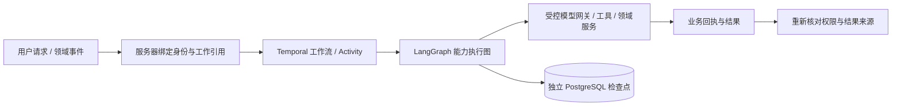

# Agent 运行架构统一：LangGraph + Temporal

2026-10-07 用户明确所有 Agent 必须遵循 LangGraph + Temporal。本合同补充完整目标架构的执行边界；业务职责、T0/T1/T2、独立身份与资格保持。Agent 拓扑以[目标架构 v1.1](2026-10-08-pdos-complete-target-architecture-v1.1.md) §06 为准：唯一 Agent 小Pai，经工具、MCP 与技能包完成工作（2026-10-08 补注）。

| 责任 | 唯一边界 |
|---|---|
| 持久任务、定时等待、调度和 Activity 重试 | Temporal；Workflow 历史只接收固定工作引用。 |
| 能力内执行和检查点 | LangGraph；模型网关拒绝绕过执行图的正式调用。普通对话以判断、研究和条件分支运行。 |
| 模型选路、当前资格、材料出站、计量及未知调用 | 各工程自己的服务器网关；框架不授予模型或写入资格。 |
| 业务事实、幂等、版本、撤回、具名批准 | 原有领域服务与数据库合同；不由 Workflow 或模型参数决定。 |
| 会话与共享范围 | 原服务器授权、原件与引用守卫；每次执行和结果返回重新核对当前身份及可见范围。 |

共同代码在 `packages/pdos-agent-runtime/`，不导入任何业务模块。原工程通过 `app.ai.durable_registry` 注册 31 个完整入口，包含专业能力、普通对话、会议/讨论、事件 Agent；项目委托另由 `ProjectFollowup` 的持久定时器驱动。新工程保留自己的 WorkRequest/Run、Outbox、SourceWork、领域命令及独立身份，使用共同执行图，并由自己的 `ModelRuntimePorts` 组装模型工厂。新旧工程不共享业务库、状态凭据或资格。

原工程的私有参数、进度和结果存在独立 `pdos_agent_runtime` 数据库；身份只保存引用及版本，密码不进入工作载荷。Temporal 只保存租户、工作和固定处理器引用。原有应用执行租约只能接管同一个有效令牌，不能新增或延长业务授权。相同输入重用原工作，页面断开不取消后台执行。

恢复按证据分支：已经保存的完整能力结果可以恢复并重新验证；未保存图结果且业务动作结果不确定时，明确进入回执对账等待，禁止自动重复动作。模型调用的原有未知账本和防重放继续生效。错误路径没有 LLM 兜底。当前共同适配器保存完整能力结果；不能据此宣称所有旧能力都已具备逐工具节点的自动恢复。

开发启动：`scripts/dev.sh` 同时启动 API、Agent Worker 和原确定性调度器；`scripts.agent_runtime_environment start` 创建并验证本机独立状态服务，私有配置存于忽略目录 `.local/agent-runtime/`。缺少服务不回退进程内正式执行。`pdos-next` 的 API/ASGI 默认开启持久队列；本地直执行仅允许经过目标核对的显式合成测试。下一工程的 Worker 缺少独立配置/资格/出站接口时记录 `MODEL_RUNTIME_PORTS_MISSING`，保留工作与人工办理能力。

本地 Temporal 使用开发服务器及 SQLite 历史，LangGraph 使用 PostgreSQL 检查点。生产 Temporal PostgreSQL、完整主协调器/Skills/长期记忆、真实模型资格及人工出口仍是原计划余项；本次不改变这些状态。验证与已知限制见[收口证据](../reports/evidence/agent-runtime-convergence-20261007/result.md)。
