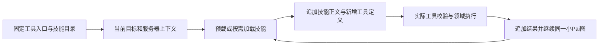

# M2 工具按技能分组下发与提示缓存方案

**状态：待评审方案，2026-10-08。仅写文档，未实施，未替换冻结条款。** 本方案处理小Pai 主循环每轮下发全部工具的载荷与选择问题；活动状态仍以[唯一清单](../../tasks/ai-native-integrated-todo.md#current-queue)为准。

建议保留完整的服务器工具注册表，将模型所见内容改为两层：**固定少量工具入口与技能目录作为缓存前缀；已加载技能所需的具体工具定义追加到消息末尾。** 这样既能按技能缩减具体 schema，又能在现有两类协议上保持顶层 `tools` 与 system 稳定。服务器继续按实际领域工具校验参数、授权、档位和回执。

这是值得在 M2/B7 汇合时处理的性能与选择准确度隐患。106 个工具及约 167 KB 定义已经复核；具体时延、费用与误选增幅仍须在同模型任务对照中测量。当前实现遵循了 v1.1 的固定工具列表约定，不能把这次改进写成已违反冻结架构的缺陷。

## 1 已核实的下发路径与载荷

[AgentKernel](../../pdos-next/server/pdos_next/agent_kernel/graph.py) 的 `compile()` 从 `registry.definitions(scope.isolation)` 捕获列表，`model()` 每轮原样传给网关。`skill.load` 只追加技能正文和加载绑定，不改变此列表。[注册表](../../pdos-next/server/pdos_next/agent_kernel/registry.py)的 `definitions("main")` 按名称排序，只排除必须隔离读取的工具，没有按技能过滤。

[协议适配器](../../pdos-next/server/pdos_next/providers/agent_client.py)将所传定义全部放入请求：OpenAI 兼容协议的 `tools[].function`，或 Anthropic 原生协议的 `tools[].input_schema`。因此准确范围是“主循环的每次模型调用下发 106 个工具”；研究和原件提取子任务已有独立的小列表。

2026-10-08 离线执行 `default_registry()` 与 `SkillCatalog()`，按 `json.dumps(definitions, ensure_ascii=False).encode()` 统计如下。没有连接数据库、读取凭据或调用模型。

| 工具集合 | 工具数 | 定义 UTF-8 字节数 |
|---|---:|---:|
| 当前主循环全部定义 | 106 | 167,596 |
| 仅 category_framing 的主循环工具 | 7 | 1,177 |
| 仅 public_research 的主循环工具 | 11 | 3,277 |
| 仅 proposal_drafting 的主循环工具 | 15 | 2,189 |
| public_research 与 proposal_drafting 去重并集 | 20 | 4,532 |
| 全部 12 个技能的主循环工具去重并集 | 32 | 6,255 |
| research 隔离子任务 | 2 | 662 |
| extract 隔离子任务 | 1 | 163 |

当前主循环定义的 SHA-256 为 `64dd1d97e8cbe0ff80f7607531db096341da21e90240f0cba5166525b75c4a0d`。已有[候选载荷记录](../reports/evidence/pdos-next-m2-20261008/tool-footprint.json)为 106 个、167,872 字节；这是另一份源快照，不覆盖其历史证据。紧凑 JSON 的当前全量定义仍有 153,826 字节，去空格不能解决规模问题。

106 个主循环工具中有 **74 个不属于现有任一技能的 allowed_operations**，包括交样、测试、CAPA、制造等长尾命令。它们仍需保留在服务器注册表中，但没有必要进入本轮模型上下文。也不能把这 74 个都描述成“服务器已拒绝”：当前注册表对普通写工具要求已加载技能，对只读和 T2 准备工具另有规则。

全部现有技能的定义并集约为全量的 3.7%，说明分组有足够空间。该比例只比较定义字节，**不代表成本或时延降低 96.3%**：完整请求还包括技能正文、消息、结果 schema 和协议封装，部分 M3 工具目前也只有占位 schema，领域合同补齐后应重测。

## 2 冻结条款与缓存边界

[v1.1 §06.3.3](2026-10-08-pdos-complete-target-architecture-v1.1.md)目前明确要求：工具定义整体保持稳定，技能加载决定调用许可；工具过多时引入按需检索工具，不在运行中改写工具列表。故直接把顶层 `tools` 改为已加载技能的并集，会改变冻结约定。

缓存需要区分“system 文本不变”和“供应商实际缓存前缀不变”。Anthropic 的顺序为 `tools → system → messages`；修改顶层工具定义会使后续缓存失效。当前适配器虽然在 system 上设置了 `cache_control`，也不能隔离前面的工具变化。[Anthropic 缓存规则](https://platform.claude.com/docs/en/build-with-claude/prompt-caching)

OpenAI 的官方建议同样包括保持工具定义、顺序与 schema 稳定，并用追加式工具加载保留先前上下文。**第三方 OpenAI 兼容服务的缓存能力需按实际服务商与模型验证**，不能因为请求格式兼容就沿用官方命中结论。[OpenAI 缓存指南](https://developers.openai.com/api/docs/guides/prompt-caching)

前缀稳定只创造复用条件；是否命中还受模型最小缓存长度、有效期和供应商支持影响。即使缓存命中，全量工具仍需传输并占用模型可见上下文，缓存也不负责排除无关工具。

## 3 推荐路径与备选路径

| 路径 | 按技能缩减具体定义 | 缓存边界 | 主要代价 |
|---|---|---|---|
| **A 固定窄入口，技能 schema 追加到消息，推荐作为兼容方案** | 是 | 顶层工具和 system 固定，技能及后续结果只追加 | 供应商只约束入口参数；具体业务参数必须在服务器按原 schema 校验，可信调用证明需支持入口到目标工具的映射 |
| B 供应商原生追加工具，具备已验证能力时优先采用 | 是，并保留原生专用工具 schema | 保持初始 `tools`，在后续消息追加原生工具定义 | 依赖具体 API、模型和协议能力，当前适配器尚未接入 |
| C 每个工具组固定一份原生 tools 列表 | 是 | 同组内稳定，换组重新建立缓存 | 无法承诺跨组完整前缀稳定；必须显式处理版本转换和恢复，不可直接删掉现有摘要检查 |

A 与 B 共用同一技能工具分组、授权和证明规则。先验证 A 的参数遵从度；已取得 B 的协议能力证据时，优先保留专用原生工具调用。**不将 C 宣称为同时解决渐进加载与跨组缓存稳定的方案。**

Anthropic 已提供按值追加 `tool_addition` 的协议能力，在支持的模型与 beta 配置下可保留先前前缀；需保留至少一个非延迟的顶层工具。OpenAI 的工具搜索指南也提供追加工具的能力。两者均不能直接套进当前的 Chat Completions 兼容适配器或现有纯文本消息校验。[Anthropic 原生工具追加](https://platform.claude.com/docs/en/build-with-claude/mid-conversation-system-messages)、[OpenAI 工具搜索与追加](https://developers.openai.com/api/docs/guides/tools-tool-search)

仅把全部工具加上 `defer_loading` 并继续每次发送，也未必解决传输载荷；需分别检查模型实际展开的定义和 HTTP 请求字节。当前仅 12 个技能，第一步用确定性的技能分组即可，不需要增加向量检索、工具路由模型或第二个 Agent。

## 4 固定入口与技能分组

### 4.1 主循环的固定入口

A 路径建议固定以下四个窄入口，具体名称为方案名，尚未注册：

| 入口 | 作用与服务器限制 |
|---|---|
| `skill.load(name)` | 校验租户启用和实际范围，加载技能正文与本组工具定义，记录加载事实 |
| `tool.read(tool, arguments_json)` | 只能分派到本轮已披露的读取、计算或受控研究工具；按实际 ToolSpec 判断并行与隔离 |
| `tool.prepare(tool, arguments_json)` | 只生成原工具允许的 T0/T1 候选或 T2 决定材料，不执行具名决定 |
| `tool.write_draft(tool, arguments_json)` | 只分派合格且当前授权的 T0 草稿命令，经原受控领域入口执行；资格不足按原规则生成候选并说明 |

`arguments_json` 是完整 JSON 对象的字符串，外层 schema 固定且拒绝额外字段。服务器使用严格 JSON 解析，拒绝重复键、非有限数字和非对象值，再按目标工具的原 schema 校验。目标 `tool` 必须在实际加载、披露和隔离集合内，不能因为注册表中有同名命令就放行。入口不接受 SQL、代码、任意 URL 执行器或任意领域命令透传。

四个入口常驻只表示模型可以提出请求，不授予业务能力。真实档位、范围、资格与调用权限仍来自服务器；不得按外层入口名称推断目标档位，也不得把 `tool.write_draft` 自身登记成拥有所有草稿操作资格的技能。

research 与 extract 子任务保留现有固定只读工具列表；原文读取工具不会借入口进入主循环。MCP 工具按实际连接器准入、技能或 AutomationRule 授权与隔离规则形成组，第三方描述不能作为系统指令。

### 4.2 每个技能的具体工具定义

沿用现有 `allowed_operations`，从唯一注册表生成工具组，不再手写第二份 schema：

```text
本轮具体工具 = 去重并集（已加载技能的 allowed_operations）
             ∩ 当前 isolation 可披露集合
             ∩ 实际 MCP 授权集合（仅适用于 MCP 工具）
```

分组决定披露范围；调用时仍重新做当前授权检查。按工具业务名称排序，完整保留描述、输入 schema、版本和实际档位。已经常驻的核心工具和已经披露的相同定义不重复追加；共享工具出现不同 schema 或档位时拒绝配置发布，不由模型选择版本。主循环的 `research.read` 等隔离操作不进入组，也不以文字方式附上完整原文读取 schema。

服务器依据页面、对象或触发事件预载实际相关技能；无法确定时先给目录与固定入口，由小Pai 加载。预载和自加载使用相同校验与记录路径。技能引用其他技能不等于立即递归加载全部依赖，例如起草提案不必提前加载 RFQ、派生和全部市场分析技能。

技能加载结果至少包含：技能固定版本与正文、此次新增的工具定义、本组摘要，以及因隔离或授权不可用的操作类别。缺 schema 或领域端口的占位工具明确标注能力限制，不能被包装成可执行能力。重复加载同一版本复用原绑定；版本变化按原恢复规则拒绝静默替换。

## 5 缓存前缀与运行状态



顶层工具入口、system、目录及结果 schema 随发布版本固定，禁止放入用户、租户、时间、权限开关或动态技能列表；模型路由与影响前缀的协议选项同样按 Run 绑定。技能正文与具体工具 schema 每次加载后都作为新消息追加，先前消息不因新增技能重新拼成一段“当前全部已加载技能”。权限撤销后在模型出站和工具执行前拒绝继续，不以删改旧消息来制造缓存命中。

追加披露不会免除后续请求重发已有历史的传输成本，但只会重发已加载的定义，不再重发无关的全量定义。长期运行加载过的内容会累积；达到原上下文或预算边界时沿既有收尾和恢复规则处理，不用自动卸载技能重写历史。

Anthropic 现有 system 缓存断点可以保留；若希望已加载技能和会话历史也被复用，适配器还需对稳定消息边界设置合适的缓存断点并验证真实 usage。不能把“追加内容”直接报告成“追加内容已命中缓存”。OpenAI 兼容路径只记录实际服务商返回的缓存读写用量，不合成命中数。

## 6 可信调用证明必须一起调整

当前[网关](../../pdos-next/server/pdos_next/agent_kernel/gateway.py)按 `run × isolation` 固定 `tool_definitions` 摘要；[执行证明](../../pdos-next/server/pdos_next/agent_kernel/execution.py)还要求该摘要等于完整 `registry.definitions()`，并逐项检查实际模型回复中的 `name/arguments` 等于领域工具调用。A 路径下实际回复会是窄入口，B 路径下初始 tools 与已追加工具也不再等于完整注册表。**只筛选 tools、只放宽摘要比较或改写模型回复名称，都会破坏既有证明。**

需要分别保存与验证四类事实，字段放在运行、调用和检查点已有版本化记录中；不把提示词、技能或工具集版本写入数据库约束：

1. **固定前缀**：入口定义与 system 的摘要，按 isolation 固定，继续拒绝静默替换。
2. **注册表与协议版本**：本 Run 使用的具体工具定义快照，以及 A 的分派解析版本或 B 的原生追加协议版本。
3. **每次模型调用的披露集合**：当时已加载的 SkillBinding、实际披露工具的名称/版本/schema 摘要、对应披露消息摘要。由服务器生成，并进入调用摘要与幂等比较；模型不能提交这些政策事实。
4. **实际调用来源**：原始模型回复、实际 response_index、目标工具及参数。A 按固定解析规则从该索引的入口参数重建目标；B 保留原生工具名和参数的直接比较。两者都核对该目标属于此次模型调用的披露集合。

同一回复里先 `skill.load` 再调用新技能工具时，该工具不属于生成此回复时的披露集合，拒绝执行并要求下一次模型调用。尤其不能用“工具节点现在已加载”代替“实际模型调用时已加载”的事实。预载在首轮模型调用前完成，正常预载不增加加载轮次。

T0 的校验仍绑定实际模型账本、技能加载事件、当前资格、cancel epoch、范围、参数摘要和领域命令摘要；幂等键仍由实际 `run_id + model_call_id + response_index` 生成。分派不得生成假的模型索引，也不接受模型传来的身份、范围、资格或计费事实。T1 一次确认、T2 具名决定、同 Session prepare/finish、事务回滚、整次撤回守卫和已完成结果只读恢复均保留。

检查点保存加载与披露的顺序、版本和摘要。恢复时按原快照重放，缺原定义或版本漂移就返回现有 `VERSION_CONFLICT` 或相应源不可用错误；不改用最新版再派发。发布切换只影响新 Run，旧 Run 继续使用可验证的旧快照。

## 7 实施落点与顺序

以下为后续实施范围，本轮没有修改这些文件。

| 归属 | 必要改动 |
|---|---|
| `skills.py` 与 `registry.py` | 从 allowed_operations 生成组，隔离过滤、schema 去重、定义快照与校验；完整注册表继续由共同命令生成 |
| `graph.py` | 固定入口，预载与自加载追加正文及 schema，捕获模型调用时披露集合；先解析实际目标再决定读取并行和写入串行 |
| `gateway.py` 与 `bindings.py` | 分开固定前缀、完整注册表和每次披露集合绑定；保留实际出站、预算与调用恢复 |
| `execution.py` 与领域接入 | 校验原始模型回复到目标命令的确定性映射，接回原受控调用证明，不增加新的业务写路径 |
| `providers/agent_client.py` | A 保持现有协议并支持固定入口；B 仅在资格确认后接原生追加定义；缓存断点、流式解析与 usage 需按协议验证 |

先完成工具分组及载荷观测，再实现固定入口、逐调用证明和恢复；最后统一做受影响验证与真实模型对照。现有 74 个未归组工具不强塞进首批技能；后续领域能力按 v1.1 增加相应技能配置后才披露。A 不达参数遵从度标准时保持候选状态，采用已验证的 B 或将 C 的缓存取舍提交裁决，不偷偷回退到全量定义并声称优化完成。

## 8 验证与采用判据

现有[图渐进加载测试](../../pdos-next/server/tests/agent_kernel/test_graph.py)和[网关前缀测试](../../pdos-next/server/tests/agent_kernel/test_gateway.py)能证明“列表不变”，尚不能证明“仅披露相关工具”。后续检查应覆盖下列不同失效模式：

| 范围 | 必要判据 |
|---|---|
| 分组与载荷 | 单技能、共享工具、多技能与零预载的实际模型载荷符合声明；未加载技能的业务 schema 不出现；只有相关组，不默认全载 |
| 缓存结构 | 新增技能前后顶层 tools/system 摘要相同，原消息保持不变；序列化顺序、名称编码及 schema 稳定；真实命中另按供应商 usage 记录 |
| 调用与权限 | 拒绝未披露工具、错误入口档位、嵌套权限参数、跨范围目标、同批加载后调用和原文隔离绕行；模型出站前复查撤权 |
| 来源与恢复 | 原始入口、目标名或参数被替换后拒绝；技能/定义漂移、旧检查点和重复模型结果保持原拒绝或只读恢复语义；工具重试不重复写入 |
| 原领域边界 | 合格 T0、资格不足候选、T1 确认、T2 只准备、取消、异常回滚和整次撤回保留；按影响选择验证，不新增重复全系统攻防流程 |

真实模型比较用同服务商、模型版本、输出限制与同批自有或合成任务，至少包含公开研究、提案起草、跨技能追问、无需工具回复和相邻工具混淆。分别记录冷缓存首轮、同组后续轮、新增技能轮以及完整任务结果。所需模型调用、出站与费用授权沿既有边界取得；本方案不授予真实模型或 T0 资格。

每次记录实际请求字节、具体 schema 字节与个数、输入/输出 token、缓存读写 token、首响应时延、模型轮次、工具选择错误和参数校验重试。比较完整任务费用与完成质量，避免用单次请求缩小掩盖额外加载轮次。输入 token 已包含缓存分项，费用按实际价格卡分别计算，缓存读写不能再叠加为额外输入量。

**建议采用判据**：不扩大权限、事务或恢复风险；典型单技能的具体定义载荷显著小于 167,596 字节；A 的任务完成率、来源可核性、参数错误率与误选率没有实质退化；完整任务成本和时延至少一项改善，另一项可接受。具体性能目标在基线对照后登记，不能把本方案的建议值升级为 v1.1 新验收门槛。

## 9 建议的架构文字与待确认事项

建议将 v1.1 §06.3.3 关于工具列表的说明细化为以下内容，**本轮只给候选文字，不改原文**：

> 固定系统提示保留技能目录，固定核心工具入口作为缓存前缀。技能预载或自加载后，将该技能所需的具体工具定义从唯一注册表生成并追加到上下文；未加载技能的具体定义不下发。支持原生追加工具的合格协议使用原生定义，其他协议经固定窄入口调用，并由服务器校验具体工具 schema、实际披露集合、调用来源和当前授权。顶层 tools、system 与既有消息不因技能加载而改写；模型调用前与领域执行前均以服务器事实校验权限、档位、资格和隔离范围。

AT-58 建议补充“实际模型载荷仅含已加载技能的具体工具定义、固定前缀保持不变、调用证明绑定该次披露集合”；原“未加载技能写调用拒绝、加载入回执、修改技能无数据库迁移”继续保留。AGENTS.md 前缀冻结、单小Pai、领域写入口及 T0/T1/T2 规则均继续适用。

待确认的实质选择是：是否采用 A 的固定窄入口及相应调用证明，并允许在已验证能力的模型上采用 B。上述冻结文字需要在确认后同步，不能由实施代码先行改变事实。当前已完成源码审查、离线载荷复核和方案；实现、真实模型对照与正式 M2 出口均未完成。

审查方法采用 ai-agent-engineering 的渐进披露与能力接口两个模块，分别处理定义规模，以及固定入口的参数保真和权限边界。
