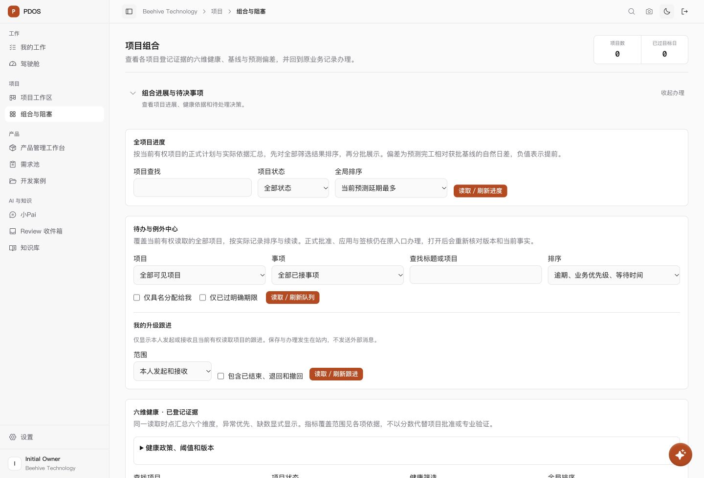
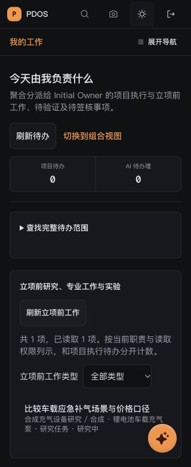

# 全站布局优化检查点 · 2026-10-01

用户授权：使用Vercel、Impeccable、Taste及Figma等前端工具优化使用体验，并明确范围为“整个项目布局”。本轮完成全站共享壳和主要工作区布局，保留Next.js、shadcn/ui、Tailwind v4、Geist、Phosphor、公司橙及双主题。

## 可用改动

| 范围 | 原问题与当前行为 |
|---|---|
| 全局导航与内容区 | 顶栏滚动后丢失、宽屏内容受窄容器约束；现在顶栏固定、显示当前位置，侧栏可在224/56px切换并跨页面记忆，内容使用实际可用宽度。设置保留适合表单阅读的宽度。 |
| 角色入口 | 工程师/质量点击驾驶舱实际上回本人工作；现在这两类角色只显示真实可到达的本人工作入口。原外部权限筛选保留。 |
| 项目及组合办理 | 计划、供给、工程、质量和组合页多个完整模块直接堆叠；现在按办理任务分组展开，所有子组件继续挂载，收起不丢未保存表单。旧查询和锚点自动展开分组及嵌套记录，包括延迟出现的目标。 |
| 工作项、项目目录与风险 | 工作项分类写入原URL并保留键盘焦点；项目目录支持名称/编号/阶段查找与实际状态过滤，零匹配可清除并回到输入。驾驶舱使用真实阶段名称，移除阶段位置推算百分比；风险直达具体风险记录。 |
| 需求池与开发案例 | 未开始办理时不再预留空白右栏，选中记录或打开表单后才分栏。手机操作与统计换行，表单按需打开。 |
| 知识、搜索与采集 | 原始资料与证据移入知识库已授权的主要内容区；外部角色及读取失败路径不会挂载资料区。搜索、采集移除重复main和手机留白。 |
| Review、小Pai、登录与设置 | Review手机避免详情与队列各自固定高度滚动，保留往返锚点及接受/独立应用守卫。小Pai全屏适配侧栏56/224px。登录突出实际工作入口，安全说明按需展开；设置子导航跟随顶栏位置。 |

## 验证与候选边界

- [受影响组件验证](tests.log)：14份测试文件、133项通过。覆盖角色导航、偏好、原路由兼容、查询/锚点展开、延迟目标、保留表单、分类定位、风险深链、知识权限及建议接受/独立应用。
- [受影响lint](lint.log)、[类型检查](typecheck.log)通过；生产构建同时完成全前端TypeScript检查。未新增低风险文案/展示的镜像测试。
- [独立webpack生产构建](build.log)通过，97个静态页面生成完成，[退出回执](build-status.json)为0。构建使用1071份前端文件冻结副本，不覆盖用户正在运行的开发`.next`。
- [构建摘要](build-candidate.json)、[本轮源码归属及SHA256](source-scope.json)：33份本轮文件与构建候选全部一致。产品工作区由其他会话持续修改；冻结后变化的文件已单列，不将其后续候选计入本轮验证。其总览仅补一处共同行类型注解以兼容现有类型检查，未重写业务内容。
- [浏览器几何及操作记录](browser-layout-checks.json)：复用已有合法登录的合成预览。实测320px手机亮暗、1280px笔记本暗色、1440px桌面亮色及1920px宽屏；已测页面无全页横向溢出。手机需求表单滚动655.5px后顶栏仍位于0；小Pai全屏左边界随侧栏在56/224px切换。导航Escape收起并返回触发按钮，跨页保留侧栏偏好。
- 实测页包括本人工作、知识库、组合、案例、需求池/按需表单、搜索、采集、Review空态、小Pai及登录。当前合成预览没有项目和Finding；有记录的专业页及Review队列/详情主要依组件行为验证，不能宣称本轮浏览器完整覆盖。
- `git diff --check`通过。未改数据库schema/迁移，未运行repo数据库测试、真实AI调用或业务写入；未触碰57432存续联验库，未push或部署，原N/P/Q及人工出口保持。

构建首次因包管理器尝试联网检查依赖中止，改用已安装本地Next工具；随后沙箱缺公开字体DNS访问，经环境权限允许下载既有Geist字体后构建通过。失败原始日志分别保留于[包管理启动](build-launcher-failure.log)和[字体网络](build-font-network-failure.log)，不以模拟字体结果替代成功构建。

## 工具与剩余条件

Impeccable用于布局/信息架构审阅、渐进展开和可操作性检查；Taste按现有密集业务界面选取视觉规则，沿既有品牌和组件库实现。Vercel官方[Web Interface Guidelines](https://vercel.com/design/guidelines)用于焦点、触控、布局及导航检查；Vercel连接未安装完成，因此未创建云端预览或部署。

已尝试生成“PDOS 全站布局与工作路径”Figma图，工具要求用户选择团队/组织后才能创建；当前未返回设计图链接，不能宣称已创建。工具选择完成后可继续云端工作；有真实业务记录的专业页整链验证沿对应业务闭环补齐。

## 查看与恢复

本地结果：[项目组合](http://127.0.0.1:3023/portfolio)。原合成预览前端3023/API8893及`pdos-ui-preview-20261001-b28c`继续保留供查看；环境归属及收尾方法沿[原预览记录](../product-space-ui-20261001/preview-open.md)，本轮不停止其他会话环境。

其余截图：知识手机暗色、组合笔记本暗色、需求手机表单、Review手机亮色及登录桌面/手机均保存在本目录。浏览器临时视口覆盖已恢复，登录检查临时页已关闭。
