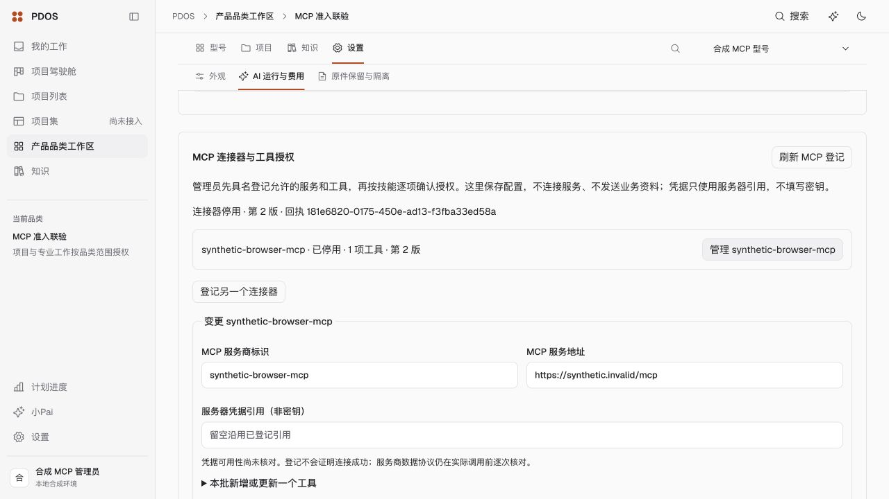
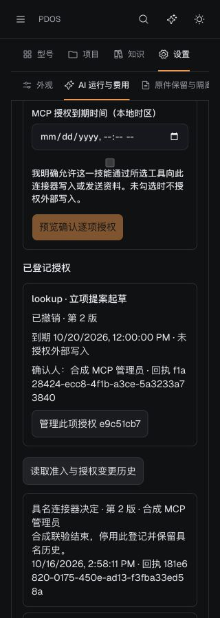

# M3：MCP 管理员准入与技能工具授权

本地管理闭环完成，按冻结 v1.1 §06.6.2、附录 A 的 `mcp.connector.allow`（T2）与 `mcp.tool.grant`（T1）建设。真实 MCP、模型、凭据解析、外发均为 **0**；完整 M3/S1 未验收。

- 品类设置接入租户管理员具名登记、工具增补/移除、技能逐项授权/续期/撤销、连接器停用、分页历史与原回执恢复。登记不显示“连接成功”，凭据仅使用服务器引用且不经读取接口回传。
- 服务器绑定实际管理员、品类权限、技能和工具合同；调用服务消费当前有效授权。服务目标/凭据引用变更影响该连接器的授权，对应工具合同变更只影响该工具；新增无关工具不打断原调用或要求重复确认。
- 当前事实、具名控制历史、Receipt/Audit/Outbox 与确认凭证原子提交；失败回滚、旧零版本授权撤销、新授权独立身份及原请求精确恢复通过。外部写入默认关闭，授权不能替代实际业务批准。
- 参数使用本地 JSON Schema 校验，不解析远程引用；隔离调用仍保留原始响应与结构化结果边界。

## 验证

[最终 MCP 后端 22 项](backend-final.log)通过，含管理员/权限、确认档位、参数合同、原子回滚、授权变化、失效/撤销、隔离服务消费以及新增无关工具后原调用精确重放。[增量 60 项](backend-increment.log)中包含上述两项和 58 项技能合同/受控执行纯检查，合计 **80 个不同后端病例**；[前端/BFF 57 项](frontend.log)通过，合计 **137 个不同病例**。去重范围见 [检查清单](checks-result.json)。

[类型](types-final.log)、[lint](lint-final.log)、[Ruff](ruff-final.log)、[最终生产构建](build-final-binding.log)与[冻结目录对应](design-catalog.log)通过。最终源码见 [指纹清单](source-manifest.json)，父提交 `3c91d7b`；未进行新的攻防或全量回归轮次。

迁移从真实 `s0_0769` 单调续到 `s0_0770`，[0769 → 0770 → 0769 → 0770、原 MCP 事实保留与 ORM 对齐](migration-result.json)通过。仅使用独立 64245/pdos_test，标记 `f9048729-3f2a-4494-af75-56e1db7d743d`；非生产数据库。

最终 [HTTP 交互测量](interactive-latency.json)：单个合成租户、每操作 20 个已认证 execute 样本，连接器决定 p95 **208.45ms**、工具授权 p95 **169.69ms**，应用引擎最多 25 次驱动 SQL；不含预览及认证引擎 SQL，不代表完整 S1 性能出口。

实际浏览器完成合成登记 → 授权 → 成功响应替换为 503 → 刷新只读恢复原回执 → 撤销 → 停用，桌面亮色和 320px 暗色可用。[业务核对](browser-business-result.json)为 1 个连接器和 1 项授权，最终均第 2 版且已停用/撤销，4 份具名回执各有一份 Audit/Outbox/控制历史。[请求顺序](browser-recovery-result.json)证明授权业务 POST 仅 1 次，刷新只读恢复同一回执；[原始 HTTP 观测](browser-http.jsonl)保留。

## 收尾与剩余

[自用预览收尾](closeout.json)：3051/8051 服务、自建标签关闭，视口恢复，合成登录已过期、合成管理员停用；历史保留。原主临时库和共用 Temporal/运行时未停用，无 push/生产操作。

当前默认 Bootstrap/注册图尚未接入 MCP 发现/读取适配器和真实协议传输，`McpService` 的网络与隔离抽取仍由端口注入。因此本次完成的是管理入口与调用服务消费，不能宣称小Pai已经贯通真实 MCP。自动化规则管理属 S5，本次只实现技能授权管理；通用结构化输出校验器也未新增。下一步继续默认注册图的 MCP 发现/读取桥接；真实协议、模型、KMS与签约材料齐备后完成获授权的实际联验。操作与恢复条件见[运行手册](../../../../runbooks/mcp-admission-and-grants.md)。
