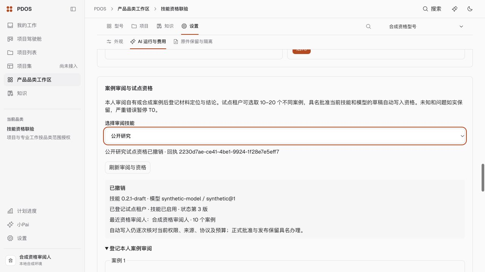
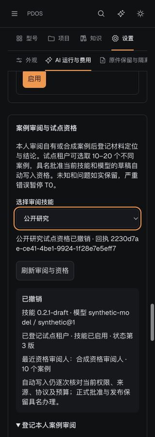

# M3：本人案例审阅与草稿试点资格

本地闭环完成，按冻结 v1.1 §06.12、附录 A 的 T2 `ai.skill.qualify` 办理。真实模型调用、真实租户试点准入及真实资格授予均为 **0**，完整 M3/S1 未验收。

- 品类设置可选择实际技能，批量登记 1–20 条本人自有/合成案例的材料定位、结论、严重度与六项审阅；未知不补成通过。T1 一次确认保存本人私有、不可覆写的记录。
- 试点租户可从本人当前审阅中选取 10–20 个不同材料，预览后具名批准或撤销资格（T2）。服务器绑定实际技能内容、相关工具与模型身份，无额外通过率门槛。应用账号不能写试点准入根，Agent 不能读取原始审阅或代办 T2。
- 严重错误原子暂停后续 T0；恢复只接受错误批次之后的新审阅。同一严重错误批次的其他案例不能代替重新审阅。模型/技能/相关工具变化使旧资格失效；凭据和价格不混入质量身份。
- 资格由实际领域执行检查消费；具名批准 → 实际 T0 Claim 写入 → 撤销 → 历史同回执恢复已通过。当前授权、来源、出站协议、预算、实际 Run/模型回复绑定仍核对。
- 页面刷新只读恢复原请求，不自动写入。实际合成浏览器完成第十条审阅、十案例具名批准、成功响应被替换为 503、刷新恢复同回执，以及 320px 暗色具名撤销。

## 验证

[139 个不同后端病例的去重范围](checks-result.json)经集中与增量复核通过；包括首组 [71 项](qualification-final-targeted.log)、[资格增量](qualification-final-increment.log)中 16 项通过及两项夹具错误的[定向补验](qualification-two-fixed-fixtures.log)、[51 项实际写回/抽取/撤回回归](affected-runtime-final.log)、[13 项最终投影/材料/技能契约](final-version-projection.log)和[具名资格到实际 T0](named-to-actual-t0.log)。各组有重叠，不累加日志次数。早期回执 SQL 名称歧义、试点锁定读和 T2 凭证约束失败已定位修复；失败日志保留，不计作通过。

[前端/BFF 57 项](frontend-verified.log)、[类型](types.log)、[lint](lint.log)、[Ruff](ruff-final.log)、[生产构建](build.log)及冻结[设计目录对应](design-catalog.log)通过。本轮之后只补撤销预览的原技能/模型版本字段，经上述 13 项定向复验，前端源码未再变动。[最终源码指纹](source-manifest.json)基于父提交 `764ae60`。

迁移从真实 `s0_0765` 单调续到 `s0_0769`。原临时库的 [0766 往返与原技能历史保留](migration-result.json)通过；另建空库完成 [0765 → 0769 → 0765 → 0769、ORM 对齐与普通角色权限核对](empty-schema/result.json)，自建空库已备份停服。原测试库 64245/pdos_test、标记 `f9048729-3f2a-4494-af75-56e1db7d743d` 保留。

[实际业务记录](browser-business-result.json)：2 批/10 个案例、1 次具名批准 + 1 次具名撤销，技能状态第 3 版且已撤销；Receipt/Audit/Outbox 原子记录各 1 份。[恢复请求顺序](browser-recovery-result.json)及[原始 HTTP 观测](browser-http.jsonl)确认只有 1 次批准业务 POST，刷新后只读恢复，批准没有重复提交。观测到的单次保存用时为秒级，未作 p95 或 S1 性能出口结论。

## 收尾与剩余

[自用预览已收尾](closeout.json)：3050/8050 服务和自建标签关闭，视口恢复，合成登录已过期，合成管理员与试点已停用；案例和历史保留，共用 Temporal/状态服务未动。没有 git push、生产操作、真实外发或重复攻防轮次。

办理路径与真实准入恢复条件见[运行手册](../../../../runbooks/pilot-skill-qualification.md)。真实服务商/模型、KMS、签约与价格材料、本人实际案例审阅和真实资格，以及完整 M3/S1 的真实 Worker/模型、性能与恢复验收仍未完成；缺材料只暂停对应实测。继续按唯一清单推进已授权的独立建设，不把本闭环当作阶段验收通过。
