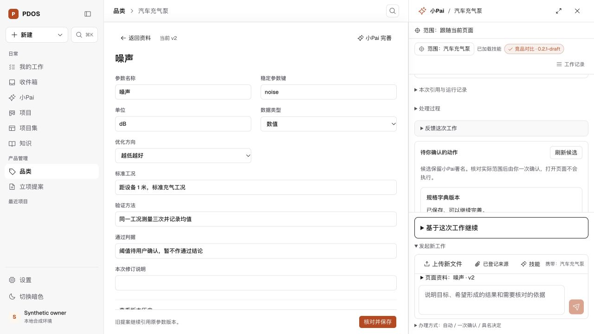

# 品类资料与小Pai编辑流程 · 2026-10-25

本轮按用户指出的“品类资料与小Pai编辑流程”接通正式功能。竞品、用户声音、规格参数的真实运行候选，现可从「查看与编辑」进入独立大编辑区，旁边保留原对话。保存后保持编辑和对话，继续修订同一资料；历史会话的已保存卡片可重新打开服务器当前版本。收起编辑区、切换候选和继续运行不会丢失仍在本页的未保存内容。

品类页「小Pai新增与维护」准备新的品类资料请求，清除之前被聚焦的无关运行，用户发送后才开始执行。当前资料对象、版本和未保存字段随用户下一次发送/续聊带入；权限和实际写入范围仍由服务器判定。

## 实现与边界

- `PaiMaterialWorkspace` 复用品类编辑器，缓存各候选编辑状态；保存读回成功后，后续保存绑定实际对象/版本。已保存回执与真实对象读回支持刷新恢复，未知结果沿用原请求，避免重复创建。
- 原始 AI 候选及其摘要不变。人工修订通过独立 `human_edits` 进入预览、本人一次确认和回执；模型工具不接受该字段。服务器与数据库均限制可修改字段，保留来源、目标版本、运行取消/权限、原子性与重复采用守卫。
- 401/403 清除编辑内容、上下文和当前范围的本地请求；重新授权读取可以恢复使用，但不恢复已清除的旧内容。
- `s0_0815` 追加数据库一致性守卫。存在具名修订历史时拒绝降级，防止恢复为不识别该历史的旧守卫。

## 验证

- [55项受影响前端测试](frontend-tests.txt)：包括原稿/人工修订分离、保存后同对象续版、原请求恢复、折叠/继续运行保留、撤权清除/重新读取、页面新请求释放旧运行。
- [24项实际 PostgreSQL/API 测试](postgres-tests.txt)：三类资料保存与回执采用、原稿不可篡改、非法编辑字段拒绝、其他身份拒绝、取消、重复保存，以及已有修订历史的降级保护。
- [浏览器检查](browser-checks.json)：实际 Next→API→PG 保存规格 v1、同对象续版 v2、刷新后从原会话继续编辑；桌面亮暗和390px核对。浏览器候选来自显式合成模型账本，没有调用外部模型，也不冒充真实模型共创验收。
- 最终生产构建及类型检查见 [build.txt](build.txt)；受影响前端 lint 和 Python ruff 通过，见 [frontend-lint.txt](frontend-lint.txt)、[python-lint.txt](python-lint.txt)。源范围见 [source-manifest.json](source-manifest.json)。
- 独立测试库53502曾停留在0790，备份后升级至0815；合成账本夹具原先加载技能后未同步工具披露摘要，已修正。浏览器实测还修复了候选中空确认令牌导致预览不匹配、旧聚焦运行重新出现和窄屏保存栏叠层问题；最终验证结果对应修复后候选。

## 本地运行状态

用户预览继续使用 `http://localhost:57859/`。专属综合预览克隆57358已核对身份，从0814升级到0815，并重启57858 API；未重建数据、未修改生产环境。升级前备份：`~/pdos-preview-backups/2026-10-25-material-pai-preview-034250/pdos_test.sql.gz`，gzip校验通过。测试库升级前备份：`~/pdos-preview-backups/2026-10-25-material-edits-test-033313/pdos_test.sql.gz`。

## 剩余范围

本轮完成三类品类资料候选编辑与保存续编，不等于全产品功能迁移完成。提案候选的同方式直接编辑、品类名称/主要场景正式更新、参数撤回/恢复、完整原件来源选择，以及原覆盖矩阵中的项目集/组织消息/NPI等余项仍保留；真实模型往返共创未在本轮验收。阶段、资格和生产启用不因此改变。
