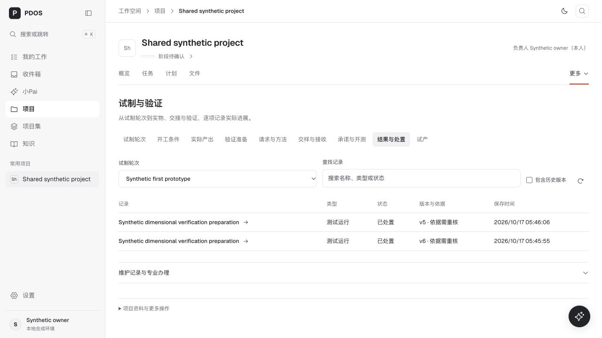

# 专业页面 UI 与实际数据接入检查点

2026-10-26。按用户确认的整个 `ui-lab/platform`、A 方案及 Impeccable，继续在正式页面补齐专业工作。原有具名办理、一次确认、历史与原请求恢复均保留。

## 已实现

- 14 类专业记录接入实际授权 API：开工、产出、物料、成本、验证准备、请求与方法、交接、开测、结果、质量问题、原因措施、变更、现场反馈及制造发布。统一搜索、当前/历史筛选、详情、刷新、错误/空态及已有历史游标。
- “继续专业办理”定位实际 Build、请求、Run、问题、变更、反馈或发布版本；不触发提交。专业编辑区展开后保留输入，保存回执刷新对应摘要；待定原请求不会被导航覆盖。
- 制造准备、物料和成本固定当前项目。旧本机草稿按已验证项目范围恢复，原待定命令、幂等键和凭证保留；不跨项目取用草稿。
- 项目概览改读真实试制轮次、固定配置和计划数量，明确选择轮次后直达后续工作。
- 失效原件/扫描在变更页明确说明；保留可读变更选择器和已保存版本，正式上下文仍由服务器拒绝，不放宽资格。
- 项目动态将同一读取事务内反复使用的授权回执/事件元数据一次物化，继续执行原 RLS、项目条件、固定身份与分页水位。同一合成制造项目从原 HTTP 46.09 秒、EXPLAIN 执行约 44.04 秒降到默认规划器 3.384 秒（单次本地观察，不代表 p95）。概览实际读回 20 条动态及下一页入口。

## 页面覆盖

| 页面组 | 本轮覆盖 |
| --- | --- |
| 我的工作、收件箱、小Pai、项目、项目集、知识、品类、提案、设置 | 正式导航逐页打开并读取；记录见 `global-*.txt`。未新增消息、模型调用或设置写入 |
| 产品与工程 | 定义、工程/BOM、平台与差异入口；制造准备实际 3 个资料系列、固定项目/配置；制造发布实际固定版本；物料与成本项目范围及恢复 |
| 试制与验证 | 原完整面板映射保留；开工、产出、准备、方法、交接、开测、结果的实际 API 读取；结果当前 2 个 Run、接续精确 Run；历史、来源与试产原入口保留 |
| 问题与变更 | 项目 Build 范围问题与措施读集；变更当前 v12 与 12 版历史；实际变更接续及失效来源处理 |
| 评审与交付 | 固定发布包、工程/制造决定、具名例外与撤回入口；实际外部交接、6 条回执水位，发送/接收/生效分开显示，冲突保持可见 |
| 现场反馈 | 实际反馈 v2、固定配置定位、处置与后续结果、变更接续；公开逻辑 ID 自动定位 |
| 文件、计划、阶段与门禁 | 既有能力与新入口映射保留；本轮不重跑上一检查点的资源冲突、计划修订及阶段正式写入，沿用其既有证据 |

## 验证

- 282 项组件/投影检查通过；234 项相关库回归通过；制造准备 50 项恢复与确认契约通过；变更契约 24 项通过。最后变更修复另复核 5 项组件子集（包含在组件总集中，不重复计数）。
- 动态后端 29 项通过，其中 3 项实际 PostgreSQL 链覆盖工作/计划、多主体回执、固定游标、撤权、跨范围拒绝、实物与发布决定；在已核对的独立 `pdos_test` 64245 运行。
- 源码类型检查、最终生产构建、Ruff 与差异空白检查通过；改动文件 lint 0 错误，1 项既有测试工具未使用参数警告。
- Google 字体网络请求曾超时；最终构建在独立源码副本使用本机已实际缓存的 11 个 Geist/Geist Mono 字体文件，未改变应用字体或关闭 TLS。最终副本 `src` 与工作区逐字节一致。
- 浏览器检查桌面亮色、390px/320px 暗色；详情焦点、列表局部横向滚动、实际记录接续、已保存内容与来源状态有截图/快照。正式 57859 与验证 57861 共用源码；仅重启本地 57858 API 使查询修复生效，原前端及 worker 保持运行。

最终文件哈希见 [source-manifest.json](source-manifest.json)，计数与环境见 [verification-summary.json](verification-summary.json)，独立检查处置见 [finish-review.md](finish-review.md)。对应原始日志与页面快照均在本目录。

## 可用边界与后续

本轮新增专业 UI 接入及发现的接续/读取缺陷已完成。验证材料来自已有合成数据库中的实际 API，不是前端示例数据；不代表真实业务资格或阶段人工验收。

部分旧合成原件的安全扫描已失效，正式变更材料读取返回 `SOURCE_UNAVAILABLE / ORIGINAL_SECURITY_BLOCKED`；需通过文件安全流程恢复有效来源后才能继续相关正式办理。已保存版本仍可查。外部移交案例的生效回执存在原有指纹冲突，页面如实显示，未伪造成功或执行外发。

本轮没有进行真实生产部署、git push、模型调用或真实业务外发。唯一清单中其他已记录的小Pai及后续建设缺口仍按原状态保留，不由本次专业页检查覆盖为完成。

