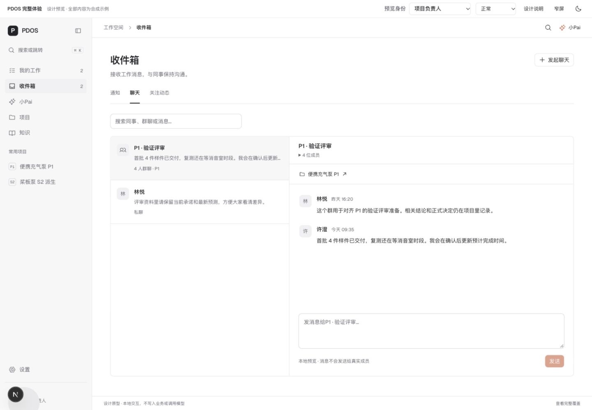
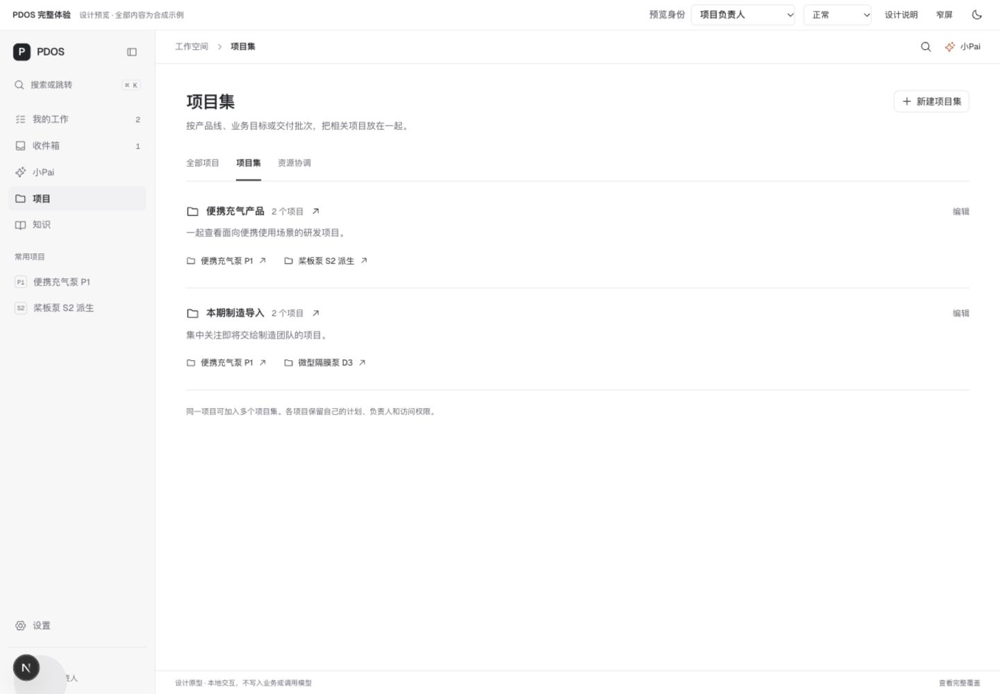
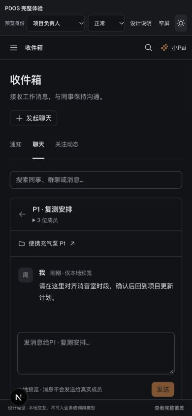

# 本人工作、组织收件箱与项目集预览修订

日期：2026-10-23。仅修改 `/ui-lab/platform` 设计候选，不替换正式产品，不改变冻结业务规则。

## 用户确认与落地

用户要求调整个人工作、承诺和动态，新增项目集，解释“组合与资源”；对收件箱范围明确答复“工作消息与提醒、完整团队聊天，两种都可以有”。

- 我的工作：待我处理 / 承诺 / 已完成。承诺显示责任人、接收人、交付、日期与预计，使用共享合成记录双向投影；已完成只读回看结果和说明。
- 收件箱：通知 / 聊天 / 关注动态。通知支持搜索、未读、已读、归档恢复、原对象跳转和联系同事；私聊群聊可创建、关联项目、查看成员、跨页保留草稿。动态支持关注项目和范围筛选。
- 项目集：新建/编辑名称、说明和项目成员，一项目可归属多个集；列表、看板、时间轴使用同一筛选。项目集仅组织项目，不改变权限和业务记录。
- 原组合与资源改名资源协调，移到项目内部；用消音室冲突说明用途，取舍后进入项目计划。
- 五个主入口：我的工作 / 收件箱 / 小Pai / 项目 / 知识。外部协作者不进入组织消息。

## 验证

[浏览器原始检查](browser-checks.json)保留 28 条观察：首轮 25 项通过、1 项跳转失败；修复后对应跳转复核和项目 A/B 方案比较均通过，27 个最终不同检查点无剩余失败。覆盖通知、私聊群聊、跨页草稿、离线、项目集三种视图、责任人与接收者同一承诺、身份隔离、外部入口、已完成只读、小Pai连续两次介入提醒、错误/空态。

桌面 1440×1000、桌面390px容器模拟、实际390×844暗色均检查；通知/聊天窄屏单列并可返回，横向溢出指标通过。长消息打开/发送后滚到末尾。不是全产品全部页面与全部岗位的重新验收。

最终候选 `eslint` 与 `tsc --noEmit` 均退出0，日志见 [eslint.txt](eslint.txt)、[typecheck.txt](typecheck.txt)；[源码哈希和验证范围](verification.json)。最终浏览器 error/warn 为空。

Impeccable 独立只读复核提出的容器查询、承诺事实一致、每次小Pai事件已读键、长消息滚动四项已修复并由浏览器核对。初次资源跳转失败原件保留，不冒充首轮全部通过。

## 可预览

- [收件箱](http://localhost:57859/ui-lab/platform?view=inbox)
- [项目集](http://localhost:57859/ui-lab/platform?view=sets)
- [资源协调](http://localhost:57859/ui-lab/platform?view=portfolio)
- [我的工作](http://localhost:57859/ui-lab/platform)

## 剩余与边界

全部合成资料与本地交互，消息不会发送给真实成员；不调用业务API、数据库或模型。刷新清空演示消息、草稿、项目集和办理状态。用户可直接预览选择，无剩余环境阻塞；正式消息持久化、实时投递、群受众授权、通知事件同步和项目集领域接入仍需后续实现。未宣称正式通信能力、生产启用或阶段验收通过。
