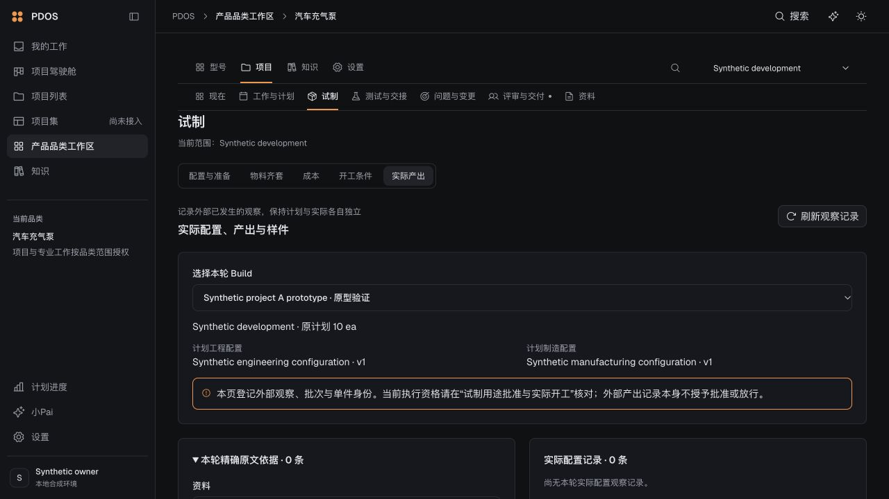

# S2 项目办理入口闭环（2026-10-17）

已按[接续合同](../../../../design/2026-10-17-pdos-next-s2-project-workbench-contract.md)恢复 S2 建设。本批完成项目入口到配置/Build、用途批准、实际产出/样件、验证准备、请求与方法、品质交接、开测和结果八个面板的项目绑定；本人草稿、选择和原请求按项目保存。型号总览保持原有读取方式，服务器仍拥有实际权限与业务事实。

Build 读取先核对真实项目所属型号与受众，再筛选和投影；合法空项目与不可见/无关联项目分别处理。结果页先核对本项目轮次，旧选择不深读其他项目，失败不退回全部轮次。恢复其他项目的 Build 创建请求时拒绝提交。写入复用原命令和 T1/T2，不增加资格。

验证：

- [实库输出](backend-scope-initial)：**50 项通过**后主动中断较宽执行回归（退出 2），不称完整回归通过。前段包括新增的 3 项同型号双项目筛选/合法空结果/原总览兼容/项目权限撤销检查，以及原 Build 创建、幂等和执行的已完成病例。只用已核对 `127.0.0.1:64245/pdos_test`，标记 `f9048729-3f2a-4494-af75-56e1db7d743d`，head `s0_0772`，无迁移。
- 前端/BFF 首组 184 项通过；补齐专业面板后其 22 项通过，与首组 20 项重叠，合计 **186 个不同病例**。类型、最终生产构建、Ruff 通过；全量 lint 零错误、2 条已跟踪旧 JS 警告，新增专业面板改动 lint 零警告。目录合同核对只表示 86 操作/85 事件/63 场景的设计覆盖，不表示阶段验收。
- [实际浏览器记录](browser-observations.json)：两个经真实 G0 创建的同型号合成项目分别只列自己的 Build；B 初始选择为空，A/B 草稿分别保存，返回 A 恢复原轮次及 `S2-A-draft`。停止本任务 API 后显式刷新显示读取失败、清空可选轮次并保留输入；恢复 API 后显式重读恢复 A 并清除错误。页面未点击业务提交按钮。本次只验证实际产出页的项目选择/草稿恢复；其余面板由类型、受影响库测试和接线检查覆盖，未冒称八面板完整实物业务联验。
- [源与检查记录](checks.json)保留本批文件哈希及验证边界。导出实际 OpenAPI/载荷和目录状态，同时对齐此前 S1 已实现接口的合同滞后。测试库与共用服务保留，本任务 API/Web 已关闭。

S2 阶段未验收。下一步贯通固定实际配置→多批产出/样件→具名品质接收→部分/最终测试结果，按 AT-07/08/11–15 检查恢复与未知条件。S1 未验收、3 项确认消费间歇失败及真实 MiniMax/KMS/协议条件继续保留；性能验收暂缓，真实模型调用为 0，本批不恢复 S3–S4。
