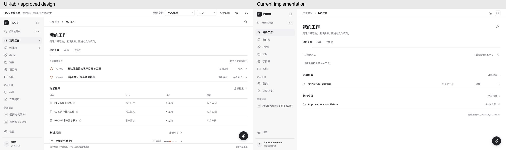
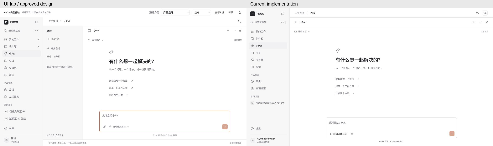
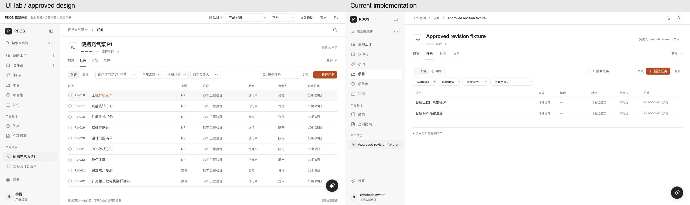
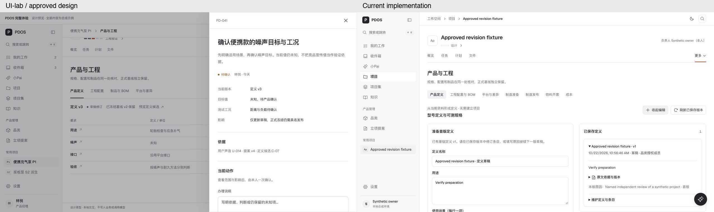

# UI-lab/platform 与当前正式实现差异 · 2026-10-26

结论：主导航、主题、常用页面骨架和不少核心交互已经对齐，但仍不能称为整个 UI-lab 的完整复刻。主要余项集中在首页信息展示、小Pai会话状态、提案编辑、组织通知和专业办理的呈现方式。

## 核对口径

- 设计源：当前 `pdos-next/web/src/app/ui-lab/platform/` 代码、其 DESIGN.md 与完整产品 UI 设计说明。
- 实现源：当前工作区 `pdos-next/web/src/components/`、相关前端读写协议和必要的后端投影代码，包含既有未提交修改；不是只看 HEAD。
- 本轮浏览器实看四处：产品经理首页、小Pai独立工作区、项目任务、产品与工程。使用同一浏览器的 1280×720 视口；设计为产品经理合成身份，正式为现有本地合成 Owner。两端业务对象不同，只对比结构与操作方式。
- 设计页顶部评审工具及底部原型说明不计为正式缺项。空队列、人数、项目名和未知事实不计为设计缺陷。
- 下文区分浏览器已见差异与静态代码差异。没有提交表单、发送组织消息、调用模型、修改业务数据或运行数据库命令；没有进行完整权限、手机、暗色、可访问性或 S1–S5 验收。

## 四处实际页面对照

### 1. 我的工作：骨架接近，继续工作的信息未完整呈现

- 正式“继续提案”是标题、品类、状态的无表头列表；设计是“提案／入口／状态／更新”四列表，还标识私有提案。
- 正式“继续项目”固定输出项目名和品类；设计输出阶段和阶段进度条。这是组件差异，不是样本没有阶段。
- 正式增加刷新、搜索筛选和“资料读取于”时间，页面信息与设计也不完全一致。
- 代码：[my-work.tsx:311](../../../../pdos-next/web/src/components/my-work.tsx#L311)、[my-work-continue.tsx:9](../../../../pdos-next/web/src/components/my-work-continue.tsx#L9)、[my-work-continue.tsx:41](../../../../pdos-next/web/src/components/my-work-continue.tsx#L41)；设计 [platform-preview.tsx:524](../../../../pdos-next/web/src/app/ui-lab/platform/platform-preview.tsx#L524)、[product-preview.tsx:192](../../../../pdos-next/web/src/app/ui-lab/platform/product-preview.tsx#L192)。

### 2. 小Pai：聊天基础已对齐，默认布局和资料操作仍不同

- 本轮桌面首次进入，正式会话列收起；设计默认常驻显示。正式能力已经存在，属于默认展开状态差异。`historyOpen` 只在挂载时按 fullPage 初始化，之后的整页展开不会同步重算。
- 正式个人通用聊天没有附件入口，首轮固定发送 `sources: []`。范围内聊天有附件，但需先上传并成为登记来源，再选择固定版本；续聊没有同等的附件及技能选择入口。
- 设计附件只模拟文件名；因此“入口差异”成立，但不能将设计演示当成真实文件处理已完成。
- 代码：[personal-xiaopai.tsx:82](../../../../pdos-next/web/src/components/category-create/personal-xiaopai.tsx#L82)、[personal-xiaopai.tsx:281](../../../../pdos-next/web/src/components/category-create/personal-xiaopai.tsx#L281)、[xiaopai.tsx:279](../../../../pdos-next/web/src/components/xiaopai.tsx#L279)、[xiaopai.tsx:291](../../../../pdos-next/web/src/components/xiaopai.tsx#L291)。

### 3. 项目任务：主要视图已落地，工具栏和办理方式未一致

- 同为1280px，设计将视图、阶段／来源／状态／负责人、搜索和新建排列在一行；正式分成两行，并多一个任务更多菜单。
- 正式默认“所有阶段”，设计默认当前阶段。正式任务行没有设计中的状态图标及任务编号。
- 正式办理沿分派、承接、开工、提交、验收；设计直接编辑名称、说明、负责人、状态、优先级及截止日期。正式没有相同的通用任务编辑表单。
- 任务的真实具名办理和不同日期语义必须保留；不能为复制原型而将专业验收变成任意状态切换。
- 代码：[project-work.tsx:60](../../../../pdos-next/web/src/components/projects/project-work.tsx#L60)、[project-work.tsx:145](../../../../pdos-next/web/src/components/projects/project-work.tsx#L145)、[project-work.tsx:158](../../../../pdos-next/web/src/components/projects/project-work.tsx#L158)；设计 [project-tasks.tsx:193](../../../../pdos-next/web/src/app/ui-lab/platform/project-tasks.tsx#L193)、[project-tasks.tsx:470](../../../../pdos-next/web/src/app/ui-lab/platform/project-tasks.tsx#L470)。

### 4. 专业页面：真实内容已有接入，深入办理仍偏长表单

- 原稿以紧凑列表和统一右侧详情／确认抽屉办理；正式不少详情出现在列表下方，继续专业办理再展开既有 Workspace。
- 本轮实看产品定义：正式展开“准备首版定义”和“已保存定义”的双列长表单；设计在规格表内点行进入统一抽屉。两图比较操作方式，不表示是同一个业务动作。
- 正式专业页保留更多制造、成本、质量和治理能力，这是应保留的业务范围；呈现方式仍可统一到设计的按需详情模式。
- 代码：[project-professional-records.tsx:50](../../../../pdos-next/web/src/components/projects/project-professional-records.tsx#L50)、[project-professional.tsx:77](../../../../pdos-next/web/src/components/projects/project-professional.tsx#L77)、[product-definition.tsx:192](../../../../pdos-next/web/src/components/product/product-definition.tsx#L192)；设计统一抽屉 [platform-preview.tsx:2677](../../../../pdos-next/web/src/app/ui-lab/platform/platform-preview.tsx#L2677)。

## 其他现存差异：代码核对

| 页面／能力 | 当前差异 | 证据 |
|---|---|---|
| 双向承诺 | 目前本人承诺投影未提供设计中的“我承诺的／别人承诺给我的”切换，也未并列呈现承诺日期与最新预计。 | [my-work.tsx:220](../../../../pdos-next/web/src/components/my-work.tsx#L220)、[personal_project_work.py:175](../../../../pdos-next/server/pdos_next/personal_project_work.py#L175) |
| 收件箱通知 | 已有通知／聊天／关注框架，但通知来源主要是小Pai等待与失败／部分结果，普通工作通知和提及未按设计接齐。 | [inbox.tsx:119](../../../../pdos-next/web/src/components/inbox.tsx#L119)、[inbox.tsx:495](../../../../pdos-next/web/src/components/inbox.tsx#L495) |
| 组织聊天 | 私聊、多人会话、已读、归档与回复已存在；创建只绑定品类，没有设计中的项目关联和项目入口。 | [inbox.tsx:667](../../../../pdos-next/web/src/components/inbox.tsx#L667)、[inbox.tsx:690](../../../../pdos-next/web/src/components/inbox.tsx#L690) |
| 项目集 | 已可创建、编辑、移入／移出；看板按来源是否当前分类，尚非设计的项目健康度汇总。详情缺阶段／健康度列，直接换归属也需先移出再移入。 | [project-sets.tsx:47](../../../../pdos-next/web/src/components/projects/project-sets.tsx#L47) |
| 项目概览 | 原稿顶部有健康度与当前进展摘要；正式需要推进主要汇总任务／风险并跳任务页，未覆盖设计中决定、接收、验证等直接办理入口。 | [project-workspace.tsx:74](../../../../pdos-next/web/src/components/projects/project-workspace.tsx#L74) |
| 项目计划 | 三种视图、四时间及资源方案已接入；里程碑下仍重复展示计划任务／工作包／依赖等明细，设计要求这里突出里程碑与资源。 | [project-planning.tsx:44](../../../../pdos-next/web/src/components/projects/project-planning.tsx#L44)、设计 [DESIGN.md:45](../../../../pdos-next/web/src/app/ui-lab/platform/DESIGN.md#L45) |
| 项目文件 | 当前主要是型号共享原件、解析状态与大小；设计是资料／版本／所属对象／可用性的项目资料汇总。 | [project-files.tsx:18](../../../../pdos-next/web/src/components/projects/project-files.tsx#L18)、[project-files.tsx:27](../../../../pdos-next/web/src/components/projects/project-files.tsx#L27) |
| 提案编辑 | 方案仍为“方案／类型／说明”行式表格，点铅笔逐行编辑；设计A/B并排、单元格直改。待决问题表没有设计中的手动增删入口。 | [proposal-item-table.tsx:139](../../../../pdos-next/web/src/components/preproject/proposal-item-table.tsx#L139)、[proposal-item-table.tsx:202](../../../../pdos-next/web/src/components/preproject/proposal-item-table.tsx#L202)、[proposal-document.tsx:318](../../../../pdos-next/web/src/components/preproject/proposal-document.tsx#L318) |
| 新建品类保存后 | 正式直接展示元数据编辑表单，个人续聊未接入保存对象的编辑上下文；设计保留内容阅读态并继续同份材料。 | [personal-xiaopai.tsx:267](../../../../pdos-next/web/src/components/category-create/personal-xiaopai.tsx#L267)、[personal-xiaopai.tsx:280](../../../../pdos-next/web/src/components/category-create/personal-xiaopai.tsx#L280) |
| 品类冷恢复 | 恢复采用卡片的名称／场景取原AI候选，没有重新读取确认保存时的人工修订，可能展示旧名。此为代码风险，未运行复现。 | [personal-xiaopai.tsx:140](../../../../pdos-next/web/src/components/category-create/personal-xiaopai.tsx#L140)、实际保存 [category_creation.py:652](../../../../pdos-next/server/pdos_next/domain/preproject/category_creation.py#L652) |
| 型号与定义 | 原稿是用途／定义／配置／平台／项目的单页概要与版本派生表；正式仍为7个标签内嵌 Workspace。 | [model-workspace.tsx:11](../../../../pdos-next/web/src/components/model-workspace.tsx#L11)、[model-workspace.tsx:43](../../../../pdos-next/web/src/components/model-workspace.tsx#L43) |
| 设置 | 四分组已落地；成员页缺责任列与具体范围，个人偏好未呈现设计的待处理提醒和默认首页控制。正式真实模型、预算、技能资格、MCP等能力应保留。 | [platform-settings.tsx:26](../../../../pdos-next/web/src/components/platform-settings.tsx#L26)、[app-shell.tsx:243](../../../../pdos-next/web/src/components/app-shell.tsx#L243) |

## 比外观更应优先核对的会话状态差异

以下来自代码路径分析，尚未通过多会话运行复现，不作为已发生的越权或数据损失结论：

1. **项目会话筛选缺失**：SessionHistory 接收 projectId，但 readScope、列表键、readConversations 请求未使用它。Run已绑定项目，不代表历史列表已按项目分开。证据：[session-history.tsx:60](../../../../pdos-next/web/src/components/pai/session-history.tsx#L60)、[session-history.tsx:73](../../../../pdos-next/web/src/components/pai/session-history.tsx#L73)、[pai-session-presentation.ts:104](../../../../pdos-next/web/src/lib/pai-session-presentation.ts#L104)。
2. **未发送草稿不按会话恢复**：续聊输入由 RunContinuation 的局部 goal 状态持有，组件按 runId 重建；设计每个会话分别保存 draft、skill、files。证据：[run-continuation.tsx:50](../../../../pdos-next/web/src/components/pai/run-continuation.tsx#L50)、[xiaopai.tsx:279](../../../../pdos-next/web/src/components/xiaopai.tsx#L279)。
3. **切会话未同步切换编辑材料**：clearSelection未清 editingMaterial，而 currentMaterial优先取该编辑器上下文；旧编辑器可能继续显示并进入下一轮上下文。设计在 switchSession先关闭编辑器。证据：[xiaopai.tsx:68](../../../../pdos-next/web/src/components/xiaopai.tsx#L68)、[xiaopai.tsx:99](../../../../pdos-next/web/src/components/xiaopai.tsx#L99)、[xiaopai.tsx:233](../../../../pdos-next/web/src/components/xiaopai.tsx#L233)。
4. **新候选不自动替换已开编辑区**：正式编辑器绑定已点开的 event_id；原稿按会话查最新同类候选。证据：[xiaopai.tsx:62](../../../../pdos-next/web/src/components/xiaopai.tsx#L62)、[xiaopai.tsx:227](../../../../pdos-next/web/src/components/xiaopai.tsx#L227)、设计 [pai-preview.tsx:249](../../../../pdos-next/web/src/app/ui-lab/platform/pai-preview.tsx#L249)。

## 已对齐与合理实现差异

- 六个主入口、按权限产品管理、浮动小Pai和项目四常用标签已落地。
- 项目目录列表／看板／时间轴直接共用 ProjectDirectoryView；不能再列为未迁移。阶段／门禁真实读集及资源方案修订已有实现，不沿用旧报告“全部缺失”的结论。
- 知识已提供已发布／候选／已失效列表与详情；正式另有品类筛选、搜索和管理入口。
- 小Pai已有连续会话、搜索、重命名、置顶、归档和恢复；资料／提案已有左编辑右聊天、保存阅读和续聊。
- 提案规格多选／搜索／批量加入／删除，以及手机编辑／对话切换已有实现。
- 正式版的持久化、领域权限、固定版本、具名批准、幂等恢复等比内存原型更完整；这些不应作为“多出来应删”的设计差异。

建议顺序：先复现并处理会话状态与项目筛选，再补双向承诺／通知／资料入口，最后统一专业办理与页面密度。此轮仅形成对照结果及截图，没有修改产品代码。
