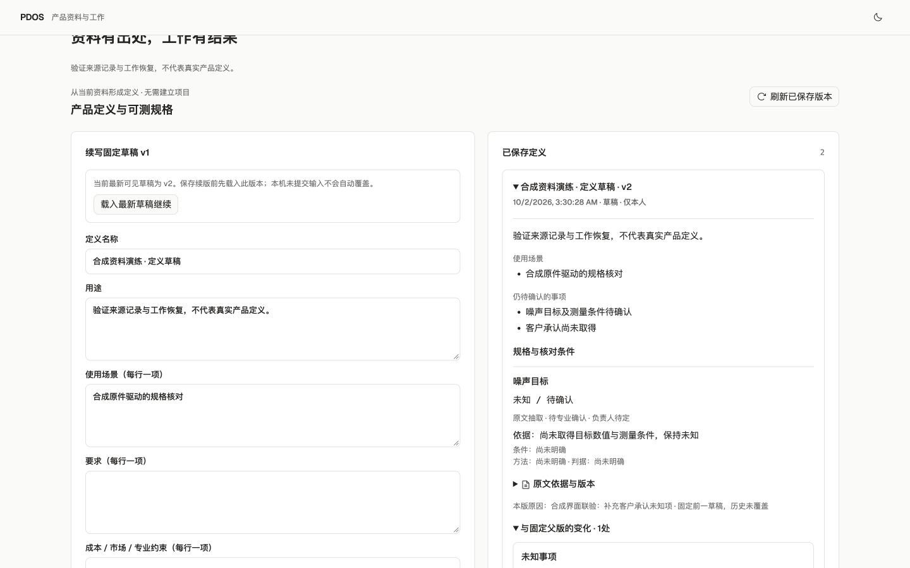

# PDOS Next · 首波并行施工与联通检查点

2026-10-02。按用户“开始执行”，主会话与三个独占工作包并行实现并完成共同接线。可用路径是：Product范围→上传原件/定位来源→人工定义与规格草稿→续版/历史差异；来源事实及委派共用原受控命令、回执与权限。活动状态仅在[唯一清单](../../../../tasks/ai-native-integrated-todo.md#pdos-next-queue)维护；本证据是固定候选记录，不宣称G0/G1全部或原N/P/Q正式出口完成。

## 四路结果

| 归属 | 已交付与复用 | 集成边界 |
|---|---|---|
| 主会话 | 现有来源/身份/领域事务扩展；next_0003七表与公共字段、RLS/不可变守卫；Outbox/Inbox租约分发；实际Temporal活动/信号；独立PG LangGraph断点、运行租约及持久未知调用防重发；API/BFF/Workspace | 唯一迁移、命令、入口、环境和候选验证；不导入旧业务包、不共享旧库。 |
| A 模型网关 | 抽取双协议/固定前缀/回执规则；OpenAI-compatible与Anthropic-native校验、受控端点/服务器许可、限额及精确引用；持久预算预留/结算/未知保留，撤权或取消后仍记录已发生费用 | HTTP检查全部假传输；当前worker provider=None，真实模型配置、资格和出站许可尚未接入；明文预留凭证不入DB。 |
| B 证据处理 | 私有不可覆盖原件、摘要验证、S3注入端口；UTF-8行/PDF页/XLSX单元格及公式原文；原解析限额/主动内容拒绝与子进程CPU/RSS/时间限制 | 实际接线为私有本地目录；无恶意文件扫描/OCR。资源隔离不是完整OS沙箱。PDF部分无文字页明确PARTIAL_TEXT，扫描件需OCR。 |
| C 产品定义 | 独立不可变DefinitionRevision/Spec/引用表；未知不补零、精确来源、受众/责任人守卫、固定父版续写/新父版冲突/可读差异；复用独立UI与阅读/数值规则 | 人工草稿可办；定义发布、AI定义写入、平台派生/三方rebase/专业决定均未开放。 |

## 固定候选验证

- [联合日志](postgres-tests.log)：**215通过**，含纯协议/解析/载荷/目标护栏及独立PG领域/预算/Outbox/持久恢复检查。不是215个验收目标或完成率。超限后直接领域动作阻断另补[受影响验证](budget-domain-guard.log)，同一已有用例扩展断言通过，不另计不同测试。
- [迁移往返](migration-roundtrip.log)：迁移前私有完整备份，next_0002→0003→0002→0003通过，往返在生成新定义/原件前进行。首个schema比较仅提示环境guard属于工具表，明确排除该工具表后[模型/迁移相容](schema-match.log)通过；没有改动或删除guard。
- 全服务/迁移/工具Ruff、全前端ESLint及[Next.js生产构建](web-build.log)通过。前端构建包含TypeScript，沿用现有技术栈和双主题。
- [实际HTTP/Temporal](temporal-http.json)：保存原件/下载逐字节一致，同键原件及定义只一回执/版本，未知规格不补值，委派实际进入MODEL_UNAVAILABLE等待，同一继续请求只一事件。
- [真实进程重启](temporal-restart.json)：停止并重启本轮Temporal与worker，原work保持同一Temporal run；停机期间上传合成原件恢复后只一派生来源，模型仍失能。
- [确认取消](temporal-cancel.json)：领域确认令牌→取消同一工作→实际Temporal工作完成cancelled，零模型调用。
- [最终worker PDF/XLSX](pdf-xlsx-http.json)：实际解析、定位及原件下载一致；单独DB回归覆盖跨页空行、单元格尾换行、CR/Unicode换行/空行。
- 实际浏览器通过BFF办理首版→固定父版续写→历史差异/未知规格→刷新保留；上传合成文本后自动形成来源，[浏览器下载](browser-download.json)与原件字节一致。PDF显示原件1/2页，XLSX显示sheet/A1/B1；亮暗/1440px、390px和320px，后两者document宽度=内容宽度。保存后的原文与具名人员活动真实可见；未执行AI或正式发布。
- [旧源码抽样复核](legacy-source-check.json)：61重点库存中57个旧文件摘要全部保持，其他4个是本工程文件；旧完整工作树并非本候选验收范围。保留原恢复历史和正式义务。

## 环境与保留资产

业务检查显式使用本轮容器及marker匹配的 `127.0.0.1:62513/pdos_test`，应用非所有者、auth只读会话、Agent NOLOGIN且业务表/预算表零直接写权限。状态PG独立实例65109，checkpoint角色及凭据独立；各连接前核对实例ID/标记/地址/数据库用途。无旧.env回退或57432/57439/57441操作。

Temporal镜像下载及manifest探测受网络阻塞，停止原下载后，从官方[CLI发布源](https://github.com/temporalio/cli/releases)取得v1.9.1并核对发行摘要，本地Server1.32.0运行65425，工作历史持久于私有`.local/temporal.sqlite`。这是实际Temporal **开发服务**，没有证明生产PG部署/高可用/恢复。生产路径保留独立Temporal/visibility PostgreSQL配置；官方[持久开发服务说明](https://github.com/temporalio/documentation/blob/main/docs/cli/command-reference/server.mdx)支持此本地演练方式。

本地[预览3028](http://127.0.0.1:3028)、API8898、worker、Temporal、业务/状态PG暂留；会话、对象、原件、两阶段必要备份均在忽略的私有`.local/`，不进入Git。迁移前备份摘要、环境非密钥元数据及源码摘要见[candidate](candidate.json)。收尾须按实例/进程归属核对，不能把仅删除业务测试容器当成全环境清理。

## 仍未交付与下一依赖

真实模型租户配置、ModelCall的request_id/trace持久化、调用/费用未知窗口对账及凭证恢复、真实golden-case资格/当前授权、完整T1原子组和T2具名决定、来源失效传播、扫描/OCR/OS沙箱、S3实际连接/孤立原件回收、生产Temporal PG及正式备份恢复出口仍待完成。未知预算预留不会自动释放或重发；原件对象落盘与业务DB不是跨系统事务，失败可留孤立对象，需后续对账回收。

G1研究/OEM多证据/机会实验、平台派生/三方差异、真实项目及工程/NPI双线首版计划、专业核对与发布，以及G2–G5业务对象仍按执行方案推进。定义已有来源引用若撤回，历史版本显示needs_recheck且不能自动继承续写；rebase路径尚未实现。新原件解析失败可见且原件保留，人员授权失效期间不继续写入；恢复/改投处理入口待下一切片。

下一窗口可独立并行：模型配置/调用对账、扫描/OCR与对象回收、平台派生/确定性计划；主线提供T1/决定/恢复共同合同并统一注册与验证。真实凭据或批准缺失仅暂停依赖它的动作，其余人工与确定性建设继续。

