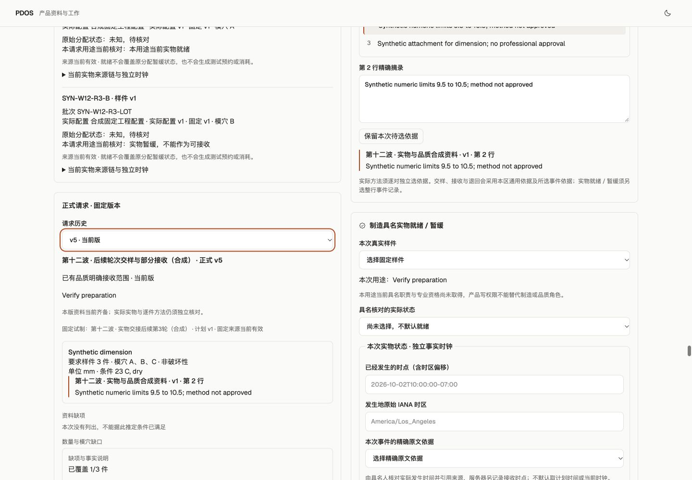

# 第十二波：实物就绪、实际方法与品质部分接收

本轮闭环已完成本地合成验证。仍是 G0～G5 全量建设中的一个检查点，真实工厂资格、生产启用与人工 Exit 未通过。

## 可用结果与原有内容衔接

沿同一 SampleUnit → BuildLot → ActualConfiguration → Build 关系办理制造具名就绪/暂缓，再以实际 sample/item 配对核对品质方法、交样、部分接收和退缺项。原样件身份的 `availability=unknown` 保持，独立事实表达本用途的当前就绪或暂缓；计划方法不自动授予实际方法资格。

同一 FormalVerificationRequest 保留五版：draft、draft、offered、accepted、accepted。实际演练交样 A/B，只接收 A，B 保留暂缓、方法未知及下一责任人。数量仍为 1/3，模穴 B/C 仍缺项。浏览器再将 B 的方法续为 v2/unknown，正式请求仍 v5，A 的方法与接收范围保持。六个主流程回执及一个浏览器续版回执，各有且仅有一条审计和事件。

旧 Build、实际配置、批次、样件、准备、原三版正式请求及原开工固定记录逐字段对照通过。新增专业事实使旧轮次资格需重核；执行期间时钟跨越导致一轮合成窗口过期，已保留该轮事实并建立有效后续轮次，未改写已发生历史。详见 [业务回读](actual-preview.json)、[浏览器续版回读](browser-actions.json)。

## 复用与并行

指定的 57 份旧轨文件、25 份验证核心、7 份运行资产哈希保持，共 89 份；这是明确列出的资产范围，不代表整个旧工作区无差异。[复用核对](reuse-review.json)

三路独占并行完成实物状态/可用性、品质方法/交接适配、办理界面；主线统一同一请求版本链、共同命令/API/BFF、迁移、引用保护及验证。联合检查最多六进程，每例独立租户；两个重模块按完整参数化函数分成四组，结构检查最后单独执行，包含漏选/重复选防护。

页面按明确选择的 Build 读取请求和样件，空选择不展开全产品历史；相同办理阶段的重复专业核对仅在权限、来源、人员状态、issuer epoch 与时间边界仍有效时复用，不跨预览/执行。单次合成顺序读取：交接详情 4.099 秒，样件状态 2.674 秒；这是本机单次观测，不是生产性能承诺。[读取测量](http-read-sequential.json)

## 最终候选验证

| 项目 | 结果与证据 |
|---|---|
| 冻结候选 | 541 份源码/配置；运行代码保持冻结，仅一份测试修正错误码预期并加强回滚断言；[候选](candidate.json)、[测试变更](test-only-repair.json) |
| 联合检查 | 主运行 1483 通过、1 条断言失败，975.8 秒、46 组；同运行代码下修正测试并单例复验通过（105.54 秒），最终选集 1484 项通过；[首轮](joint-result.json)、[最终核对](joint-resolved-result.json) |
| 前端 | 70 项辅助检查通过；构建通过；lint 0 错误、2 个既有 contracts.js 警告；[检查](ui-helpers-final.log)、[构建](web-build-final.log) |
| 迁移 | next_0014 → next_0015 → next_0014 → next_0015 在业务写入前通过；最终 schema 一致；[往返](migration-roundtrip.log)、[schema](schema-match.log) |
| 权限 | 82 张业务表 Agent 直接写权限 0；新增六表强制 RLS；来源失效、资格变更、CAS、回执重放与回滚覆盖在联合选集中 |
| 页面 | 实际一次确认保存 B 方法 v2、旧 v2 只读、当前 v5；桌面 1440×1000/手机 390×844、亮暗四布局无横向溢出；[页面记录](browser-actions.json)、[布局](browser-layouts.json) |
| 历史与边界 | 开测相关五个未来时钟为空，TestRun/测试占用 0，模型调用 0；[业务回读](actual-preview.json) |
| 备份 | 迁移前与闭环后私有备份保留，最终备份目录检查通过；未执行恢复覆盖；[记录](backup.json) |

早期候选的失败与中断保存在 retired-candidate-1/2/3，不计为最终通过。定位并修正了测试回执键、计划方法载荷、旧确认缺少新来源读集的预期，以及按轮次查询误用 Build 来源字段；最后一项由实际 HTTP 发现并增加真实接口回归。之后运行代码保持冻结，完整选集执行中仅来源撤回用例的错误码预期失败：共同来源保护先返回 SOURCE_UNAVAILABLE，测试原期待较后一步的 ACTUAL_SAMPLE_REQUIRED。仅修正该测试并加强无新事实、无回执及确认未消费断言，定向复验通过；不把首轮报告改写为全部通过。单例复验启动与末尾结构检查存在时间重叠，因此其后再次单独完成 24 项结构检查，重复检查不重复计数。[单例复验](test-only-recheck.log)、[独立结构检查](lifecycle-isolated-recheck.json)

注册载荷共 42 个（25 个 canonical、15 个辅助、2 个宿主扩展）。66 个操作/65 个事件/48 个 AT 的定义目录保持，定义存在不等于全量实现或 AT 通过。[合同核对](source-contract-check.json)

## 剩余范围与下一步

下一步按执行方案 §12 接“明确已接收范围 → 完整 Run/资源窗口 → 具名承诺 → 同事务占用和实际开测”，复用现有验证与资源核。共享占用归属、设备/人员/样件资格、破坏性样件消费、结果原值导入、专业复核与处置尚未完成。本轮接收不授予开测、制造放行、客户承认或外部交付。

验证仅使用本任务标记的 127.0.0.1:62513/pdos_test，marker 916f950f-2d2b-405d-b809-c15db75dc20c。原存续 57432、已有 57439/57441 和旧未提交业务代码未操作。Temporal SQLite 仍只用于本地开发；未调用真实模型、未执行真实业务外发、git push 或生产操作。9/27 原恢复边界及 N/P/Q 正式出口继续保留。

[打开本地预览](http://127.0.0.1:3028/)

