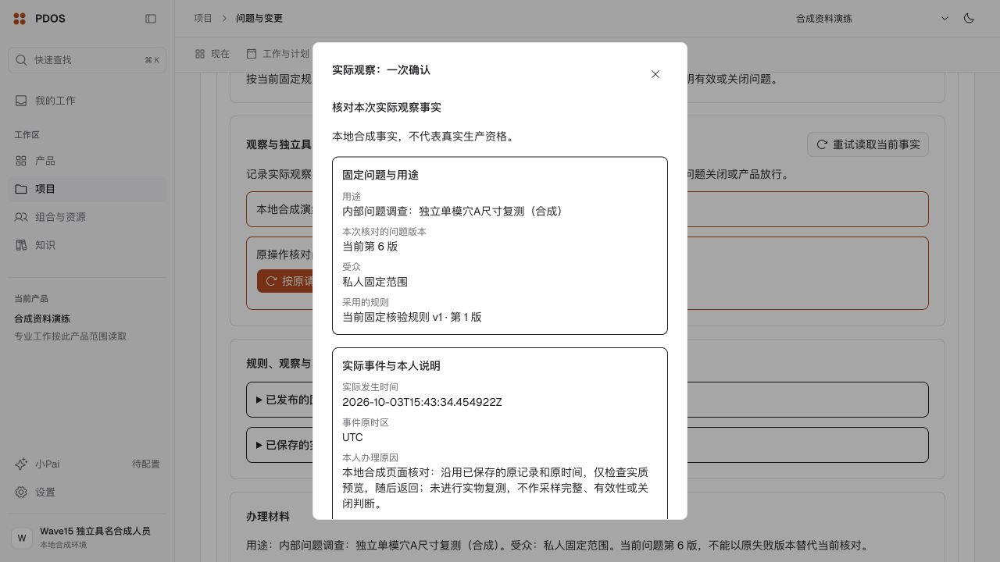

# 第十八波：固定规则与部分观察闭环

已接通可信宿主发布 Rule、本人实际观察 T1 的实质预览、一次保存、原请求恢复和固定历史显示。实际保存仅使用已核对的本地合成实例；具名 Review 的接口与拒绝守卫已接线，**尚未保存独立 Review，完整观察、有效性、关闭及 G3 整体仍未完成**。

## 可用结果与复用

- 复用 `next_0026` 的五张事实表、Current、共同 Receipt/Audit/Outbox/RequestKey、一次确认及原件安全读取，本波没有新迁移或第二份业务状态。Rule 保持可信宿主专用入口，未加入公开操作；实际发布一份 Rule v1，完整来源18份。[发布结果](actual-fact-rule-v4.json)
- 已登记的原生系统记录经过完整19份来源核对和13键预览，实际保存一份 Observation v1；保存 HTTP 200 / 47.223秒。同一原请求恢复 HTTP 200 / 33.453秒，返回原 Receipt；历史 GET HTTP 200 / 49.156秒。[预览](fact-actual-http-prepare-v1.json)、[保存](fact-actual-http-save-v1.json)、[恢复](fact-actual-http-replay-v1.json)、[历史](fact-actual-http-saved-read-v1.json)
- 实际原记录、事件时钟与原时区保留，观察范围为 `2026-10-03T15:43:19.675996Z`～`15:43:34.454922Z`。该记录只核对存续系统事实，明确未实物复测；采样数量和观察区间不完整，`current_complete` 保持未知，原两份候选仍 indeterminate，Issue Current 仍 v6。
- 最终 SELECT/读锁回读确认 Rule/Current、Observation/Current 各1行，NamedReview为0行；两组唯一共同保存出处、完整原锚及观察确认消费钟通过。所列24张旧业务表全行摘要保持，111张注册表、110张租户强制RLS表（登录上下文引导表除外）、Agent直接业务写表0。[最终存储与参与者回读](stored-fact-readback-v6.json)

## 实际问题修复

读取器现在兼容真实 SourceRef/DefinitionReference，并按 Run 中保存的 launch/result 输入核对其动作原子组，保留完整原聚合摘要。上传原报告使用真实 upload v1 保存组及当前 parsed Original 的 parse Receipt/Audit/Outbox；解析没有公共登记回执或请求键，因此不补造这些记录。安全扫描、原件字节和完整来源闭包仍独立核对。[来源差量](participants-source-shape-delta-v1.json)、[Run差量](participants-run-atom-delta-v1.json)、[上传与解析差量](participants-report-lineage-delta-v1.json)

最终实际参与者读取成功，原测试/报告/根因/措施与观察链指向同一人；当前本人属于参与者，不能独立复核。该读取结果没有签发专业或配对认证，仍明确缺少独立性 owner；不得把结构回读当作正向资格。

页面原预览曾因服务器把 `+00:00` 规范为等价的 `Z` 而误拒。仅四类声明的事件时钟按微秒瞬时比较，其余原文、来源、引用摘要、时区、顺序和命令字段严格相等。最终159份前端候选重新构建后，浏览器按原 pending 请求成功恢复完整预览（10段/43项），随后返回核对，没有再次保存观察；具名复核按钮实际禁用。[修复](fact-ui-clock-normalization-v2.md)、[实际恢复及返回](browser-preview-recovery-v2.json)

## 集中验证范围

| 检查 | 最终证据与边界 |
|---|---|
| 后端受影响选集 | [v9：259项通过，3.21秒](affected-backend-v9.log)，7份纯测试、禁止数据库连接；不是PG或全树联合验收。v8路径错误未运行测试，原日志保留。 |
| 静态与BFF | [受影响静态通过](root-static-v3.log)；[29项BFF检查](bff-check-v1.log)，运输替身不冒充实际API权限。 |
| 事实UI | [v2：24项辅助检查](fact-ui-helper-v2.log)，类型与定向lint通过；[真实响应离线v4](fact-ui-actual-contract-check-v4.json)仅按明确历史钟检查显示，不授当前预览资格。 |
| 前端整体 | [159文件v2源稳定，lint/build/typecheck通过](web-build-result-v2.json)；两个既有 unused 警告仍保留，零错误。 |
| 实际HTTP/浏览器/存储 | 上列保存、原请求恢复、历史、页面预览返回和v6实际回读各自记录；未办理浏览器第二次保存或独立Review。1280px亮暗历史截图保留，未宣称本波手机尺寸通过。 |
| 最终候选 | [351运行文件、7份选集测试、159前端文件](candidate-source-v3.json)。实际保存至最终运行代码仅参与者读取器变化；保存/恢复仍保留各自原manifest，不宣称在新版下重做写入。 |

独立写入、来源/参与者、界面三份归属并行建设，公共数据库、服务、浏览器和验证由主线统一办理。各检查范围不累加为全量验收。原 Rule v1～v3、HTTP context及readback v1～v5失败保留；readback v6才闭合实际参与者链。离线v3采用旧context无法匹配完整原记录，拒绝保留；v4显式使用真实context-v3后通过。未覆盖失败证据、改写旧回执或省略完整来源。

## 剩余与下一步

1. 接真正的 LivePairedOwner：复用现存 Formal/Run/原子组、原件、历史执行与数值规则读取，补同UOW的 read/refresh/attest、末端重核及最早到期界限。[接线合同与可复用入口](next-live-pair-handoff.md)
2. 独立正例需另建合法产品共享范围的失败/复验链及真正独立有资格的人；旧 private 不扩围、不借原作者身份，不能让当前参与者签独立Review。新复验完成专业复核/处置后，回链精确当前输出及候选，再办理具名Review。
3. 实际方法适用、完整采样/观察期、七owner正向认证、分别有效性和关闭仍有缺口；完整来源闭包重新计算，超过20直接拒绝，不截断。

API8898、预览3028与原开发worker保留；仅标记实例 `127.0.0.1:62513/pdos_test`，零模型调用/真实业务外发。存续库、旧预览、golden-case、G/N/P/Q人工出口及9/27恢复边界保持。本轮不授真实生产资格或生产启用。
