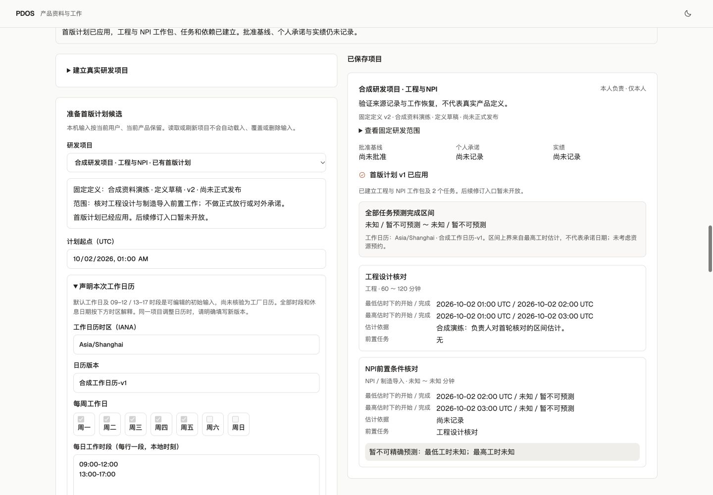

# PDOS Next 第二波 · 派生与真实项目首版计划

2026-10-02。按用户“继续”推进独立新工程，形成第二个可用人工闭环。活动状态只在[唯一清单](../../../../tasks/ai-native-integrated-todo.md#pdos-next-queue)，本目录是候选证据，不替代 G0～G5 或原 N/P/Q 正式出口。

## 已交付的实际行为

- **定义与派生**：同一 Product 内建立客户/地区/配置派生，固定 DefinitionRevision、适用范围、typed 显式覆盖及精确来源；生成不可变 VariantRevision。父版推进时比较旧父、新父与当前派生，区分父独变/子独变/同改/冲突，冲突须逐项选择并注明原因，再一次确认续版。私人依据不扩大受众；专业任命及确认状态不继承。
- **真实研发项目**：人工选定可读、当前来源有效的定义草稿，核对名称、用途、研发范围、当前本人责任与受众，再建立 Project + ProjectProductLink。研究仍可无项目进行，草稿不冒充已发布定义。项目固定版不会随父定义或派生续版自动改写。
- **工程/NPI首版计划**：候选保存真实工作日历、UTC起点、IANA时区、版本和实际TZif摘要、任务工时区间/估计依据及FS依赖。无依赖任务可并行，缺失上/下界分别保持未知并向下游传播。相同项目同一日历key/version不允许静默变更时段/假日。一次确认原子建立 PlanRevision、两个 WorkPackage、全部 Task/Dependency、项目指针及回执/审计/Outbox；中途失败一并回退，重复请求只返回原回执。预测与 Baseline/Commitment/Actual独立，后三者当前保持未记录。
- **当前范围的一次确认**：服务器关闭注册表决定T1操作。确认令牌绑定具名本人、租户/Product、真实payload、固定来源读集和目标快照；当前身份/授权/来源先于去重核对。原请求和服务器语义重放先于令牌消费，新增写入与确认消费同事务。省略覆盖字段保留原字段集合，避免将继承误写为null；共享领域意图绑定具名责任人。
- **调用追踪与用量对账**：Invocation在调用前固定call_id，并由可信工厂将同ID接到持久预算；保存协议/版本/路由摘要/原调用编号、规范输入输出及缓存分项/结算版/时间。已完成候选重放不重新调用或收费；发送后未知不盲重发。具名T1只对账原调用用量，费用未知继续保留预留；已知超限先真实落账并保持后续运行停止，不改变Invocation结果、Run资格或重排请求。

## 衔接与并行

主会话独占公共模型/迁移/命令/API/BFF/入口、隔离环境与联合检查。三包并行交付调用账本、排程适配与项目界面、派生与界面。排程直接复用用户另开日历会话的 `pdos_next.engines.planning.WorkingTime` 和时区规则核；只添加FS工时区间薄适配，不改对方目录。外部 `engines/` 和对应检查目录保持各独立会话所有权；供应成本与派生算法的纯检查随本候选运行，不代表已接入权威业务对象。

[候选摘要](candidate.json)记录146个独立源码/配置摘要与57个旧复用源码核对结果：57个旧文件未变；不宣称整个旧脏工作区被冻结或由本轮完成。新工程不导入旧业务包，不继承旧实例、批准或AI资格。

## 核对结果

| 核对范围 | 实际结果与证据 |
|---|---|
| 全部当前检查 | **536 passed in 35.00s**，[日志](postgres-tests.log)。含真实PG命令/权限/幂等/原子性、T1改动/过期/撤权、派生续版竞争、计划未知与日历、调用费用/恢复及已有断点检查；也含用户另开三算法包的纯检查。不是将历史215项再次相加。 |
| 当前施工静态检查 | 当前范围Ruff与工具Ruff通过：[当前范围](current-scope-lint.log)、[工具](tools-lint.log)。完整server扫描另有独立供应成本包 `engines/supply_cost/dto.py:170` 的一处E501行长，见[完整扫描](server-lint.log)；该文件不属本波修改范围，未替对方改写或将完整扫描报为通过。 |
| 前端 | 全量ESLint、生产构建与TypeScript通过：[lint](web-lint.log)、[构建](web-build.log)。最终仅补了活动名称显示，重构建后不重复业务全量检查。 |
| 迁移 | 真实head next_0003→next_0004，先保留私有备份；在新对象写入前完成4→3→4与schema相容。[往返记录](migration-roundtrip.log)、[最终schema](schema-match.log)。首次JSONB默认表达式错误在事务内回滚，修复并核对真实head/无新表后恢复，未覆盖原备份。已有第二波数据后禁止下迁。 |
| 实际浏览器/BFF/HTTP | [实际结果](actual-preview.json)：建立合成项目、候选、确认应用；工程/NPI两工作包、两任务、一依赖；父定义v2→v3，派生v1→v2经三方冲突显式保留子范围，项目仍固定定义v2。5个动作各一Receipt/Audit/Outbox；当前预览实际模型调用列表为空；Agent所有业务表INSERT/UPDATE/DELETE为零。 |
| 可视界面 | 实际1440/390/320亮暗主题，scrollWidth均等于viewport，无横向溢出；UTC日期由原生控件录入，未知不填零。本机项目/任务输入保留；选父版和冲突原因均来自界面。见下面截图。 |
| 恢复边界 | 本轮刷新独立API/Web/worker以加载候选；实际Temporal开发服务继续使用原持久历史。首波真实停止/重启恢复证据仍保留，本波未重复整套恢复演练或宣称生产PG恢复通过。新的固定call_id恢复/未知不重发由当前真实PG检查覆盖。 |

其他尺寸证据：[暗色桌面](project-plan-dark.png)、[390亮](project-mobile-light.png)、[390暗](project-mobile-dark.png)、[320亮](project-320-light.png)、[320暗](project-320-dark.png)。

## 环境与备份

仅核对自己的 `127.0.0.1:62513/pdos_test`，marker `916f950f-2d2b-405d-b809-c15db75dc20c`；独立状态PG65109，checkpoint单独角色和数据库。Temporal65425采用已核对官方CLI与持久SQLite开发模式；API8898、Web3028和worker暂留，均为合成演练。私有 `.local/` 不纳入交付或公开日志：保留 `pre-wave2-next_0003.dump`、`wave2-business.dump`、`wave2-checkpoints.dump`，600权限与摘要/大小见实际结果。备份留存不等于本波已完成恢复/重放验收。

原存续57432、已有57439/57441、旧业务实例与旧未提交工作未操作。9/27恢复备份基线0377后的登录/序列部分无法完全重建，原边界保留，不能宣称历史零丢失。没有git push、部署、真实业务外发、真实模型请求或真实自动写入资格。

## 未完成与下一步

G0仍缺真实租户模型配置/真实golden-case资格/当前出站授权、扫描/OCR/完整OS沙箱、S3实际接线与原件回收、失效传播、完整具名决定/补偿及生产Temporal PG联合出口。当前账本统计token用量，没有冒充已完成实际币种费用定价或生产账单接入。

G1仍缺无项目研究/OEM多证据/机会实验、跨Product平台匹配与采用、派生定义进入项目、计划后续修订、Task责任指派、资源容量/预约、独立承诺/批准基线/实绩、专业审核与定义发布。当前预测为FS零lag的工时上下界前推，不是CPM浮动或资源优化。人工定义/计划草稿路径无需等待真实模型。

下一主线统一工程/制造双配置、BOM和Build前置合同；稳定接口后品质Validation/TestRun、供应齐套/成本快照及G0文件回收/受控模型配置继续独立并行。当前检查点不新增阶段批准，也不代替原N/P/Q、正式T2或人工Exit。
