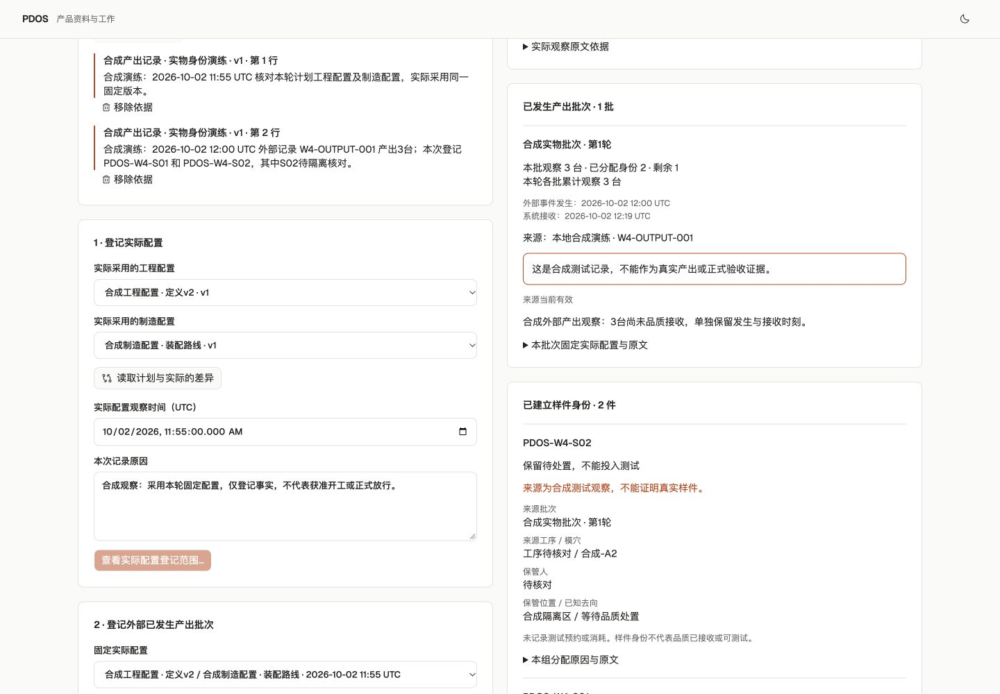

# PDOS Next 第四波 · 实际配置、产出与样件身份

2026-10-02。已打通既有计划 Build → 实际配置与差异 → 已发生产出批次 → 限额分配单件身份。活动状态仍只在[唯一清单](../../../../tasks/ai-native-integrated-todo.md#pdos-next-queue)。本轮登记观察事实，不授予开工、工程/制造放行、品质接收或测试资格，不代表 G2 或 AT-07/08/11 全部验收。

## 可用行为与复用

- 复用第三波固定 Build、工程/制造配置、BOM 和精确原文，以及既有一次确认、当前权限、幂等、回执/审计/Outbox。实际配置固定自己的版本；服务器比较固件、BOM用量、制造场地、工序和顺序，变化逐项解释并绑定出处，不接受客户端伪造前后值。
- 同一轮次可登记多份实际配置及多个产出批次；每批固定唯一实际配置。批次记录整数离散数量、外部事件编号、发生时间和系统接收时间，现实观察与合成观察明确区分。累计超出计划按全轮次批次合计显示，允许真实超产事实，不用计划量代替实物。
- 样件整组一次确认、同事务建立身份；唯一标识、实际配置、批次、工序、模穴、保管人与去向可追溯。累计分配不能超过实际批次数量，并发请求不会重复占用余量。未知与保留待处置单独保留，未建立预约或消耗记录。
- 当前来源、私有受众与权限先于重放检查；来源变化后历史显示需重核。四张新增业务表强制租户隔离和不可变，Agent 仍无直接写权限。前端保留本机输入和原请求，在提交结果未知时只重试原请求。

三个独占包并行完成领域、关键测试和操作界面，主线统一配置比较、注册、迁移、API/BFF和验证。177份主线源码/配置摘要见[candidate.json](candidate.json)；57份原复用源码摘要保持。已交付的品质、供应成本、文件安全包保持独立归属；下一供应适配与界面正在施工，未计入本轮联合证据。

## 集中验证

| 范围 | 结果 |
|---|---|
| 固定主线候选 | **693 passed in 287.85s**，[26文件范围](integrated-test-selection.json)、[实际日志](postgres-tests.log)。覆盖此前已集成路径及本轮范围、权限、来源、过期、重放、事务回滚、实际配置差异、超产、并发分配、隔离与不可变。没有相加历史检查数。 |
| 静态及前端 | 133份主线Python文件[Ruff通过](integrated-lint.log)，[范围](integrated-lint-selection.json)；可见前端[ESLint通过](web-lint.log)、[TypeScript与生产构建通过](web-build.log)。后续未接入文件不据此宣称通过。 |
| 迁移 | 写入本轮业务数据前保留私有备份，完成 next_0005→0006→0005→0006；[迁移往返](migration-roundtrip.log)、[schema核对](schema-match.log)通过。四张新增表，已有数据后未再次下迁。 |
| 实际浏览器/BFF/HTTP/PG | 页面登记合成原文并分别一次确认：1份实际配置、1批3台产出、2件身份，余1台。刷新读回；计划Build及准备结果与第三波逐字段相同，两个样件为unknown/hold，预约/消耗均为空。三个操作各1条Receipt/Audit/Outbox，42张业务表Agent写权限为零，模型调用0。详见[持久结果](actual-preview.json)。 |
| 双主题和尺寸 | 1440、390、320三尺寸亮暗无横向溢出，[布局记录](browser-layouts.json)。实际结果、合成性质、未知与处置状态可读，见下方截图。 |
| 合同 | [目录验证](catalog-validation.log)保留66操作、65事件、48验收ID；实际导出20个已实现payload及OpenAPI。目录覆盖不表示全部能力已实现。 |

最初重点检查为90通过、1失败，原因是配置关联错误的HTTP状态码与测试约定在运行中变更；统一为409后，对冻结候选完成上述693项联合检查。[早期日志](scoped-tests.log)保留。未通过放松业务守卫来消除失败。最终摘要与核对见[final-check.json](final-check.json)。

其他截图：[桌面暗](actual-ledger-dark.png)、[390亮](actual-mobile-light.png)、[390暗](actual-mobile-dark.png)、[320亮](actual-320-light.png)、[320暗](actual-320-dark.png)、[整组确认](sample-confirmation.png)。

## 环境与剩余范围

仅操作已核对的127.0.0.1:62513/pdos_test，marker为916f950f-2d2b-405d-b809-c15db75dc20c；API8898与[生产构建预览3028](http://127.0.0.1:3028)保留。私有迁移前与本轮业务备份均600，大小/摘要见实际记录；备份存在不宣称本轮已做恢复演练。状态PG65109、Temporal65425及既有worker沿用；Temporal仍为本地SQLite开发服务，未声称生产PG验收。

原存续57432、57439/57441和旧业务未提交内容未操作；9/27备份基线0377后的部分登录/序列无法完整重建，不能宣称零丢失。没有git push、部署、真实模型调用、真实业务外发或资格授予。

下一步接供应来源快照与确定性齐套，复用持久Build需求及既有供应领域算法/展示；随后接成本、品质与文件安全。真实完整存量/占用、资源与专业资格、开工守卫、品质接收/TestRun和预约消耗仍未完成；本地合成记录不能作为真实生产或人工Exit证据。
