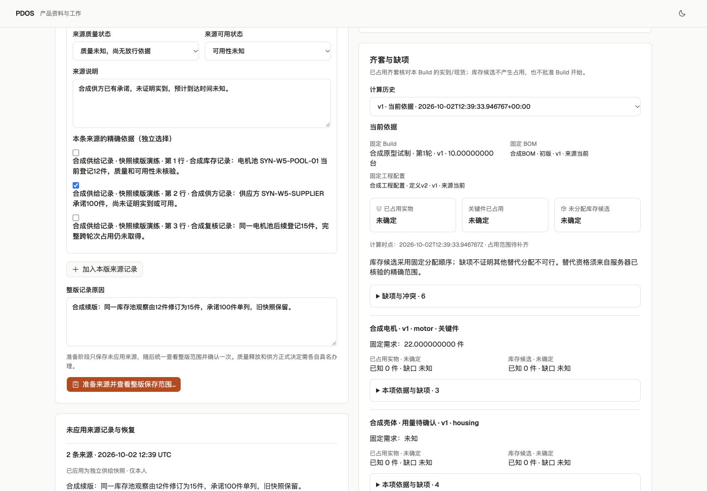

# PDOS Next 第五波 · 固定供给来源与齐套缺项

2026-10-02。已打通固定 Build 需求 → 逐条精确来源 → 整版一次确认 → 不可变供给快照与前版对账 → 确定性齐套结果及历史回查。活动状态只在[唯一清单](../../../../tasks/ai-native-integrated-todo.md#pdos-next-queue)。这是本地合成闭环，不代表权威库存完整、品质放行、开工、G2/G4 或 AT 全量验收。

## 已实现与复用

- 直接读取第三波持久化的 BuildReadiness basis/demands，固定工程、制造、BOM、定义及来源版本。供应输入不重算或改写原需求；已知电机需求22件、壳体用量未知保持原值。
- 复用已交付供应包的快照、对账、覆盖算法及历史/缺项组件。24份包内资产摘要完全相同，见[复用核对](supply-package-reuse.json)。主线另做持久化与共同事务适配，不重复建立独立包的确认、审计或回执事务。
- 来源准备生成有期限的未应用记录，输入次序规范化与稳定请求编号支持恢复；每条记录独立绑定原文。人工整版保存属于辅助 `supply.snapshot.record` T1，服务器核对前后范围后一次确认；canonical `supply.kit.compute` 保持确定性 T0，不增加确认或授予真实 AI 资格。见[施工合同](scope.md)。
- 库存余额、供方承诺、在途、到货、质量限制分别保存，不能相加成库存。当前无完整占用来源，范围明确不完整；人工记录不能把质量或可用性提升为放行。未知数量、到达时间、可用量、缺口与齐套结论不补零。
- 来源快照不可变，续版推进当前指针并保留前版。齐套结果固定输入与计算时点；新供给版出现后旧结果显示需要重新核算。当前权限与来源检查先于重放；私有来源不扩大受众；共同服务负责同事务 Receipt/Audit/Outbox，四张新增表保留租户隔离和 Agent 零直接写入。

领域适配、持久需求/事务测试、薄界面按独占文件并行完成；主线程统一注册、迁移、API/BFF与验证。当前208份主线源码/配置候选见[candidate.json](candidate.json)，57份旧复用源码未改变。品质、成本完整业务、文件安全及其他并行包未接入部分不计主线可用能力。

## 集中验证

| 范围 | 实际结果 |
|---|---|
| 冻结主线联合检查 | **750 passed in 414.63s**；[28文件范围](integrated-test-selection.json)、[实际日志](postgres-tests.log)。覆盖既有主线及本轮固定需求、权限/来源、范围绑定、过期、重放、并发、原子回滚、历史与不可变等场景。历史包检查数未相加。 |
| 局部验证及冻结复核 | 需求与供应事务[54项通过](scoped-tests.log)。153份后端冻结文件与24份复用资产在联合检查后摘要仍相同，[独立复核](backend-freeze-review.json)。54项不与750项相加。 |
| 静态及生产构建 | [153份Python范围](integrated-lint-selection.json)的[Ruff通过](integrated-lint.log)；最终前端[ESLint通过](web-lint.log)、[TypeScript与生产构建通过](web-build.log)。未挂载包即使被类型扫描，也不代表业务已接线。 |
| 迁移与schema | 先保留私有备份，在本轮业务写入前完成 next_0006→0007→0006→0007；[往返日志](migration-roundtrip.log)、[schema匹配](schema-match.log)。新数据存在后未再次下迁。 |
| 实际浏览器/BFF/HTTP/PG | 页面保存库存12件及单列承诺100件，再续版库存为15件、承诺仍100件，分别计算齐套。刷新后2份来源记录均已应用，2快照、2齐套结果和当前指针正确；旧结果需重算。原计划与准备结果逐字段不变，两件既有样件保留。4个操作各恰有1条Receipt/Audit/Outbox，46张业务表Agent写权限0，模型调用0。详见[持久结果](actual-preview.json)。 |
| 亮暗及尺寸 | 1440、390、320三尺寸双主题无横向溢出，[布局记录](browser-layouts.json)；当前/历史、未知条件、供方承诺与库存分列均已核对。 |
| 合同 | [目录检查](catalog-validation.log)保留66操作、65事件、48验收ID；22个实际payload及OpenAPI与运行时代码相同。辅助快照操作另册登记，未改 canonical 政策；目录齐备不等于全部实现。 |

最初需求检查为20失败、5通过，原因是只读需求适配对不可变 Build/Readiness 使用了要求更新权限的行锁。移除这两处多余锁，保留 Product→Grant 及来源锁和当前权限守卫后通过；没有扩大应用角色写权限。[早期失败日志](initial-demand-tests.log)保留。最终候选与证据核对见[final-check.json](final-check.json)。

截图：[库存与承诺分列](supply-snapshot-light.png)、[旧结果需重算](supply-history-light.png)、[桌面暗](supply-results-dark.png)、[390亮](supply-390-light.png)、[390暗](supply-390-dark.png)、[320亮](supply-320-light.png)、[320暗](supply-320-dark.png)。早期[首版确认截图](supply-confirmation.png)保留；最终构建已把库存记录的生成标识显示为来源系统、池与物料名称。

## 环境和未完成范围

仅操作已核对的127.0.0.1:62513/pdos_test，marker为916f950f-2d2b-405d-b809-c15db75dc20c；API8898与[预览3028](http://127.0.0.1:3028)保留。迁移前与业务后备份均为600权限，摘要/大小见持久结果；备份存在不宣称恢复演练通过。状态PG65109、Temporal65425及worker沿用，本地SQLite不代表生产Temporal PG验收。

供应当前指针由领域服务保证首版从v1开始，数据库外键保证同范围已存快照，更新触发器校验连续前版；本轮不宣称数据库INSERT触发器单独强制首版编号。业务角色与访问只能经现有受控服务，未增加用户或Agent直接数据库入口。

下一步接成本口径与报价固定快照，随后汇合品质交接/TestRun、文件安全与原件生命周期。权威库存/跨Build完整占用、替代资格、资源准备、工程/制造放行、开工与真实专业资格仍缺，相关结论保持未知。真实模型、出站、生产及人工Exit仍需原规定的条件与批准。

原存续57432、57439/57441及旧业务未提交内容未操作；9/27备份基线0377后部分登录/序列无法完整重建的边界保留，不能宣称零丢失。没有git push、部署、真实业务外发或资格授予。
