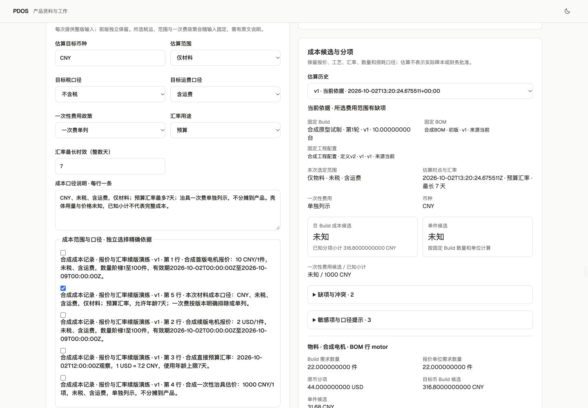

# PDOS Next 第六波 · 成本口径快照与确定性估算

2026-10-02。已打通固定 Build 需求 → 精确原文报价、工艺与汇率事实 → 整版一次确认 → 不可变成本输入续版 → 确定性估算与历史回查。活动状态只在[唯一清单](../../../../tasks/ai-native-integrated-todo.md#pdos-next-queue)。这是 G4 成本路径及 AT-22 的本地部分覆盖，不代表完整成本、实际降本、采购批准或 G4/正式出口通过。

## 可用能力与复用

- 复用第三波持久化 BuildReadiness 的需求、固定工程/制造/BOM与来源版本；保留计划10台、电机22件和壳体未知用量，不以最新配置覆盖固定依据。第四波实际产出/样件、第五波供应与齐套历史保持。
- 直接复用已交付供应成本包的 Decimal 成本核、成本候选、时效判定、读模型和 CostBreakdown 展示，24份冻结资产字节未改变，见[复用核对](cost-package-reuse.json)。共同服务统一执行确认、回执、审计与事件事务，没有另建一套确认事务。
- 逐条固定价格原币金额、计价分母/单位、数量阶梯、税运、有效期和精确引用；材料价格显式绑定固定 BOM 行。工艺按每合格产品的工序数量/单位/损耗固定；一次费明确排除、单列或依明确销量摊销。直接汇率保留币对、用途及原来源实际观察时点，不倒推、不使用保存时间代替观察时间。
- 辅助 `cost.inputs.record` 为具名人工 T1，预览前后范围后一次确认保存整版；canonical `cost.estimate.compute` 保持确定性 T0。未知、无合适报价、过期价格、过龄/缺失汇率继续呈现缺项与已知小计。只有所选费用范围完整才显示成本候选总额，估算不授权开工或采购。
- 捕获支持稳定请求编号与原请求恢复；输入历史不可变，当前指针须同范围、连续前版，数据库同时保护首版插入与续版更新。当前权限、来源和可见范围先于重放；私有来源不扩大受众。新版本使旧估算需要重核；同一固定输入重放保留原回执与计算时点，时效更新需新输入版本。

成本领域适配、关键事务测试、薄界面按独占文件并行，主线统一公共接线、迁移与验证。当前[219份主线源码/配置候选](candidate.json)；57份旧轨重点复用文件未改变。未接入的其他并行包不计主线业务能力。

## 集中验证

| 范围 | 实际结果 |
|---|---|
| 冻结主线联合检查 | **787 passed in 511.68s**；[29文件范围](integrated-test-selection.json)、[实际日志](postgres-tests.log)。覆盖已有主线与成本输入范围、精确来源/ACL、时效跨界、重放、原子回滚、并发续版、不可变记录及当前指针等场景。历史包通过数不相加。 |
| 冻结与复用 | 162份后端冻结文件、24份供应成本包资产及57份旧轨重点文件摘要一致，见[独立复核](backend-freeze-review.json)。范围不等于整个旧未提交工作树。 |
| 静态和构建 | [162份Python范围](integrated-lint-selection.json)的[Ruff通过](integrated-lint.log)；[前端ESLint](web-lint.log)、[TypeScript及生产构建](web-build.log)通过。 |
| 迁移与schema | 保留迁移前私有备份，在本轮业务写入前完成 next_0007→0008→0007→0008，[往返日志](migration-roundtrip.log)、[schema匹配](schema-match.log)。本轮业务数据产生后未再次下迁。 |
| 实际页面/BFF/HTTP/PG | 页面首版保存10 CNY/件报价，电机22件已知小计220 CNY；续版保存2 USD/件及7.2预算汇率，小计316.8 CNY，1000 CNY治具一次费单列。壳体用量/成本与完整总额仍未知。2个输入版本、2次估算、前版/当前指针正确，旧结果需重算；4次操作各恰有1条Receipt/Audit/Outbox。原计划和准备逐字段不变，样件与供应历史保留；50张业务表Agent直接写权限0，模型调用0。见[持久结果](actual-preview.json)。 |
| 界面 | 1440、390、320三尺寸双主题无横向溢出，见[布局记录](browser-layouts.json)。当前结果、历史结果、原币金额、缺项与一次费分列均已核对。 |
| 合同 | [目录检查](catalog-validation.log)保留66操作、65事件、48验收ID；24个实际payload及OpenAPI与当前运行时代码匹配，见[最终核对](final-check.json)。辅助成本输入操作另册登记，未改变canonical政策。 |

最初成本局部检查为36通过、1失败，源于测试要求分钟→小时中间数量等于无限精确的5.5；现有引擎按38位 Decimal 计算得到5.500…0001。只将该中间数量断言改为声明精度内的误差，并核对精度/舍入合同；货币金额断言仍严格相等，未修改计算核。[初始日志](initial-scoped-tests.log)保留，[针对性检查](scoped-tests.log)1项通过；后续787项联合检查已包含全部37项成本测试，不能额外相加。

截图：[首版历史需重核](cost-history-light.png)、[桌面暗](cost-results-dark.png)、[390亮](cost-390-light.png)、[390暗](cost-390-dark.png)、[320亮](cost-320-light.png)、[320暗](cost-320-dark.png)。完整施工范围见[施工合同](scope.md)。

## 环境及剩余范围

仅操作已核对127.0.0.1:62513/pdos_test，marker为916f950f-2d2b-405d-b809-c15db75dc20c；API8898及[生产构建的本地预览3028](http://127.0.0.1:3028)保留。迁移前及业务后私有备份均600权限，摘要/大小见持久结果；备份存在不等于恢复演练通过。状态PG65109、Temporal65425与worker沿用，本地SQLite不代表生产Temporal PG验收。

下一步汇合品质交接/TestRun与文件安全、原件生命周期。权威完整库存/跨Build占用、替代/资源/品质资格、工程制造放行、开工、真实专业验证、实际成本与已实现降本仍未完成。模型真实资格、出站、生产与人工Exit继续遵守原条件和明确批准边界。

原存续57432、57439/57441及旧业务未提交内容未操作；9/27备份基线0377后部分登录/序列无法完整重建的边界保留，不能宣称零丢失。没有git push、部署、真实业务外发或资格授予。
