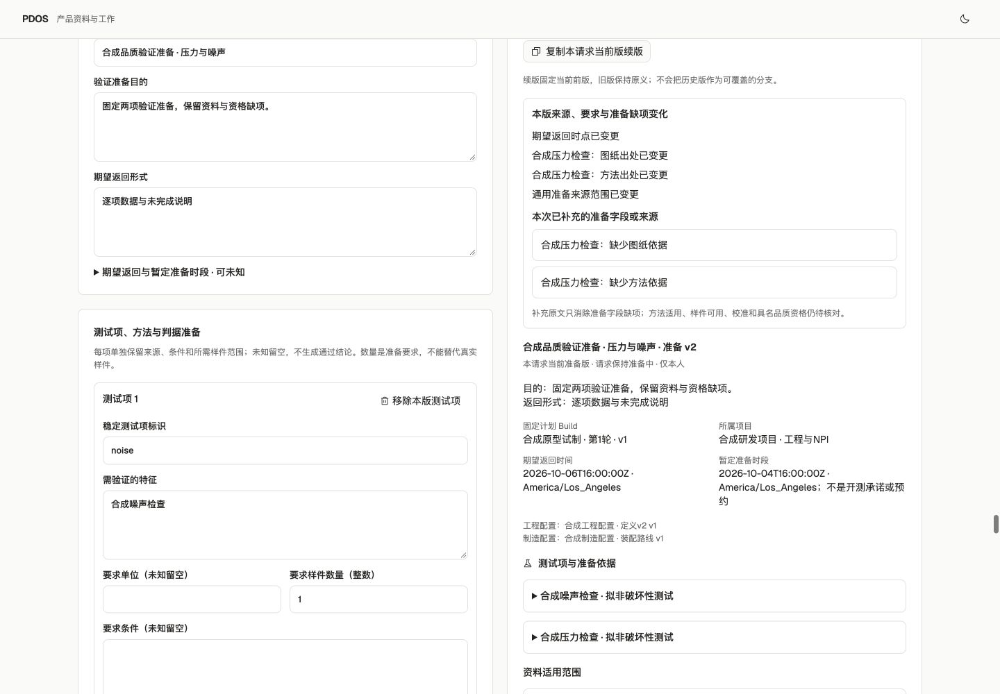

# PDOS Next 第七波 · 人工验证准备与品质缺项

2026-10-02。已接通固定 Build → 要求、方法与资料准备 → 整版一次确认 → 不可变版本续接 → 缺项与历史回查。活动状态只在[唯一清单](../../../../tasks/ai-native-integrated-todo.md#current-queue)。这是 G2 品质路径的准备能力及相关验收的部分覆盖，不代表正式接样、TestRun、专业资格或人工 Exit 通过。

## 可用能力与复用

- 承接第三波固定工程/制造配置和 Build、第四波实际配置/批次/单件身份，沿用第五波供应与第六波成本记录。原计划10台、电机需求22件、壳体未知保持原义。
- 只读复用验证包的请求 DTO、资料缺项与数量/模穴覆盖规则、时间展示。25份原包资产未改变，见[复用核对](verification-package-reuse.json)。既有 VerificationHandler 依赖真实专业职责、人员/设备资格、执行与样件消费端口，本波未以产品写权限或模拟资格替代这些前置。
- 辅助 `verification.preparation.record` 只供具名人工 T1 使用；共同服务提供实质预览、一次确认及同事务回执、审计和事件。保存请求标题、目的、返回形式、逐项方法/判据/单位/条件/材料/样件数/模穴、适用资料与精确原文版本。
- 未知保留为空。期望返回和暂定时间保存明确时点及原 IANA 时区；首次准备时间来自服务器回执，续版不改首版时钟。暂定时间不产生品质承诺或资源预约。
- 当前版本连续续接、固定前版和 Build，历史不可变。来源当前权限先于幂等重放；新写重新核对当前版本，重复请求不产生重复副作用。私有来源不能扩大受众。
- 已有样件仅作准备参考：unknown/hold 不变成可接收样件。页面明确呈现专业资格、校准/资源、样件就绪与消费接口缺口，正式交接、接收、开测和结果导入保持不可用。

领域适配、关键事务测试、页面按独占新文件并行；主线负责共同注册、迁移和集中验证。[当前候选](candidate.json)固定242份源码/配置，175份后端在联合检查期间保持不变；57份旧轨重点复用文件未改变。未接入的其他并行包不计主线可用能力。

## 集中验证

| 范围 | 实际结果 |
|---|---|
| 主线联合检查 | **819 passed in 596.46s**；[30文件范围](integrated-test-selection.json)、[日志](postgres-tests.log)。覆盖既有主线及准备来源/权限、T1漂移、历史首创时钟、重放、并发幂等与续版CAS、事务回滚、不可变记录及指针守卫。旧包通过数不相加。 |
| 局部检查与冻结 | 新增[32项针对性检查通过](scoped-tests.log)，已包含在819项中。175份后端、原包25份和旧轨57份摘要核对见[独立复核](backend-freeze-review.json)；不等于整个旧未提交树的审阅。 |
| 静态与构建 | [175份Python范围](integrated-lint-selection.json)的[Ruff](integrated-lint.log)、[全前端ESLint](web-lint.log)、[TypeScript及生产构建](web-build.log)通过。 |
| 迁移与schema | 业务写入前保留私有备份，完成 next_0008→0009→0008→0009，[往返日志](migration-roundtrip.log)与[schema匹配](schema-match.log)。本波业务数据产生后未再次下迁。 |
| 页面/BFF/HTTP/PG | 实际页面经两次T1确认保存同一请求v1/v2。首版10个资料字段缺项，续版补压力图纸/方法出处后剩8个；4个数量/模穴缺口不变。期望返回由10月5日改为6日，首次准备时钟相同；旧版保留。2次操作各恰有1条Receipt/Audit/Outbox。见[持久结果](actual-preview.json)。 |
| 原能力与边界 | 原Build逐字段不变；旧样件、供应与成本记录身份集合保留。2个参考样件仍为unknown/hold，交接/接收/结果集合为空、所有物理事件时钟为空、TestRun为0。52张业务表Agent直接写权限为0，模型调用0。 |
| 界面 | 1440、390、320三种宽度双主题无横向溢出，见[布局与实际操作记录](browser-layouts.json)。刷新后当前版/旧版、资料缺项、实物时钟和禁用原因均已核对。 |
| 合同 | [目录校验](catalog-validation.log)保留66操作、65事件、48验收ID；25个实际payload和OpenAPI与运行时代码匹配，见[最终核对](final-check.json)。辅助准备操作另册登记，canonical正式验证操作未开放。 |

真实页面检查发现并修复两处展示问题：原缺项字段名显示为英文；对象键序差异导致未改变的判据、资料误报变化。只修改新页面与比较辅助函数，未改原验证规则或后端；定向核对后重新完成全前端静态检查和生产构建，最终页面只显示期望时间、压力图纸、压力方法和通用来源四项真实变化。后端冻结未改变，因此不重复已经通过的联合检查。初始构建日志保留在[初始检查](initial-web-lint.log)与[初始构建](initial-web-build.log)。

截图：[历史首版](preparation-history-light.png)、[实际事件时钟](preparation-times-light.png)、[剩余条件](preparation-blockers-light.png)、[桌面暗](preparation-current-dark.png)、[390亮](preparation-390-light.png)、[390暗](preparation-390-dark.png)、[320亮](preparation-320-light.png)、[320暗](preparation-320-dark.png)。施工边界见[范围说明](scope.md)。

## 后续与环境

下一步接入文件安全与原件生命周期；正式品质路径继续依赖可信专业职责/人员资格、Build执行与样件物理就绪、方法适用、设备校准、资源预约和样件消费事务。资料准备齐全不能替代这些条件。权威供应/占用、正式工程制造放行、开工、真实专业验证、实际成本与已实现降本、模型真实资格及人工Exit仍未完成。

仅操作已核对127.0.0.1:62513/pdos_test，marker为916f950f-2d2b-405d-b809-c15db75dc20c；API8898和[本地生产构建预览3028](http://127.0.0.1:3028)保留。迁移前及业务后备份权限600，大小/摘要见持久结果；备份存在不等于恢复演练通过。状态PG65109、Temporal65425及worker沿用，本地SQLite不代表生产Temporal PG验收。

原存续57432、57439/57441及旧业务未提交内容未操作。9/27备份基线0377后部分登录/序列无法完整重建的边界保留，不能宣称零丢失。没有git push、部署、真实业务外发、真实资格授予或正式Exit操作。
