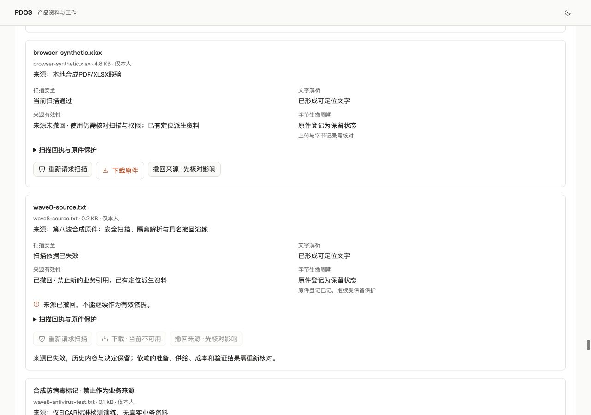

# PDOS Next 第八波 · 原件扫描、隔离解析与具名撤回

2026-10-02。本轮接通“上传前留日志 → 原件登记 → 独立扫描事实 → 隔离解析 → 定位来源 → 具名撤回”的本地合成业务闭环。活动状态在[唯一清单](../../../../tasks/ai-native-integrated-todo.md#current-queue)。这是 G0.3 的部分覆盖；完整原件生命周期、生产扫描资格及 G/N/P/Q 正式出口仍未完成。

## 已接通及复用

- 复用既有不可变原件引用、精确定位、扫描规则、T1 一次确认及 Receipt/Audit/Outbox/Temporal；扫描请求和结果成为独立不可变事实，保护版本与解析进度分开。权限、来源或扫描依据变化后，旧 clean 事实保留，但不再授予当前下载、解析或新引用能力。
- 服务器绑定租户、产品、请求人、原件哈希/大小、保护版本和权限版本；权限撤销后再恢复也不能复用旧授权。下载及解析在读取前和提交前重新检查；迟到扫描、过期/漂移依据、未知或失败结果均不能产生有效 clean。模型传参不能授予扫描事实或权限。
- 新上传先持久记录范围、原件身份和上传意图，再写字节；领域事务提交后登记成功。未知、半完成及登记失败不推定孤儿。三份旧原件继续显示日志覆盖未知，不补造上传记录；已登记原件和解析失败原件继续受保护。
- 实际 ClamAV 容器扫描和固定镜像解析已连接 worker。文件仅经标准输入传入，运行边界包括无网络、无宿主挂载/凭据、非 root、只读根目录及资源/输出/超时限制。解析镜像绑定代码与依赖摘要，没有宿主解析回退；UTF-8/PDF/XLSX 原有定位规则复用。实现与限制见[运行合同](transport-runtime-contract.md)。
- 辅助 `evidence.original.withdraw` 为具名人工 T1：预览绑定当前产品/原件版本、原因与确认令牌，提交撤回来源及派生资料的当前有效性，保留字节和历史。已接入定义/派生/配置/Build/供应/成本/准备的当前来源核对；历史快照不回写。完整跨对象引用库存及失效传播任务仍待补齐。
- 页面分别呈现扫描、解析、来源有效性和字节生命周期；旧解析成功不自动升级为扫描通过，风险隔离不等于字节已物理迁移。未知请求保留原幂等键供核对，撤回先预览再一次确认。

扫描/隔离运行器、上传日志、状态界面按独占文件并行，主线负责持久模型/迁移、事务/API/BFF、worker及公共验证。当前候选含280份源码/配置；联合检查开始时279份保持不变，之后只新增并执行证据回读工具，见[源码与合同核对](source-contract-check.json)。[独立复用与冻结复核](reuse-freeze-review.json)区分旧轨、原包和当前主线范围。

## 验证证据

| 范围 | 实际结果与证据 |
|---|---|
| 主线联合检查 | **975 passed in 879.55s**，见[联合日志](postgres-tests.log)、[34组范围](integrated-test-selection.json)和[最终核对](final-check.json)。覆盖既有主线、扫描/日志/运行器、来源权限、T1、幂等/并发、事务回滚、RLS及权限撤销再恢复；独立包旧结果不相加。 |
| 静态与构建 | 冻结206份Python的[静态检查](integrated-lint.log)、证据回读工具的[静态检查](readback-lint.log)、[全前端lint](web-lint.log)及[TypeScript/生产构建](web-build.log)通过；前端12项辅助检查见[原始结果](ui-helper-checks.json)。 |
| 数据库 | 真实 head `next_0009` 后新增 `next_0010`。备份后完成升级/降级/升级；增加单调权限版本时先验证扫描表为空，再往返验证，见[完整日志](migration-roundtrip.log)。最终[schema匹配](schema-match.log)通过；本波业务数据产生后未下迁。 |
| 真实扫描与隔离 | [11项实际运行检查](transport-real-checks.json)包括正常字节、EICAR标准检测标记、超时/输出上限、解析及真实OS限制；24项运行器协议检查包含在主线联合范围。实际引擎1.5.4、规则28123，检查时规则距发布18天，仅属本地合成配置。 |
| 上传日志 | [26项临时文件检查](journal-checks.json)覆盖日志先于字节、跨实例并发、重放、损坏/未知、登记及保留；已纳入主线联合范围。日志本身不证明完整业务引用或物理回收资格。 |
| 实际页面/worker/HTTP/PG | 页面重新扫描三份旧原件并核对可下载；新合成文本上传、真实扫描、容器解析形成定位后，经页面T1具名撤回。另一个标准防病毒测试标记实际扫描为infected，从未解析或产生Artifact，下载被拒绝。共5份实际扫描结果（4 clean、1 infected）。[持久回读](actual-preview.json)逐字节核对保留原件，撤回/风险下载均409，每项安全操作Audit/Outbox各一次。 |
| 保留与权限 | 旧三份原件精确哈希下载正常；新撤回及风险字节保持原哈希。此前Build与第七波验证准备响应逐字段不变。55张业务表的Agent直接写权限为0，合成租户模型调用0，见同一持久回读。 |
| UI | 1280和320宽度、亮暗主题均核对，无页面或本区横向溢出，见[布局读数](browser-layouts.json)。当前来源失效、风险拦截、下载禁用及历史保留已在实际页面确认。 |
| 合同 | [目录校验](catalog-validation.log)保留66操作、65事件、48验收ID；26个实际payload及OpenAPI与运行时代码相同。辅助撤回另册登记，不改变canonical正式决定政策。 |

施工中修正的问题保留记录：跨实例首次日志锁创建竞态在包内修复并重验；扫描后权限“撤销再恢复”的ABA问题由持久权限版本解决；不可变事实测试先触发app权限拒绝，修正为分别检查app拒绝和admin不可变触发器，[首次诊断](scoped-tests-initial.log)与[受影响复核](scoped-tests.log)保留。业务预览启动时发现旧合成对象目录权限755，只将核对过的7个自有目录收紧为700，未改字节，见[权限修复范围](storage-permissions.json)。

页面证据：[一次确认预览](withdraw-preview.png)、[风险文件拦截](risk-blocked.png)、[桌面暗色](desktop-dark.png)、[手机亮色](mobile-light.png)、[手机暗色](mobile-dark.png)。

## 剩余与环境

下一闭环是完整引用/保留保护及具名可逆隔离与恢复：复用生命周期包，但其孤儿隔离规则明确拒绝已登记原件（包括解析失败）。候选须有可信终结失败/放弃证据、完整引用覆盖、保留/hold核对、数据库保护栅栏和效果回执；日志未知、损坏或分页未齐均保持保护。扫描风险隔离与孤儿生命周期分别核对；物理删除不在本轮实现。随后继续OCR、私有S3实际适配和生产扫描规则维护/资格；真实专业职责、方法适用、资源校准/预约与样件消费仍是正式品质交接/TestRun的前置。

仅使用已核对127.0.0.1:62513/pdos_test、marker 916f950f-2d2b-405d-b809-c15db75dc20c；状态PG65109、Temporal开发服务65425、API8898、worker及[本地预览3028](http://127.0.0.1:3028)沿用。迁移前及业务后私有备份保留，备份存在不等于完成恢复演练；开发Temporal SQLite不代表生产Temporal PG验收。

原存续57432、57439/57441、开发55432及旧业务未提交内容未操作；9/27备份基线0377后部分登录/序列无法完整重建的边界保留，不能宣称零丢失。无git push、云部署、真实业务出站、模型真实资格或人工Exit操作。
