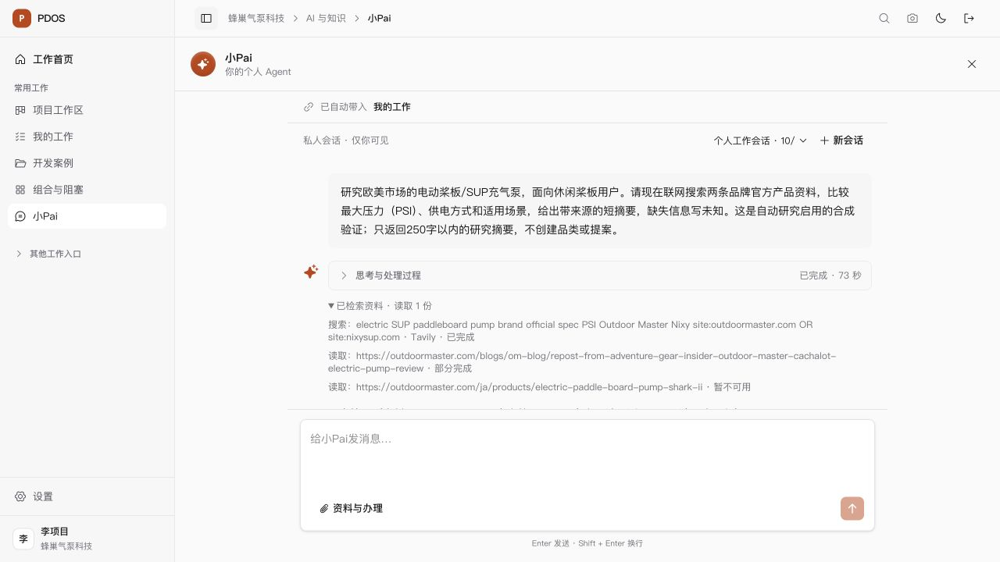

# 本地自动研究已启用

最新状态：截图跟进中发现的未知占账并发阻塞，已依用户后续“取消token预算限制”处理；本地每日及累计额度关闭，未知历史保留，新真实研究及浏览器回读通过，见[最新验证](token-budget-disabled/result.md)。下文保留当时启用样本与限制。

2026-10-06（洛杉矶日期），原3000/8000预览。用户“同意”后完成实际采用，当前租户为`budgeted` revision 2；合法Owner通过正常登录和受控服务办理，浏览器仍使用原项目经理账号。正式计量包、固定摘要、`research_discussion`及公开DNS配置已写入私有`.env`（0600），未改golden、角色、生产或原人工Exit。

## 已完成及实际证据

- [采用记录](enablement-application.json)：0428迁移前私有备份、draining排空、0429迁移、三条占账、预算切换与配置应用。三个旧调用各保守占账1,524,288，合计4,572,864，归属原UTC日期2026-10-06；原记录摘要完全一致，实际用量仍unknown。审批见[用户确认](legacy-bound-approval.json)，原提案原件不改写。
- [真实研究及账本核对](real-public-research-proof.json)：实际Tavily搜索、Firecrawl原文读取、持久引用、MiniMax回复与GUI回读通过。最终普通研究运行`7156b23b-c2d0-5d6e-8272-01b6452ce049`为answered，73秒，1次搜索、2次读取、1份引用；第二页返回429，失败原文回执保留。没有提交品类/提案采用。
- 修复后品类模式曾成功读取同一网站两份原文；该验证请求同时要求不生成候选，模型返回preproject=null，领域规则以`PREPROJECT_OUTPUT_INVALID`拒绝，未保存品类。原请求和结果保留在[模式冲突记录](real-public-research-recovery.json)，不当成品类建档整链通过。
- 5次新增模型调用有真实已知用量，共17,963输入、7,768输出token。另一次过时验证请求沿正常取消API停止，供应商返回`PROVIDER_INVALID_RESPONSE`且用量unknown；其原预算预留7,494完整保留为unknown/held，charged=null，不补零、不套用三个旧调用的恢复规则。所有调用会话已关闭，新的未知占用没有被释放；尚需真实供应商用量回执才能结算。

## 修复与检查范围

同网站的多页读取复用匹配的active公开来源登记；重名竞争复用同一登记，停用、origin或用途不符仍拒绝。公开DNS通过固定TLS端点恢复，私网、保留地址、每次重定向及连接地址固定守卫保留。SSE未知异常返回安全错误与done，保存原失败且重放不再次调用模型。

[首轮113项](enablement-tests-first.log)为110通过、3项历史迁移检查因独立PG锁容量失败；备份自有测试库后调整容量，[3项复核](enablement-migration-recovery.log)通过。来源与对话闭环[28项首跑](source-registration-recovery-tests.log)为26通过、2失败：停用夹具误写inactive，改为既有disabled；另一个调用在API编辑期间被源码bundle变化守卫拒绝。停止代码编辑后[4项定向复核](source-registration-recovery-recheck.log)通过，包括新的安全SSE错误病例，共覆盖29个不同用例。Ruff/格式检查、shell语法与限定diff检查通过；未重复前端全构建或宣称共享树正式联合门禁通过。[最终范围摘要](enablement-final-candidate.json)保留原候选与当前文件摘要。

自有53996/pdos_test已私有备份、核对归档目录、清理合成夹具、恢复下次启动的锁配置64并停容器，卷保留，见[收尾](enablement-test-closeout.json)。主库57432没有运行repo测试；实际采用写入与本次合成公开研究分别留证。当前主预览使用`PDOS_DEV_API_RELOAD=false ./scripts/dev.sh`，源码变化仍由bundle守卫拒绝，长调用前须保持源码稳定。

## 限制与下一步

自动研究运行通道已可用，研究质量没有据此认定合格。最终模型把实际Outdoor Master日文产品页的429误归给Nixy，且回复超过所请求的250字；原工具回执保留确切失败URL。多品牌覆盖、正文去导航噪声、引用标题、来源归因和短答遵从仍须改进，不能拿这条回复作为完整竞品分析或认证有效性结论。

真实研究→品类候选→一次人工保存整链尚未完成；产品八能力真实资格、专业模板采用、立项承接/规格冻结和原人工Exit仍独立待齐。正式计量包于2026-10-14 02:12:31 UTC（洛杉矶10月13日19:12:31）到期，不能自动延长或回退legacy。
