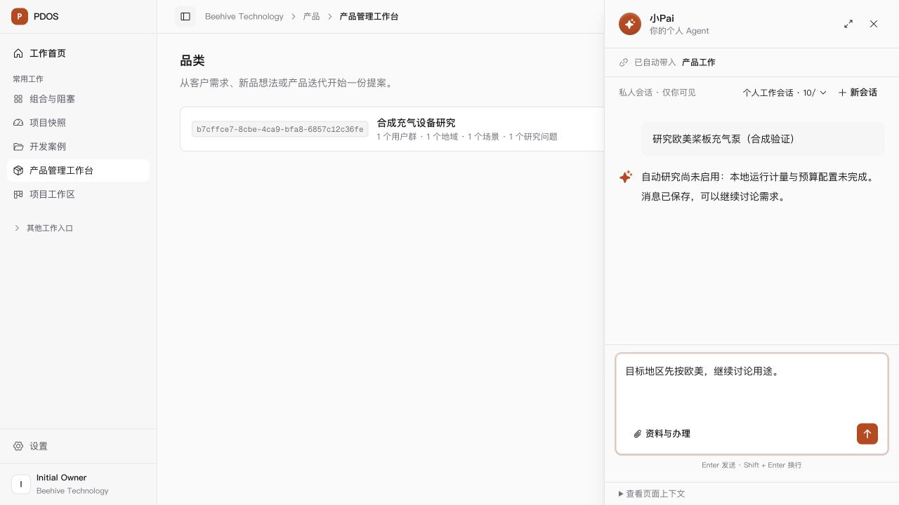

# 小Pai本地研究运行配置诊断与错误恢复

2026-10-06。当前状态：本地自动研究已启用，实际搜索、原文读取、引用回复及GUI回读通过；网页限流与内容质量缺口保留。最新结果见[本地启用结果](enablement-result.md)。下方保留原配置诊断检查点，其中“未启用”“未修改”仅描述当时状态。

## 已查明的问题

截图对应运行 `32a8181a-e22c-516e-89fa-2b223405878e` 在普通模型回复之后选择搜索，搜索准入前被拦住。对已核对的存续57432/pdos只读查询显示：应用预算配置为空，当前是legacy；该运行没有应用授权、租约、模型checkpoint或工具观察。MiniMax-M3已有模型资格，模型可正常回复；这不能代替公开研究所需的受控运行计量和预算通道。[诊断记录](diagnostic.json)不含私有消息、凭据或客户资料。

之前的“正在搜索”在准入之前显示，失败又被保存为通用 `REPLY_REQUEST_FAILED`，导致页面只说明“能力、授权或预算条件尚不满足”。此次失败发生在搜索派发前；公开来源DNS是后续独立条件，不能作为这条错误的原因。

## 本次改动

- 未绑定应用运行授权时明确返回 `APPLICATION_RESEARCH_BUDGET_REQUIRED`，保存原消息和终态回执。界面说明本地运行计量/预算配置未完成，结束等待，允许继续输入；查询和刷新读取同一回执。
- 通过授权、预算、当前模型选择及实际派发事务之后才显示搜索/读取进度；原权限、租约、停止、幂等、地址和来源守卫继续执行。
- 其他预算异常保留原错误代码及拒绝路径。没有降级搜索、伪造资格或重复派发；已保存的旧失败运行保持历史状态。
- 配置示例及[采用手册](../../../runbooks/application-budget-adoption.md)补充“模型能回复但搜索不能运行”的区别。

## 验证及范围

实际legacy工厂配合隔离合成模型响应，覆盖普通会话和品类对话：各一次模型调用、零搜索供应商请求，SSE结果/完成、明确终态、原回执查询/重放、零工具派发均通过。[针对性2项](legacy-runtime.log)包含在后续[30项后端检查](backend-final.log)范围内，不重复计数。

[15项前端检查](frontend.log)、[TypeScript](typecheck.log)、[受影响ESLint](lint.log)、Python Ruff格式/规范及diff空白检查通过。没有schema或迁移改动。前端仅增加已知错误文案，未重复生产全构建；临时3047采用与当前前端源一致的dev快照，不冒充上一轮冻结构建后的完整门禁。

隔离3047/8847浏览器通过新建品类入口触发真实HTTP错误路径，显示明确回执、可输入下一条消息，刷新重新打开同一会话仍保留原因。[刷新界面](browser-restored.txt)与下图仅为合成验证：模型选择由测试网关提供，没有调用真实模型或搜索供应商。

repo数据库检查只复用已核对的自有63201/pdos_test；私有备份校验归档目录后清理合成租户，临时API/前端/浏览器及自有容器已停，卷保留，3000/8000主预览继续运行。[环境收尾](environment-closeout.json)记录备份路径和摘要；没有实际恢复演练。本轮存续57432只读、私有`.env`未改、golden可信根/租户模式/额度/角色/真实业务对象未改，未push或生产启用。

## 剩余与恢复条件

当前MiniMax-M3端点的真实输入计量包、配套资产、固定可信部署摘要及用户发布确认已齐；实际只读核验通过。真实自动研究仍需3条旧未知用量的供应商回执核对，由合法Owner/Admin按既有draining/准入流程采用预算通道，再验证真实搜索→原文→引用候选→人工保存整链。

[启用材料与具体校准计划](enablement-plan.md)已经准备：官方固定资产摘要核对通过，四条合成样本离线估计共16,604输入tokens、每条最大32输出tokens，无自动重试；[离线预检](meter-preflight.json)没有真实调用观察。诊断修复检查点未执行`--execute`；后续用户明确授权四次校准，真实结果输入计数4/4一致、合计16,604输入与128输出token，见[真实计量复核记录](meter-review.md)。用户随后确认正式发布并通过只读核验，配置暂存；本地预算通道尚未切换，详见[最新采用阻塞](meter-adoption.md)。

原N/P/Q勾选、T1采用/T2具名立项与规格冻结、真实资格和人工Exit均未变。源码候选摘要见[source-manifest.json](source-manifest.json)。
