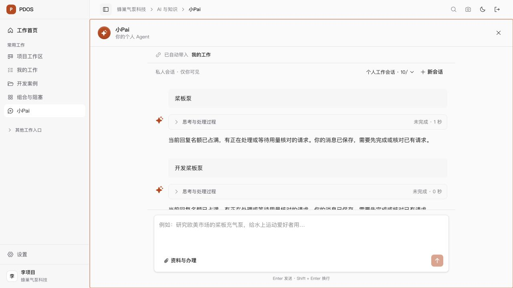

# 截图失败跟进 · 预算并发阻塞

2026-10-06 22:25 PDT的历史检查点：当时尚未恢复自动研究，执行名额与未知用量恢复规则等待用户裁决。随后用户明确请求“取消token预算限制”，已经本地采用并真实验证；见[最新结果](../token-budget-disabled/result.md)。下文保留原诊断和当时建议。

截图中的“桨板泵”和“开发桨板泵”两个请求均为 `BUDGET_TENANT_CALL_BUSY`，供应商派发次数为零。两个更早的未知用量尝试分别保留 7,494 和 8,507 token，合计 16,001；它们的模型会话均 closed、所属运行均 degraded。当前租户全部模型会话无未关闭记录；未知账本仍占用并发 2 的全部名额。准确使用量和供应商请求 ID 缺失，第二个聚合 trace 的 partial 用量只对应已独立结算的第一次尝试，不能补成第二次的回执。

实际元数据与原历史摘要见[只读核对](closed-call-evidence.json)，原请求见[截图请求诊断](matching-request-diagnostic.json)。先前正常回复只是当时局部通道通过，不能作为当前可持续运行的结论。其中第一个未知尝试来自先前验证中的取消请求，保留原件。

前端已为租户/lineage 并发阻塞显示明确原因；原消息、终态和输入保留，没有重复供应商请求或自动重试。`xiaopai-session.test.tsx` 13 项通过，受影响 ESLint 与 diff 检查通过；实际3000浏览器回读同一会话，两个原失败显示明确原因。没有新增数据库测试、迁移、全构建或正式 Exit。

[当时的恢复建议](recovery-decision.md)为仅释放真实预算绑定、模型会话关闭且整个运行结束后的执行名额，保留全部未知 token 占用和原 lineage 不可重放约束；此检查点没有修改规则或借用此前三个legacy调用的批准。后续明确决定及实际0430采用见上述最新结果；原截图中的两个失败请求保持原件，没有重派。
