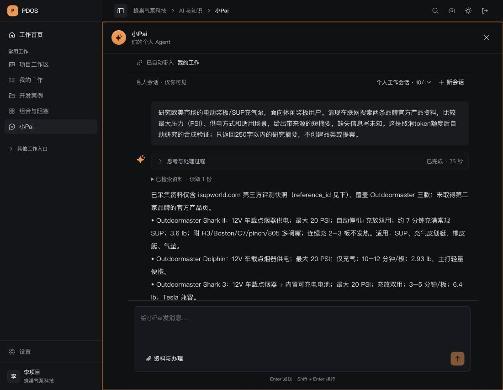

# 本地预览取消 token 额度

2026-10-06（洛杉矶日期）。依用户明确请求“取消token预算限制”，原3000/8000预览租户已关闭每日及累计 token 额度；实际计量、用量结算与原未知记录继续保留。真实公开研究已返回带引用的回复，浏览器回读通过。

## 实际采用

- [私有备份核对](live-backup.json)后应用0430迁移，[迁移记录](application-migration.json)包含预览排空及恢复。首次终止启动脚本未排空Next子进程，未执行迁移；核对原进程归属后正常终止，再应用成功。
- 合法Owner通过正常登录及原治理API设置 `token_budget_enforced=false`，[读取与审计](policy-adoption.json)核对actor及审计139。首次PATCH已成功，审计记录脚本错误先后使用不存在的排序字段；读取实际schema后按id取审计，核对期间没有重复PATCH。
- 0430默认仍为true。取消额度只对服务端已绑定应用授权的run生效；独立Agent及未绑定Owner调用保留原预算。未改私有环境模式、模型资格、计量包、角色或golden。
- 已关闭模型会话、整个运行已结束且真实预算绑定匹配的unknown尝试，取消额度后不再占用新研究的执行名额。运行中、未关闭或缺回执关联的调用继续占用；原lineage的未知尝试仍不得重放。原16,001 token未知占账、全部journal及三个legacy调用的历史摘要不变。
- 实际计量、模型上下文/单次输出边界、有效期、调用次数、工具次数、活动时间、真正的在途并发和授权守卫保留。既有单轮研究搜索/读取数量边界也保留；本次取消的是每日和累计消费额度。

## 真实研究与页面

[真实请求](real-public-research.json)使用项目经理的私有新会话及合成公开桨板泵输入，没有客户资料。运行 `fdcade24-8984-5bc5-9f3a-d63df0930d07` 为answered，75秒；实际Tavily搜索、读取一份第三方评测快照、生成一份引用，另一页因超过2MiB采集上限不可用。回复明确说明没有取得两家品牌官方页，缺项为未知。没有采用品类或提案。

[账本核对](real-public-research-proof.json)记录两次MiniMax-M3调用均succeeded/known、两笔模型预算均settled，实际3,497输入、1,774输出token；模型会话全部closed。原unknown journal摘要仍为 `f47638a90957ddc0b856935a707ac8ae7038062e4ffaa1065589bae09bf737ba`，三个legacy trace摘要保持。此证明通道恢复，不证明两家官方资料已齐或竞品研究质量通过。

浏览器登录过期后用原本地测试项目经理账号正常重新登录，回读同一会话，未重派模型请求；输入及已完成回复可见。预览继续以 `PDOS_DEV_API_RELOAD=false ./scripts/dev.sh` 运行。

## 验证与收尾

[最终受影响后端](backend-v3.log)11项通过：额度超限放行且保留用量、未绑定调用仍受限、运行中/未关闭/已结束三种名额状态、迁移往返及采用后禁止降级、Owner设置和审计/经理拒绝、真实会话调用链的合成传输。随后[默认策略回归](default-policy-regression.log)5项通过：未知保留/不重放、并发、跨日及关联run累计不重置。隔离PG目标61533/pdos_test，显式TEST_DATABASE_URL；主57432未运行repo测试。

[前端](frontend.log)5项通过，类型检查、受影响ESLint及Ruff/格式、限定diff通过。未重复全构建或声称正式联合Exit。最初[后端失败](backend.log)、[第二轮失败](backend-v2.log)保留：纠正迁移表名、合成测试绑定方式和审计字段允许表；未放宽manifest或凭据守卫。当前最终21项受影响检查与真实样本各自记录。

[隔离环境收尾](test-closeout.json)：核对独立容器/数据库/卷和零外部客户端，私有备份并验证归档目录；空夹具清理后停服，卷保留。原主预览继续运行。

剩余：官方资料覆盖、多品牌搜索及短答长度仍需改进；真实研究→品类候选→一次人工保存整链、产品八能力真实资格及原人工Exit仍沿原队列推进。未知调用准确用量仍待真实供应商回执，不因取消消费额度伪造结算。
