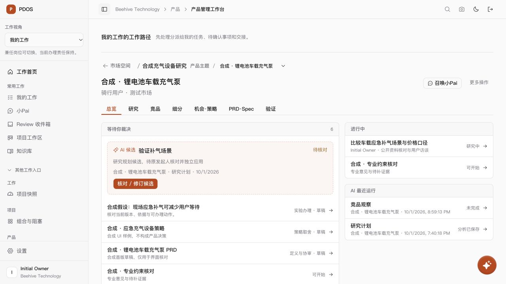
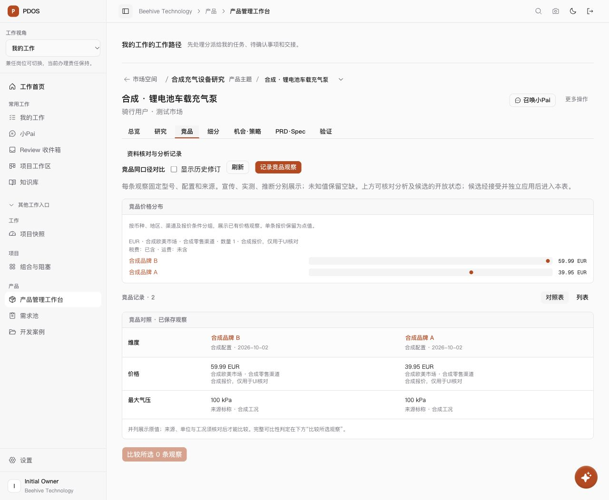
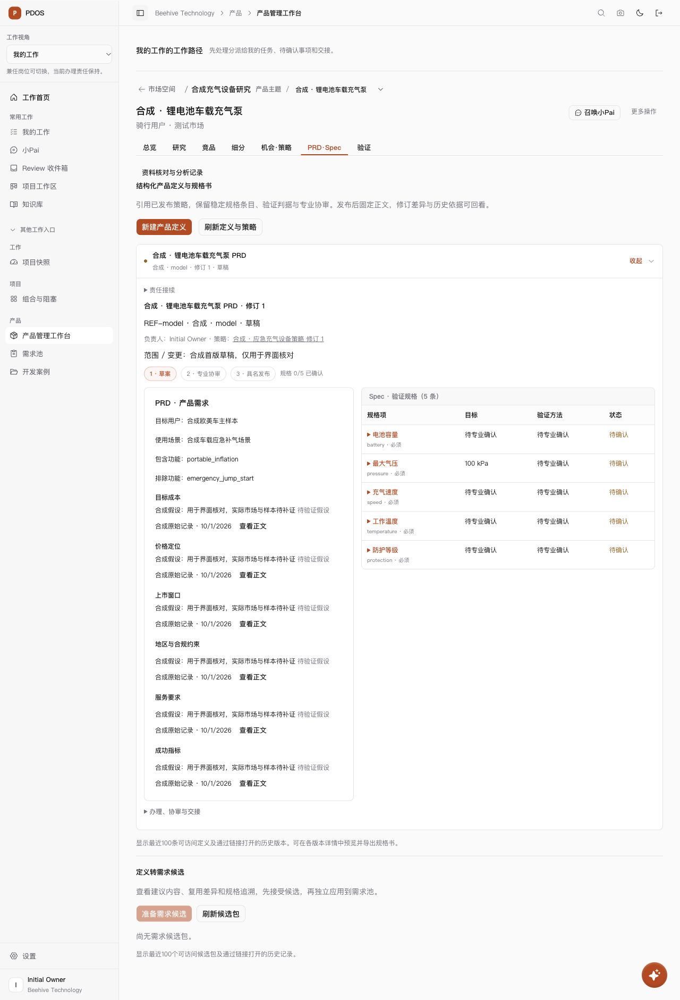
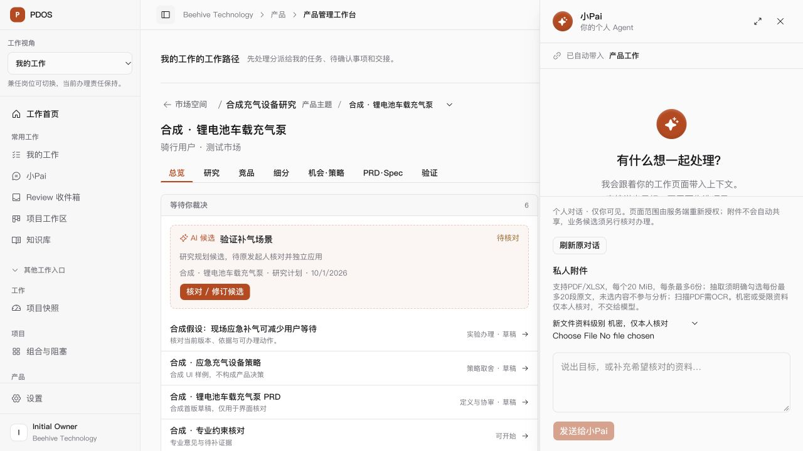

# 产品空间交互原稿业务实现 · 2026-10-01

按用户“开始修改业务代码”授权，以指定的可交互 HTML 为结构和交互参考，接入真实产品领域服务。原稿保持只读；没有将其中的静态市场数据、演示关卡或运行结果写成真实业务事实。

## 可用结果

- 空间目录和产品主题采用完整摘要行；三层位置合并到页头，主题待办纳入本人研究、协作、候选和最近一页专业工作。七视图与 URL 工作归属统一，设置、路线图、分析记录按需打开。
- 总览为紧凑两栏，区分等待裁决、进行中、缺口和最近运行。主题队列、总览和成果词条在受控写入通知、回到页面与定时读取时更新；打开编辑或未决写入时暂停相应读取。
- 研究任务和协作采用可展开摘要；词条来自已保存研究、细分事实与报价，展示版本、来源和待验证状态。专业成果取得失败保留未知状态。
- 竞品显示按报价条件分组的价格点和原值对照表，可切到观察列表；点击图或表定位记录。保留原同口径比较服务，单条报价没有伪装为价格区间。
- 细分提供 JTBD 摘要和已有测算区间；机会图使用实际重要度、满意度，点击点展开方案、依据和约束。摘要按百分制显示，保存公式保持不变。
- PRD 默认显示产品需求与规格双栏，逐项标注未知要求和验证方法；草案、协审、具名发布关卡使用真实状态。验证保留四维统计，以实验摘要进入具名办理。
- 产品页面的小Pai为全高 420px 右侧抽屉，复用个人会话、来源和真实候选组件；Escape 收起并恢复入口焦点。

## 逐条裁决的业务支持

新增 `evidence-ai-item`、`evidence-ai-item-review`、`evidence-ai-item-apply`，支持竞品、细分、机会、实验、策略和定义六类已有候选能力。读取不创建记录；具名接受或忽略时在同一事务中创建来源绑定的条目 Finding 与裁决。接受后仍须独立应用。

原始批次和模型输出保留不变，条目绑定父 Finding、位置、来源摘要和原投影；修订在独立接受内容中留痕。单项失败不应用同批其他条目，重复办理复用回执。发生条目办理后禁止整批办理，避免重复应用。原已办理整批与深链继续使用原接口。

迁移为真实 head 后的 `0416_product_evidence_item_decisions`。数据库保留来源/运行/领域写入守卫，仅允许从已发布原 Finding 派生的严格投影形成人工条目裁决；新模型发布仍需原 worker lease，没有新增代理授权。已有条目裁决时阻止直接降级，避免丢失审计。实验批准、策略/定义正式发布不由 AI 条目应用代办。

## 验证与范围

- [前端测试](ui-tests.log)：40 文件、356 项通过。浏览器发现图表重复定位、百分制摘要与主题专业待办口径问题后，分别完成 [38 项阅读与权限复核](reader-rechecks.log) 和 [27 项总览与主题复核](counts-rechecks.log)。不是把后续重跑数量相加当成新增测试。
- [API 原检查](api-initial.log)：46 项中 41 项通过，5 项因迁移 head 的测试期望仍为0415而失败。更新真实 head 和迁移链长度后，这5项保留/原子性检查及1项迁移历史检查 [全部通过](migration-and-retention-rechecks.log)。覆盖六类逐条接受与独立应用、原文不变、兄弟条目隔离、来源篡改回滚、拒绝原因、幂等、原整批兼容和 T2 仅生成草稿。
- 类型、受影响 ESLint、后端 Ruff 与 [最终 webpack 生产构建](build.log) 通过。受影响源码及只读参考校验值见 [源码清单](source-manifest.json)。检查在含其他既有改动的共享工作区进行，没有重置、提交或推送其他工作。
- 新建独立测试容器 `pdos-item-test-20261001-c84d`，核对任务标签、容器 ID、`127.0.0.1:57445`、数据库和用户后，仅用显式 `TEST_DATABASE_URL` 执行 repo 测试。空条目条件下0416→0415→0416往返通过；没有对存续57432或合成预览57439运行清库测试。
- 检查收尾再次核对完整容器ID和本任务标签后，已删除57445独立测试容器；57439用户预览继续保留。
- 浏览器实际核对主题统计、研究词条、竞品图表/列表、机会点定位、细分区间、PRD双栏、实验批准入口与抽屉。默认桌面1280px、390px总览、320px规格页无整页横向溢出；320px规格表460px、父容器256px，仅表内滚动。暗色主题已检查，最终恢复浅色和默认视口。桌面抽屉实测420×720px。

## 本地预览与合成数据

[打开主题总览](http://127.0.0.1:3023/product-work?space=49ae912b-afca-4c7f-a718-6b738c25f9f8&tab=overview&line=6bdc158e-ae8d-4ef1-b435-809cdffd3cd9)。前端3023、API8893与自建合成预览容器 `pdos-ui-preview-20261001-b28c`（仅127.0.0.1:57439）保持运行。API 本轮重启后的 session 为56852；前端原 session 为58123。预览库在备份后升级0416，备份为本机 `/tmp/pdos-preview-before-ui-0416.sql`。

为核对有内容的专业页面，通过真实领域接口追加明确标注“合成”的细分、三路线机会、策略、产品层级、定义草稿、两条竞品和实验草稿，[样例准备检查](synthetic-preview-fixture.log)通过。策略发布仅为此隔离合成夹具的具名动作，不代表真人业务签核；定义和实验保留草稿/待批准。尝试生成合成竞品的运行未完成，预览仍显示真实失败状态，没有改成成功。真实模型资格、主动采集和调度未启用。

## 剩余能力

研究计划仍沿既有整批接受/应用与分派能力；空间/产品主题的一次确认候选、持续主动研究、冲突复核编排、跨视图受控词条引用及专业办理页面统一更新尚未作为本轮完整能力交付。责任入口已降低视觉权重，原责任/写入锁未改成局部锁。原65项清单状态、真实资格及人工 Exit 边界保持，未宣称原N/P/Q全量验收或生产部署。

