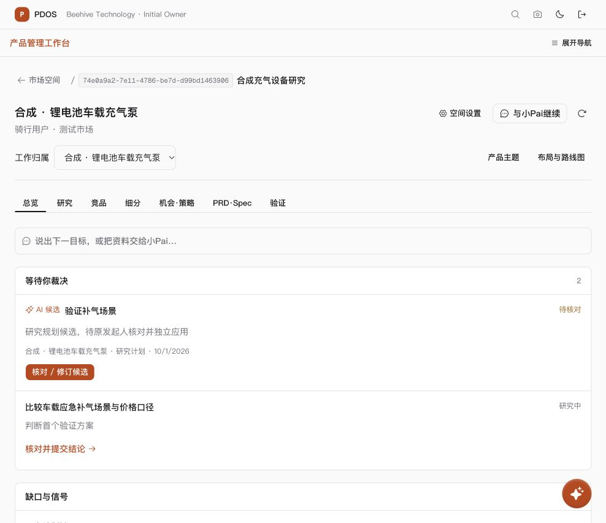

# 本地预览窗口 · 2026-10-01

用户在首版检查收尾后要求“打开本地预览”，中断后又明确“继续”。已重新启动真实应用并通过普通登录进入合成主题总览，浏览器保持打开。

[打开主题总览](http://127.0.0.1:3023/product-work?space=49ae912b-afca-4c7f-a718-6b738c25f9f8&tab=overview&line=6bdc158e-ae8d-4ef1-b435-809cdffd3cd9)

本窗口是独立的合成数据预览，未复用存续数据库。容器 `pdos-ui-preview-20261001-b28c`，任务标签 `product-space-ui-preview-20261001`，仅绑定 `127.0.0.1:57439`；前端 `127.0.0.1:3023`（exec session 58123），API `127.0.0.1:8893`（exec session 53005）。本轮只运行一次原有合成预览夹具，迁移和示例准备通过；不重新验收业务或授予真实模型资格，不启动 worker/调度器。服务与合成库为用户查看暂时保持运行，不能再沿上一轮“已清理”状态判断本窗口。

正常登录使用独立测试租户 beepump 的 owner 账号。浏览器已定位主题总览并保存截图；没有在浏览器接受、应用、批准或发布任何业务内容。

后续收尾只停止本窗口的自建服务/容器，其他环境保持原样。此前检查点的关闭/清理记录仍描述上一轮不同容器。

