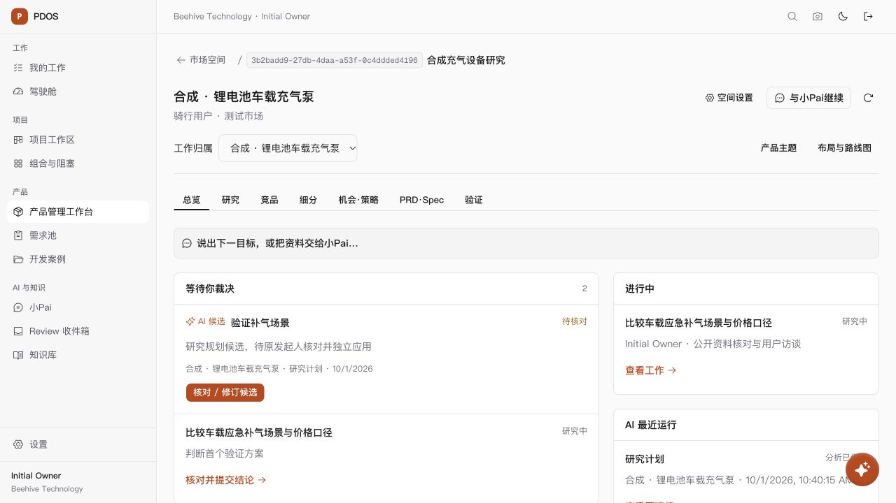
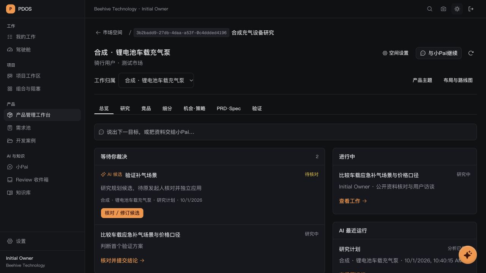
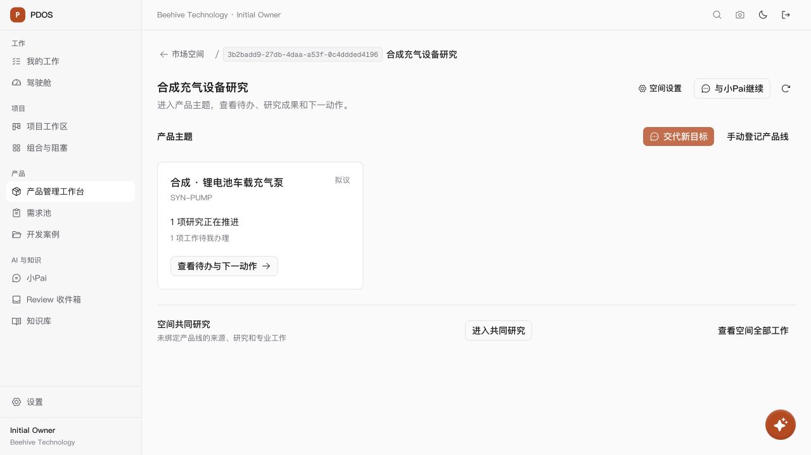
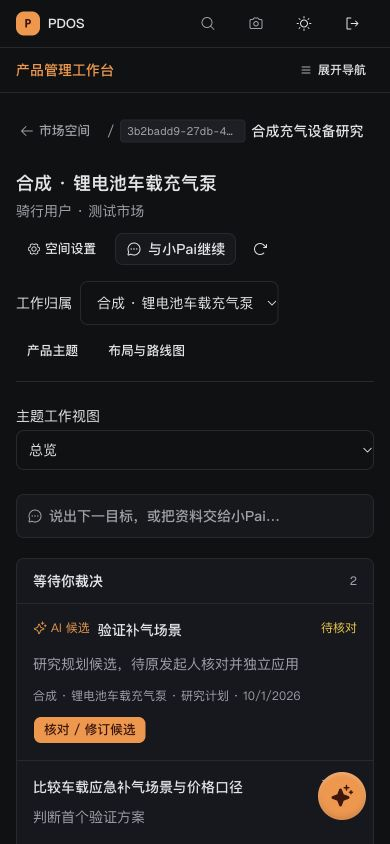
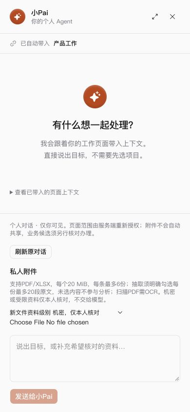

# 产品空间 AI-native UI 首版检查点

日期：2026-10-01。依据用户“开始修改”的授权，采用 [产品空间 HTML 主参考](../../../design/2026-10-01-product-space-mockup.html) 和 [优化方案](../../../design/2026-10-01-product-manager-ai-native-ui-proposal.md)。本轮已修改真实应用；参考 HTML 保持原样。下列检查证明本轮 UI 和只读待办入口的范围，不代表完整自主研究、真实模型资格或原 N/P/Q 正式出口通过。

## 已实现

- 空间目录 → 产品主题 → 主题工作台。产品主题复用真实产品线身份；空间共同研究与全部可访问工作有独立范围。
- 主题默认总览，集中显示本人 AI 候选、研究待结论、工作待接收/办理、My Work 中当前空间的实验/策略/定义事项，以及真实缺项、来源质量信号和最近运行。候选最多 100 项；专业事项采用 My Work 当前一页并提示继续查看。
- 七个专业入口：总览、研究、竞品、细分、机会·策略、PRD·Spec、验证。布局与路线图为次级入口；设置、成员权限、空间责任、成效与投入、管理员评测归入设置；定义版本内保留导出。旧 tab、原运行及对象深链继续使用原业务服务。
- 小Pai复用现有个人对话和页面上下文。桌面宽 420px；手机铺满屏幕。候选默认为可读草案，需要修订时展开原编辑组件；研究/竞品/细分/机会/实验/策略/定义均沿原接受与独立应用边界办理。
- 六个专业区共用 URL 工作归属，切视图保留范围，移除过时 run/record/责任目标。机会评分输入与候选阅读使用百分制，底层仍保存 0–1；未知值保持未知。机会主判断与规格阅读层级更清楚，审计 ID/哈希移入“技术核对”。
- 总览和主题列表在确认写入、重新聚焦/可见以及 30 秒间隔时重新读取；编辑、选中候选和未决办理期间暂停相关更新。研究页先展示任务，资料与采集位于下方；分析运行器按需展开。
- 手机用视图选择器；桌面 tab 支持左右/Home/End 键、选中项焦点和面板关联。候选审阅打开定位标题，关闭回到原入口；小Pai同样恢复焦点。补齐候选接受/应用或撤权后释放导航锁的回归断言。

新服务仅增加 `POST /spaces/{space_id}/product-work-attention` 只读查询及对应 BFF。它按租户、空间、当前用户、产品线、冻结运行绑定和现有来源读取权限核对候选；不调用模型，不写业务、事件或审计，不改变数据库 schema。具名批准/发布、AI 身份、来源/版本、幂等及现有失败恢复守卫保留。

## 本轮验证

| 检查 | 结果与证据 |
|---|---|
| 产品工作组件、小Pai及 BFF 回归 | 最终同一源码：39 个文件、351 项通过。[原始日志](frontend-final.log)。包含原权限/撤权、未确认写入恢复、来源、旧深链、候选接受/应用及范围检查。 |
| PostgreSQL / API | 8 项通过，新队列 2 项与原研究候选 6 项。[原始日志](backend-tests.log)。包含只读零审计新增、本人隔离、冻结绑定损坏、来源撤权、范围拒绝、接受后待应用及应用后移出队列。合成 transport，不证明模型资格。 |
| 静态与构建 | 全项目 TypeScript、受影响 ESLint、新领域/测试 Ruff 通过；最终 `next build --webpack` 编译、类型及 97 页生成成功。[构建日志](production-build-webpack.log)，[ESLint](lint.log)，[最后修改 ESLint](last-edit-lint.log)，[候选解锁 ESLint](candidate-unlock-lint.log)。 |
| 默认构建环境 | 默认 Turbopack 首次无法下载已有 Google 字体；开放构建网络后，子进程绑定端口受本机环境限制。改用项目现有 Next.js webpack 生产构建通过，未修改技术栈或字体来源。[环境日志](turbopack-environment-failure.log)。 |
| 浏览器 | 实际 Next/BFF/FastAPI/PG 页面，合成账号合法登录；1280 桌面亮暗、390 手机亮暗及 320 亮主题检查。根页面宽度与滚动宽度一致；抽屉、只读/修订、范围、设置和键盘行为见 [检查记录](browser-checks.json)。没有在浏览器接受、批准、发布或应用业务内容。 |
| 设计机械检查 | 执行一次。唯一 warning 是 tab 的 `border-b-2`；该元素明确 `rounded-none`，实际截图为平直选中下划线，属检测误报，保留参考风格。[记录](design-detector.json)。 |

[31 份受影响源码摘要](source-manifest.json)记录本轮检查点。共享工作树原有大量未提交修改；摘要文件可能包含之前的工作，不将整份 diff 归为本轮新增。未提交、推送或部署。

## 实际应用截图

以下均来自独立临时数据库中的合成材料，产品、市场和研究内容不作为真实业务事实。

## 剩余与建议

首版先接通真实待办、候选阅读和原业务办理。建议下一轮优先做竞品同口径对比、机会方案对照与规格表，让取舍与缺项更直观。

目标方案中的空间/产品线 T1 候选创建、研究逐项接收与建议分派、跨能力持续编排及主动公开研究仍按原 N 项和逐能力资格接续。本轮不虚构自动推进或真实研究结果。全空间目录的跨空间候选统计、竞品价格图/词条阅读、团队排序、专业页后台更新、完整关系图和部分旧跨对象关联链接仍可继续优化。专业页保留原刷新入口；责任调整的原全局草稿/未确认写入锁尚未统一收为对象级锁。现有来源冲突/陈旧信号已聚合，自动生成结论复核工作仍需相应后端能力。

本轮临时 PG16/pgvector 容器为 `pdos-ui-test-20261001-a71c`（任务标签 `product-space-ui-20261001`），仅绑定 `127.0.0.1:57439`，迁移至 `0415_product_planning_v6_runs`。所有 repo 数据库测试显式指定该独立 `pdos_test`，没有使用 `.env` 回退或访问存续 57432。预览端口 3023/8893、自建容器与浏览器已关闭/清理；三个端口无监听。该容器仅含合成测试数据，检查证据保留。原 65 项勾选、真实资格及人工出口状态不变。
