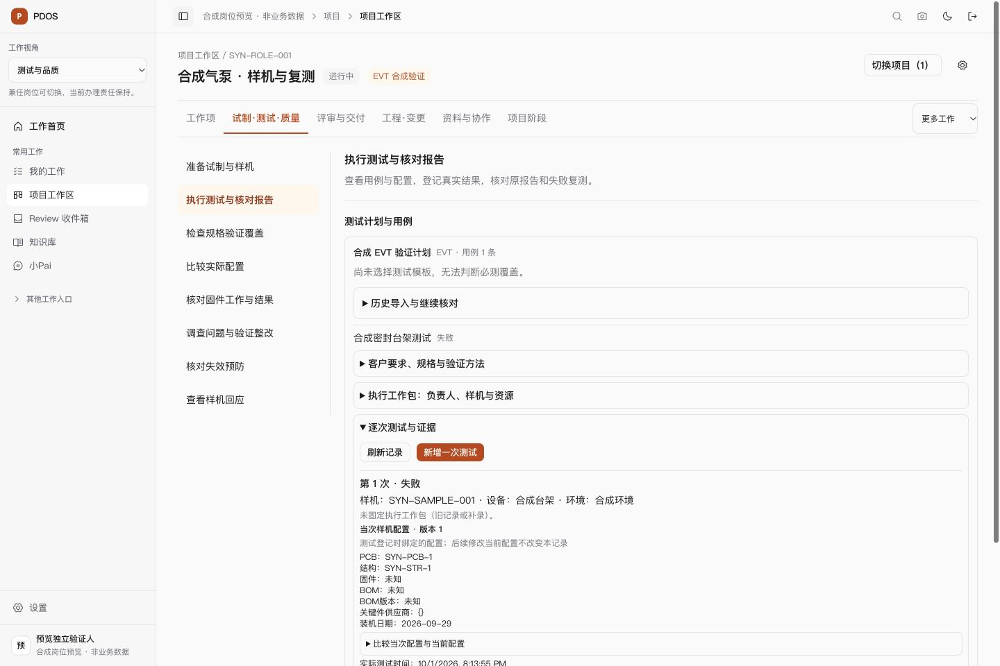

# 岗位场景 UI 重构检查点 · 2026-10-01

依用户“整个 UI 重构，按照不同角色的真实使用场景”授权，已将全站入口、本人待办、项目专业任务和组合办理组织为工作场景。延续公司橙、Geist、Phosphor、双主题、shadcn/ui 与 Tailwind v4；使用 Impeccable、Taste 适用的产品界面规则及 Vercel 界面指南。具体使用模型见[角色场景合同](../../../design/2026-10-01-role-scenario-ui.md)，全局尺寸、位置提示和低频功能整理延续[前一布局检查点](../global-layout-20261001/result.md)。

## 已可用能力

| 场景 | 当前行为 |
|---|---|
| 登录与兼岗 | 工程、品质从本人真实待办开始；内部账户可选择九种工作视角，按租户及用户记忆。工作首页打开有效视角入口，切换视角保留当前办理页。 |
| 全站导航 | 先显示当前视角常用工作，其余已授权入口可展开；项目快照保留独立入口，专业页提供可收起的下一步路径。产品路径保留当前空间、主题及正确研究/定义视图。 |
| 本人办理 | 依实际待办选初始场景，执行、验证接收、批准协调、AI 和立项前工作分别呈现；保留全部队列、服务器总数、分页、原办理动作及异常。 |
| 项目推进 | 计划、工程、试制测试品质、物料供应、例会决策、评审交付采用任务导航与单一办理区。新选项目按视角进入专业工作，显式旧链接保持优先。 |
| 数据与草稿 | 专业组件保持挂载；任务切换保留未提交输入。旧查询、锚点、延迟返回的记录及嵌套详情打开对应任务；手动切换取消旧链接的延迟定位。 |
| 品质/PIE | 品质优先执行测试，PIE 优先试制与样机；测试配置、逐次 Run、问题整改、FMEA、样机回应各自办理，原写入及具名签核规则保持。 |
| 管理决策 | 组合首先处理待决与例外，健康、进度、资源、物料、产品投入等分区办理。 |
| 外部参与 | 客户/supplier 仅呈现原授权同 audience 的样机回应，提交原 pending 请求的同意/拒绝及说明；失败或状态漂移保留草稿并重读，不能读取内部试制及测试详情。 |
| 多尺寸与键盘 | 桌面为任务左列及办理右区，手机只让任务导航横向滚动；页面主体无横向溢出。任务支持方向键/Home/End；Ctrl/Meta/Alt 快捷键保留浏览器语义。 |

工作视角不新增 RBAC、专业任命、Owner/Receiver/Verifier 或批准资格；本人责任及原 T0/T1/T2 政策由服务器事实决定。系统管理视角仅 owner/admin 可用；外部账户不显示内部工作视角及入口。

## 最终候选与验证

最终冻结前端为 `/private/tmp/pdos-role-scenario-ui-20261001-_npy8ks1/web`，[1095 文件摘要](build-candidate.json)保留。30 份主要改动均与当前工作树一致，见[范围核对](source-scope.json)；同期产品会话冻结后的 8 份改动在核对时单列，该候选不声明覆盖这些文件的最新内容。最终文档更新后 `git diff --check` 通过。

- [完整前端组件检查](tests-candidate.log)：181 个文件、1136 项全部通过，退出码 0；包括身份首页、视角降权与隔离、外部回应、任务定位/草稿、品质错误和键盘修复。
- [生产构建](build.log)：通过，包含完整 TypeScript 检查及 98 个静态页面。
- [完整源码 lint](lint-candidate.log)通过；后续产品路径调整的[受影响检查](lint-final-adjustment.log)及最后键盘修复的[受影响检查](lint-browser-shortcut.log)均通过。最终状态见[检查回执](build-status.json)。
- [真实浏览器场景与尺寸记录](browser-checks.json)：工程/品质登录及真实合成待办、角色专业初始任务、产品/管理/PIE 视角、深链接、品质草稿保留、组合输入保留、Ctrl+Home、320px/1440px 亮暗检查通过。
- [独立 HTTP 核对](preview/http-checks.json)覆盖三身份本人队列；[品质 Run 与文档核对](preview/http-quality-runs.json)在 BFF 和 API 均为 200，浏览器读取同一失败 Run、配置修订、登记人与时间。

工程表单首次通过 HTML value 属性核对未提交输入未取得值，故不计为浏览器草稿证据；品质表单已直接读取实际 input.value 验证保留，并取消未提交操作。独立办理面板持续可见；本人工作场景中的嵌入式准备区保持挂载但随场景隐藏。外部回应有 19 项组件检查，本轮未创建外部身份做浏览器联验。

诊断和恢复记录保留：首次软链接源码预览 404 后改为冻结候选实体副本；两个 `127.0.0.1` 预览的同名 Cookie 对应 401 现象后，改用 `localhost` 并正常登录，实际读取恢复，Cookie 冲突原因是根据主机及正常登录恢复作出的推断。收尾时也在旧产品预览正常登录原合成 owner，恢复原主题页且无错误提示，只发生合成登录/会话记录，不提交业务内容。Ctrl+Home 被任务导航截获后修正并完成最终检查。旧日志只说明当时状态，最终通过计数以本节候选为准。

## 可查看预览与剩余条件

[本地预览](http://localhost:3024/login)仍运行，合成账号及恢复/收尾信息见[预览说明](preview/README.md)。前端 3024/API8894 使用新建、仅本地映射 `57441/pdos_test` 的独立容器，真实迁移到 `0416_product_evidence_item_decisions`；预览 1066 份源码与最终候选相同。旧产品预览 3023/8893/57439 服务及存续库 57432 保留，未运行 repo 数据库测试、worker、AI、批准、发布或业务外发。

Vercel 云端连接和 Figma 团队/组织选择尚未完成，因此本轮没有云端部署或 Figma 设计产物。PIE 完整工艺路线、SOP、工时及生产接收等缺少已实现领域接口的能力仍沿原共同合同建设，当前视角不宣称它们已完成。专业责任细化和真实业务全链仍在对应 N 项验收；合成数据和本地通过不代表真实模型资格、生产启用或人工 Exit 通过。原 N/P/Q 状态及 65 项勾选不变。

