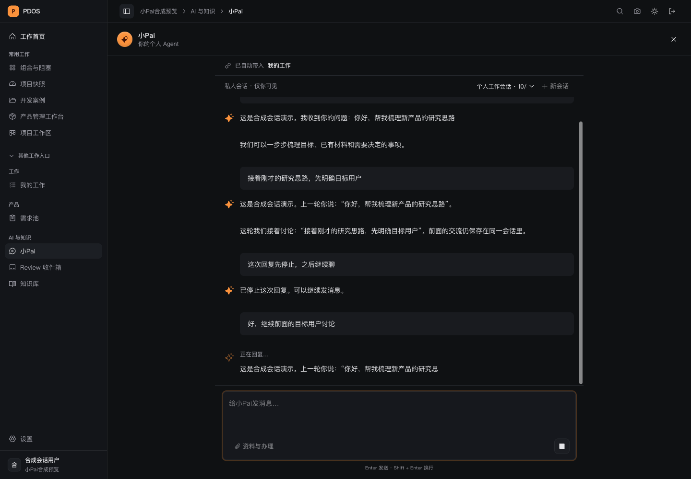
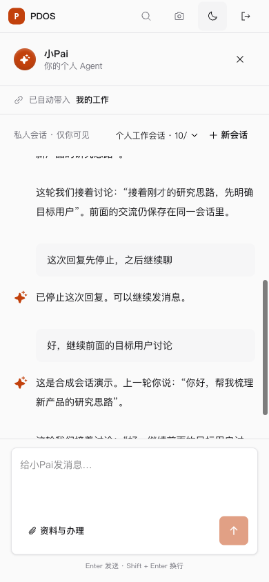

# 小Pai连续会话实现与验证

小Pai主入口已改为连续自然语言会话：普通消息直接生成回复，带入同一会话的历史，边生成边显示。支持追问、新会话、历史切换、刷新恢复和停止生成；资料与专业办理保留在独立入口。此次实现位于原 `server/web`，不涉及 `pdos-next`。

回复接入原有模型资格、预算、调用回执与来源授权，并新增 OpenAI 兼容和 Anthropic 原生流式适配。消息与回复分别持久化；同一消息重复请求返回原运行，保存结果不明时复用原请求标识。模型不可用显示明确失败，不用固定话术冒充成功。项目或产品的具体事实引用服务器当前允许的资料，历史对话不授业务写入权。

## 验证结果

| 检查 | 结果与证据 |
|---|---|
| 流式适配与现有模型适配 | [24 项通过](xiaopai-provider-tests.log)，覆盖两种协议、使用量、截断与中文分片。HTTP 为合成响应。 |
| 最终会话 API | [7 项通过](xiaopai-final-api-tests.log)，覆盖多轮历史、私人隔离、原请求复用、模型不可用、真实预算端口、停止与启动前拒绝、历史截断。此前与已有产品会话的[联合 17 项检查](xiaopai-api-tests.log)通过。 |
| 最终前端与 BFF | [36 项通过](xiaopai-final-web-tests.log)，覆盖流式显示、原请求恢复、权限撤回、草稿、新会话历史、旧专业入口和不缓冲转发。 |
| 类型、规范与构建 | [TypeScript](xiaopai-typecheck.log)、[ESLint](xiaopai-eslint.log)、[Ruff](xiaopai-ruff.log)及[98 页生产构建](production-build.log)通过。三个改动的生产前端文件与冻结构建一致，见[候选摘要](candidate.json)。 |
| 0418 迁移 | [保留回复时拒绝降级](xiaopai-history-guard.json)；[独立往返](xiaopai-migration-roundtrip.json)保留前驱约束及注释，Agent 对任务、会话消息仍无直接 INSERT 权限。 |
| 实际浏览器 | 合成用户完成流式显示、追问、刷新、停止后续聊、新建后返回历史、抽屉展开；1440px、390px、320px及双主题检查通过。320px文档宽度为320，无横向溢出，见[浏览器记录](browser-checks.json)。 |

浏览器发现的启动前停止竞态已修复：停止按钮须收到已提交运行的回执，启动前接口返回409；最终浏览器已观察到停止结果。该演示单次首段文字约5.827秒，不是性能分位数或真实模型时延验收。

## 剩余条件与环境

真实目标环境尚未升级0418或调用真实模型；实际回复质量、真实首段时延、golden-case与人工出口待其配置、资格和对应授权。当前实现提供会话回复及原有专业办理入口，全系统自主工具编排和更长记忆仍按原N项继续。服务进程异常后的孤立运行仍须查询原回执并沿原预算恢复，不能重新发起同一运行来绕过计量。

本轮只使用新建容器 `pdos-xiaopai-session-test-20261004-f3a7` 的 `127.0.0.1:64185/pdos_test`，显式传入 `TEST_DATABASE_URL`，未用存续57432或`.env`回退。0418往返通过直接 Alembic Operations 隔离执行；整个head降级另遇同期0419的 `ck_users_work_modules_allowed` 缺失，未修改该迁移，不宣称全head回退通过。

[合成预览](http://127.0.0.1:3035/ask)及API8899、上述独立数据库暂留供查看。账号为 `beepump / owner`，仅此合成环境密码为 `correct horse battery staple`；回复明确标注合成演示，没有真实模型或业务外发。冻结前端目录为 `/tmp/pdos-xiaopai-session-f3a7/web`，测试历史私有备份为 `/tmp/xiaopai-tested-history-f3a7.dump`。原N/P/Q状态、存续环境、9/27恢复边界与其他会话的未提交修改保持；未push或部署。
